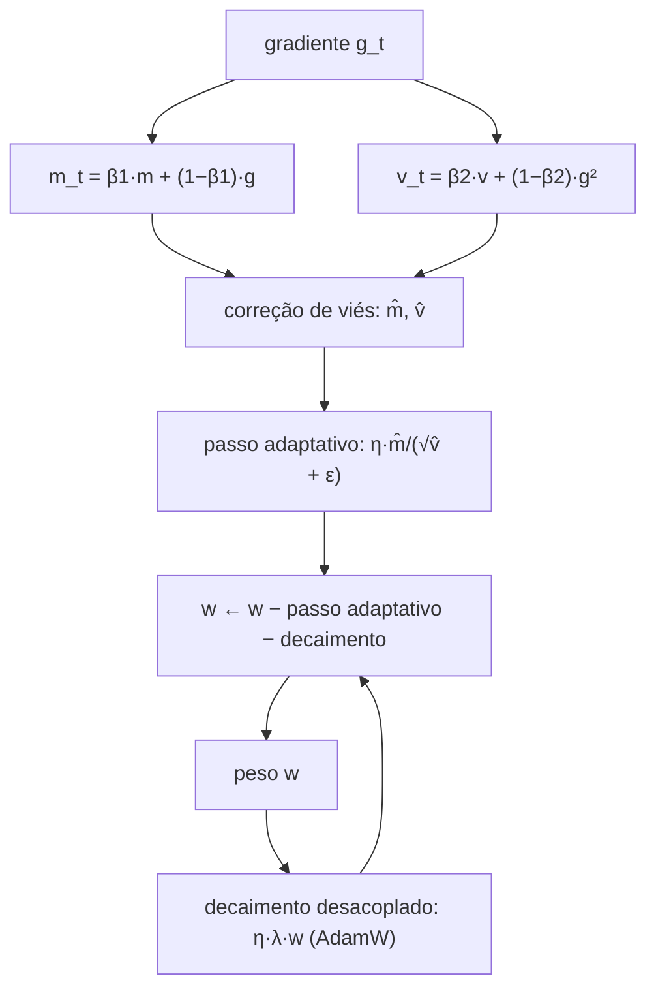

# Adam e AdamW

> "O Adam não dá o mesmo passo para todo mundo: cada parâmetro recebe um passo sob medida para a sua própria história de gradientes." — Adam combina o momentum do SGD com um ajuste automático da taxa de aprendizado, e o AdamW conserta um defeito sutil na forma como o decaimento de peso era aplicado.


## 1. Intuição: um passo sob medida por parâmetro

O SGD com momentum usa um único passo $\eta$ para **todos** os parâmetros. Isso é problemático: em uma rede, alguns pesos têm gradientes grandes e outros, gradientes minúsculos. Um $\eta$ fixo pode ser pequeno demais para os pesos de gradiente fraco (treino lento) e grande demais para os de gradiente forte (oscilação).

O Adam resolve isso **normalizando** o passo de cada parâmetro pela magnitude dos seus próprios gradientes históricos. O resultado é:

- Parâmetros com gradientes **grandes e instáveis** recebem passos **menores** (cautela);
- Parâmetros com gradientes **pequenos e consistentes** recebem passos **maiores** (avanço);
- A **escala** do gradiente deixa de importar: multiplicar a perda por 10 não muda (quase) o passo do Adam, porque a normalização cancela a escala.


## 2. As duas médias móveis: $m$ e $v$

O Adam mantém **duas** médias móveis exponenciais por parâmetro.

### Primeira: a média do gradiente ($m$)

É o "momentum" clássico, a média dos gradientes:

$$
m_t = \beta_1 \, m_{t-1} + (1 - \beta_1) \, g_t
$$

Ela estima a **média** (primeiro momento) do gradiente, apontando a direção consistente de descida. $\beta_1$ é tipicamente $0{,}9$.

### Segunda: a média do gradiente ao quadrado ($v$)

É a média dos **quadrados** dos gradientes:

$$
v_t = \beta_2 \, v_{t-1} + (1 - \beta_2) \, g_t^2
$$

Ela estima a **variância** (segundo momento) do gradiente, medindo o quanto o gradiente "chacoalha" ao longo do tempo. O quadrado $g_t^2$ é sempre positivo, então $v_t$ cresce quando o gradiente oscila muito. $\beta_2$ é tipicamente $0{,}999$.

> $m$ diz "para onde ir"; $v$ diz "com que confiança". O passo final divide $m$ pela raiz de $v$, de modo que direções instáveis (grande $v$) recebem passos pequenos.

## 3. Correção de viés (bias correction)

As médias móveis começam em zero: $m_0 = 0$ e $v_0 = 0$. Isso gera um problema nos primeiros passos. Expandindo $m_t$:

$$
m_t = (1 - \beta_1) \sum_{i=1}^{t} \beta_1^{t-i} \, g_i
$$

A soma dos pesos não vale $1$, mas $1 - \beta_1^t$ (porque é uma série geométrica truncada). Logo, $m_t$ é **sistematicamente menor** que o gradiente verdadeiro no início:

$$
\mathbb{E}[m_t] = (1 - \beta_1^t) \, \mathbb{E}[g_t]
$$

Para corrigir, dividimos por $1 - \beta_1^t$:

$$
\hat{m}_t = \frac{m_t}{1 - \beta_1^t}, \qquad \hat{v}_t = \frac{v_t}{1 - \beta_2^t}
$$

Quando $t$ é grande, $\beta_1^t \to 0$ e a correção desaparece; nos primeiros passos, ela "infla" as médias de volta à escala correta.

### Exemplo numérico da correção

Com $\beta_1 = 0{,}9$, no primeiro passo ($t=1$) temos $1 - \beta_1^1 = 0{,}1$. Se o primeiro gradiente é $g_1 = 6$, então $m_1 = 0{,}1 \cdot 6 = 0{,}6$. Sem correção, o passo usaria $0{,}6$ — muito pequeno. Com correção:

$$
\hat{m}_1 = \frac{0{,}6}{0{,}1} = 6
$$

A média corrigida recupera exatamente o gradiente $6$. É por isso que o Adam, já no primeiro passo, "enxerga" o gradiente real.

## 4. A regra de atualização completa do Adam

Juntando tudo, o Adam faz:

$$
g_t = \nabla L(w_{t-1})
$$

$$
m_t = \beta_1 m_{t-1} + (1 - \beta_1) g_t
$$

$$
v_t = \beta_2 v_{t-1} + (1 - \beta_2) g_t^2
$$

$$
\hat{m}_t = \frac{m_t}{1 - \beta_1^t}, \qquad \hat{v}_t = \frac{v_t}{1 - \beta_2^t}
$$

$$
w_t = w_{t-1} - \eta \cdot \frac{\hat{m}_t}{\sqrt{\hat{v}_t} + \varepsilon}
$$


## 5. Adam passo a passo: exemplo numérico completo

Considere $L(w) = w^2$, gradiente $g = 2w$, partindo de $w_0 = 3$, com $\eta = 0{,}1$, $\beta_1 = 0{,}9$, $\beta_2 = 0{,}999$ e $\varepsilon = 10^{-8}$.

**Passo 1** ($t=1$): gradiente $g_1 = 2 \cdot 3 = 6$.

$$
m_1 = 0{,}1 \cdot 6 = 0{,}6
$$

$$
v_1 = 0{,}001 \cdot 6^2 = 0{,}036
$$

Correção: $1 - \beta_1^1 = 0{,}1$ e $1 - \beta_2^1 = 0{,}001$, logo:

$$
\hat{m}_1 = \frac{0{,}6}{0{,}1} = 6, \qquad \hat{v}_1 = \frac{0{,}036}{0{,}001} = 36
$$

$$
w_1 = 3 - 0{,}1 \cdot \frac{6}{\sqrt{36} + 10^{-8}} = 3 - 0{,}1 \cdot \frac{6}{6} = 3 - 0{,}1 = 2{,}9
$$

Observe o fenômeno clássico do Adam: **o primeiro passo tem magnitude exatamente $\eta$**, independentemente do valor do gradiente. É a chamada *invariância de escala*.

**Passo 2** ($t=2$): gradiente $g_2 = 2 \cdot 2{,}9 = 5{,}8$.

$$
m_2 = 0{,}9 \cdot 0{,}6 + 0{,}1 \cdot 5{,}8 = 0{,}54 + 0{,}58 = 1{,}12
$$

$$
v_2 = 0{,}999 \cdot 0{,}036 + 0{,}001 \cdot 5{,}8^2 = 0{,}035964 + 0{,}03364 = 0{,}069604
$$

Correção: $1 - 0{,}9^2 = 0{,}19$ e $1 - 0{,}999^2 = 0{,}001999$, logo:

$$
\hat{m}_2 = \frac{1{,}12}{0{,}19} \approx 5{,}895, \qquad \hat{v}_2 = \frac{0{,}069604}{0{,}001999} \approx 34{,}82
$$

$$
w_2 = 2{,}9 - 0{,}1 \cdot \frac{5{,}895}{\sqrt{34{,}82} + 10^{-8}} = 2{,}9 - 0{,}1 \cdot \frac{5{,}895}{5{,}901} \approx 2{,}9 - 0{,}0999 = 2{,}8001
$$

**Passo 3** ($t=3$): gradiente $g_3 = 2 \cdot 2{,}8001 = 5{,}6002$.

$$
m_3 = 0{,}9 \cdot 1{,}12 + 0{,}1 \cdot 5{,}6002 \approx 1{,}568
$$

$$
v_3 = 0{,}999 \cdot 0{,}069604 + 0{,}001 \cdot 5{,}6002^2 \approx 0{,}1009
$$

$$
\hat{m}_3 = \frac{1{,}568}{1 - 0{,}729} = \frac{1{,}568}{0{,}271} \approx 5{,}786
$$

$$
\hat{v}_3 = \frac{0{,}1009}{1 - 0{,}997003} = \frac{0{,}1009}{0{,}002997} \approx 33{,}67
$$

$$
w_3 = 2{,}8001 - 0{,}1 \cdot \frac{5{,}786}{\sqrt{33{,}67}} \approx 2{,}8001 - 0{,}0997 = 2{,}7004
$$

A tabela resume:

| Passo | $g_t$ | $m_t$ | $v_t$ | $\hat{m}_t$ | $\hat{v}_t$ | $w_t$ |
|-------|-------|-------|-------|-------------|-------------|-------|
| 1 | 6,000 | 0,600 | 0,0360 | 6,000 | 36,00 | 2,900 |
| 2 | 5,800 | 1,120 | 0,0696 | 5,895 | 34,82 | 2,800 |
| 3 | 5,600 | 1,568 | 0,1009 | 5,786 | 33,67 | 2,700 |

Compare com o SGD puro: no SGD, o passo encolhe junto com o gradiente (de $0{,}6$ para $0{,}48$...). No Adam, o passo se mantém **quase constante em $0{,}1$** a cada iteração, porque a normalização $\hat{m}/\sqrt{\hat{v}}$ cancela a escala do gradiente. Isso significa que o Adam caminha com ritmo estável mesmo quando o gradiente muda de magnitude — a chave da sua robustez.

## 6. Decaimento de peso: do L2 ao desacoplado (AdamW)

O **decaimento de peso** (*weight decay*) é uma forma de **regularização**: penaliza pesos grandes, empurrando-os suavemente para zero e evitando sobreajuste (overfitting).

### A forma tradicional (acoplada, L2)

Historicamente, o decaimento de peso era implementado adicionando $\lambda w$ ao gradiente (equivalente a um termo $\frac{\lambda}{2}\|w\|^2$ na perda):

$$
g_t^{\text{eff}} = g_t + \lambda w_{t-1}
$$

No Adam, esse $\lambda w$ entra **dentro** de $v_t$ (porque $g_t^2$ é computado com o gradiente modificado). O problema: a normalização adaptativa do Adam **interfere** no decaimento. Parâmetros com grande $v$ têm seu decaimento de peso "dividido" pela raiz da variância, enfraquecendo a regularização de forma desigual.

### A correção do AdamW (desacoplada)

O **AdamW** aplica o decaimento de peso **fora** da atualização adaptativa, diretamente sobre os pesos:

$$
w_t = w_{t-1} - \eta \cdot \frac{\hat{m}_t}{\sqrt{\hat{v}_t} + \varepsilon} - \eta \, \lambda \, w_{t-1}
$$

Equivalentemente, o decaimento aparece como um fator multiplicativo:

$$
w_t = (1 - \eta \lambda)\, w_{t-1} - \eta \cdot \frac{\hat{m}_t}{\sqrt{\hat{v}_t} + \varepsilon}
$$

O termo $\lambda w_{t-1}$ agora é aplicado **independentemente** da variância $v$. A consequência prática: o AdamW regulariza **mais forte e de forma mais uniforme** do que o Adam com L2, permitindo usar $\lambda$ maiores sem perder o controle do treino.



## 7. Os hiperparâmetros do Adam(W): $\beta_1$, $\beta_2$ e $\varepsilon$

| Hiperparâmetro | Papel | Valor típico | Efeito de aumentar |
|----------------|-------|--------------|--------------------|
| $\eta$ (lr) | Tamanho base do passo | $10^{-4}$ a $10^{-3}$ | Mais rápido, porém instável |
| $\beta_1$ | Peso da média do gradiente (momentum) | $0{,}9$ | Mais inércia/suavização |
| $\beta_2$ | Peso da média do quadrado (escala) | $0{,}999$ | Mais "memória" da variância |
| $\varepsilon$ (eps) | Estabiliza a divisão | $10^{-8}$ a $10^{-6}$ | Evita divisão por zero |
| $\lambda$ (weight decay) | Intensidade da regularização | $0{,}01$ a $0{,}1$ | Mais regularização |

Detalhes importantes:

- **$\lambda$ e a desacoplagem.** O AdamW permite $\lambda$ relativamente altos (como $0{,}1$) sem os efeitos colaterais do Adam+L2, porque o decaimento não passa pela normalização adaptativa.

## 8. Código PyTorch: Adam e AdamW

### Implementação manual (para entender cada passo)

```python
import torch

w = torch.tensor(3.0, requires_grad=True)
eta = 0.1
beta1 = 0.9
beta2 = 0.999
eps = 1e-8

m = 0.0
v = 0.0

for t in range(1, 4):
    L = w ** 2
    L.backward()
    with torch.no_grad():
        g = w.grad.item()
        m = beta1 * m + (1 - beta1) * g
        v = beta2 * v + (1 - beta2) * (g ** 2)
        m_hat = m / (1 - beta1 ** t)   # correção de viés
        v_hat = v / (1 - beta2 ** t)   # correção de viés
        w -= eta * m_hat / (v_hat ** 0.5 + eps)
        w.grad.zero_()
    print(f"passo {t}: w={w.item():.4f}, m_hat={m_hat:.3f}, v_hat={v_hat:.3f}")
```

### Usando os otimizadores prontos

```python
import torch

w = torch.tensor(3.0, requires_grad=True)

# Adam clássico (decaimento de peso acoplado, via L2)
adam = torch.optim.Adam([w], lr=0.1, betas=(0.9, 0.999), eps=1e-8)

# AdamW (decaimento de peso desacoplado)
adamw = torch.optim.AdamW([w], lr=0.1, betas=(0.9, 0.999),
                          eps=1e-8, weight_decay=0.1)

for passo in range(3):
    otimizador = adamw
    otimizador.zero_grad()
    L = w ** 2
    L.backward()
    otimizador.step()
    print(f"passo {passo}: w={w.item():.4f}")
```

### A diferença visível entre Adam e AdamW

Com `weight_decay=0.1` e $\eta = 0{,}1$, o termo de decaimento do AdamW é $\eta \lambda = 0{,}01$ por passo. Isso significa que, a cada passo, o peso é multiplicado por $(1 - 0{,}01) = 0{,}99$ **antes** de receber o passo adaptativo — um "empurrão" constante em direção a zero, independente do gradiente. No Adam com L2, esse mesmo empurrão seria diluído pela variância $v$, tornando a regularização mais fraca e irregular.

## 10. Erros comuns

- **Confundir $\beta_1$ com $\beta_2$.** $\beta_1$ suaviza o gradiente (direção); $\beta_2$ suaviza o quadrado do gradiente (escala/variância). Trocá-los muda completamente o comportamento.
- **Usar $\varepsilon$ grande demais.** Um eps muito alto "amortece" o passo adaptativo, tornando o Adam lento; o valor é uma salvaguarda contra divisão por zero, não um hiperparâmetro de ajuste fino.
- **Aplicar weight decay como L2 no Adam.** Sem o desacoplamento do AdamW, o decaimento de peso é distorcido pela normalização adaptativa e a regularização fica fraca/irregular.
- **Ignorar a correção de viés.** Sem $\hat{m}$ e $\hat{v}$, os primeiros passos são anormalmente pequenos e o treino "demora a engrenar".
- **Esquecer que o Adam é invariante à escala.** Multiplicar a perda por uma constante não muda o passo do Adam; isso é uma vantagem, mas significa que "corrigir" a perda com um fator não tem o efeito intuitivo esperado.
- **Manter $\eta$ fixo.** Mesmo com Adam, schedules (warmup + decaimento) são importantes para convergência fina.

## 11. Resumo

- O Adam mantém duas médias móveis: $m_t$ (gradiente) e $v_t$ (gradiente ao quadrado).
- $m$ dá a direção; $v$ dá a escala da variância; o passo é $\eta \cdot \hat{m}/(\sqrt{\hat{v}} + \varepsilon)$.
- A **correção de viés** ($\hat{m}, \hat{v}$) compensa o fato de as médias começarem em zero.
- O Adam é **invariante à escala** e ajusta o passo de cada parâmetro individualmente.
- O **AdamW desacopla** o decaimento de peso, aplicando $\eta\lambda w$ diretamente, fora da normalização.
- Hiperparâmetros centrais: $\eta$, $\beta_1$ (momentum), $\beta_2$ (escala), $\varepsilon$ (estabilidade) e $\lambda$ (regularização).
