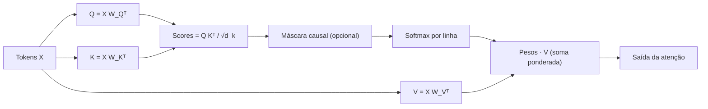

# Atenção (Q, K, V)

> A atenção é o mecanismo que permite a um token "decidir" quais outros tokens merecem ser ouvidos. No centro dela estão três papéis: **Query** (o que eu procuro), **Key** (o que eu ofereço) e **Value** (o que eu entrego). Esta página constrói a intuição do zero e resolve um exemplo numérico completo, passo a passo.

## Visão geral

Dada uma sequência de tokens, a atenção produz, para cada token, uma **nova representação** que é uma **soma ponderada** das representações de todos os tokens — os pesos sendo determinados por quão "compatível" cada par é. Essa operação é o coração do Transformer e, em sua versão simplificada com decaimento, também do RetNet.

Vamos entender os três atores, a matemática do score, o papel do softmax e a soma ponderada, tudo acompanhado de números pequenos que você pode conferir na mão.

## Intuição: uma busca em uma biblioteca

Imagine uma biblioteca onde cada livro tem uma **etiqueta** (título, assunto, palavras-chave) e um **conteúdo**. Quando você chega com uma **pergunta**, faz o seguinte:

1. Compara sua pergunta com a etiqueta de cada livro.
2. Obtém um **score** de relevância para cada um.
3. Normaliza esses scores para que virem "pesos" que somam 1.
4. Produz uma resposta como **soma ponderada dos conteúdos**, dando mais voz aos livros mais relevantes.

A atenção faz exatamente isso, com três papéis:

- **Query ($Q$)** — a sua pergunta, ou "o que este token está procurando".
- **Key ($K$)** — a etiqueta de cada token, ou "o que este token oferece como descrição".
- **Value ($V$)** — o conteúdo de cada token, "o que ele de fato entrega de informação".

## Conceito: de onde vêm Q, K e V

Cada token tem uma representação $x_i \in \mathbb{R}^{d}$. Para gerar os três vetores, usamos três matrizes aprendidas $W_Q$, $W_K$, $W_V$:

$$
q_i = W_Q \, x_i, \qquad k_i = W_K \, x_i, \qquad v_i = W_V \, x_i
$$

Com dimensão $d_k$ para queries/keys e $d_v$ para values. Essas projeções são **aprendidas durante o treino**: o modelo descobre sozinho que tipo de pergunta, etiqueta e conteúdo são úteis.

Em notação matricial, para todos os tokens de uma vez:

$$
Q = X W_Q^{\top}, \qquad K = X W_K^{\top}, \qquad V = X W_V^{\top}
$$

onde $X \in \mathbb{R}^{n \times d}$ empilha os $n$ tokens como linhas.

## A matemática do score de similaridade

Para medir quão compatível é a query do token $i$ com a key do token $j$, usamos o **produto escalar**:

$$
s_{ij} = q_i \cdot k_j = q_i^{\top} k_j
$$

Por que o produto escalar? Porque ele mede alinhamento: vetores na mesma direção produzem valores altos; vetores opostos, valores baixos. E porque é barato e paralelizável.

Lembre-se de que o produto escalar de dois vetores $a, b$ é:

$$
a \cdot b = \sum_{t} a_t b_t = \lVert a \rVert \lVert b \rVert \cos\theta
$$

Assim, o score cresce com o tamanho dos vetores e com a similaridade de direção ($\cos\theta$).

## A escala por $\sqrt{d_k}$

Um detalhe importante: se $d_k$ é grande, o produto escalar tende a ter **variância alta**, e o softmax satura (produz pesos quase one-hot), matando o gradiente. A solução é dividir o score pela raiz da dimensão:

$$
\text{score}_{ij} = \frac{q_i^{\top} k_j}{\sqrt{d_k}}
$$

O fator $\sqrt{d_k}$ mantém a variância do score sob controle, independentemente da dimensão. Com isso, o softmax fica bem comportado.

## O softmax transforma scores em pesos

Aplicamos o softmax **ao longo da linha** (para cada query $i$, sobre todas as keys $j$):

$$
\alpha_{ij} = \frac{\exp\!\left(\frac{q_i^{\top} k_j}{\sqrt{d_k}}\right)}{\sum_{j'} \exp\!\left(\frac{q_i^{\top} k_{j'}}{\sqrt{d_k}}\right)}
$$

O resultado é que, para cada token $i$, os pesos $\alpha_{ij}$ sobre todos os $j$ somam 1. Cada peso é a "fatia de atenção" que o token $i$ dá ao token $j$.

## A soma ponderada final

Com os pesos em mãos, a nova representação do token $i$ é:

$$
\text{saída}_i = \sum_{j} \alpha_{ij} \, v_j
$$

Ou seja, uma **média ponderada dos values**, onde o peso de cada value é a atenção correspondente. Em forma matricial compacta:

$$
\text{Attention}(Q, K, V) = \text{softmax}\!\left(\frac{Q K^{\top}}{\sqrt{d_k}}\right) V
$$

## Exemplo numérico completo

Vamos resolver tudo com $n = 3$ tokens e dimensão $d_k = d_v = 2$, para poder conferir cada número.

### Passo 1 — os tokens de entrada

Suponha três representações (valores pequenos, inventados):

$$
x_1 = \begin{bmatrix} 1 \\ 0 \end{bmatrix}, \qquad
x_2 = \begin{bmatrix} 0 \\ 1 \end{bmatrix}, \qquad
x_3 = \begin{bmatrix} 1 \\ 1 \end{bmatrix}
$$

### Passo 2 — projeções Q, K, V

Para manter o exemplo enxuto, usamos matrizes de projeção simples (a identidade para Q e K, e uma matriz que soma as coordenadas para V):

$$
W_Q = W_K = \begin{bmatrix} 1 & 0 \\ 0 & 1 \end{bmatrix}, \qquad
W_V = \begin{bmatrix} 1 & 0 \\ 0 & 1 \end{bmatrix}
$$

Então $q_i = k_i = v_i = x_i$:

$$
q_1 = k_1 = v_1 = \begin{bmatrix} 1 \\ 0 \end{bmatrix}, \quad
q_2 = k_2 = v_2 = \begin{bmatrix} 0 \\ 1 \end{bmatrix}, \quad
q_3 = k_3 = v_3 = \begin{bmatrix} 1 \\ 1 \end{bmatrix}
$$

### Passo 3 — os scores (produtos escalares)

Como $d_k = 2$, o fator de escala é $\sqrt{2} \approx 1.4142$. Primeiro, os produtos escalares $q_i^{\top} k_j$:

Para $q_1 = [1, 0]$:

$$
q_1^{\top} k_1 = 1 \cdot 1 + 0 \cdot 0 = 1
$$

$$
q_1^{\top} k_2 = 1 \cdot 0 + 0 \cdot 1 = 0
$$

$$
q_1^{\top} k_3 = 1 \cdot 1 + 0 \cdot 1 = 1
$$

Para $q_2 = [0, 1]$:

$$
q_2^{\top} k_1 = 0 \cdot 1 + 1 \cdot 0 = 0
$$

$$
q_2^{\top} k_2 = 0 \cdot 0 + 1 \cdot 1 = 1
$$

$$
q_2^{\top} k_3 = 0 \cdot 1 + 1 \cdot 1 = 1
$$

Para $q_3 = [1, 1]$:

$$
q_3^{\top} k_1 = 1 \cdot 1 + 1 \cdot 0 = 1
$$

$$
q_3^{\top} k_2 = 1 \cdot 0 + 1 \cdot 1 = 1
$$

$$
q_3^{\top} k_3 = 1 \cdot 1 + 1 \cdot 1 = 2
$$

### Passo 4 — dividir por $\sqrt{d_k}$

Dividindo cada score por $\sqrt{2} \approx 1.4142$, obtemos a matriz de scores:

$$
\frac{Q K^{\top}}{\sqrt{d_k}} =
\begin{bmatrix}
1/\sqrt{2} & 0 & 1/\sqrt{2} \\
0 & 1/\sqrt{2} & 1/\sqrt{2} \\
1/\sqrt{2} & 1/\sqrt{2} & 2/\sqrt{2}
\end{bmatrix}
\approx
\begin{bmatrix}
0.7071 & 0 & 0.7071 \\
0 & 0.7071 & 0.7071 \\
0.7071 & 0.7071 & 1.4142
\end{bmatrix}
$$

### Passo 5 — softmax por linha

Lembre que $e \approx 2.71828$. Para a **linha 1** (scores $0.7071, 0, 0.7071$):

$$
\exp(0.7071) \approx 2.0281, \quad \exp(0) = 1, \quad \exp(0.7071) \approx 2.0281
$$

Soma:

$$
2.0281 + 1 + 2.0281 = 5.0562
$$

Pesos:

$$
\alpha_{11} = \frac{2.0281}{5.0562} \approx 0.4011
$$

$$
\alpha_{12} = \frac{1}{5.0562} \approx 0.1978
$$

$$
\alpha_{13} = \frac{2.0281}{5.0562} \approx 0.4011
$$

Para a **linha 2** (scores $0, 0.7071, 0.7071$), por simetria:

$$
\alpha_{21} \approx 0.1978, \quad \alpha_{22} \approx 0.4011, \quad \alpha_{23} \approx 0.4011
$$

Para a **linha 3** (scores $0.7071, 0.7071, 1.4142$):

$$
\exp(0.7071) \approx 2.0281, \quad \exp(0.7071) \approx 2.0281, \quad \exp(1.4142) \approx 4.1133
$$

Soma:

$$
2.0281 + 2.0281 + 4.1133 = 8.1695
$$

Pesos:

$$
\alpha_{31} = \frac{2.0281}{8.1695} \approx 0.2483
$$

$$
\alpha_{32} = \frac{2.0281}{8.1695} \approx 0.2483
$$

$$
\alpha_{33} = \frac{4.1133}{8.1695} \approx 0.5034
$$

A matriz de atenção fica:

$$
A =
\begin{bmatrix}
0.4011 & 0.1978 & 0.4011 \\
0.1978 & 0.4011 & 0.4011 \\
0.2483 & 0.2483 & 0.5034
\end{bmatrix}
$$

Cada linha soma $1$, como esperado de um softmax.

### Passo 6 — soma ponderada dos values

Para o **token 1**:

$$
\text{saída}_1 = 0.4011 \, v_1 + 0.1978 \, v_2 + 0.4011 \, v_3
$$

$$
= 0.4011 \begin{bmatrix} 1 \\ 0 \end{bmatrix} + 0.1978 \begin{bmatrix} 0 \\ 1 \end{bmatrix} + 0.4011 \begin{bmatrix} 1 \\ 1 \end{bmatrix}
$$

Coordenada $x$:

$$
0.4011 \cdot 1 + 0.1978 \cdot 0 + 0.4011 \cdot 1 = 0.8022
$$

Coordenada $y$:

$$
0.4011 \cdot 0 + 0.1978 \cdot 1 + 0.4011 \cdot 1 = 0.5989
$$

Logo:

$$
\text{saída}_1 \approx \begin{bmatrix} 0.8022 \\ 0.5989 \end{bmatrix}
$$

Para o **token 2** (por simetria com a linha 2):

$$
\text{saída}_2 = 0.1978 \, v_1 + 0.4011 \, v_2 + 0.4011 \, v_3
$$

Coordenada $x$:

$$
0.1978 \cdot 1 + 0.4011 \cdot 0 + 0.4011 \cdot 1 = 0.5989
$$

Coordenada $y$:

$$
0.1978 \cdot 0 + 0.4011 \cdot 1 + 0.4011 \cdot 1 = 0.8022
$$

$$
\text{saída}_2 \approx \begin{bmatrix} 0.5989 \\ 0.8022 \end{bmatrix}
$$

Para o **token 3**:

$$
\text{saída}_3 = 0.2483 \, v_1 + 0.2483 \, v_2 + 0.5034 \, v_3
$$

Coordenada $x$:

$$
0.2483 \cdot 1 + 0.2483 \cdot 0 + 0.5034 \cdot 1 = 0.7517
$$

Coordenada $y$:

$$
0.2483 \cdot 0 + 0.2483 \cdot 1 + 0.5034 \cdot 1 = 0.7517
$$

$$
\text{saída}_3 \approx \begin{bmatrix} 0.7517 \\ 0.7517 \end{bmatrix}
$$

### Interpretação do resultado

Observe: o token 3 (que era $[1, 1]$, "alinhado" com todos) recebeu o maior peso de si mesmo ($0.5034$) porque seu produto escalar consigo é $2$, o maior de todos. Já o token 1 deu pesos iguais ao token 1 e ao token 3 ($0.4011$ cada), pois ambos são "igualmente parecidos" com ele segundo o produto escalar.

## Atenção causal (mascarada)

Em um modelo de linguagem, um token **não pode ver o futuro**. Durante a geração, ao prever o token da posição $t$, só os tokens $1 \dots t$ estão disponíveis. Isso se implementa com uma **máscara**: os scores de posições futuras são forçados a $-\infty$, de modo que o softmax lhes dê peso zero:

$$
\text{score}_{ij} =
\begin{cases}
\dfrac{q_i^{\top} k_j}{\sqrt{d_k}}, & \text{se } j \leq i \\
-\infty, & \text{se } j > i
\end{cases}
$$

Como $\exp(-\infty) = 0$, o peso da posição futura vira zero, e a soma de cada linha continua valendo $1$.

## Código em PyTorch

### Implementação passo a passo

```python
import torch
import torch.nn.functional as F

def attention(q, k, v, mask=None):
    d_k = q.size(-1)
    # scores escalados
    scores = q @ k.transpose(-2, -1) / (d_k ** 0.5)
    # máscara causal: posições futuras -> -inf
    if mask is not None:
        scores = scores.masked_fill(mask == 0, float("-inf"))
    # pesos
    attn = F.softmax(scores, dim=-1)
    # soma ponderada dos values
    out = attn @ v
    return out, attn
```

### Conferindo o exemplo numérico

```python
q = k = v = torch.tensor([
    [1.0, 0.0],
    [0.0, 1.0],
    [1.0, 1.0],
])

out, attn = attention(q, k, v)
print("pesos de atenção:")
print(attn)          # ~ [[0.4011, 0.1978, 0.4011], ...]
print("saída:")
print(out)           # linha 1 ~ [0.8022, 0.5989]
```

### Com máscara causal

```python
n = 3
causal = torch.tril(torch.ones(n, n))   # 1 na diagonal e abaixo, 0 acima
out_c, attn_c = attention(q, k, v, mask=causal)
print("pesos causais:")
print(attn_c)
```

Na linha 2 (token 2), o peso da posição 3 vira zero, pois $j=3 > i=2$.

## Fluxo em diagrama



## Erros comuns

- **Esquecer o fator $\sqrt{d_k}$**: sem ele, scores grandes saturam o softmax e o gradiente some.
- **Aplicar softmax na direção errada**: é sempre ao longo da última dimensão (sobre as keys), nunca sobre a dimensão do batch.
- **Esquecer a máscara causal em LLMs**: permite "vazamento de futuro" e o modelo trapaceia durante o treino.
- **Confundir a ordem das transposições**: a fórmula é $Q K^{\top}$, não $K Q^{\top}$.
- **Não subtrair o máximo no softmax em precisão baixa**: em precisão reduzida, o overflow aparece mais cedo; a subtração do máximo é obrigatória.
- **Achar que Q, K e V são "dados"**: eles são **projeções aprendidas** dos mesmos tokens; o modelo descobre os papéis sozinho.

## Resumo

- A atenção usa três papéis: **Query** (o que procuro), **Key** (o que ofereço) e **Value** (o que entrego).
- Q, K e V vêm de projeções lineares aprendidas dos mesmos tokens.
- O **score** entre $q_i$ e $k_j$ é o produto escalar, dividido por $\sqrt{d_k}$ para estabilidade.
- O **softmax** converte scores em pesos que somam 1 em cada linha.
- A **saída** de cada token é a soma ponderada dos values: $\sum_j \alpha_{ij} v_j$.
- A **máscara causal** impede que tokens vejam o futuro.
