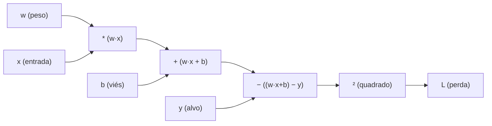
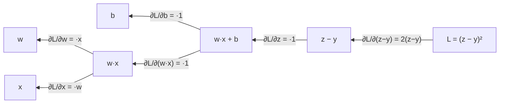
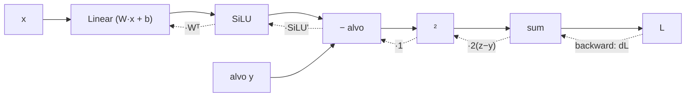

# Autograd e grafos computacionais

## Intuição: o framework que calcula derivadas sozinho

Imagine que você montou uma máquina de engrenagens: a manivela gira uma roda, a roda puxa uma correia, a correia move um ponteiro. Agora imagine que alguém pergunte: "se eu girar a manivela um pouquinho a mais, quanto o ponteiro se move?". Você poderia medir isso desmontando a máquina peça por peça, ou poderia construir a máquina de um jeito que ela **registre automaticamente** como cada movimento se propaga.

É exatamente isso que o **autograd** (diferenciação automática) faz por você. Quando você escreve código como:

```python
import torch

x = torch.tensor(2.0, requires_grad=True)
y = x ** 3
y.backward()
print(x.grad)   # 12.0
```

o PyTorch não se limita a calcular $y = 2^3 = 8$. Ele **constrói, em segundo plano, um grafo de todas as operações** executadas, e quando você chama `backward()`, ele percorre esse grafo de trás para frente aplicando a regra da cadeia, entregando a derivada $\frac{dy}{dx} = 3x^2 = 12$ sem que você tenha derivado nada na mão.

> O autograd é a diferença entre "saber a fórmula da derivada" e "pedir para o computador descobrir a derivada de qualquer programa que você escrever".


## Conceito: o grafo computacional

### Toda conta vira um grafo

Um **grafo computacional** é uma representação em forma de diagrama de uma expressão matemática. Cada **nó** é uma operação (soma, multiplicação, exponenciação, ativação, etc.) ou um valor (uma variável de entrada ou um resultado intermediário). As **arestas** indicam o fluxo dos dados: a saída de uma operação alimenta a entrada de outra.

Para a expressão $L = (w \cdot x + b - y)^2$, o grafo seria:



Repare na leitura da esquerda para a direita: os valores de entrada (`w`, `x`, `b`, `y`) fluem por operações até chegar na perda `L`. Essa leitura é o **forward pass** (passada para frente).

### Por que o grafo importa

A vantagem de ter o grafo é que ele permite calcular derivadas de forma **sistemática**. Para saber como `L` depende de `w`, basta percorrer o caminho de `w` até `L`, multiplicando as derivadas locais de cada aresta (regra da cadeia). O autograd guarda o grafo precisamente para poder fazer esse caminho de volta.

### O que o PyTorch guarda em cada tensor

Todo tensor criado com `requires_grad=True` carrega, além dos dados, duas informações escondidas:

- `grad_fn`: a referência ao nó do grafo que **produziu** aquele tensor (por exemplo, `MulBackward`, `AddBackward`, `PowBackward`). Tensores de entrada (folhas) têm `grad_fn = None`.
- `grad`: o campo onde o gradiente será **acumulado** quando `backward()` for chamado. Começa como `None` e passa a existir depois do primeiro `backward()`.

Vamos inspecionar:

```python
import torch

w = torch.tensor(2.0, requires_grad=True)
b = torch.tensor(1.0, requires_grad=True)
x = torch.tensor(3.0)          # sem requires_grad
y = torch.tensor(10.0)         # alvo

z = w * x + b                  # z = 2*3 + 1 = 7
L = (z - y) ** 2               # L = (7 - 10)^2 = 9

print("w.grad_fn =", w.grad_fn)   # None (folha)
print("z.grad_fn =", z.grad_fn)   # <AddBackward0>
print("L.grad_fn =", L.grad_fn)   # <PowBackward0>
print("w.grad =", w.grad)         # None (ainda não chamamos backward)
```

O `grad_fn` é o "rastro de migalhas" que o backward vai seguir.

## requires_grad: o interruptor do rastreamento

### O que ele faz

`requires_grad` é a flag que decide se um tensor participa do grafo. Quando você define `requires_grad=True` em um tensor, o PyTorch passa a registrar **toda operação** que envolve esse tensor, montando o grafo incrementalmente.

```python
a = torch.tensor(1.0)                 # requires_grad=False por padrão
b = torch.tensor(2.0, requires_grad=True)

c = a + b                             # c herdou requires_grad=True, pois b pediu
print(c.requires_grad)                # True
print(a.requires_grad)                # False
```

A regra é simples: **um resultado herda `requires_grad=True` se qualquer um dos operandos exigir gradiente**.

### Desligando o rastreamento

Há três formas principais de impedir o rastreamento, cada uma com um propósito:

| Mecanismo | Efeito | Uso típico |
|-----------|--------|------------|
| `requires_grad_(False)` | Desliga o rastreamento em um tensor específico, permanentemente | Congelar camadas (feature extraction) |
| `tensor.detach()` | Cria uma "cópia" que compartilha os dados mas **fora do grafo** | Remover um valor do histórico de gradiente |
| `torch.no_grad()` | Desliga o rastreamento em todo um bloco de código | Inferência, avaliação, atualização de pesos |

A diferença sutil entre `detach()` e `no_grad()`: o primeiro cria um novo tensor; o segundo apenas suspende temporariamente a gravação do grafo dentro de um contexto.

## backward(): a passada para trás

### O ponto de partida é a perda

Para calcular gradientes, o PyTorch precisa saber **em relação a quê** derivar. O `backward()` começa do tensor sobre o qual você chama e propaga o gradiente para trás até todas as folhas com `requires_grad=True`.

O detalhe importante: se a perda for um tensor com mais de um elemento (um vetor, uma matriz), o `backward()` exige um argumento `gradient` (ou você precisa reduzir a um escalar antes). O motivo é matemático: o gradiente de um vetor em relação a um escalar é um vetor; para iniciar a propagação, é preciso fornecer a "semente" de gradiente.

```python
x = torch.tensor([1.0, 2.0, 3.0], requires_grad=True)
y = x * x              # vetor de 3 elementos

# y.backward()  # Erro: "grad can be implicitly created only for scalar outputs"

y.backward(torch.ones_like(x))   # fornece a semente (1, 1, 1)
print(x.grad)        # tensor([2., 4., 6.])  -> d(x^2)/dx = 2x
```


### Um exemplo numérico resolvido

Vamos resolver à mão o grafo do diagrama acima, com `w = 2`, `x = 3`, `b = 1`, `y = 10`:

1. **Forward:**
   - $z = w \cdot x + b = 2 \cdot 3 + 1 = 7$
   - $L = (z - y)^2 = (7 - 10)^2 = 9$

2. **Backward (da direita para a esquerda):**
   - Do quadrado: $\frac{\partial L}{\partial (z-y)} = 2(z - y) = 2 \cdot (-3) = -6$.
   - Da subtração (derivada é $1$): $\frac{\partial L}{\partial z} = -6$.
   - Da soma $z = (w \cdot x) + b$: tanto para $(w \cdot x)$ quanto para $b$, a derivada local é $1$, então $\frac{\partial L}{\partial (w \cdot x)} = -6$ e $\frac{\partial L}{\partial b} = -6$.
   - Da multiplicação $w \cdot x$: $\frac{\partial L}{\partial w} = \frac{\partial L}{\partial (w \cdot x)} \cdot x = -6 \cdot 3 = -18$; e $\frac{\partial L}{\partial x} = -6 \cdot 2 = -12$.

3. **Resultado:** $\frac{\partial L}{\partial w} = -18$, $\frac{\partial L}{\partial b} = -6$.

Vamos confirmar com o PyTorch:

```python
import torch

w = torch.tensor(2.0, requires_grad=True)
b = torch.tensor(1.0, requires_grad=True)
x = torch.tensor(3.0)
y = torch.tensor(10.0)

z = w * x + b
L = (z - y) ** 2
L.backward()

print("dL/dw =", w.grad.item())   # -18.0
print("dL/db =", b.grad.item())   # -6.0
```

Os valores batem com o cálculo manual, confirmando que o autograd seguiu exatamente a regra da cadeia.

### O fluxo backward no diagrama



As setas agora apontam para a esquerda, carregando os gradientes que se acumulam ao longo do caminho. É o backpropagation em sua forma mais pura.

## torch.no_grad(): onde a gravação é pausada

### Por que desligar o grafo

Durante o treinamento, nem toda operação deve construir grafo. Dois casos clássicos:

1. **A atualização dos pesos.** Ao executar `w -= eta * w.grad`, você não quer que essa atualização vire parte do grafo (ela criaria um grafo gigantesco e sem sentido a cada passo).
2. **A avaliação.** Ao medir validação ou calcular acurácia, você não precisa de gradientes — só quer o resultado. Construir o grafo desperdiça memória.

Para esses casos, usamos `torch.no_grad()`:

```python
import torch

w = torch.tensor(3.0, requires_grad=True)
L = w ** 2          # L = 9

L.backward()        # grad = 2w = 6

eta = 0.1
with torch.no_grad():
    w -= eta * w.grad     # w = 3 - 0.6 = 2.4, SEM rastrear
    w.grad.zero_()        # limpa o gradiente acumulado

print(w, w.requires_grad)   # 2.4, True
```

Dentro do bloco `no_grad()`, `w` ainda exige gradiente (a flag continua `True`), mas as operações realizadas ali **não são gravadas** no grafo. É a forma de dizer "estou mexendo no peso, mas isso não faz parte da história de derivadas".

### Exemplo de avaliação sem gradientes

Em uma avaliação, coloque o modelo no modo apropriado e desative o rastreamento de gradientes. `inputs` representa um lote preparado para o modelo:

```python
model.eval()
with torch.inference_mode():
    logits = model(inputs)
    predictions = logits.argmax(dim=-1)
```

Sem gradientes, o grafo não é construído para essa passagem; isso pode economizar memória e trabalho quando só precisamos de previsões ou métricas.

### no_grad vs. inference_mode vs. eval

- `torch.no_grad()`: suspende a gravação do grafo, mas ainda permite que tensores exijam gradiente.
- `torch.inference_mode()`: mais agressivo, desabilita até a autograd internamente (mais rápido em inferência pura). Não funciona bem se você precisar mexer em `requires_grad`.
- `model.eval()`: **não desliga gradientes**. Ele muda o comportamento de camadas como `Dropout` e `BatchNorm`; módulos personalizados também podem definir outros comportamentos para esse modo.

É comum confundir `eval()` com `no_grad()`, mas são coisas diferentes: `eval()` muda a semântica do modelo, `no_grad()` muda o rastreamento de derivadas.

## Acumulação de gradiente

### O comportamento padrão: somar

Um dos comportamentos mais surpreendentes do PyTorch para quem está começando é que `backward()` **soma** o gradiente novo ao gradiente existente, em vez de sobrescrever. Veja:

```python
x = torch.tensor(2.0, requires_grad=True)
y = x ** 2          # dy/dx = 4

y.backward()
print(x.grad)       # 4.0

y.backward()        # chamamos de novo!
print(x.grad)       # 8.0  (4 + 4, acumulou)
```

E no treinamento:

```python
loss = total_loss / accumulation_steps                     # normaliza
loss.backward()                                            # acumula o gradiente

if (microbatch_index + 1) % accumulation_steps == 0:
    optimizer.step()        # só aqui atualiza
    optimizer.zero_grad()   # e zera para o próximo ciclo
```

O truque está em normalizar a perda durante a acumulação: cada mini-lote contribui com uma fração do gradiente do lote efetivo. A equivalência a um lote grande pressupõe tamanhos compatíveis, redução correta da perda e ausência de operações que dependam do lote inteiro.

### Controlar a acumulação de gradientes

Como o gradiente acumula, limpe-o antes de iniciar um novo ciclo de atualização quando não quiser somar gradientes de ciclos distintos. Em acumulação intencional, mantenha os gradientes entre microbatches e limpe-os após a atualização. `optimizer.zero_grad()` pode definir `param.grad = None` ou zerar o tensor, conforme a configuração.

```python
for passo in range(3):
    L = perda(w)        # forward
    L.backward()        # backward (acumula em w.grad)
    optimizer.step()    # w = w - eta * w.grad
    optimizer.zero_grad()   # essencial! senão o gradiente soma no próximo passo
```

Sem limpar os gradientes no limite correto do ciclo, gradientes de atualizações diferentes podem se misturar. O momento de chamar `zero_grad()` depende de o treino usar ou não acumulação.

## Um grafo mais realista: camada + ativação

Vamos montar um mini-modelo de uma camada com função de ativação para ver o grafo completo e o backward automático:

```python
import torch
import torch.nn as nn

torch.manual_seed(0)

model = nn.Sequential(
    nn.Linear(2, 3),   # 2 entradas -> 3 neurônios
    nn.SiLU(),         # ativação
)

x = torch.tensor([[1.0, 2.0]])
y_alvo = torch.tensor([[0.5, 0.2, -0.3]])

L = ((model(x) - y_alvo) ** 2).sum()   # perda = soma dos quadrados
L.backward()

# Imprime a forma dos gradientes
for nome, p in model.named_parameters():
    print(f"{nome}: shape={p.shape}, grad.shape={p.grad.shape}")
```

A saída mostra algo como:

```text
0.weight: shape=torch.Size([3, 2]), grad.shape=torch.Size([3, 2])
0.bias: shape=torch.Size([3]), grad.shape=torch.Size([3])
```

Repare no padrão fundamental: **o gradiente tem sempre o mesmo shape do parâmetro**. Isso é o que permite a atualização componente a componente $W \leftarrow W - \eta \cdot \frac{\partial L}{\partial W}$.

### Diagrama do grafo dessa rede



A linha pontilhada representa o caminho reverso que o autograd percorre sozinho, aplicando em cada aresta a derivada local correta.

## Código completo: treinamento manual com autograd

Para consolidar, um loop de treinamento mínimo que usa apenas os blocos básicos do autograd:

```python
import torch

torch.manual_seed(42)

# Dados sintéticos: y = 2x + 1 (com ruído)
X = torch.tensor([[1.0], [2.0], [3.0], [4.0]])
Y = torch.tensor([[3.0], [5.0], [7.0], [9.0]])

# Parâmetros
W = torch.tensor([[0.0]], requires_grad=True)
b = torch.tensor([0.0], requires_grad=True)

eta = 0.01

for passo in range(200):
    pred = X @ W + b                 # forward
    L = ((pred - Y) ** 2).mean()     # MSE
    L.backward()                     # backward (autograd)

    with torch.no_grad():
        W -= eta * W.grad
        b -= eta * b.grad
        W.grad.zero_()
        b.grad.zero_()

    if passo % 40 == 0:
        print(f"passo {passo}: W={W.item():.3f}, b={b.item():.3f}, L={L.item():.4f}")
```

Saída esperada (aproximada):

```text
passo 0: W=0.140, b=0.060, L=44.3820
passo 40: W=1.487, b=1.088, L=1.5189
passo 80: W=1.769, b=1.333, L=0.2701
passo 120: W=1.890, b=1.439, L=0.0480
passo 160: W=1.950, b=1.446, L=0.0086
```

O modelo converge para $W \approx 2$ e $b \approx 1$, exatamente a relação que gerou os dados ($y = 2x + 1$). Tudo isso sem derivar nada à mão.

## Pseudocódigo do autograd

```text
entrada: expressão L, parâmetros w (requires_grad=True)

forward:
    construir grafo registrando cada operação e seus operandos
    guardar valores intermediários para o backward
    devolver L

backward(L):
    grad[L] = 1                       # semente
    para cada nó em ordem reversa (topológica):
        grad_local = derivada do nó em relação a cada entrada
        para cada entrada e:
            grad[e] += grad[nó] · grad_local(e)
    devolver grad em todas as folhas com requires_grad=True
```

Autograd também pode ser combinado com funções de gradiente personalizadas e estimadores aproximados. Eles alteram a regra de *backward* e precisam ser avaliados conforme o método; não fazem parte do comportamento padrão de toda operação.

## Operações com gradiente aproximado

Operações não diferenciáveis, como arredondamento, podem exigir estimadores de gradiente aproximados. Um exemplo é o *Straight-Through Estimator* (STE), descrito no material sobre quantização. Esses estimadores substituem a derivada usada no *backward* e não são o comportamento automático do autograd.

### Forma dos gradientes

Para um parâmetro tensorial, o gradiente normalmente tem a mesma forma do parâmetro. O otimizador usa esse gradiente para atualizar os valores, de acordo com sua regra e seu estado interno.

### Otimizador

Autograd calcula gradientes; a escolha do otimizador é separada. Por exemplo, AdamW recebe parâmetros, uma taxa de aprendizado e opções de regularização:

```python
optimizer = torch.optim.AdamW(
    model.parameters(),
    lr=learning_rate,
    weight_decay=weight_decay
)
```
