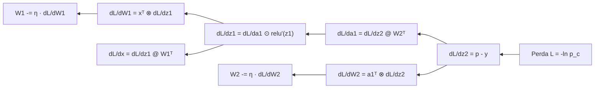

# Backpropagation: o algoritmo que treina

> O forward pass produz uma previsão; a função de perda mede o erro; o **backpropagation** fecha o ciclo, calculando quanto cada peso contribuiu para o erro e indicando como ajustá-lo. É o algoritmo que transforma "erro" em "aprendizado". Nesta página derivamos as regras do zero, resolvemos uma rede minúscula à mão e escrevemos o backward manual em código.

## Visão geral

O backpropagation responde a uma pergunta precisa: *se eu mexer um pouquinho neste peso, o erro sobe ou desce, e em quanto?* A resposta é a **derivada parcial** da perda em relação a cada parâmetro. Com ela, o gradiente descendente dá um passo na direção que reduz a perda.

O nome "back" (para trás) vem do fato de que as derivadas são calculadas da **saída para a entrada**, reutilizando resultados intermediários — em vez de recalcular tudo do zero para cada peso, o que seria inviável numa rede com milhões de parâmetros.

A sequência completa de treino, então, é:

1. **Forward**: calcular a previsão e a perda $\mathcal{L}$.
2. **Backward**: calcular $\frac{\partial \mathcal{L}}{\partial \theta}$ para cada parâmetro $\theta$, de trás para frente.
3. **Atualização**: dar um passo na direção oposta ao gradiente.

## Intuição: a corrente de culpa

Imagine um erro de previsão como uma "culpa" que deve ser distribuída entre todos os pesos que participaram da decisão. O peso que mais influenciou o erro deve receber a maior correção. O backpropagation distribui essa culpa de forma exata e eficiente, seguindo a regra da cadeia: a culpa de um peso é a culpa da saída multiplicada pela sensibilidade daquele peso.

Concretamente, cada etapa do forward é uma função conhecida (multiplicação de matriz, ativação, softmax). Sabemos a derivada de cada uma. O backpropagation simplesmente **encadeia** essas derivadas, andando de trás para frente, acumulando em cada peso a sua parcela de responsabilidade.

## Conceito: derivada e gradiente

A derivada de uma função $f$ em um ponto mede a inclinação — quanto $f$ muda por unidade de mudança na entrada:

$$
\frac{\partial f}{\partial x} \approx \frac{f(x + h) - f(x)}{h} \quad\text{para } h \text{ muito pequeno}
$$

Para uma função de várias variáveis (como uma perda que depende de milhares de pesos), juntamos todas as derivadas parciais num vetor chamado **gradiente**:

$$
\nabla_{\theta} \mathcal{L} = \left[ \frac{\partial \mathcal{L}}{\partial \theta_1},\; \frac{\partial \mathcal{L}}{\partial \theta_2},\; \dots \right]
$$

O gradiente aponta na direção de **maior subida** da perda. Por isso, para minimizar, andamos na direção **oposta**:

$$
\theta \leftarrow \theta - \eta \, \nabla_{\theta} \mathcal{L}
$$

onde $\eta$ é a taxa de aprendizado (learning rate), um número pequeno que controla o tamanho do passo.

## A regra da cadeia

O coração do backpropagation é a regra da cadeia. Se a perda depende de $a$, que depende de $b$, que depende de $\theta$, então:

$$
\frac{\partial \mathcal{L}}{\partial \theta} = \frac{\partial \mathcal{L}}{\partial a} \cdot \frac{\partial a}{\partial b} \cdot \frac{\partial b}{\partial \theta}
$$

Em uma rede, a perda passa por uma pilha de funções:

$$
\mathcal{L} \rightarrow z^{(L)} \rightarrow a^{(L-1)} \rightarrow \dots \rightarrow a^{(1)} \rightarrow z^{(1)} \rightarrow x
$$

O backward percorre essa pilha na ordem inversa, multiplicando as derivadas locais. A beleza é que, ao chegarmos em um ponto, o "erro acumulado" até ali já está pronto, e só multiplicamos pela derivada local daquele nó.

## As três regras locais que você precisa

### 1. Saída: softmax + entropia cruzada

Na última camada, o gradiente tem uma forma notavelmente simples (a "fórmula mágica"):

$$
\frac{\partial \mathcal{L}}{\partial z} = p - y
$$

ou seja, a diferença entre a probabilidade prevista e o alvo one-hot. Não há termos complicados, porque o log do softmax cancela a exponencial.

### 2. Camada linear

Uma camada linear $y = x W^\top$ (com $x$ linha, $W$ matriz) tem duas derivadas:

$$
\frac{\partial \mathcal{L}}{\partial W} = \left(\frac{\partial \mathcal{L}}{\partial y}\right)^\top x
$$

$$
\frac{\partial \mathcal{L}}{\partial x} = \frac{\partial \mathcal{L}}{\partial y} \, W
$$


### 3. Ativação

Para uma ativação elemento a elemento $a = \phi(z)$:

$$
\frac{\partial \mathcal{L}}{\partial z_i} = \frac{\partial \mathcal{L}}{\partial a_i} \cdot \phi'(z_i)
$$


## Exemplo numérico completo em uma rede minúscula

Vamos treinar à mão uma rede de duas camadas. Tudo será calculado com números exatos.

**Arquitetura:** entrada $x = [1.0,\; 2.0]$ (um único exemplo); camada escondida linear de 2 neurônios com ReLU; camada de saída linear de 3 neurônios; softmax; entropia cruzada. Alvo: classe $1$, isto é, $y = [0, 1, 0]$.

$$
W_1 =
\begin{bmatrix}
0.5 & -0.3 \\
0.2 & 0.8
\end{bmatrix},
\qquad
W_2 =
\begin{bmatrix}
0.4 & -0.2 & 0.1 \\
0.3 & 0.5 & 0.6
\end{bmatrix}
$$

### Forward

**Camada 1 (linear):** $z_1 = x W_1$:

$$
z_1 = [1.0 \cdot 0.5 + 2.0 \cdot 0.2,\;\; 1.0 \cdot (-0.3) + 2.0 \cdot 0.8] = [0.9,\; 1.3]
$$

**Ativação ReLU:** $a_1 = [\max(0, 0.9), \max(0, 1.3)] = [0.9,\; 1.3]$.

**Camada 2 (linear):** $z_2 = a_1 W_2$:

$$
z_2 = [0.9 \cdot 0.4 + 1.3 \cdot 0.3,\;\; 0.9 \cdot (-0.2) + 1.3 \cdot 0.5,\;\; 0.9 \cdot 0.1 + 1.3 \cdot 0.6]
$$

$$
z_2 = [0.75,\;\; 0.47,\;\; 0.87]
$$

**Softmax:** subtraindo o máximo $0.87$, obtemos os deslocados $[-0.12, -0.40, 0]$. Exponenciais:

$$
e^{-0.12} \approx 0.8869,\quad e^{-0.40} \approx 0.6703,\quad e^{0} = 1.0
$$

Soma $\approx 2.5572$, logo:

$$
p = [0.3468,\; 0.2621,\; 0.3910]
$$

**Perda:** a classe correta é a 1, então:

$$
\mathcal{L} = -\ln(0.2621) \approx 1.3390
$$

### Backward — camada de saída

O gradiente da perda em relação aos logits é $p - y$:

$$
\frac{\partial \mathcal{L}}{\partial z_2} = [0.3468,\; 0.2621 - 1,\; 0.3910] = [0.3468,\; -0.7379,\; 0.3910]
$$

**Gradiente de $W_2$** (produto externo de $a_1$ pelo gradiente de $z_2$):

$$
\frac{\partial \mathcal{L}}{\partial W_2} =
\begin{bmatrix}
0.9 \cdot 0.3468 & 0.9 \cdot (-0.7379) & 0.9 \cdot 0.3910 \\
1.3 \cdot 0.3468 & 1.3 \cdot (-0.7379) & 1.3 \cdot 0.3910
\end{bmatrix}
=
\begin{bmatrix}
0.3121 & -0.6641 & 0.3519 \\
0.4508 & -0.9593 & 0.5083
\end{bmatrix}
$$

**Gradiente propagado para $a_1$** (multiplica pelo transposto de $W_2$):

$$
\frac{\partial \mathcal{L}}{\partial a_1} = [0.3468,\; -0.7379,\; 0.3910]\,
\begin{bmatrix}
0.4 & 0.3 \\
-0.2 & 0.5 \\
0.1 & 0.6
\end{bmatrix}
$$

$$
\frac{\partial \mathcal{L}}{\partial a_1} = [0.3254,\; -0.0303]
$$

### Backward — camada escondida

**Através da ReLU:** como $z_1 = [0.9, 1.3]$ tem ambos os componentes positivos, a derivada vale $[1, 1]$ e o gradiente passa intacto:

$$
\frac{\partial \mathcal{L}}{\partial z_1} = [0.3254,\; -0.0303]
$$

**Gradiente de $W_1$** (produto externo de $x$ pelo gradiente de $z_1$):

$$
\frac{\partial \mathcal{L}}{\partial W_1} =
\begin{bmatrix}
1.0 \cdot 0.3254 & 1.0 \cdot (-0.0303) \\
2.0 \cdot 0.3254 & 2.0 \cdot (-0.0303)
\end{bmatrix}
=
\begin{bmatrix}
0.3254 & -0.0303 \\
0.6508 & -0.0606
\end{bmatrix}
$$

**Gradiente da entrada** (para completar o fluxo até $x$):

$$
\frac{\partial \mathcal{L}}{\partial x} = [0.3254,\; -0.0303]\,
\begin{bmatrix}
0.5 & 0.2 \\
-0.3 & 0.8
\end{bmatrix}
= [0.1718,\; 0.0408]
$$

### Atualização dos pesos

Com taxa de aprendizado $\eta = 0.1$, cada peso dá um passo na direção contrária ao gradiente:

$$
W_1 \leftarrow W_1 - 0.1 \cdot \frac{\partial \mathcal{L}}{\partial W_1}
$$

Para o primeiro elemento de $W_1$:

$$
0.5 - 0.1 \cdot 0.3254 = 0.4675
$$

E para o elemento $W_1[1][1]$, cujo gradiente é negativo (o que significa que aumentá-lo reduz a perda):

$$
0.8 - 0.1 \cdot (-0.0606) = 0.8061
$$

A tabela completa de um passo:

| Peso | Valor antes | Gradiente | Passo ($\eta = 0.1$) | Valor depois |
|---|---|---|---|---|
| $W_1[0][0]$ | $0.5000$ | $+0.3254$ | $-0.0325$ | $0.4675$ |
| $W_1[0][1]$ | $-0.3000$ | $-0.0303$ | $+0.0030$ | $-0.2970$ |
| $W_1[1][0]$ | $0.2000$ | $+0.6508$ | $-0.0651$ | $0.1349$ |
| $W_1[1][1]$ | $0.8000$ | $-0.0606$ | $+0.0061$ | $0.8061$ |
| $W_2[0][0]$ | $0.4000$ | $+0.3121$ | $-0.0312$ | $0.3688$ |
| $W_2[1][1]$ | $0.5000$ | $-0.9593$ | $+0.0959$ | $0.5959$ |

Note o peso que mais mudou: $W_2[1][1]$, justamente o que tinha o gradiente de maior magnitude, porque sua saída alimentava diretamente a classe correta que o modelo errou.

## O fluxo do backward em diagrama



O diagrama vai da direita (perda) para a esquerda (entrada), espelhando exatamente a ordem dos cálculos.

## Código: backward manual, sem autograd

Vamos implementar o backward à mão, em Python puro, e conferir contra o PyTorch:

```python
import math

def relu(z):
    return [max(0.0, v) for v in z]

def relu_deriv(z):
    return [1.0 if v > 0 else 0.0 for v in z]

def softmax(z):
    m = max(z)
    e = [math.exp(v - m) for v in z]
    s = sum(e)
    return [v / s for v in e]

# --- parâmetros ---
W1 = [[0.5, -0.3], [0.2, 0.8]]          # 2x2
W2 = [[0.4, -0.2, 0.1], [0.3, 0.5, 0.6]]  # 2x3
x = [1.0, 2.0]
y_true = [0, 1, 0]                       # classe correta = 1

# --- forward ---
z1 = [sum(x[i] * W1[i][j] for i in range(2)) for j in range(2)]
a1 = relu(z1)
z2 = [sum(a1[i] * W2[i][j] for i in range(2)) for j in range(3)]
p = softmax(z2)
loss = -math.log(p[1])

# --- backward ---
dL_dz2 = [p[j] - y_true[j] for j in range(3)]            # p - y

dL_dW2 = [[a1[i] * dL_dz2[j] for j in range(3)] for i in range(2)]
dL_da1 = [sum(dL_dz2[j] * W2[i][j] for j in range(3)) for i in range(2)]

dL_dz1 = [dL_da1[i] * relu_deriv(z1)[i] for i in range(2)]
dL_dW1 = [[x[i] * dL_dz1[j] for j in range(2)] for i in range(2)]

# --- atualização (descida do gradiente) ---
lr = 0.1
W1 = [[W1[i][j] - lr * dL_dW1[i][j] for j in range(2)] for i in range(2)]
W2 = [[W2[i][j] - lr * dL_dW2[i][j] for j in range(3)] for i in range(2)]

print("loss:", round(loss, 4))
print("dL/dW1:", [[round(v, 4) for v in row] for row in dL_dW1])
print("dL/dW2:", [[round(v, 4) for v in row] for row in dL_dW2])
print("W1 novo:", [[round(v, 4) for v in row] for row in W1])
```

Para conferir com autograd (mesmo resultado, calculado automaticamente):

```python
import torch
import torch.nn.functional as F

x_t = torch.tensor([1.0, 2.0])
W1_t = torch.tensor([[0.5, -0.3], [0.2, 0.8]], requires_grad=True)
W2_t = torch.tensor([[0.4, -0.2, 0.1], [0.3, 0.5, 0.6]], requires_grad=True)

z1_t = x_t @ W1_t
a1_t = torch.relu(z1_t)
z2_t = a1_t @ W2_t
loss_t = F.cross_entropy(z2_t.unsqueeze(0), torch.tensor([1]))
loss_t.backward()

print("loss torch:", round(loss_t.item(), 4))
print("dL/dW1 torch:", W1_t.grad.round(decimals=4))
print("dL/dW2 torch:", W2_t.grad.round(decimals=4))
```

Os valores batem com o cálculo à mão: `dL/dW1 = [[0.3254, -0.0303], [0.6508, -0.0606]]` e `dL/dW2 = [[0.3121, -0.6641, 0.3519], [0.4508, -0.9593, 0.5083]]`.

## Por que "de trás para frente" é eficiente

Se calculássemos a derivada de cada peso de forma independente (derivada numérica), precisaríamos de um forward extra **por parâmetro**. Numa rede com 100 milhões de pesos, isso seria 100 milhões de forwards por passo de treino — impossível.

O backpropagation aproveita que a rede é uma composição de funções: cada derivada local é calculada uma única vez e **reutilizada** por todos os pesos anteriores. O custo total é de apenas **um forward + um backward** por lote, com o backward custando aproximadamente o mesmo que o forward.

## Erros comuns

- **Esquecer o sinal da atualização**: descemos a perda, então o passo é **menos** $\eta$ vezes o gradiente. Somar em vez de subtrair faz a perda subir.
- **Confundir a direção do produto externo**: $\frac{\partial \mathcal{L}}{\partial W} = x^\top \frac{\partial \mathcal{L}}{\partial y}$, não o contrário. Inverter $x$ e o gradiente de $y$ dá dimensões erradas ou gradientes trocados.
- **Propagar pela ReLU sem a máscara**: neurônios com $z \le 0$ têm gradiente zero; multiplicar por $1$ indiscriminadamente "ressuscita" neurônios mortos e corrompe o treino.
- **Aplicar softmax duas vezes**: se a função de perda já aplica softmax internamente (como `cross_entropy`), aplicar softmax antes de novo altera os gradientes.
- **Não zerar os gradientes entre lotes**: no PyTorch, os gradientes acumulam por padrão; é preciso `optimizer.zero_grad()` a cada passo, senão os gradientes de lotes anteriores se somam indevidamente.
- **Verificar gradientes contra autograd sem desligar a aleatoriedade**: use pesos e entradas fixas ao conferir o backward manual, senão os números nunca batem.
- **Taxa de aprendizado grande demais**: com $\eta$ alto, o passo "pula" o mínimo e a perda oscila ou diverge; com $\eta$ baixo demais, o treino fica lento.

## Resumo

- O backpropagation calcula $\nabla_{\theta}\mathcal{L}$ para todos os parâmetros, da saída para a entrada.
- A regra da cadeia encadeia as derivadas locais de cada operação do forward.
- Na saída, o gradiente é a "fórmula mágica" $\frac{\partial \mathcal{L}}{\partial z} = p - y$.
- Numa camada linear, $\frac{\partial \mathcal{L}}{\partial W} = x^\top \frac{\partial \mathcal{L}}{\partial y}$ e $\frac{\partial \mathcal{L}}{\partial x} = \frac{\partial \mathcal{L}}{\partial y} W$.
- A ativação propaga multiplicando pela sua derivada ($\text{ReLU}' = 1$ ou $0$; SiLU é suave).
- A atualização é $\theta \leftarrow \theta - \eta \nabla_{\theta}\mathcal{L}$.
- O backward custa cerca de um forward, graças à reutilização de derivadas intermediárias.
