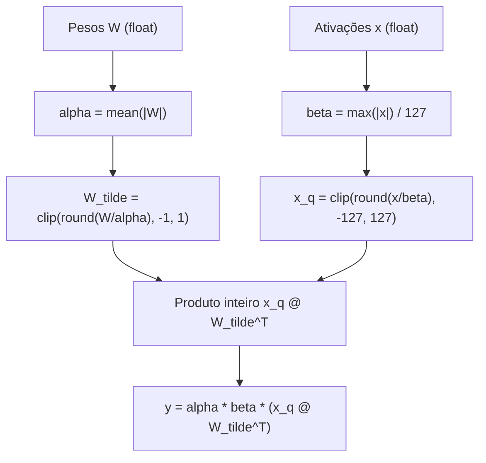

# BitLinear em detalhe

> BitLinear é o nome usado para camadas lineares em variantes do BitNet. As operações e regras exatas variam: o exemplo deste guia descreve uma variante didática que quantiza pesos e ativações com escalas.


## 1. A intuição: separar sentido de magnitude

Uma camada linear comum faz:

$$
y = W x
$$

Onde $W$ é a matriz de pesos e $x$ o vetor de ativações. Nesta variante, fatoramos tanto $W$ quanto $x$ em duas partes — um fator de **escala** (magnitude) e um fator **quantizado** (sentido):

$$
W \approx \alpha \cdot \tilde{W}, \qquad x \approx \beta \cdot \tilde{x}
$$

Onde $\tilde{W}$ só contém $-1$, $0$ e $+1$, e $\tilde{x}$ é um vetor de inteiros de 8 bits. Substituindo na equação da camada:

$$
y = \left( \alpha \cdot \tilde{W} \right) \left( \beta \cdot \tilde{x} \right) = \alpha \cdot \beta \cdot \left( \tilde{W} \tilde{x} \right)
$$

A grande sacada: a multiplicação $\tilde{W} \tilde{x}$ não envolve nenhum número de ponto flutuante com magnitude — são ternários vezes inteiros, que viram **somas com sinal**. Toda a "magnitude" ficou concentrada nas duas escalas $\alpha$ e $\beta$, que são multiplicadas uma única vez no final. É como tirar a vírgula decimal de uma conta, fazer a conta com inteiros, e recolocar a vírgula no resultado.



## 2. As duas quantizações

Esta variante didática aplica duas quantizações distintas, com critérios distintos. Outras variantes podem quantizar apenas os pesos ou usar escalas e formatos diferentes.

### 2.1. Quantização dos pesos (ternária)

A escala dos pesos é a **média dos valores absolutos** de toda a matriz $W$, de dimensões $d_{\text{out}} \times d_{\text{in}}$:

$$
\alpha = \frac{1}{d_{\text{out}} \cdot d_{\text{in}}} \sum_{i=1}^{d_{\text{out}}} \sum_{j=1}^{d_{\text{in}}} \left| W_{ij} \right|
$$

A quantização em si:

$$
\tilde{W} = \text{clip}\!\left( \text{round}\!\left( \frac{W}{\alpha} \right),\; -1,\; 1 \right)
$$

O resultado $\tilde{W}$ tem as **mesmas dimensões** de $W$ ($d_{\text{out}} \times d_{\text{in}}$), mas cada entrada pertence a $\{-1, 0, +1\}$.

> A escala e a regra de arredondamento variam entre métodos e implementações: podem ser calculadas por tensor, canal ou grupo. A média global usada nas equações deste exemplo é uma escolha didática, não uma regra universal para toda variante BitNet.

Se todos os pesos forem zero, $\alpha=0$; a implementação precisa tratar esse caso para evitar divisão por zero.

### 2.2. Quantização das ativações (8 bits, absmax)

As ativações usam um critério diferente: a escala é o **máximo valor absoluto**, dividido pela magnitude máxima do intervalo inteiro escolhido. Aqui usamos $[-127,127]$, então $Q_b=127$:

$$
\beta = \frac{\max\left| x \right|}{Q_b} = \frac{\max\left| x \right|}{127}
$$

E a quantização:

$$
\tilde{x} = \text{clip}\!\left( \text{round}\!\left( \frac{x}{\beta} \right),\; -127,\; 127 \right)
$$

Se o tensor de entrada for todo zero, é preciso tratar a escala para evitar divisão por zero. O máximo ajuda a manter os valores dentro do intervalo escolhido; escalas por grupo ou outras regras mudam o comportamento. Pesos e ativações não precisam usar o mesmo método de escala.

### 2.3. Por que os critérios diferem

| | Pesos $\tilde{W}$ | Ativações $\tilde{x}$ |
|---|---|---|
| Níveis | 3 ($-1, 0, +1$) | 255 no intervalo simétrico escolhido |
| Escala | $\alpha$ = média de $|W_{ij}|$ | $\beta$ = $\max|x| / 127$ |
| Bits por valor | 2 bits em uma codificação simples; $\log_2 3$ é limite teórico | 8 |
| Critério | estabilidade, aproveitar centro | evitar *overflow* |
| Recalculado | conforme a regra do método | conforme a entrada e o grupo de escala |

## 3. Os formatos (shapes) dos tensores

Entender os formatos evita a maioria dos erros de implementação. Vamos usar a convenção do PyTorch, onde a camada linear aplica $x W^\top$.

| Tensor | Símbolo | Shape |
|--------|---------|-------|
| Ativações de entrada | $x$ | $(B, T, d_{\text{in}})$ |
| Pesos latentes | $W$ | $(d_{\text{out}}, d_{\text{in}})$ |
| Escala dos pesos | $\alpha$ | escalar |
| Pesos ternários | $\tilde{W}$ | $(d_{\text{out}}, d_{\text{in}})$ |
| Escala das ativações | $\beta$ | escalar neste exemplo |
| Ativações quantizadas | $\tilde{x}$ | $(B, T, d_{\text{in}})$ |
| Produto bruto | $p = \tilde{x} \tilde{W}^\top$ | $(B, T, d_{\text{out}})$ |
| Saída | $y$ | $(B, T, d_{\text{out}})$ |

Aqui $B$ é o tamanho do lote (*batch*), $T$ o comprimento da sequência, $d_{\text{in}}$ a dimensão de entrada e $d_{\text{out}}$ a de saída. Note que $\tilde{W}$ tem exatamente o shape de $W$, e que $\alpha$ e $\beta$ são escalares compartilhados por todo o lote — é isso que mantém a contabilidade simples.

## 4. O forward completo, passo a passo

### 4.1. Pseudocódigo

```text
ENTRADA: x (float), W (float, pesos latentes)

1. alpha = media_dos_valores_absolutos(W)        # escala dos pesos
2. W_tilde = clip(round(W / alpha), -1, 1)       # pesos ternários

3. beta = max(|x|) / 127                          # escala das ativações
4. x_q = clip(round(x / beta), -127, 127)         # ativações int8 simétricas

5. p = x_q @ W_tilde^T                            # produto inteiro, acumulado
6. y = alpha * beta * p                           # reescala final

SAÍDA: y
```

### 4.2. Código Python didático

```python
def bitlinear_forward(x, W):
    # 1. escala dos pesos (média dos valores absolutos)
    alpha = W.abs().mean().clamp(min=1e-8)

    # 2. pesos ternários
    W_tilde = (W / alpha).round().clip(-1, 1)

    # 3. escala das ativações (absmax, 8 bits)
    beta = x.abs().max().clamp(min=1e-8) / 127

    # 4. ativações quantizadas (int8)
    x_q = (x / beta).round().clip(-127, 127)

    # 5. produto didático dos valores quantizados e reescala
    p = x_q @ W_tilde.T
    y = alpha * beta * p
    return y
```

Neste exemplo, os valores discretos permanecem em tensores de ponto flutuante por simplicidade. Ele ilustra a aproximação numérica, não implementa um kernel inteiro otimizado.

### 4.3. Uma implementação didática em PyTorch

Este exemplo quantiza os pesos e usa um STE. Ele não quantiza as ativações; é uma variante simplificada para ilustrar o fluxo e não representa todas as versões de BitLinear.


```python
def forward(self, x):
    target_dtype = x.dtype
    w = self.weight.to(device=x.device, dtype=target_dtype)

    # escala dos pesos — propaga gradiente de magnitude
    scale = w.abs().mean().clamp(min=1e-5)

    weight_scaled = w / scale
    weight_quantized = torch.round(weight_scaled).clamp(-1, 1)

    # STE: mantém o valor quantizado, mas deixa o gradiente fluir
    weight_ste = (weight_quantized - weight_scaled).detach() + weight_scaled

    output = F.linear(x, weight_ste) * scale
    if self.bias is not None:
        output += self.bias.to(dtype=target_dtype)
    return output
```

Leitura linha a linha:

- `scale = w.abs().mean().clamp(min=1e-5)` é o $\alpha$; o `clamp` evita divisão por zero se a camada tiver pesos todos nulos.
- `weight_scaled = w / scale` é $\frac{W}{\alpha}$.
- `weight_quantized` é o ternário $\tilde{W}$.
- `weight_ste` é o truque do STE: numericamente igual a `weight_quantized`, mas com gradiente apontando para `weight_scaled`.
- `F.linear(x, weight_ste) * scale` é o forward $y = \alpha \cdot (\tilde{W} x)$.

## 5. Exemplo numérico completo

Vamos resolver um caso minúsculo à mão, com $d_{\text{in}} = 3$ e $d_{\text{out}} = 2$.

### 5.1. Os pesos e a escala $\alpha$

$$
W = \begin{bmatrix} 0.06 & -0.04 & 0.02 \\ -0.03 & 0.05 & -0.01 \end{bmatrix}
$$

Somamos os valores absolutos:

$$
0.06 + 0.04 + 0.02 + 0.03 + 0.05 + 0.01 = 0.21
$$

$$
\alpha = \frac{0.21}{6} = 0.035
$$

### 5.2. A quantização dos pesos

Dividimos cada entrada por $\alpha$:

$$
\frac{W}{\alpha} = \begin{bmatrix} 1.714 & -1.143 & 0.571 \\ -0.857 & 1.429 & -0.286 \end{bmatrix}
$$

Arredondamos:

$$
\text{round}\!\left(\frac{W}{\alpha}\right) = \begin{bmatrix} 2 & -1 & 1 \\ -1 & 1 & 0 \end{bmatrix}
$$

Clipamos em $[-1, 1]$:

$$
\tilde{W} = \begin{bmatrix} 1 & -1 & 1 \\ -1 & 1 & 0 \end{bmatrix}
$$

### 5.3. As ativações e a escala $\beta$

$$
x = [0.8,\; -0.6,\; 1.2]
$$

O máximo absoluto é $1.2$, logo:

$$
\beta = \frac{1.2}{127} \approx 0.009449
$$

Quantizamos:

$$
\frac{x}{\beta} = [84.66,\; -63.50,\; 127.0]
$$

$$
\tilde{x} = [85,\; -64,\; 127]
$$

### 5.4. A multiplicação barata

Multiplicamos $\tilde{x}$ por $\tilde{W}^\top$. Em aritmética inteira, os produtos com pesos $-1$, $0$ e $+1$ podem ser somados, omitidos ou ter o sinal invertido; isso não garante que qualquer implementação use um kernel sem multiplicadores:

$$
\tilde{W}^\top = \begin{bmatrix} 1 & -1 \\ -1 & 1 \\ 1 & 0 \end{bmatrix}
$$

$$
p = \tilde{x} \tilde{W}^\top = [85 \cdot 1 + (-64)(-1) + 127 \cdot 1,\;\; 85(-1) + (-64)(1) + 127 \cdot 0]
$$

$$
p = [85 + 64 + 127,\;\; -85 - 64 + 0] = [276,\; -149]
$$

### 5.5. A reescala final

$$
\alpha \cdot \beta = 0.035 \cdot 0.009449 \approx 0.0003307
$$

$$
y = \alpha \beta p = [276 \cdot 0.0003307,\;\; -149 \cdot 0.0003307] = [0.0913,\; -0.0493]
$$

### 5.6. Comparação com a camada densa

A camada linear clássica daria:

$$
y_{\text{denso}} = W x = [0.096,\; -0.066]
$$

O resultado quantizado $[0.0913, -0.0493]$ está próximo, mas não idêntico — a diferença é o preço pago pela compressão. Em redes grandes e bem treinadas, essa diferença é aprendida e compensada, e o ganho em energia e memória mais do que paga o custo.

## 6. O papel do STE no BitLinear

A quantização dos pesos envolve `round` e `clip`, que são operações não diferenciáveis. Se deixássemos o gradiente literal, ele morreria nas bordas. O Straight-Through Estimator resolve isso com a substituição:

$$
\frac{\partial \tilde{W}}{\partial W} \approx 1
$$

Na forma de STE usada acima, a linha:

```python
weight_ste = (weight_quantized - weight_scaled).detach() + weight_scaled
```

faz exatamente isso: no *forward*, `weight_ste` vale o ternário; no *backward*, o `.detach()` do primeiro termo faz o gradiente fluir apenas por `weight_scaled`, chegando até $W$ e $\alpha$. Repare também que a escala $\alpha$ **propaga gradiente** (não foi "detachada") — um detalhe importante, porque a magnitude da camada também precisa aprender.

## 7. O caminho da inferência: materializar e empacotar

Durante o treinamento, o ternário $\tilde{W}$ pode ser recalculado a cada passo. Como os pesos ficam fixos durante a inferência, alguns runtimes pré-calculam a representação quantizada antes de gerar tokens. Um exemplo simplificado é:

```python
scale = self.weight.abs().mean().clamp(min=1e-5)
quantized = torch.round(self.weight / scale).clamp(-1, 1)
self._inference_weight = (quantized * scale).contiguous()
```

Essa pré-computação evita repetir a quantização, mas não garante, por si só, uma inferência mais rápida. Empacotamento, kernels especializados, alinhamento e compatibilidade com o hardware são decisões de implementação; o ganho precisa ser medido no runtime e no dispositivo de interesse.

## 8. Erros comuns

- **Confundir a escala dos pesos com a das ativações**: neste exemplo $\alpha$ é a média de $|W_{ij}|$; $\beta$ é $\max|x|/127$. Trocar uma pela outra quebra a normalização.
- **Esquecer a reescala final $\alpha \cdot \beta$**: sem ela, o resultado fica ordens de magnitude errado.
- **Não clipar**: o `round(W/alpha)` pode produzir $2$ ou $-2$; o `clip(-1, 1)` é obrigatório para manter o ternário.
- **Esquecer a aproximação de gradiente nesta implementação de treino**: sem o STE ilustrado, o arredondamento não fornece o gradiente usado para atualizar os pesos latentes. Outros métodos podem usar outra estratégia.
- **Tratar a escala do exemplo como universal**: aqui usamos a média dos valores absolutos dos pesos, mas outros métodos podem usar máximos, grupos ou canais.
- **Usar o mesmo shape errado**: $\tilde{W}$ tem shape $(d_{\text{out}}, d_{\text{in}})$ e a multiplicação é $\tilde{x} \tilde{W}^\top$, não $\tilde{W} \tilde{x}$.
- **Presumir que o bias segue a mesma regra dos pesos**: o tratamento do bias depende da variante; neste exemplo ele permanece em ponto flutuante.
- **Achar que a ativação quantizada é ternária**: ela é int8 (8 bits); só os pesos são ternários.

## 9. Resumo

- Nesta variante, os pesos são fatorados em $\alpha \cdot \tilde{W}$ (ternário) e as ativações em $\beta \cdot \tilde{x}$ (int8); o produto inteiro pode ser implementado com somas e negações, dependendo do kernel.
- $\alpha = \frac{1}{d_{\text{out}} d_{\text{in}}} \sum |W_{ij}|$ (média dos valores absolutos) e $\beta = \max|x| / 127$ (absmax).
- $\tilde{W} = \text{clip}(\text{round}(W/\alpha), -1, 1)$ e, nesta forma simétrica, $\tilde{x} = \text{clip}(\text{round}(x/\beta), -127, 127)$.
- O *forward* completo é $y = \alpha \beta \cdot (\tilde{x} \tilde{W}^\top)$, com shapes $(B, T, d_{\text{in}}) \to (B, T, d_{\text{out}})$.
- O STE mantém o gradiente fluindo através da quantização não diferenciável.
- Na inferência, um runtime pode pré-computar e empacotar os pesos ternários; o formato e o ganho dependem do kernel e do hardware compatíveis.
