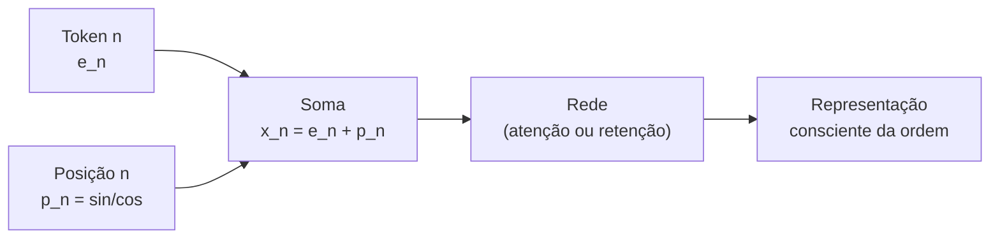
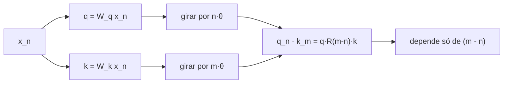

# Codificação posicional e RoPE

## Visão geral

Um modelo de linguagem processa texto token a token. Mas há um detalhe que passa despercebido por muita gente: a arquitetura básica de atenção — e a retenção do RetNet, que é sua prima eficiente — é **cega à ordem**. Ela trata um conjunto de vetores como um *conjunto*, e não como uma *sequência*. Se você alimentar "o cachorro mordeu o menino" e "o menino mordeu o cachorro", as representações internas seriam idênticas sem algum truque extra.


> A pergunta que move esta página: como uma máquina que só soma e multiplica vetores pode "sentir" que uma palavra vem depois de outra?

## Por que a posição importa

### O problema da permutação

Considere as duas frases:

1. *"O gato comeu o rato."*
2. *"O rato comeu o gato."*

Elas usam exatamente as mesmas palavras (os mesmos tokens, em qualquer tokenizador razoável), mas significam coisas opostas. Um modelo que ignorasse a ordem produziria a **mesma** representação para as duas frases e, portanto, seria incapaz de diferenciá-las.

Para entender por que a arquitetura é cega à ordem, olhe a operação central de atenção escalada (scaled dot-product attention), que é um somatório sobre todos os pares:

$$
\text{Attention}(Q, K, V) = \text{softmax}\!\left(\frac{Q K^\top}{\sqrt{d}}\right) V
$$

Se você permutar as linhas (as posições) de $Q$, $K$ e $V$ **da mesma forma**, o resultado permuta da mesma forma. Em outras palavras, a atenção é **equivariante a permutações**: ela não tem nenhum conhecimento intrínseco de que a posição 3 vem depois da posição 2.

### Um exemplo numérico rápido

Imagine três tokens com embeddings hipotéticos em $\mathbb{R}^{2}$:

| Token | Embedding |
|---|---|
| "gato" | $[1.0,\; 0.0]$ |
| "comeu" | $[0.5,\; 0.5]$ |
| "rato" | $[0.0,\; 1.0]$ |

Se invertermos a ordem dos tokens, o *conjunto* de embeddings é o mesmo; só a ordem do lote muda. Uma rede que faz pooling sobre a sequência (soma ou média) produz exatamente o mesmo resultado nos dois casos:

$$
\text{pool}([e_1, e_2, e_3]) = e_1 + e_2 + e_3 = \text{pool}([e_3, e_2, e_1])
$$

A conclusão é direta: **precisamos de um mecanismo que torne o vetor dependente da posição**.

## O que é codificação posicional

Codificação posicional é qualquer função que associa a cada índice $n$ (a posição na sequência) um vetor $p_n$ do mesmo tamanho do embedding, e soma (ou concatena) esse vetor ao token correspondente:

$$
x_n = e_n + p_n
$$

onde $e_n$ é o embedding do token na posição $n$ e $p_n$ é o vetor posicional. A ideia é que, depois dessa soma, o vetor $x_n$ "sabe" onde ele está. A pergunta que sobra é: **como escolher $p_n$?**

Existem três respostas clássicas, que vamos explorar em ordem:

1. **Senoidal** (Transformer original, Vaswani et al., 2017): uma função determinística e sem parâmetros.
2. **Aprendida** (estilo GPT): uma tabela de embeddings treinada junto com o modelo.
3. **RoPE** (Rotary Position Embedding, Su et al., 2021): uma rotação do vetor, aplicada nas projeções $Q$ e $K$.

## Codificação senoidal

### A fórmula

A codificação senoidal original atribui a cada posição $n$ e a cada dimensão $i$ um valor baseado em senos e cossenos de frequências decrescentes:

$$
p_{n, 2i} = \sin\!\left(\frac{n}{10000^{2i/d}}\right)
$$

$$
p_{n, 2i+1} = \cos\!\left(\frac{n}{10000^{2i/d}}\right)
$$

Aqui $d$ é a dimensão do modelo e $i$ vai de $0$ até $d/2 - 1$. Cada par de dimensões $(2i, 2i+1)$ usa uma **frequência** diferente:

$$
\omega_i = \frac{1}{10000^{2i/d}}
$$

Para dimensões baixas ($i$ pequeno), o expoente $2i/d$ é pequeno e a frequência é alta; para dimensões altas ($i$ grande), a frequência é baixa. Isso produz um espectro de frequências, como se cada dimensão fosse uma "engrenagem" girando em velocidade própria.

### Exemplo numérico resolvido

Vamos fixar $d = 4$ e calcular a codificação para as posições $n = 0$ e $n = 1$. Temos $i \in \{0, 1\}$.

Para $i = 0$, o fator é:

$$
10000^{2 \cdot 0 / 4} = 10000^{0} = 1
$$

Logo $\omega_0 = 1$, e o par de dimensões $(0, 1)$ recebe $\sin(n)$ e $\cos(n)$.

Para $i = 1$, o fator é:

$$
10000^{2 \cdot 1 / 4} = 10000^{0.5} = \sqrt{10000} = 100
$$

Logo $\omega_1 = \frac{1}{100}$, e o par $(2, 3)$ recebe $\sin\!\left(\frac{n}{100}\right)$ e $\cos\!\left(\frac{n}{100}\right)$.

Montando a tabela:

| Posição $n$ | $\sin(n)$ | $\cos(n)$ | $\sin(n/100)$ | $\cos(n/100)$ |
|---|---|---|---|---|
| $0$ | $0$ | $1$ | $0$ | $1$ |
| $1$ | $\approx 0.8415$ | $\approx 0.5403$ | $\approx 0.0100$ | $\approx 0.9999$ |
| $2$ | $\approx 0.9093$ | $\approx -0.4161$ | $\approx 0.0200$ | $\approx 0.9998$ |

Então, por exemplo:

$$
p_0 = [0,\; 1,\; 0,\; 1]
$$

$$
p_1 = [0.8415,\; 0.5403,\; 0.0100,\; 0.9999]
$$

Observe como a dimensão de baixa frequência (posições 2 e 3) muda **muito devagar** de uma posição para a próxima, enquanto a de alta frequência (posições 0 e 1) muda **rápido**. Esse contraste é o que dá à codificação senoidal sua riqueza.

### A propriedade da linearidade relativa

A razão pela qual a codificação senoidal é elegante é a seguinte identidade trigonométrica. Para uma frequência fixa $\omega$, a adição de ângulos nos dá:

$$
\sin(a + b) = \sin(a)\cos(b) + \cos(a)\sin(b)
$$

$$
\cos(a + b) = \cos(a)\cos(b) - \sin(a)\sin(b)
$$

Isso significa que o vetor na posição $n + k$ pode ser escrito como uma **transformação linear** do vetor na posição $n$:

$$
\begin{bmatrix} p_{n+k, 2i} \\ p_{n+k, 2i+1} \end{bmatrix}
=
\begin{bmatrix} \cos(\omega_i k) & \sin(\omega_i k) \\ -\sin(\omega_i k) & \cos(\omega_i k) \end{bmatrix}
\begin{bmatrix} p_{n, 2i} \\ p_{n, 2i+1} \end{bmatrix}
$$

Ou seja, deslocar $k$ posições equivale a **girar** cada par de dimensões por um ângulo $\omega_i k$. Essa é a ponte conceitual que leva diretamente à RoPE, que veremos mais adiante: em vez de girar o *embedding*, a RoPE gira as *consultas* e as *chaves*.

### Diagrama do fluxo



### Pontos fortes e fracos

| Propriedade | Avaliação |
|---|---|
| Sem parâmetros | Não precisa treinar nada |
| Extrapola para qualquer comprimento | A fórmula vale para qualquer $n$ |
| Distância relativa é linear | Facilita generalização |
| Frequências fixas | Não se adapta aos dados |
| Base 10000 é heurística | Foi escolhida de forma empírica |

## Embeddings posicionais aprendidos

A alternativa mais simples é tratar cada posição como se fosse um "token" e aprender um vetor para ela, igual a um embedding de palavra:

$$
x_n = e_n + W_{\text{pos}}[n]
$$

onde $W_{\text{pos}}$ é uma matriz de tamanho $\text{max\_len} \times d$, treinada por descida de gradiente junto com o resto da rede. É a abordagem usada pela família GPT (GPT-2, GPT-3) e por muitos modelos BERT.

### Vantagem e desvantagem

- **Vantagem**: o modelo é livre para descobrir a representação de posição mais útil para os seus dados.
- **Desvantagem**: a tabela tem tamanho fixo. Se você treinou com `max_len = 512`, o modelo **não tem** um vetor para a posição 513. Não há extrapolação natural.

```python
import torch
import torch.nn as nn

class EmbeddingPosicional(nn.Module):
    def __init__(self, vocab: int, d_model: int, max_len: int):
        super().__init__()
        self.token_emb = nn.Embedding(vocab, d_model)
        self.pos_emb = nn.Embedding(max_len, d_model)

    def forward(self, ids: torch.Tensor):
        b, t = ids.shape
        posicoes = torch.arange(t, device=ids.device)   # [0, 1, ..., t-1]
        return self.token_emb(ids) + self.pos_emb(posicoes)
```

### Comparação entre senoidal e aprendida

| Critério | Senoidal | Aprendida |
|---|---|---|
| Parâmetros | Zero | $\text{max\_len} \times d$ |
| Extrapolação | Sim | Não |
| Flexibilidade | Baixa | Alta |
| Uso típico | Transformer original | GPT, BERT |

## O problema das abordagens absolutas

Tanto a senoidal quanto a aprendida codificam a posição **absoluta**: cada posição $n$ tem seu vetor próprio. Isso funciona, mas tem uma limitação conceitual importante. Em linguagem, o que importa para a gramática e o sentido é, muitas vezes, a **distância relativa** entre tokens, não a posição absoluta.

Por exemplo, na frase "o gato que comeu o rato dormiu", o verbo "dormiu" precisa concordar com "gato", e o que importa é que "gato" está a uma certa distância *relativa* de "dormiu" — não que "gato" esteja na posição absoluta 1. Uma codificação puramente absoluta força a rede a aprender a subtrair posições implicitamente, o que é mais difícil de generalizar.

A **RoPE** resolve isso de forma elegante: ela codifica a posição de modo que o **produto escalar** entre consulta e chave dependa apenas da **diferença** entre as posições, e não de cada posição em si.

## RoPE (Rotary Position Embedding)

### A ideia: girar em vez de somar

Em vez de *somar* um vetor posicional ao embedding, a RoPE *gira* os vetores de consulta e de chave por um ângulo proporcional à sua posição. Intuitivamente: cada token "aponta" numa direção, e a posição em que ele aparece gira essa direção. Dois tokens na mesma posição relativa apontam na mesma direção relativa entre si.

### Rotação em duas dimensões

A matriz de rotação por um ângulo $\theta$ no plano é:

$$
R(\theta) =
\begin{bmatrix}
\cos\theta & -\sin\theta \\
\sin\theta & \cos\theta
\end{bmatrix}
$$

Aplicada a um vetor $[x, y]$, ela produz:

$$
x' = x \cos\theta - y \sin\theta
$$

$$
y' = x \sin\theta + y \cos\theta
$$

Geometricamente, o vetor gira $\theta$ radianos no sentido anti-horário, preservando o seu comprimento (norma):

$$
\left\lVert R(\theta) v \right\rVert = \left\lVert v \right\rVert
$$

### Aplicando a RoPE ao vetor completo

Para um vetor de dimensão $d$, a RoPE divide as dimensões em $d/2$ pares e gira cada par por um ângulo diferente. Para o par $i$, o ângulo é:

$$
\theta_i = 10000^{-2(i-1)/d}, \quad i = 1, 2, \dots, d/2
$$

Assim, para a posição $n$, o par $(x_{2i-1}, x_{2i})$ é girado por $n \cdot \theta_i$. A transformação completa é:

$$
\begin{bmatrix} x'_{2i-1} \\ x'_{2i} \end{bmatrix}
=
\begin{bmatrix} \cos(n\theta_i) & -\sin(n\theta_i) \\ \sin(n\theta_i) & \cos(n\theta_i) \end{bmatrix}
\begin{bmatrix} x_{2i-1} \\ x_{2i} \end{bmatrix}
$$

Escrevendo de forma compacta por coordenadas:

$$
x'_{2i-1} = x_{2i-1} \cos(n\theta_i) - x_{2i} \sin(n\theta_i)
$$

$$
x'_{2i} = x_{2i-1} \sin(n\theta_i) + x_{2i} \cos(n\theta_i)
$$

### Onde aplicar: em $Q$ e $K$

A RoPE não gira os embeddings de entrada. Ela gira as **consultas** e as **chaves** depois das projeções lineares, e deixa os **valores** intactos:

$$
q_n = R(n) \, W_q \, x_n
$$

$$
k_m = R(m) \, W_k \, x_m
$$

onde $R(n)$ é a rotação por todos os ângulos $\{n\theta_i\}$.

### Por que a posição relativa emerge

A propriedade crucial da RoPE é que a rotação é um **grupo**: girar por $n$ e depois por $m$ é o mesmo que girar por $n + m$. O produto escalar entre uma consulta na posição $n$ e uma chave na posição $m$ vale:

$$
q_n^\top k_m = (R(n) q)^\top (R(m) k) = q^\top R(n)^\top R(m) k
$$

Como rotações são matrizes ortogonais, $R(n)^\top R(m) = R(m - n)$. Ou seja:

$$
q_n^\top k_m = q^\top R(m - n) k
$$

A conclusão é profunda: o produto escalar — que é o coração da atenção e da retenção — passa a depender **apenas da diferença** $m - n$, e não das posições absolutas $n$ e $m$ separadamente. Isso é exatamente a codificação relativa que desejávamos.



### Exemplo numérico resolvido

Vamos girar um vetor de $d = 2$ (um único par, então $i = 1$ e $\theta_1 = 1$) na posição $n = 1$, supondo $q = [1, 0]$.

O ângulo de rotação é $n\theta = 1 \cdot 1 = 1$ radiano. Lembrando $\cos(1) \approx 0.5403$ e $\sin(1) \approx 0.8415$:

$$
q'_1 = 1 \cdot \cos(1) - 0 \cdot \sin(1) = 0.5403
$$

$$
q'_2 = 1 \cdot \sin(1) + 0 \cdot \cos(1) = 0.8415
$$

O vetor $[1, 0]$ virou $[0.5403, 0.8415]$: ele girou 1 radiano. Note que o comprimento se preserva:

$$
\sqrt{0.5403^2 + 0.8415^2} \approx \sqrt{0.2919 + 0.7081} = \sqrt{1.0} = 1
$$

Agora suponha uma chave na posição $m = 3$ com $k = [1, 0]$. Ela gira $3$ radianos, dando $k_3 = [\cos 3, \sin 3] = [-0.99, 0.1411]$. O produto escalar entre $q_1$ e $k_3$ depende de $\cos(3 - 1) = \cos(2) \approx -0.4161$, o que ilustra a dependência exclusiva da diferença $m - n = 2$.

### Código em Python

```python
import torch
import math

def rope_apply(x: torch.Tensor, pos: int):
    """
    Aplica rotação RoPE a um vetor x de dimensão d,
    na posição absoluta 'pos'.
    """
    d = x.shape[-1]
    # frequências: theta_i = 10000^(-2(i-1)/d)
    i = torch.arange(0, d // 2, dtype=torch.float32)
    theta = 10000.0 ** (-2 * i / d)
    angulos = pos * theta                      # n * theta_i
    cos = torch.cos(angulos)
    sin = torch.sin(angulos)

    # divide em pares (par, ímpar)
    x_par = x[0::2]                            # x_1, x_3, ...
    x_impar = x[1::2]                          # x_2, x_4, ...
    rot_par = x_par * cos - x_impar * sin
    rot_impar = x_par * sin + x_impar * cos

    saida = torch.empty_like(x)
    saida[0::2] = rot_par
    saida[1::2] = rot_impar
    return saida

q = torch.tensor([1.0, 0.0, 2.0, 1.0])
print(rope_apply(q, pos=1))
```

### Pseudocódigo geral

```text
função rope(x, pos):
    para cada par i em [0, d/2):
        theta = 10000^(-2i/d)
        angulo = pos * theta
        c = cos(angulo)
        s = sin(angulo)
        (x[2i], x[2i+1]) = (x[2i]*c - x[2i+1]*s, x[2i]*s + x[2i+1]*c)
    retorna x
```

### Por que RoPE virou padrão

A RoPE é usada em praticamente todos os LLMs modernos (LLaMA, Mistral, Qwen e outros) porque combina o melhor dos dois mundos:

1. **Eficiência**: não adiciona parâmetros e o custo é uma rotação por token.
2. **Extrapolação**: como depende de ângulos, técnicas como o re-escalonamento da base permitem estender o contexto.
3. **Relatividade**: o produto escalar depende da distância relativa, o que se alinha com a natureza da linguagem.

## Erros comuns

- **Somar a codificação posicional no lugar errado**: a senoidal deve ser somada ao embedding **antes** das projeções $Q, K, V$; a RoPE deve ser aplicada **depois** das projeções, e apenas em $Q$ e $K$.
- **Girar os valores $V$ na RoPE**: isso distorce a informação que será agregada. Somente $Q$ e $K$ devem ser girados.
- **Esquecer que $\theta$ é por par de dimensões, não por dimensão**: o ângulo $\theta_i$ vale para o *par* $(2i-1, 2i)$.
- **Confundir $\sin$ e $\cos$ na matriz de rotação**: trocar os sinais muda o sentido da rotação e quebra a identidade $R(m-n)$.
- **Achar que a codificação posicional muda o vocabulário**: ela só muda a representação vetorial; o vocabulário de tokens permanece o mesmo.
- **Usar embedding aprendido com sequência maior que `max_len`**: a posição além do limite não tem vetor, causando erro ou comportamento indefinido.
- **Ignorar a base 10000**: a base controla o "espectro" de frequências; alterá-la muda o comportamento de extrapolação (base maior tende a estender melhor o contexto).

## Resumo

- Arquiteturas de atenção/retensão são cegas à ordem, então precisamos de **codificação posicional**.
- A **senoidal** gera vetores posicionais por fórmulas $\sin$/$\cos$ sem parâmetros e com boa extrapolação.
- A **aprendida** treina uma tabela de posições, mas é limitada ao comprimento máximo.
- A **RoPE** gira as projeções $Q$ e $K$ por ângulos $\theta_i = 10000^{-2(i-1)/d}$, fazendo o produto escalar depender só da distância relativa $m - n$.
- A rotação preserva a norma e forma um grupo, o que garante $q_n^\top k_m = q^\top R(m-n) k$.
