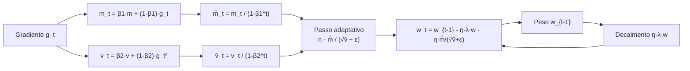

# Como o AdamW faz o modelo aprender

## Intuição: um GPS que se adapta a cada rua

Imagine que você está dirigindo por uma cidade desconhecida seguindo as instruções de um GPS. Em uma rua plana e reta, você pisa no acelerador. Em uma descida íngreme, você tira o pé. Em uma subida, você reduz a marcha. Se o GPS apenas dissesse "siga em frente" sem olhar para o terreno, você acabaria rápido demais em uma ladeira ou lento demais em uma reta.

O **AdamW** é esse GPS para os pesos de uma rede neural. Ele não aplica o mesmo passo para todo mundo. Ele olha, parâmetro por parâmetro, para o histórico do gradiente e decide o tamanho do passo. Parâmetros cujo gradiente muda muito de sinal recebem passos suaves; parâmetros cujo gradiente é sempre pequeno recebem passos maiores para não ficarem estagnados.


> "O otimizador é o motorista do gradiente descendente: o gradiente diz a direção, e o otimizador decide o tamanho e a cadência dos passos."

## Conceito: do gradiente descendente puro ao AdamW

### O passo básico (SGD)

O documento sobre gradientes mostrou a regra fundamental do gradiente descendente. Com a perda $L$ e o vetor de parâmetros $w$, o passo clássico é:

$$
w \leftarrow w - \eta \cdot \nabla L(w)
$$

Aqui $\eta$ é a taxa de aprendizado (learning rate) e $\nabla L(w)$ é o gradiente. O problema dessa regra é que ela usa **um único $\eta$ fixo para todos os parâmetros**. Se um parâmetro tem gradiente gigante e outro tem gradiente minúsculo, o primeiro salta demais e o segundo quase não anda.

### A ideia do momentum

Para suavizar a caminhada, adicionamos **momento** (momentum): em vez de seguir apenas o gradiente de agora, seguimos uma média que "lembra" dos gradientes passados. É como uma bola rolando morro abaixo: ela acumula velocidade na direção em que vinha caindo.

$$
m_t = \beta_1 \cdot m_{t-1} + (1 - \beta_1) \cdot g_t
$$

Onde $g_t = \nabla L(w_{t-1})$ é o gradiente no passo $t$, e $\beta_1 \in [0,1)$ controla a memória. Com $\beta_1 = 0{,}9$, cerca de 90% da "velocidade" vem do passado e 10% do gradiente novo.

### A segunda média: a magnitude

Só o momento não resolve tudo. Imagine dois parâmetros: um tem gradientes sempre em torno de $100$, outro em torno de $0{,}001$. O primeiro andaria enormemente; o segundo ficaria parado. O Adam resolve isso mantendo uma segunda média, agora dos **quadrados** dos gradientes:

$$
v_t = \beta_2 \cdot v_{t-1} + (1 - \beta_2) \cdot g_t^2
$$

Dividindo o momento pela raiz dessa média, cada parâmetro ganha um passo com escala própria. O quociente:

$$
\frac{m_t}{\sqrt{v_t}}
$$

fica aproximadamente entre $-1$ e $+1$ quando $m_t$ e $v_t$ convergem para estimativas consistentes do mesmo gradiente. É essa normalização que faz o Adam ser tão robusto.

### Correção de viés

No início do treino, $m_0 = 0$ e $v_0 = 0$. Nos primeiros passos, essas médias ainda estão "viciadas" em zero, porque começaram em zero. Para corrigir, o Adam divide por um fator que compensa o aquecimento:

$$
\hat{m}_t = \frac{m_t}{1 - \beta_1^t}, \qquad \hat{v}_t = \frac{v_t}{1 - \beta_2^t}
$$

No passo $t = 1$, $1 - \beta_1^1 = 1 - \beta_1$, que é pequeno, então $\hat{m}_1$ fica maior, compensando o fato de $m_1$ só ter recebido uma fração do gradiente.

### O que o "W" faz de diferente

O Adam clássico misturava a regularização de decaimento de pesos (weight decay) com a adaptação. O **AdamW** separa as duas coisas: o decaimento de pesos vira uma subtração direta e independente do gradiente:

$$
w_t = w_{t-1} - \eta \cdot \lambda \cdot w_{t-1} - \eta \cdot \frac{\hat{m}_t}{\sqrt{\hat{v}_t} + \varepsilon}
$$

O termo $\eta \cdot \lambda \cdot w_{t-1}$ é o decaimento de pesos **desacoplado** (aqui $\lambda$ é o `weight_decay`), e o termo seguinte é o passo adaptativo. Separar os dois melhora a generalização e evita que a regularização interfira na escala do passo adaptativo.

## A fórmula completa do AdamW

Juntando tudo, o algoritmo do AdamW para um único parâmetro $w$ é:

1. Calcular o gradiente: $g_t = \nabla L(w_{t-1})$.

2. Atualizar a média do primeiro momento:

$$
m_t = \beta_1 \cdot m_{t-1} + (1 - \beta_1) \cdot g_t
$$

3. Atualizar a média do segundo momento:

$$
v_t = \beta_2 \cdot v_{t-1} + (1 - \beta_2) \cdot g_t^2
$$

4. Corrigir o viés:

$$
\hat{m}_t = \frac{m_t}{1 - \beta_1^t}, \qquad \hat{v}_t = \frac{v_t}{1 - \beta_2^t}
$$

5. Aplicar decaimento de pesos desacoplado e o passo adaptativo:

$$
w_t = w_{t-1} - \eta \cdot \lambda \cdot w_{t-1} - \eta \cdot \frac{\hat{m}_t}{\sqrt{\hat{v}_t} + \varepsilon}
$$

O $\varepsilon$ (eps) é uma constante minúscula que impede divisão por zero — crítica em `bfloat16`, como veremos adiante.



## Exemplo numérico completo de uma trajetória

Vamos acompanhar um único peso $w$ cuja perda é uma parábola simples:

$$
L(w) = \frac{1}{2} w^2, \qquad \frac{dL}{dw} = w
$$

Começamos em $w_0 = 2{,}0$, com $\eta = 0{,}1$, $\beta_1 = 0{,}9$, $\beta_2 = 0{,}99$, $\varepsilon = 10^{-8}$ e $\lambda = 0$ (sem decaimento, para focar na adaptação).

### Passo 1

- Gradiente: $g_1 = w_0 = 2{,}0$.
- Primeiro momento: $m_1 = 0{,}9 \cdot 0 + 0{,}1 \cdot 2{,}0 = 0{,}2$.
- Segundo momento: $v_1 = 0{,}99 \cdot 0 + 0{,}01 \cdot 2{,}0^2 = 0{,}04$.
- Correção: $\hat{m}_1 = 0{,}2 / (1 - 0{,}9) = 2{,}0$; $\hat{v}_1 = 0{,}04 / (1 - 0{,}99) = 4{,}0$.
- Passo: $\Delta w = \eta \cdot \hat{m}_1 / (\sqrt{\hat{v}_1} + \varepsilon) = 0{,}1 \cdot 2{,}0 / 2{,}0 = 0{,}1$.
- Novo peso: $w_1 = 2{,}0 - 0{,}1 = 1{,}9$.

### Passo 2

- Gradiente: $g_2 = w_1 = 1{,}9$.
- $m_2 = 0{,}9 \cdot 0{,}2 + 0{,}1 \cdot 1{,}9 = 0{,}18 + 0{,}19 = 0{,}37$.
- $v_2 = 0{,}99 \cdot 0{,}04 + 0{,}01 \cdot 1{,}9^2 = 0{,}0396 + 0{,}0361 = 0{,}0757$.
- Correção: $\hat{m}_2 = 0{,}37 / (1 - 0{,}81) = 1{,}947$; $\hat{v}_2 = 0{,}0757 / (1 - 0{,}9801) = 3{,}804$.
- Passo: $\Delta w = 0{,}1 \cdot 1{,}947 / \sqrt{3{,}804} = 0{,}1 \cdot 1{,}947 / 1{,}950 \approx 0{,}0999$.
- Novo peso: $w_2 = 1{,}9 - 0{,}0999 \approx 1{,}800$.

### Passo 3

- Gradiente: $g_3 = w_2 = 1{,}800$.
- $m_3 = 0{,}9 \cdot 0{,}37 + 0{,}1 \cdot 1{,}800 = 0{,}513$.
- $v_3 = 0{,}99 \cdot 0{,}0757 + 0{,}01 \cdot 1{,}800^2 = 0{,}1074$.
- Correção: $\hat{m}_3 = 0{,}513 / (1 - 0{,}729) = 1{,}893$; $\hat{v}_3 = 0{,}1074 / (1 - 0{,}9703) = 3{,}617$.
- Passo: $\Delta w = 0{,}1 \cdot 1{,}893 / 1{,}902 \approx 0{,}0995$.
- Novo peso: $w_3 = 1{,}800 - 0{,}0995 = 1{,}701$.

### A trajetória completa

| Passo $t$ | $w_{t-1}$ | $g_t = w_{t-1}$ | $\hat{m}_t$ | $\hat{v}_t$ | $\Delta w$ | $w_t$ |
|-----------|-----------|-----------------|-------------|-------------|------------|-------|
| 1         | 2,000     | 2,000           | 2,000       | 4,000       | 0,1000     | 1,900 |
| 2         | 1,900     | 1,900           | 1,947       | 3,804       | 0,0999     | 1,800 |
| 3         | 1,800     | 1,800           | 1,893       | 3,617       | 0,0995     | 1,701 |
| 4         | 1,701     | 1,701           | 1,851       | 3,441       | 0,0990     | 1,602 |
| 5         | 1,602     | 1,602           | 1,816       | 3,283       | 0,0984     | 1,503 |

Repare na propriedade mais importante do Adam: **o passo é quase constante** (em torno de $0{,}1$), mesmo com o gradiente caindo de $2{,}0$ para $1{,}6$. Isso acontece porque o quociente $\hat{m}_t / \sqrt{\hat{v}_t}$ fica sempre próximo de $1$: quando o gradiente é proporcional ao próprio peso (como nesta parábola), o numerador e o denominador escalam juntos e se cancelam.

Compare com o SGD puro, que teria passo $\eta \cdot g_t = 0{,}1 \cdot w_{t-1}$, cada vez menor. O Adam "normaliza" o passo, mantendo uma descida constante e previsível.

## Por que o AdamW converge

### 1. Passo por parâmetro, não por camada


$$
w_t = w_{t-1} - \eta \cdot \frac{\hat{m}_t}{\sqrt{\hat{v}_t} + \varepsilon}
$$

onde a divisão é feita **elemento a elemento** (componente a componente).

### 2. O quociente é limitado

Para um gradiente aproximadamente constante, $\hat{m}_t \approx g$ e $\sqrt{\hat{v}_t} \approx |g|$, então:

$$
\frac{\hat{m}_t}{\sqrt{\hat{v}_t}} \approx \frac{g}{|g|} = \text{sign}(g) \in \{-1, +1\}
$$

Ou seja, cada parâmetro anda no máximo $\eta$ por passo, **independentemente da magnitude do seu gradiente**. Isso dá uma interpretação elegante: o Adam é quase um "gradiente descendente por sinais com passo $\eta$", mas com uma suavização que impede oscilação brusca. É essa propriedade que o torna estável mesmo quando os gradientes variam muito em escala (coisa comum em redes profundas).

### 3. O decaimento de pesos desacoplado controla a magnitude


### 4. A memória suaviza o ruído


## Estabilidade em bfloat16


- Ele usa **8 bits de expoente** (os mesmos do `float32`), então a **faixa dinâmica** é a mesma: números de aproximadamente $10^{-38}$ a $3 \times 10^{38}$.
- Ele usa apenas **7 a 8 bits de mantissa**, então a **precisão** é baixa: números próximos se confundem.

Na prática, o `bfloat16` não estoura (não vira infinito) tão facilmente quanto o `float16`, mas perde precisão em somas pequenas. Isso afeta o AdamW de duas formas:


2. **A precisão do estado depende da implementação.** Estados como `exp_avg` e `exp_avg_sq` podem usar a precisão dos parâmetros ou uma precisão maior, conforme o otimizador, as opções e a biblioteca. Consulte a implementação usada: isso afeta tanto a estabilidade quanto o consumo de memória.

| Tipo       | Expoente | Mantissa | Faixa            | Precisão relativa |
|------------|----------|----------|------------------|-------------------|
| float32    | 8 bits   | 23 bits  | ~$10^{-38}$ a $10^{38}$ | ~$10^{-7}$ |
| bfloat16   | 8 bits   | 7 bits   | ~$10^{-38}$ a $10^{38}$ | ~$10^{-2}$ |
| float16    | 5 bits   | 10 bits  | ~$10^{-5}$ a $10^{4}$   | ~$10^{-3}$ |

O `bfloat16` combina a faixa segura do `float32` com a metade da memória. É por isso que ele é o padrão em pré-treinamento de modelos grandes.

## Sinais de divergência

Quando o treino começa a dar errado, os sintomas aparecem nas métricas. Conhecê-los ajuda a agir antes de perder o treino:

1. **Norma do gradiente crescendo.** Uma tendência sustentada de alta pode indicar instabilidade. Compare-a com a taxa de aprendizado, a perda e as características dos lotes; valores absolutos não têm um limite universal.

2. **Norma dos pesos crescendo.** A métrica "Weight Norm" (magnitude média L2 dos pesos) subindo sem parar indica que os passos adaptativos estão maiores que o decaimento de pesos consegue conter.

3. **Loss vira `NaN` ou `inf`.** Isso pode ocorrer por overflow, divisão inválida ou outras operações numéricas instáveis. Verifique a precisão, os dados, as divisões e os gradientes.

4. **Perplexidade disparando.** Como a perplexidade é $e^{\text{loss}}$, uma perda que cresce vira uma perplexidade astronômica (o código clampa em `loss <= 20` justamente para evitar overflow nesse cálculo).

5. **O segundo momento $v_t$ explode.** Se $v_t$ cresce demais, o passo $\eta / \sqrt{v_t}$ colapsa para zero e o treino "trava" (o modelo para de aprender). Isso é mais raro que a explosão de $m_t$, mas acontece.

Uma analogia: divergência é um carro que perde o freio na descida. Primeiro a velocidade (gradiente) aumenta, depois os giros do motor (pesos) sobem, e por fim o motor quebra (loss `NaN`). O clipping de gradiente (documento sobre gradient clipping) é o freio de emergência.

## Código: AdamW na prática

### Uma implementação didática do AdamW

Para enxergar o algoritmo por dentro, uma reimplementação manual:

```python
import math

def adamw_manual(params, grads, state, t, lr=0.1, betas=(0.9, 0.99),
                 eps=1e-8, weight_decay=0.01):
    beta1, beta2 = betas
    for i, (p, g) in enumerate(zip(params, grads)):
        if i not in state:
            state[i] = {"m": 0.0, "v": 0.0}
        s = state[i]

        # 1. Médias móveis (momentos)
        s["m"] = beta1 * s["m"] + (1 - beta1) * g
        s["v"] = beta2 * s["v"] + (1 - beta2) * (g ** 2)

        # 2. Correção de viés
        m_hat = s["m"] / (1 - beta1 ** t)
        v_hat = s["v"] / (1 - beta2 ** t)

        # 3. Decaimento de pesos desacoplado
        params[i] = p - lr * weight_decay * p

        # 4. Passo adaptativo
        params[i] -= lr * m_hat / (math.sqrt(v_hat) + eps)
    return params
```

### Simulando a trajetória com esse código

```python
w = [2.0]                       # um único parâmetro
state = {}
for t in range(1, 6):
    g = w[0]                    # gradiente de L = 0.5 * w^2 é w
    adamw_manual(w, [g], state, t, lr=0.1, weight_decay=0.0)
    print(f"passo {t}: w = {w[0]:.4f}")
```

Saída esperada:

```text
passo 1: w = 1.9000
passo 2: w = 1.8002
passo 3: w = 1.7005
passo 4: w = 1.6015
passo 5: w = 1.5031
```

Esses valores batem com a tabela da seção anterior (com pequenas diferenças de arredondamento).

## Pseudocódigo do ciclo completo

```text
entrada: pesos w, taxa eta, betas (b1, b2), eps, decaimento lambda
inicializar: m = 0, v = 0, t = 0
repetir até convergir:
    t = t + 1
    g = gradiente_da_perda(w)        # backward
    m = b1 * m + (1 - b1) * g        # primeiro momento
    v = b2 * v + (1 - b2) * g^2      # segundo momento
    m_hat = m / (1 - b1^t)           # correção de viés
    v_hat = v / (1 - b2^t)
    w = w - eta * lambda * w         # decaimento desacoplado
    w = w - eta * m_hat / (raiz(v_hat) + eps)
    devolver w
```

## Erros comuns

- **Confundir Adam com AdamW.** O Adam clássico mistura o decaimento de pesos com a adaptação; o AdamW desacopla. Para redes grandes, o AdamW generaliza melhor.
- **Ignorar a correção de viés.** Sem dividir por $1 - \beta^t$, os primeiros passos ficam pequenos demais, pois $m_0 = v_0 = 0$. O aquecimento do scheduler (documento sobre learning rate) existe justamente para cobrir essa fase.
- **Achar que o passo é $\eta$ literalmente.** O passo é $\eta$ vezes um quociente que vale no máximo cerca de $1$ (e frequentemente menos). O $\eta$ é um teto, não o passo real.
- **Não zerar os gradientes.** Em PyTorch, `backward()` acumula. O `optimizer.zero_grad()` (ou `zero_grad(set_to_none=True)`) é obrigatório a cada passo, senão $g_t$ vira a soma de vários gradientes e o AdamW enlouquece.
- **Confundir momento do otimizador com momentum de rede.** O momento $m_t$ do AdamW é um acumulador do gradiente; não tem relação com o "momentum" de outras arquiteturas.
- **Observar só a perda.** Uma perda caindo pode esconder pesos explodindo (que o decaimento ainda segura). Acompanhe também a norma do gradiente e a norma dos pesos.

## Resumo

- O AdamW é um gradiente descendente **com memória e passo adaptativo por parâmetro**: mantém $m_t$ (média do gradiente) e $v_t$ (média do gradiente ao quadrado), corrige o viés e normaliza o passo com $\hat{m}_t / (\sqrt{\hat{v}_t} + \varepsilon)$.
- O passo adaptativo fica aproximadamente entre $-1$ e $+1$, então cada peso anda no máximo $\eta$ por passo, **independentemente da escala do seu gradiente** — por isso converge de forma previsível.
- O decaimento de pesos é **desacoplado** ($\eta \lambda w$) e puxa os pesos para zero continuamente, controlando a magnitude.
- Em `bfloat16`, o `eps=1e-6` e os acumuladores em `float32` garantem estabilidade, aproveitando a faixa dinâmica ampla do formato.
- Sinais de divergência: norma do gradiente subindo, norma dos pesos crescendo, loss `NaN`/`inf` e perplexidade disparando.
