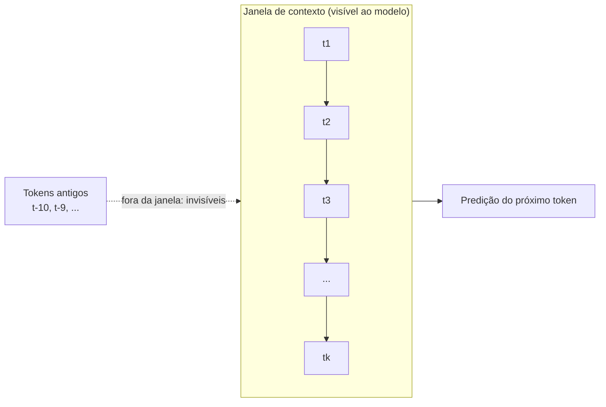

# Como o modelo "guarda" informação

> "O modelo não tem memória. Ele tem pesos, que guardam conhecimento destilado de bilhões de exemplos, e ativações, que guardam o contexto desta conversa específica — e que evaporam no instante em que a resposta termina."

Existe uma intuição muito sedutora, e muito errada, que quase todo mundo tem ao usar um modelo de linguagem: a de que ele é uma espécie de **arquivo**, um disco rígido que armazena fatos e, quando você pergunta, "busca" a resposta. Essa imagem é falsa em pelo menos três níveis.

Primeiro, o modelo não armazena fatos como frases prontas. Segundo, ele não "lembra" da sua conversa anterior do jeito que um ser humano lembra — na verdade, fora da janela de contexto, ele **não lembra de nada**. Terceiro, aquilo que chamamos de "memória" é, na verdade, dois mecanismos completamente distintos que convivem no mesmo artefato: o **conhecimento** (gravado nos pesos durante o treino) e o **contexto** (transportado pelas ativações durante a geração).


## 1. O mito da memória e de onde ele vem

Quando você conversa com um chatbot e ele responde de forma coerente, citando detalhes que você disse três mensagens atrás, a conclusão natural é: "ele guardou isso em algum lugar". E de fato guardou — mas **não** da forma que a metáfora sugere.

A metáfora do "arquivo" falha porque pressupõe que existe uma região de memória onde cada informação fica em sua própria "gaveta", endereçável e recuperável. Um modelo de linguagem não tem gavetas. Ele tem, na verdade, uma única estrutura gigante:

$$
\text{resposta} = f_\theta(x_1, x_2, \dots, x_t)
$$

Onde $\theta$ são os **parâmetros** (os pesos) e $x_1, \dots, x_t$ são os **tokens** de entrada. Tudo o que o modelo "sabe" e tudo o que ele "percebe" da sua conversa precisam caber nesses dois insumos. Não existe um terceiro lugar.

### As duas memórias em uma frase

| Tipo | Onde vive | O que guarda | Quanto dura |
|------|-----------|--------------|-------------|
| **Conhecimento** | Nos pesos $\theta$ | Padrões gerais da linguagem e do mundo, destilados do treino | Persistente (até o próximo treino) |
| **Contexto** | Nas ativações (estados internos) | O conteúdo específico desta conversa | Só enquanto os tokens estão na janela |

> A frase que resume tudo: **os pesos são a memória de longo prazo; as ativações são a memória de curto prazo.**

## 2. O que são os pesos (a memória de longo prazo)


$$
w = \alpha \cdot \tilde{w}, \qquad \tilde{w} \in \{-1, 0, +1\}
$$

O que importa aqui não é o formato do peso, mas o **fato** de que ele é um número aprendido que não muda durante uma conversa. Quando você fala com um modelo, os pesos ficam congelados: nenhuma palavra sua altera $\theta$. Isso é exatamente o oposto de uma memória humana, que se modifica a cada interação.

### Por que o conhecimento "cabe" em números

Imagine que você quer ensinar o modelo a distinguir "rei" de "rainha". O modelo não grava as palavras. Ele grava **vetores** — listas de números que posicionam cada palavra num espaço de centenas de dimensões. A palavra "rei" vira algo como:

$$
e_{\text{rei}} = [0.12, -0.45, 0.88, \dots, 0.03] \in \mathbb{R}^{512}
$$

E o conhecimento semântico (que "rei" está para "homem" assim como "rainha" está para "mulher") não é uma frase guardada, mas uma **relação geométrica** entre vetores:

$$
e_{\text{rei}} - e_{\text{homem}} + e_{\text{mulher}} \approx e_{\text{rainha}}
$$

O "conhecimento" de que um rei é a contraparte masculina da rainha é, portanto, uma propriedade emergente das distâncias entre vetores no espaço de embeddings. Não há gaveta com o rótulo "realeza". Há apenas números, e as relações entre eles.


Repare na seta tracejada: os pesos $\theta$ alimentam **todas** as camadas, mas não são alterados pela conversa. O conhecimento está neles, mas ele é **estático** durante a inferência.

## 3. O que são as ativações (a memória de curto prazo)

Se os pesos não mudam, então como o modelo "sabe" o que você acabou de dizer? A resposta é: pelas **ativações**, os números intermediários que fluem pela rede enquanto ela processa sua frase.

Quando você escreve "A capital da França é", o modelo:

1. Converte cada token em um embedding.
2. Empurra esses embeddings através das camadas.
3. Em cada camada, produz **ativações** — vetores que representam "o que esta posição significa no contexto das demais".
4. Usa a ativação da última posição para prever o próximo token ("Paris").

Essas ativações são a memória de curto prazo. Elas carregam a informação **específica** da sua frase: quem é o sujeito, qual é o tempo verbal, o que foi dito na posição anterior. Mas — e este é o ponto crucial — elas só existem **durante o cálculo**. Quando a resposta termina, as ativações são descartadas.

```python
import torch

# Ativações: números que existem apenas durante o forward pass
def forward_ilustrativo(embeddings, pesos):
    ativacoes = []                 # a "memória de curto prazo"
    x = embeddings
    for camada in pesos:
        x = camada @ x             # mistura informação entre posições
        ativacoes.append(x)        # guarda (temporariamente) o estado
    return x, ativacoes            # só o último estado é usado para prever
```

A lista `ativacoes` no código acima é a analogia exata: ela guarda o "contexto" enquanto a computação acontece, mas ninguém a persiste depois que a função retorna.

## 4. Exemplo numérico: vendo o contexto se formar

Vamos acompanhar um exemplo minúsculo para fixar a diferença entre conhecimento e contexto. Considere uma frase de três tokens e um vocabulário de cinco palavras.

### 4.1 O conhecimento é estático

Suponha que o modelo já tenha aprendido (no treino) uma tabela de embeddings. Ela é fixa — é parte dos pesos:

| Token | Embedding (2 dims, só para ilustrar) |
|-------|--------------------------------------|
| "o"   | $[1.0, 0.0]$ |
| "gato"| $[0.0, 1.0]$ |
| "dorme"| $[0.5, 0.5]$ |
| "cachorro" | $[0.1, 1.1]$ |
| "mia" | $[0.6, 0.4]$ |

Essa tabela **não muda** durante a conversa. É conhecimento congelado.

### 4.2 O contexto se forma nas ativações

Agora o modelo processa a frase "o gato". Cada camada mistura os embeddings dos tokens vizinhos. Se a camada faz uma simples soma de vizinhos (uma média móvel, que é um primo distante do que a retenção do RetNet faz), a ativação da posição 2 vira:

$$
a_2 = e_{\text{o}} + e_{\text{gato}} = [1.0, 0.0] + [0.0, 1.0] = [1.0, 1.0]
$$

Essa ativação $a_2 = [1.0, 1.0]$ agora **carrega o contexto** da frase: ela "sabe" que a posição 2 vem depois de "o". É diferente do embedding puro de "gato" ($[0.0, 1.0]$), porque foi contaminada pela palavra anterior.

Se em vez de "o gato" a frase fosse "o cachorro", a ativação seria:

$$
a_2 = [1.0, 0.0] + [0.1, 1.1] = [1.1, 1.1]
$$

Repare como $[1.0, 1.0]$ e $[1.1, 1.1]$ são próximos, mas distintos. A diferença é exatamente o contexto: o modelo consegue distinguir "gato" de "cachorro" **não porque lembrou**, mas porque a ativação resultante codifica a diferença. E, crucialmente, quando a resposta termina, essas ativações são jogadas fora.

## 5. Por que o modelo "esquece" fora da janela

Agora vem a pergunta que dá título a este documento: por que o modelo não lembra do que você disse há 50 mensagens?

### 5.1 A janela de contexto é um limite físico


```python
context_length = 2048  # limite ilustrativo; depende do modelo
logits = model(current_ids[:, -context_length:])
```

Nesse exemplo, o código passa apenas os últimos `context_length` tokens. Tokens cortados não estão diretamente disponíveis nessa chamada. Outros modelos e runtimes podem manter cache, estado recorrente ou resumir o contexto; o comportamento depende da arquitetura e da estratégia de geração.

### 5.2 Por que não dá para "guardar tudo"

A razão de fundo inclui custo computacional e limites da interface do modelo. Na atenção densa padrão, o cálculo de atenção sobre $T$ posições cresce quadraticamente:

$$
\text{custo da atenção} \propto T^2
$$

Onde $T$ é o número de tokens processados nessa operação. Dobrar a janela pode quadruplicar esse termo de atenção, embora outras arquiteturas e implementações tenham custos diferentes. Uma janela limitada não implica que todo modelo descarte o passado da mesma maneira: alguns usam estados ou caches para carregar informação anterior.



### 5.3 O que o RetNet muda aqui


$$
S_t = \gamma S_{t-1} + k_t v_t^\top
$$

Onde $S_t$ é o estado no passo $t$, $\gamma$ é uma taxa de decaimento (o *decay*) e $k_t, v_t$ são os vetores de chave e valor da posição atual. Essa equação é linda porque o custo é **linear** em $T$: para processar o token $t$, você só precisa do estado anterior $S_{t-1}$.

A consequência é que um modelo de retenção consegue manter um estado fixo (e, portanto, memória constante) enquanto processa sequências longas. **Mas atenção:** isso não elimina o esquecimento. O termo $\gamma < 1$ faz o estado antigo decair exponencialmente — informação muito antiga é "esquecida" de forma gradual, não abrupta como no corte da janela. É uma memória com **esquecimento suave**, não uma memória fotográfica.

$$
S_t = \gamma^t S_0 + \sum_{i=1}^{t} \gamma^{t-i} k_i v_i^\top
$$

O fator $\gamma^{t-i}$ é o peso que a posição $i$ tem quando você está na posição $t$. Quanto mais antiga a informação (maior $t-i$), menor o fator — pois $\gamma < 1$ implica $\gamma^{t-i} \to 0$ conforme $t-i$ cresce.

## 6. A diferença entre "esquecer" e "não saber"

Um ponto que confunde muita gente: existe uma diferença entre o modelo **não ter acesso** a uma informação e **não ter conhecimento** dela.

- **Não ter acesso** é um problema de contexto: a informação estava na conversa, mas saiu da janela. O modelo *poderia* responder se ainda a tivesse, mas a perdeu. É esquecimento de curto prazo.
- **Não ter conhecimento** é um problema de pesos: a informação nunca foi bem aprendida no treino, ou foi aprendida errada. Não adianta mantê-la na janela — o modelo não a tem nos pesos.

Isso explica fenômenos que parecem contraditórios. Por que o modelo responde bem uma pergunta de geografia que nunca esteve na sua conversa? Porque esse conhecimento está **nos pesos**. Por que ele erra o nome do seu cachorro que você mencionou há 40 mensagens? Porque esse nome estava **no contexto** — e o contexto evaporou.

## 7. Limitações: o que o modelo definitivamente não guarda


1. **Nada além da janela de contexto.** Qualquer detalhe anterior ao corte é perdido. Não há "arquivo morto" para recuperar.
2. **Nada entre sessões.** Quando o processo termina, as ativações se vão. A única coisa persistente são os pesos no disco (o checkpoint). O modelo não "aprende" com a sua conversa.
3. **Memória exata de texto.** O modelo não guarda strings; ele guarda distribuições de probabilidade. Ele pode *recitar* trechos que memorizou por repetição no treino, mas não "copia" sua frase para uma área de rascunho.
4. **Fatos novos.** Tudo o que o modelo sabe veio do treino. Se o mundo mudou depois, o modelo não sabe — a menos que seja retreinado ou receba a informação nova **no contexto** (é exatamente para isso que existem prompts com instruções e exemplos).

### Por que o contexto é a única "entrada de novos fatos"

Como os pesos estão congelados, a única forma de fazer o modelo "saber" algo novo agora é **colocar esse algo nos tokens de entrada**. É por isso que escrevemos "Você é um assistente que..." no prompt, ou fornecemos exemplos antes da pergunta. Estamos, literalmente, injetando conhecimento novo pela única porta aberta: o contexto.

```text
PESOS (congelados):  conhecimento geral aprendido no treino
      ↓
CONTEXTO (a janela): a única porta de entrada para informação nova
      ↓
ATIVAÇÕES (efêmeras): misturam pesos + contexto para produzir a resposta
```

# STE: para a frente, valor quantizado; para trás, gradiente contínuo
weight_ste = (weight_quantized - weight_scaled).detach() + weight_scaled

output = F.linear(x, weight_ste) * scale
state = torch.einsum("bhsd,bhse,hs->bhde", k, v, final_decay.to(k.dtype))
state.mul_(self.gammas.view(1, -1, 1, 1).to(state.dtype))
