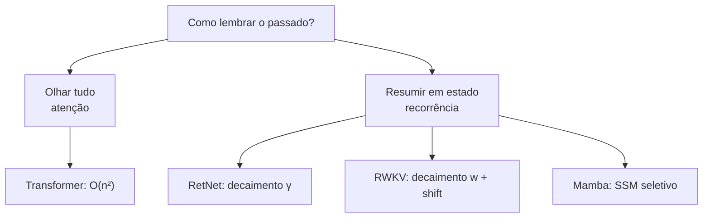
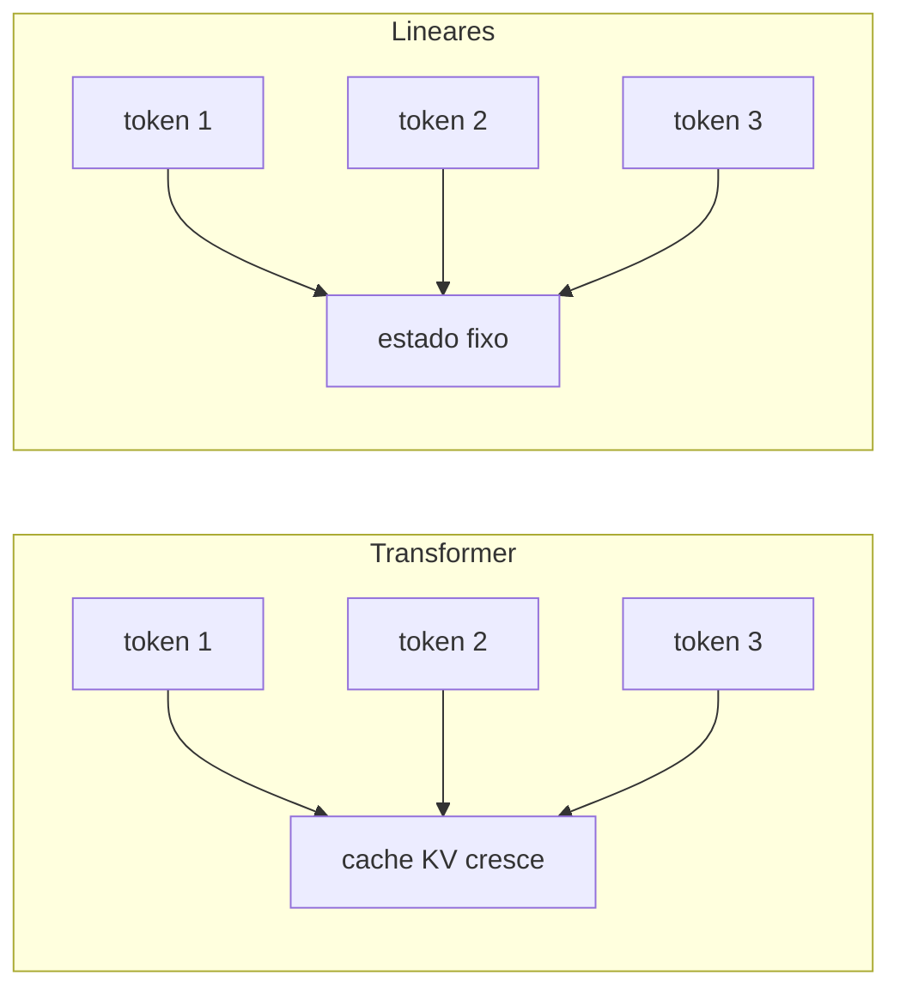
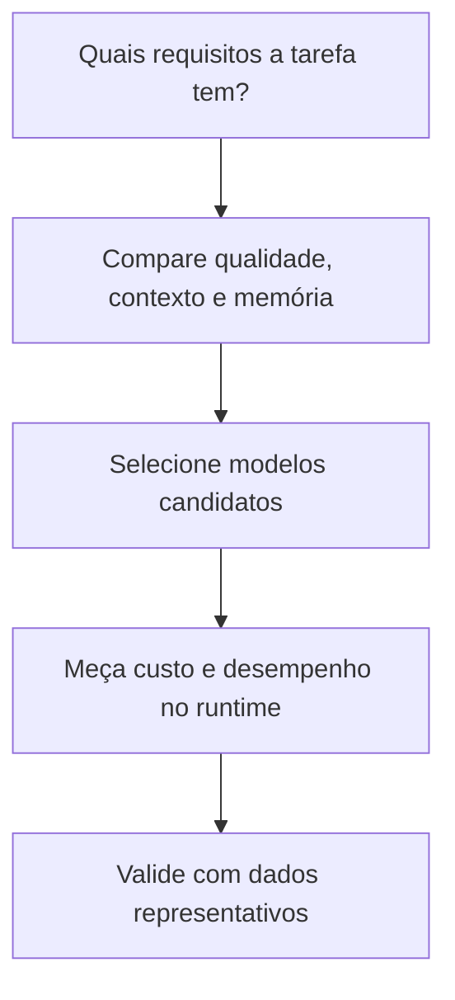

# Transformer vs RetNet vs RWKV vs Mamba

---

## 1. Intuição: a pergunta central

Toda arquitetura de sequência responde à mesma pergunta:

> *"Dado um token atual, como eu combino a informação de todos os tokens anteriores para prever o próximo?"*

As respostas diferem em **como** o passado é acessado e **quanto** isso custa. Há uma linha divisória fundamental:

- **Atenção global** compara pares de tokens; o custo dessa operação cresce como $n^2$.
- **Recorrência, SSM e retenção** processam a sequência com custo linear em $n$ quando as dimensões internas são mantidas fixas; em troca, resumem o passado em um estado.

---

## 2. Transformer: atenção total

O Transformer calcula, para cada token, uma média ponderada de **todos** os valores anteriores, com pesos vindos do produto das consultas pelas chaves:

$$
\text{Attention}(Q, K, V) = \text{softmax}\!\left( \frac{Q K^T}{\sqrt{d_k}} \right) V
$$

Cada elemento da matriz $Q K^T$ é uma comparação par a par entre dois tokens. O resultado é uma matriz $n \times n$ de pesos, e o custo de tempo e memória cresce quadraticamente:

$$
\text{custo}_{\text{tempo}} \sim n^2 d, \qquad \text{custo}_{\text{memória}} \sim n^2
$$

Na **geração** (inferência), o Transformer guarda o **cache KV** — as chaves e valores de todos os tokens já gerados —, que também cresce linearmente com $n$ e pode dominar a memória em contextos longos.

**Pontos fortes:** qualidade de referência, recuperação exata de tokens distantes, ecossistema maduro.
**Pontos fracos:** custo quadrático no treino, cache KV crescente na inferência.

---

## 3. RetNet: retenção com decaimento

O RetNet substitui o softmax por um **decaimento exponencial** $\gamma$ (entre 0 e 1):

$$
\text{Retention}(Q, K, V) = \sum_{m \le n} \gamma^{n-m}\, Q_n K_m^T V_m
$$

O estado recorrente:

$$
s_n = \gamma\, s_{n-1} + K_n^T V_n
$$

A grande vantagem é a **tripla forma de computação** com a mesma rede: paralela (treino), recorrente (inferência com estado fixo) e chunkwise (blocos).

**Pontos fortes:** custo linear, memória constante na geração, treino paralelizável, qualidade comparável ao Transformer em muitos cenários.
**Pontos fracos:** recuperação exata de longo alcance pode ser inferior à atenção total.

---

## 4. RWKV: linear com token shift

O RWKV calcula o operador WKV — uma média ponderada com decaimento e porta de receptância:

$$
\text{wkv}_t = \frac{\sum_{i=1}^{t-1} e^{-(t-1-i)w + k_i} v_i + e^{u+k_t} v_t}{\sum_{i=1}^{t-1} e^{-(t-1-i)w + k_i} + e^{u+k_t}}
$$

Com o **token shift** para informação local:

$$
x_{\text{shift}} = \mu \odot x_t + (1 - \mu) \odot x_{t-1}
$$

**Pontos fortes:** linear, memória constante, treino paralelizável, maduro para geração local.
**Pontos fracos:** como as outras lineares, recuperação exata menor que a atenção.

---

## 5. Mamba: SSM seletivo

O Mamba usa um SSM com **seleção de estado** — os parâmetros dependem da entrada:

$$
h_t = \bar{A}_t\, h_{t-1} + \bar{B}_t\, x_t, \qquad y_t = C_t\, h_t
$$

**Pontos fortes:** linear, seleção por conteúdo (aproxima a atenção), forte em contexto muito longo.
**Pontos fracos:** seleção exige scan (mais complexidade), ecossistema mais novo.

---

## 6. Análise de custo: quadrático vs linear

### 6.1 Custo de treino

Para uma sequência de comprimento $n$ e dimensão $d$:

| Arquitetura | Mistura de informação entre tokens | Crescimento com $n$ (dimensões fixas) |
|---|---|---|
| Transformer | atenção: $O(n^2 d)$; projeções: tipicamente $O(n d^2)$ | quadrático na atenção |
| RetNet | retenção paralela ou recorrente; custo depende das dimensões por cabeça | linear na sequência |
| RWKV | recorrência com custo por token e projeções da rede | linear na sequência |
| Mamba | scan seletivo, frequentemente descrito como $O(n d N)$, além das projeções | linear na sequência |

As projeções também consomem cálculo e aparecem em diferentes formas nas arquiteturas. As ordens acima descrevem como o custo cresce com o comprimento da sequência, não o tempo total nem uma comparação direta de velocidade. Implementações, dimensões por cabeça, kernels e hardware mudam o resultado prático.

### 6.2 Exemplo numérico

Considere $n = 10\,000$ tokens e $d = 64$. O número de comparações par a par na atenção é:

$$
n^2 = 10\,000^2 = 10^{8} = 100\,000\,000
$$

Multiplicado pela dimensão $d = 64$:

$$
n^2 d = 10^{8} \cdot 64 = 6.4 \times 10^{9}
$$

Como referência de escala, considere o custo de projeções densas, que costuma incluir um termo proporcional a:

$$
n d^2 = 10\,000 \cdot 64^2 = 10\,000 \cdot 4\,096 = 4.096 \times 10^{7}
$$

A razão entre esses dois termos ilustrativos:

$$
\frac{n^2 d}{n d^2} = \frac{n}{d} = \frac{10\,000}{64} \approx 156
$$

Essa razão compara apenas os dois termos algébricos escolhidos: não significa que um Transformer completo levará 156 vezes mais tempo que outro modelo. Projeções, kernels, paralelismo, memória e hardware também entram no custo real. Ela ilustra como o termo quadrático cresce mais depressa: ao dobrar $n$, a razão dobra; com $n = 100\,000$, chega a aproximadamente 1 563.

---

## 7. Memória durante a inferência

A memória durante a geração é, muitas vezes, o fator decisivo para rodar em hardware modesto.

| Arquitetura | O que guarda na geração | Crescimento com $n$ |
|---|---|---|
| Transformer | cache KV completo | $O(n d)$ |
| RetNet | estado $s$ fixo | $O(d^2)$ (constante) |
| RWKV | estado $(a, b)$ fixo | $O(d)$ (constante) |
| Mamba | estado $h$ fixo | $O(N d)$ (constante) |

---

## 8. Qualidade

Qualidade e eficiência costumam trocar de lugar. Em linhas gerais:

- **Transformer**: atenção global permite comparar diretamente posições do contexto, mas a qualidade depende de dados, escala, treinamento e implementação.
- **RetNet / RWKV / Mamba**: usam mecanismos de sequência diferentes e podem ter perfis distintos de memória e recuperação; não há uma classificação de qualidade que valha para todos os modelos e tarefas.

> A necessidade de recuperar detalhes distantes deve ser testada com a tarefa, o comprimento de contexto e o modelo concretos. Complexidade assintótica, sozinha, não determina qualidade.

---

## 9. Tabela comparativa completa

| Critério | Transformer | RetNet | RWKV | Mamba |
|---|---|---|---|---|
| Mecanismo | atenção softmax | retenção com $\gamma$ | WKV + token shift | SSM seletivo (S6) |
| Custo de mistura na sequência | atenção: $O(n^2d)$ | linear em $n$ para dimensões fixas | linear em $n$ para dimensões fixas | scan seletivo: frequentemente $O(ndN)$ |
| Outros custos de camada | projeções, MLP e demais operações | projeções e operações por cabeça | projeções e operações recorrentes | projeções e operações do estado |
| Decode por token | depende do contexto e do cache KV | depende do estado e dimensões por cabeça | depende do estado e dimensões internas | depende do estado e dimensões internas |
| Memória geração | cache KV cresce | estado fixo | estado fixo | estado fixo |
| Paralelo (treino) | sim | sim | sim | sim (scan) |
| Recorrente (inferência) | não | sim | sim | sim |
| Seleção por conteúdo | sim (QK) | parcial | parcial | sim (B,C,Δ) |
| Recuperação exata longa | excelente | boa | boa | boa |
| Simplicidade de quantização | média | alta | alta | média-baixa |
| Ecossistema | maduro | pequeno | médio | crescente |
| Complexidade de implementação | baixa | baixa | média | alta |

---

## 10. Quando usar cada uma

- **Transformer**: quando atenção global, ecossistema e ferramentas disponíveis atendem à tarefa e o orçamento comporta o custo e a memória do contexto.

- **RetNet**: quando o mecanismo de retenção e o perfil de estado são adequados à carga; valide a qualidade e o custo na implementação pretendida.

- **RWKV**: quando o comportamento recorrente e as ferramentas disponíveis correspondem às necessidades da tarefa.

- **Mamba**: quando seu mecanismo de estado seletivo atende ao problema e há suporte eficiente para as operações e kernels necessários.

---

## 11. BitNet e RetNet são escolhas independentes

BitNet e RetNet descrevem aspectos diferentes de um modelo:

- **BitNet** trata da representação e quantização dos pesos, por exemplo usando valores ternários em certas camadas.
- **RetNet** descreve um mecanismo para processar sequências por retenção.

Por isso, não são alternativas mutuamente exclusivas. Em princípio, é possível usar quantização BitNet com atenção Transformer, usar RetNet com pesos convencionais, combinar BitNet e RetNet, ou usar Transformer com pesos convencionais. A compatibilidade e os benefícios de cada combinação dependem da arquitetura concreta, do método de treinamento, do formato dos pesos e do runtime.

| Processamento da sequência | Pesos convencionais | Pesos quantizados com BitNet |
|---|---|---|
| Atenção Transformer | Transformer convencional | Transformer com quantização BitNet |
| Retenção RetNet | RetNet convencional | RetNet com quantização BitNet |

Quantização não altera, por si só, o mecanismo usado para combinar informações entre tokens. Da mesma forma, escolher RetNet não obriga a usar pesos ternários.

---

## 12. Erros comuns

1. **Comparar custo sem considerar a dimensão**: para $n$ pequeno, o Transformer pode ser mais barato que o overhead de uma arquitetura linear. A vantagem linear só se manifesta para $n$ grande (a razão é $n/d$).
2. **Achar que "linear" significa "melhor sempre"**: arquiteturas lineares comprimem o passado; para recuperação exata, atenção total continua superior.
3. **Confundir memória de treino com memória de inferência**: o Transformer sofre mais na **inferência** (cache KV crescente) do que as lineares.
4. **Ignorar o estado como gargalo**: o estado fixo das lineares tem capacidade limitada; ele é o ponto de estrangulamento de informação.
5. **Subestimar o custo de implementação**: o Mamba, por exemplo, exige scan eficiente; a troca não é apenas teórica, aparece no código e no hardware.

---

## 13. Resumo

- **Transformer**: atenção total, custo quadrático na mistura de tokens, qualidade de referência, cache KV crescente.
- **RetNet**: retenção com decaimento $\gamma$ e formas de computação paralela e recorrente.
- **RWKV**: WKV + token shift e atualização recorrente do estado.
- **Mamba**: SSM seletivo, com scan e parâmetros condicionados à entrada.
- **BitNet**: abordagem de quantização dos pesos que pode ser considerada separadamente da arquitetura de sequência.
- A escolha depende do contexto, da recuperação necessária, da memória, da qualidade, da implementação e do hardware; as ordens assintóticas não garantem velocidade ou qualidade específicas.

---
