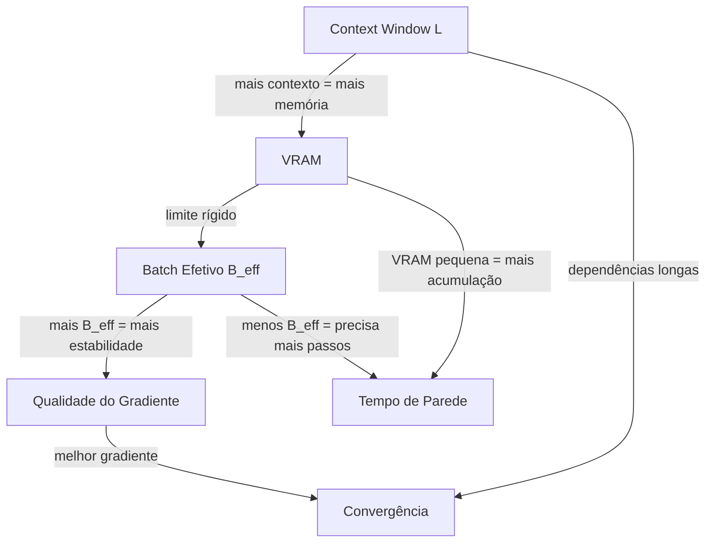

# Context window, batch size e grad accumulation

> "Você não escolhe o modelo que quer treinar. Você escolhe o modelo que a sua memória de GPU consegue treinar."

Este documento trata dos **três controles de custo/qualidade** que governam quase todas as decisões de pré-treino de um LLM: o **tamanho da janela de contexto** ($L$), o **batch size** ($b$) e a **acumulação de gradiente** ($n$). Eles parecem três botões independentes, mas na prática formam um único sistema acoplado, porque todos convergem para a mesma pergunta física: *quantos tokens cabem em trânsito na GPU ao mesmo tempo?*

---

## 1. Intuição: o que está em jogo antes de qualquer número

Imagine uma fábrica que processa texto. Em cada "passada", a fábrica lê uma pilha de documentos (o batch), cada documento tem um comprimento (a janela de contexto), e a fábrica só fecha a contabilidade depois de acumular várias passadas (a acumulação de gradiente). As três alavancas decidem:

1. **Quanto você gasta** — memória de VRAM e tempo de parede.
2. **Quanto você aprende por atualização** — a qualidade e a estabilidade do gradiente.
3. **O que o modelo consegue "ver" de uma vez** — a profundidade de dependência temporal que ele modela.

O erro mais comum de quem começa é tratar batch size e context window como "quanto maior, melhor" e a acumulação de gradiente como "uma gambiarra para quando não cabe". Na verdade, as três são parte de uma mesma equação de custo, e entendê-las juntas é o que separa um treino que converge de um treino que derrete.

---

## 2. Conceito: os três controles, um a um

### 2.1 Context window ($L$)

A **janela de contexto** é o número máximo de tokens que o modelo processa em uma única sequência. Para uma rede RetNet, isso tem uma implicação arquitetural importante: a atenção linear do RetNet usa um **estado recorrente** que condensa o histórico em um vetor de tamanho fixo, o que permite dois modos de computação:

- **Modo recorrente (inferência):** custo $O(1)$ por token, memória constante.
- **Modo paralelo (treino):** custo $O(L)$ por token, com paralelização em hardware.

A janela de contexto define o teto da memória de treino de uma forma muito concreta. As matrizes de ativação e os estados intermediários crescem proporcionalmente a $L$, e é por isso que dobrar o contexto **não** dobra a memória — em redes com custo quadrático ela quadruplica, e em RetNet ela cresce de forma mais contida, mas ainda linear no caso do treino paralelo.

$$ \text{Tokens ativos em memória} \approx b \cdot L $$

Isso é só a primeira camada da história; a memória total envolve ativações, gradientes e estados de otimizador, mas a intuição se mantém: **tokens simultâneos = batch × comprimento**.

### 2.2 Batch size ($b$)

O **batch size** é quantas sequências independentes entram na GPU de uma só vez. Ele controla duas coisas opostas:

- **Estabilidade do gradiente:** um batch maior produz um gradiente com menos variância, porque a média amostral se aproxima do gradiente verdadeiro. A variância do gradiente escala como $\sigma^2 / b$, onde $\sigma^2$ é a variância de um gradiente por amostra.
- **Custo de memória:** cada amostra extra aloca mais ativações, então $b$ entra linearmente no pico de VRAM.

A lei fundamental aqui é o **teorema central do limite em ação**: o gradiente estimado sobre um batch é

$$ g_b = \frac{1}{b} \sum_{i=1}^{b} \nabla_{\theta} \mathcal{L}(x_i), \qquad \text{Var}[g_b] \approx \frac{\sigma^2}{b}. $$

Quanto maior $b$, mais "liso" é o passo do otimizador, e portanto maior a taxa de aprendizado que você pode suportar sem divergir — este é o coração da **regra de escala de learning rate com batch size** ($\eta \propto \sqrt{b}$ na aproximação de ruído dominante).

### 2.3 Acumulação de gradiente ($n$)

A **acumulação de gradiente** resolve o seguinte dilema: você quer o efeito estatístico de um batch grande, mas só tem VRAM para um batch pequeno. A solução é fatiar o tempo:

1. Processe um micro-batch $b_{micro}$.
2. Compute o gradiente, **mas não atualize os pesos**.
3. Some o gradiente em um acumulador.
4. Repita $n$ vezes.
5. Divida por $n$ (ou normalize o learning rate) e atualize.

O **batch efetivo** é o que o otimizador "enxerga" de uma vez:

$$ B_{eff} = b_{micro} \times n $$

> Ao usar micro-batches menores, a acumulação troca **memória por tempo**: o pico associado às ativações fica ligado a cada micro-batch, enquanto o custo de parede inclui as $n$ passadas. A acumulação não reduz o pico se o tamanho do micro-batch não mudar, nem remove da memória os pesos e os estados do treino.

Há uma sutileza importante: a acumulação **não é sempre equivalente** a um batch grande processado de uma vez. Camadas com normalização dependente do batch, operações aleatórias, perdas com interações entre exemplos e o tratamento de lotes incompletos podem produzir diferenças. A equivalência também depende de como a perda é normalizada.

---

## 3. A equação de custo que amarra tudo

O número que governa a memória é o total de **tokens em trânsito** por passo de otimização:

$$ T_{step} = B_{eff} \cdot L = b_{micro} \cdot n \cdot L $$

Durante a execução, é útil registrar medidas que se relacionam com essa conta:

- `tokens_consumed`: total acumulado desde o início do treino.
- `tokens_per_sec` e `batches_per_sec`: a taxa com que $T$ cresce.

A relação entre eles é direta:

$$ \text{tokens/s} = \text{batches/s} \times b_{micro} \times L $$

Isso significa que, **mantendo $B_{eff}$ fixo**, você pode reconfigurar o treino ao longo de um eixo custo-memória × tempo:

| Configuração | VRAM pico | Tempo por passo | Efeito estatístico |
|---|---|---|---|
| $b=512, n=1$ | Alta | Rápido | Batch real de 512 |
| $b=128, n=4$ | Média | Médio | Equivalente (~512) |
| $b=32, n=16$ | Baixa | Lento | Equivalente (~512) |
| $b=512, n=4$ | Alta | Lento | Batch efetivo 2048 |

O quadro deixa claro o princípio: **$B_{eff}$ define a qualidade da estimativa; a combinação $b_{micro} \times n$ define a conta de memória e tempo que você paga por ela.**

---

## 4. Código: acumulação de gradiente na prática

```python
import torch
import torch.nn as nn
from torch.optim import AdamW

model = nn.Sequential(
    nn.Linear(512, 1024),
    nn.ReLU(),
    nn.Linear(1024, 512),
).cuda()

optimizer = AdamW(model.parameters(), lr=1e-3, weight_decay=0.1)

b_micro = 32          # micro-batch que cabe na GPU
n_accum  = 8          # passos de acumulação
B_eff    = b_micro * n_accum  # 256

model.train()
optimizer.zero_grad()

for step, (x, y) in enumerate(dataloader):
    # forward + loss no micro-batch atual
    x, y = x.cuda(), y.cuda()
    loss = nn.functional.cross_entropy(model(x), y)

    # normaliza para que a soma corresponda a um batch de B_eff
    loss = loss / n_accum
    loss.backward()

    # só atualiza a cada n_accum micro-batches
    if (step + 1) % n_accum == 0:
        optimizer.step()
        optimizer.zero_grad()
```

Pseudocódigo equivalente, para quem quer o fluxo em alto nível:

```text
acumulador = 0
para cada micro_batch na fila:
    loss = forward(micro_batch)          # gasta VRAM de 1 micro-batch
    grad  = backward(loss)               # propaga
    acumulador = acumulador + grad       # acumula sem atualizar
    se (contador mod n == 0):
        pesos = pesos - lr * (acumulador / n)
        acumulador = 0                   # zera e recomeça
```

---

## 6. Trade-offs: o triângulo que não fecha

Toda decisão de pré-treino é uma negociação entre três vértices:



A leitura do diagrama é: você não pode maximizar $L$, $B_{eff}$ e minimizar o tempo ao mesmo tempo. Algo cede. O que deve ceder depende do seu objetivo:

- **Objetivo: capturar dependências longas** (código, agentes, raciocínio) → priorize $L$.
- **Objetivo: estabilidade e passo de otimizador limpo** → priorize $B_{eff}$.
- **Objetivo: caber em uma GPU específica** → mantenha $b_{micro}$ pequeno e aumente $n$.

---

## 7. Exemplos numéricos progressivos


### Exemplo 1 — Baseline confortável

- $L = 2048$, $b_{micro} = 64$, $n = 1$
- $B_{eff} = 64$, tokens por passo $= 64 \times 2048 = 131{,}072$
- VRAM: folga, mas gradiente ruidoso.

### Exemplo 2 — Aumentando o batch efetivo via acumulação

- $L = 2048$, $b_{micro} = 64$, $n = 8$
- $B_{eff} = 512$, tokens por passo $= 512 \times 2048 = 1{,}048{,}576$
- VRAM: a mesma do Exemplo 1. Tempo: 8× por atualização.
- Efeito: gradiente muito mais estável, LR pode subir.

### Exemplo 3 — Priorizando contexto

- $L = 8192$, $b_{micro} = 16$, $n = 1$
- $B_{eff} = 16$, tokens por passo $= 16 \times 8192 = 131{,}072$
- Mesmo total de tokens do Exemplo 1, mas com 4× mais contexto por sequência.
- Efeito: o modelo vê dependências longas; paga com gradiente mais ruidoso.

### Exemplo 4 — O desastre silencioso

- $L = 8192$, $b_{micro} = 64$, $n = 8$
- tokens por passo $= 64 \times 8 \times 8192 = 4{,}194{,}304$
- VRAM: **não cabe**. O treino estoura com `CUDA out of memory`.

A lição do Exemplo 4: você não pode ter tudo. **Multiplique antes de configurar.**

---

## 8. Erros comuns

1. **Confundir batch size com batch efetivo.** Achar que $b_{micro}=64$ significa "estou treinando com batch 64" quando na verdade $n=8$ faz o otimizador ver 512. O número que importa para a física do treino é $B_{eff}$.

2. **Esquecer de normalizar a loss na acumulação.** Se você soma os gradientes sem dividir por $n$, o passo do otimizador fica $n$ vezes maior do que o pretendido — uma forma clássica de divergência.

3. **Achar que acumulação é sempre gratuita.** Ela reduz memória mas **não reduz trabalho total**. O custo computacional é proporcional a $B_{eff}$, não a $b_{micro}$.

4. **Ignorar que o contexto multiplica o batch.** Dobrar $L$ dobra os tokens por passo mesmo mantendo $b$ fixo. Muitas pessoas aumentam o contexto e se surpreendem com OOM.


6. **Não registrar o que foi configurado.** Sem anotar $L$, $b_{micro}$, $n$ e $B_{eff}$, valores de throughput, perda e norma do gradiente ficam difíceis de interpretar depois.

---

## 9. Resumo

- **Comprimento de contexto** define quantos tokens entram em cada sequência e afeta o custo e a memória, conforme a arquitetura.
- **Batch size** define a variância do gradiente ($\propto 1/b$) e o custo de memória.
- **Acumulação de gradiente** troca memória por tempo, e o que importa é o **batch efetivo** $B_{eff} = b_{micro} \times n$.
- Os três convergem para a conta de **tokens em trânsito** $T_{step} = B_{eff} \cdot L$.
- Regra de bolso final: **multiplique antes de configurar** e **normalize a loss na acumulação**.
