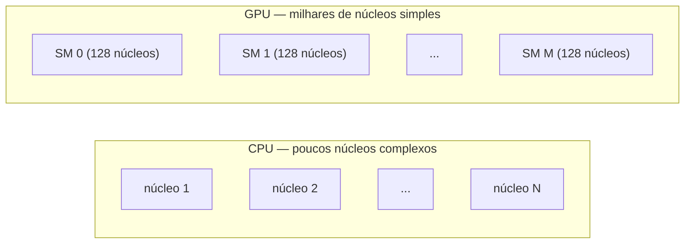
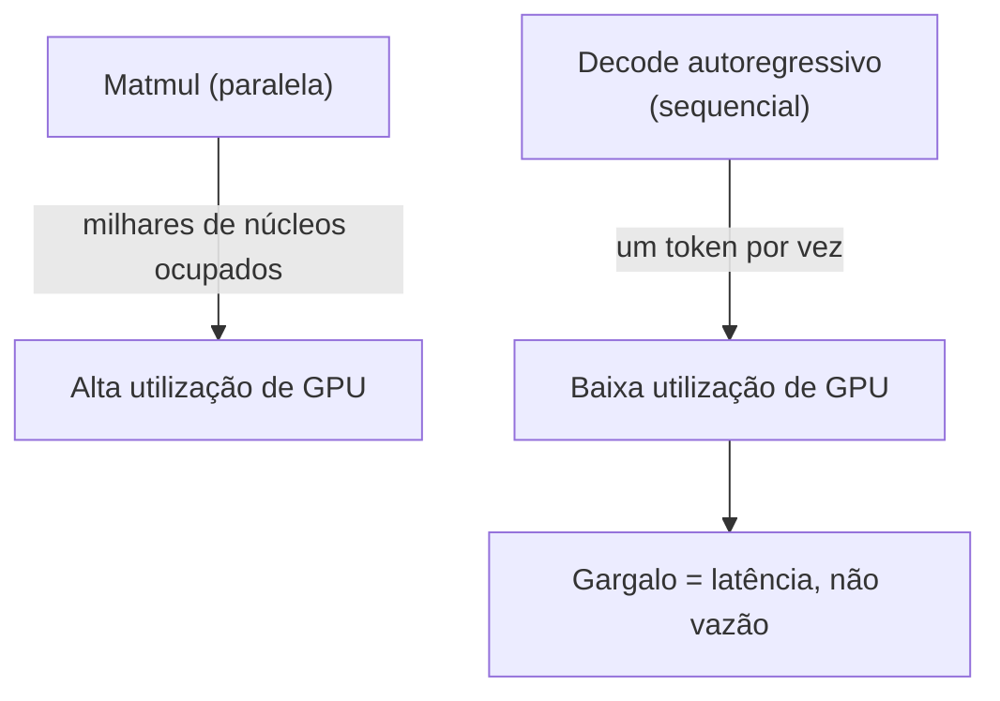

# CUDA e GPUs (visão geral)

## 1. O que é CUDA

O **CUDA** (*Compute Unified Device Architecture*) é a plataforma de computação paralela e o modelo de programação da NVIDIA. Ele permite que programas escritos em C/C++ (ou chamados a partir de Python via PyTorch) executem código nos milhares de núcleos de uma GPU. Sem o CUDA, uma GPU seria apenas um dispositivo de renderização gráfica; com ele, ela se torna uma máquina de computação massivamente paralela, capaz de treinar modelos de linguagem.

> **Intuição em uma frase:** o CUDA é a linguagem que diz à GPU "execute esta mesma conta em milhões de pedaços ao mesmo tempo" — e é exatamente isso que uma multiplicação de matrizes precisa.


## 2. CPU versus GPU: dois desenhos opostos

### 2.1 Latência versus vazão

A CPU é desenhada para **latência**: poucos núcleos (de 4 a 64), cada um muito complexo, com cache profundo, previsão de desvio e execução fora de ordem. Ela executa uma tarefa sequencial muito rápido.

A GPU é desenhada para **vazão** (*throughput*): milhares de núcleos simples, que executam a mesma instrução sobre muitos dados. Um único núcleo de GPU é mais lento que um núcleo de CPU, mas há tantos deles que o trabalho total termina muito antes.



### 2.2 A analogia

Imagine somar 10.000 números. Uma CPU faz isso com um laço sequencial: uma soma por vez, 10.000 passos. Uma GPU divide os 10.000 números em blocos, atribui cada bloco a um núcleo, e todos somam em paralelo. O que importa não é a velocidade de uma soma, mas **quantas somas acontecem simultaneamente**.

### 2.3 O modelo SIMT

A GPU executa threads em grupos de 32 chamados **warps**. Dentro de um warp, todas as 32 threads executam a *mesma instrução* ao mesmo tempo (modelo **SIMT**: *Single Instruction, Multiple Threads*), cada uma sobre seus próprios dados. Se as threads divergem (uma toma um `if` e outra um `else`), o warp serializa os dois caminhos — por isso código com muitos desvios é ruim em GPU.

## 3. A hierarquia de threads

### 3.1 Grid, blocos e threads

Um kernel CUDA é lançado como um **grid** de **blocos**, e cada bloco contém **threads**:

```text
Grid
├── Bloco 0
│   ├── Thread 0 ... Thread 255
├── Bloco 1
│   ├── Thread 0 ... Thread 255
└── ...
```

- **Thread**: a menor unidade de execução, uma "conta" individual.
- **Bloco**: um grupo de threads que compartilha memória *shared* e roda num mesmo **SM** (*Streaming Multiprocessor*).
- **Grid**: todos os blocos do kernel.

### 3.2 Como isso mapeia uma matmul

Numa multiplicação $C = A B$ com $A \in \mathbb{R}^{m \times k}$ e $B \in \mathbb{R}^{k \times n}$, cada elemento $C_{ij}$ é independente dos demais:

$$
C_{ij} = \sum_{r=1}^{k} A_{ir} B_{rj}
$$

Cada thread pode calcular um $C_{ij}$ (ou um tile deles) **sem depender de nenhuma outra thread**. Essa independência é a chave da paralelização: há $m \times n$ contas independentes esperando para serem distribuídas entre milhares de núcleos.

## 4. A hierarquia de memória e a VRAM

### 4.1 O gargalo é a largura de banda

A VRAM (memória de vídeo) é onde vivem os pesos, ativações e gradientes. Mas o verdadeiro gargalo não é o *tamanho* da VRAM — é a **largura de banda**: quantos bytes por segundo podem ser lidos/escritos. Uma GPU moderna move centenas de GB/s, mas as matmuls de um LLM exigem ainda mais. Por isso a hierarquia de memória é tão importante: quanto mais perto do núcleo, mais rápido o acesso.

| Nível | Tamanho típico | Latência | Papel |
|-------|----------------|----------|-------|
| Registradores | Kbytes por SM | ~0 ciclo | Variáveis locais de cada thread |
| Memória *shared* | 100–228 KB por SM | ~20 ciclos | Dados compartilhados dentro do bloco |
| Cache L1/L2 | MBs | dezenas de ciclos | Reuso de dados entre blocos |
| VRAM (HBM) | dezenas de GB | centenas de ciclos | Pesos, ativações, gradientes |
| RAM do host (CPU) | centenas de GB | µs (via PCIe) | Fonte dos dados |

### 4.2 Por que o reuso importa

Uma matmul reusa cada elemento de $A$ e $B$ múltiplas vezes. Se o kernel ler cada elemento da VRAM a cada uso, a largura de banda satura e os núcleos ficam ociosos esperando dados. O truque é **carregar um tile para a memória *shared* e reusá-lo** dezenas de vezes antes de voltar à VRAM. É por isso que o desenho de kernels é uma arte de *tiling* (ladrilhamento).


## 5. Tensor Cores: o segredo da velocidade

### 5.1 O que são

Os **Tensor Cores** são unidades de hardware especializadas numa única operação: a multiplicação de matrizes com acumulação (a "FMA matricial"). Enquanto um núcleo CUDA comum faz uma multiplicação escalar por vez, um Tensor Core faz uma multiplicação de **tiles** inteiros (ex.: $4 \times 4$ ou $16 \times 8$) num único ciclo.

$$
D_{ij} = A_{ik} \cdot B_{kj} + C_{ij} \quad \text{(feito em paralelo para um tile inteiro)}
$$

### 5.2 Precisões suportadas

Os Tensor Cores não operam em qualquer dtype. As precisões suportadas evoluíram com as gerações:

| Geração | Precisões dos Tensor Cores | Uso típico |
|---------|---------------------------|------------|
| Volta (2017) | fp16 | Primeiro suporte a treino em fp16 |
| Turing (2018) | fp16, int8, int4 | Inferência quantizada |
| Ampere (2020) | fp16, bf16, tf32, int8 | bf16 vira padrão de treino |
| Hopper (2022) | + fp8 | Treino/inferência em fp8 |


### 5.3 A conta de FLOPS

O custo de uma matmul $m \times k \times n$ é $2mnk$ operações de ponto flutuante (uma multiplicação + uma soma por elemento). Um Tensor Core faz isso a taxas de dezenas ou centenas de TFLOPS. A "receita" da velocidade de um LLM é simples: **mantenha os Tensor Cores ocupados fazendo matmuls em bf16, e mova os dados rápido o suficiente para alimentá-los**.

## 6. Por que matrizes paralelizam (e sequências não)

### 6.1 A independência dos dados

Uma matriz de pesos pode ser processada em paralelo porque cada produto escalar é independente. Já uma sequência de tokens num modelo **autoregressivo** é inerentemente **sequencial**: para gerar o token $t+1$, você precisa do estado produzido pelo token $t$. Essa é a tensão central de todo LLM.

O RetNet resolve parte disso com duas representações: a **paralela** (para o *prefill*, processando o prompt inteiro de uma vez) e a **recorrente** (para o *decode*, um token por vez com estado fixo). A GPU é excelente na primeira e limitada na segunda — e é por isso que o decode é o gargalo da inferência, não o prefill.

### 6.2 O caso ideal versus o caso difícil



## 7. CUDA no ecossistema do treino

### 7.1 PyTorch gera kernels automaticamente

Quando você escreve `a @ b` no PyTorch com tensores em `cuda`, ele chama kernels CUDA pré-compilados (via cuBLAS, cuDNN e operadores internos). Você não precisa escrever CUDA para treinar — mas entender o modelo de execução ajuda a prever desempenho e depurar erros como `out of memory`.

### 7.2 bitsandbytes fornece kernels de quantização

O bitsandbytes (abordado no documento dedicado) é, essencialmente, um conjunto de **kernels CUDA** para quantização em 8 e 4 bits. Sua dependência de CUDA é tão forte que ele nem compila em máquinas sem GPU NVIDIA.

## 8. Exemplo numérico progressivo

### 8.1 A matmul como contas independentes

Considere $A \in \mathbb{R}^{2 \times 3}$ e $B \in \mathbb{R}^{3 \times 2}$:

$$
A = \begin{bmatrix} 1 & 2 & 3 \\ 4 & 5 & 6 \end{bmatrix}, \qquad
B = \begin{bmatrix} 7 & 8 \\ 9 & 10 \\ 11 & 12 \end{bmatrix}
$$

O produto $C = AB$ tem $2 \times 2 = 4$ elementos, cada um um produto escalar:

$$
C_{11} = 1\cdot 7 + 2\cdot 9 + 3\cdot 11 = 58, \qquad C_{12} = 1\cdot 8 + 2\cdot 10 + 3\cdot 12 = 64
$$

$$
C_{21} = 4\cdot 7 + 5\cdot 9 + 6\cdot 11 = 139, \qquad C_{22} = 4\cdot 8 + 5\cdot 10 + 6\cdot 12 = 154
$$

As quatro contas são independentes: quatro threads poderiam calculá-las em paralelo. Numa matmul real de $1024 \times 1024$, são $1024 \times 1024 = 1.048.576$ contas independentes — trivialmente paralelizável.

### 8.2 A conta de operações

Para $m = n = k = 1024$:

$$
\text{FLOPs} = 2mnk = 2 \times 1024^3 = 2.147 \times 10^9
$$

A ~2,1 GFLOP por matmul. Um modelo com 24 camadas, cada uma com várias matmuls dessa ordem, e milhões de passos de treino, acumula exaFLOPS de computação — por isso a GPU e seus Tensor Cores são indispensáveis.

### 8.3 O peso ternário elimina a multiplicação

Com pesos ternários $\tilde{w} \in \{-1, 0, +1\}$, o produto escalar vira:

$$
C_{ij} = \sum_{r} x_r \cdot \tilde{w}_r = \sum_{\tilde{w}_r = +1} x_r - \sum_{\tilde{w}_r = -1} x_r
$$


## 9. Tabela-resumo

### 9.1 Conceitos de hardware

| Conceito | O que é | Relevância para LLMs |
|----------|---------|----------------------|
| CUDA | Plataforma de computação paralela NVIDIA | Executa todos os operadores do PyTorch |
| Núcleo CUDA | Unidade escalar de FP32 | Faz as operações "gerais" |
| SM | Multiprocessador com núcleos + memória shared | Onde os blocos rodam |
| Warp | Grupo de 32 threads em lockstep | Unidade de execução SIMT |
| VRAM (HBM) | Memória global de alta largura de banda | Guarda pesos, ativações, gradientes |
| Tensor Core | Unidade de matmul dedicada | Acelera matmuls em bf16/fp16/int8 |
| Kernel CUDA | Função executada na GPU | A "conta" que o PyTorch dispara |

## 11. Erros comuns e como evitá-los

| Erro | Sintoma | Correção |
|------|---------|----------|
| CUDA fora de memória | `CUDA out of memory` | Reduza lote/contexto, ou use gradiente acumulado |
| Esquecer `torch.cuda.is_available()` | Crash em máquina sem GPU | Sempre cheque antes de usar CUDA |
| Misturar tensores CPU/GPU | `Expected all tensors on same device` | Mova tudo com `.to(device)` |
| Subutilizar Tensor Cores | Treino lento sem explicação | Use bf16/fp16, evite dtype fp32 puro |
| `empty_cache()` a cada passo | Overhead desnecessário | Chame só após checkpoints ou em picos |
| Achar que mais núcleos = mais rápido sempre | Decode continua lento | Decode é limitado por latência, não vazão |
| Ignorar o estado do otimizador na VRAM | OOM surpresa | Meça `get_optimizer_vram_mb`; considere 8-bit |
| Kernel CUDA com desvios demais | Warp diverge e serializa | Evite `if/else` dependente de dados no kernel |

## 12. Resumo

1. CUDA é a plataforma NVIDIA que executa código paralelo nos milhares de núcleos da GPU.
2. CPU busca latência (poucos núcleos complexos); GPU busca vazão (muitos núcleos simples).
3. O modelo SIMT executa threads em warps de 32, todos com a mesma instrução.
4. A hierarquia é grid → blocos → threads, com memória shared por bloco.
5. A VRAM é o recurso crítico; o gargalo real é a largura de banda, não o tamanho.
6. Matmuls paralelizam porque cada elemento de saída é independente ($2mnk$ FLOPs).
8. O decode autoregressivo é sequencial e limitado por latência, não por vazão.
9. PyTorch gera kernels CUDA automaticamente; bitsandbytes fornece kernels de quantização.
