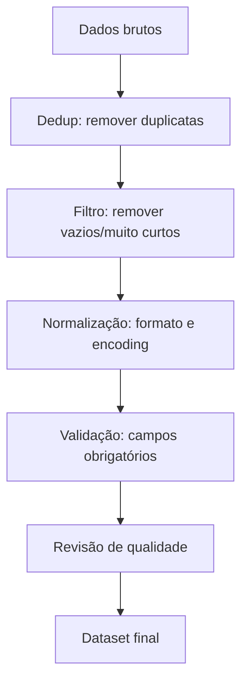

# Dataset de fine-tuning

## 1. A intuição: lixo entra, lixo sai

Um chef excepcional com ingredientes estragados não produz um bom prato. Um arquiteto brilhante com medidas erradas não constrói um prédio de pé. Da mesma forma, o **melhor modelo do mundo com um dataset ruim produz resultados ruins**.


### A intuição do "professor coerente"

Pense no SFT como um professor que ensina por exemplos. Se o professor é **coerente** (sempre resolve o mesmo tipo de problema da mesma forma), o aluno aprende rápido. Se o professor é **incoerente** (ora resolve de um jeito, ora de outro, ora erra, ora muda o formato), o aluno fica confuso e aprende um comportamento mediano e imprevisível.

Seu dataset deve ser esse professor coerente: exemplos claros, consistentes, corretos e no formato exato que você quer que o modelo reproduza.

## 2. O conceito formal

### 2.1 O que define um "bom" dataset

Formalmente, queremos que o dataset $D = \{(x^{(i)}, y^{(i)})\}_{i=1}^{N}$ seja uma **amostra representativa e de alta qualidade** da distribuição de tarefas que o modelo enfrentará na produção. Ao minimizar a perda SFT:

$$
\mathcal{L}_{\text{SFT}} = \frac{1}{N} \sum_{i=1}^{N} -\sum_{t} \log P(y^{(i)}_t \mid x^{(i)}, y^{(i)}_{<t})
$$

estamos ajustando o modelo para reproduzir as respostas $y^{(i)}$. Se os $y^{(i)}$ são ruins, o modelo aprende respostas ruins. Se a distribuição dos $x^{(i)}$ não representa a produção, o modelo terá baixo desempenho real.

### 2.2 As quatro dimensões da qualidade

Um dataset de fine-tuning pode ser avaliado em quatro dimensões:

1. **Correção** (os rótulos estão certos?).
2. **Consistência** (o formato é uniforme?).
3. **Cobertura** (cobre a variedade de casos reais?).
4. **Clareza** (as instruções são inequívocas?).

Cada uma dessas dimensões será detalhada nas seções seguintes.

### 2.3 Exemplo numérico: medindo a consistência

Suponha que você tenha $N = 1000$ exemplos, mas $300$ deles usam um formato de resposta e $700$ usam outro. Uma medida simples de desbalanceamento de formato é a entropia de Shannon da distribuição:

$$
H = -\sum_{c \in \text{formatos}} p_c \log_2 p_c
$$

Com dois formatos nas proporções $0.3$ e $0.7$:

$$
H = -0.3 \log_2(0.3) - 0.7 \log_2(0.7) \approx 0.521 + 0.360 = 0.881 \text{ bits}
$$

Se todos os exemplos usassem um único formato ($p = 1$), a entropia seria $0$ bits — máxima consistência. A meta é **reduzir essa entropia de formato** ao máximo, padronizando.

## 3. Formato dos dados

### 3.1 O formato JSONL

O formato mais comum é o **JSONL** (JSON Lines): cada linha é um objeto JSON independente, com uma entrada e uma saída. Isso permite processamento em streaming e leitura incremental.

```json
{"instrucao": "Classifique o sentimento do texto.", "entrada": "Adorei o filme!", "saida": "positivo"}
{"instrucao": "Classifique o sentimento do texto.", "entrada": "Odeio esperar na fila.", "saida": "negativo"}
{"instrucao": "Classifique o sentimento do texto.", "entrada": "O dia está nublado.", "saida": "neutro"}
```

### 3.2 Campos típicos

| Campo | Descrição | Obrigatório? |
|---|---|---|
| `instrucao` | O que o modelo deve fazer | Sim |
| `entrada` | Contexto/input adicional | Não |
| `saida` | A resposta esperada (gabarito) | Sim |

### 3.3 Formato de chat estruturado

Para SFT conversacional, o dataset é frequentemente armazenado já no formato de chat com papéis:

```json
{"mensagens": [
  {"papel": "system", "conteudo": "Você é um assistente prestativo."},
  {"papel": "user", "conteudo": "O que é BitNet?"},
  {"papel": "assistant", "conteudo": "BitNet é uma arquitetura que quantiza pesos para valores ternários."}
]}
```

### 3.4 Tabela comparativa de formatos

| Formato | Vantagem | Desvantagem |
|---|---|---|
| JSONL com `instrucao`/`saida` | Simples, universal | Menos flexível para multi-turno |
| JSONL com `mensagens` (papéis) | Suporta multi-turno e system prompt | Mais verboso |
| CSV | Fácil de editar em planilha | Ruim para textos com vírgulas/quebras |
| Parquet | Eficiente para volumes grandes | Menos legível por humanos |

## 4. Limpeza e preparação

A limpeza é onde a maioria dos datasets ganha ou perde qualidade. Vamos percorrer as etapas.

### 4.1 Pipeline de limpeza



### 4.2 Deduplicação

Exemplos duplicados enviesam o modelo e podem levar ao overfitting. Técnicas incluem:

- **Dedup exato**: remover strings idênticas.
- **Dedup aproximado**: usar hash de proximidade (MinHash) para detectar textos quase iguais.

### 4.3 Filtragem

Remover exemplos que não ajudam:

- Respostas vazias ou muito curtas (ex.: menos de 3 tokens).
- Textos com lixo (HTML, caracteres de controle).
- Exemplos fora do domínio desejado.

### 4.4 Normalização

- Padronizar **encoding** (UTF-8).
- Remover espaços extras e quebras de linha inconsistentes.
- Padronizar pontuação e caixa quando relevante.

### 4.5 Código de limpeza

```python
import json

def limpar_dataset(entrada_jsonl, saida_jsonl):
    vistos = set()
    contagem = {"total": 0, "duplicados": 0, "vazios": 0, "ok": 0}

    with open(entrada_jsonl, "r", encoding="utf-8") as fin, \
         open(saida_jsonl, "w", encoding="utf-8") as fout:

        for linha in fin:
            contagem["total"] += 1
            try:
                dado = json.loads(linha)
            except json.JSONDecodeError:
                continue  # linha malformada

            saida = dado.get("saida", "").strip()
            instrucao = dado.get("instrucao", "").strip()

            # 1. Filtra vazios/curtos
            if not saida or len(saida) < 3 or not instrucao:
                contagem["vazios"] += 1
                continue

            # 2. Deduplicação exata
            chave = (instrucao + "||" + saida).lower()
            if chave in vistos:
                contagem["duplicados"] += 1
                continue
            vistos.add(chave)

            # 3. Normaliza
            dado["instrucao"] = instrucao
            dado["saida"] = saida

            fout.write(json.dumps(dado, ensure_ascii=False) + "\n")
            contagem["ok"] += 1

    print(contagem)
    return contagem
```

### 4.6 Pseudocódigo

```text
ALGORITMO LimparDataset(dados):
    PARA cada exemplo em dados:
        SE exemplo malformado: DESCARTAR
        SE saida vazia ou muito curta: DESCARTAR
        SE duplicado: DESCARTAR
        SENAO:
            normalizar encoding e espaços
            validar campos obrigatórios
            MANTER
    RETORNAR dados_limpos
```

## 5. Quantidade de dados

### 5.1 Quanto é suficiente?

Não há um número mágico, mas há uma regra prática: **a qualidade importa mais que a quantidade**, e a quantidade necessária depende da complexidade da tarefa.

| Tipo de tarefa | Ordem de grandeza | Exemplo |
|---|---|---|
| Ajuste de formato/estilo | Centenas a poucos milhares | "Responda em Markdown" |
| Tarefa específica simples | Milhares a dezenas de milhares | Classificação, extração |
| Instrução geral (assistente) | Dezenas de milhares a centenas de milhares | Chat generalista |
| Conhecimento de domínio profundo | Centenas de milhares ou mais | Medicina, direito |

### 5.2 A lei dos retornos decrescentes

O ganho por exemplo adicional **diminui** conforme o dataset cresce. Se $N$ exemplos dão uma perda $\mathcal{L}(N)$, tipicamente:

$$
\mathcal{L}(N) \approx \mathcal{L}_{\infty} + c \cdot N^{-\alpha}
$$

para algum expoente $\alpha > 0$ e perda limite $\mathcal{L}_{\infty}$. Isso significa que os primeiros exemplos trazem o maior ganho, e cada exemplo a mais agrega cada vez menos. Portanto: **melhore a qualidade antes de aumentar a quantidade**.

### 5.3 Exemplo numérico

Suponha $\mathcal{L}_{\infty} = 0.5$, $c = 2.0$ e $\alpha = 0.5$. A perda estimada:

| $N$ | $c \cdot N^{-0.5}$ | $\mathcal{L}(N)$ | Ganho marginal |
|---|---|---|---|
| 100 | 0.200 | 0.700 | — |
| 400 | 0.100 | 0.600 | -0.100 |
| 1600 | 0.050 | 0.550 | -0.050 |
| 6400 | 0.025 | 0.525 | -0.025 |

Observe: quadruplicar os dados (de 1600 para 6400) só reduz a perda em $0.025$, enquanto os primeiros 400 exemplos reduziram $0.100$. **A curadoria de qualidade nos primeiros exemplos rende muito mais.**

## 6. Instruções claras

### 6.1 O princípio da instrução inequívoca

A instrução deve ser tão específica que **duas pessoas diferentes produziriam a mesma resposta**. Se a instrução for ambígua, o modelo aprenderá uma média das interpretações — o que é ruído.

| Instrução vaga | Instrução clara |
|---|---|
| "Resuma o texto." | "Resuma o texto em até 2 frases, em português, usando apenas o presente do indicativo." |
| "Responda sobre o assunto." | "Responda em um parágrafo de 3 a 5 frases, citando os números do texto quando existirem." |
| "Classifique." | "Classifique o sentimento em exatamente uma destas três classes: positivo, negativo ou neutro." |

### 6.2 Consistência de estilo

Decida **uma vez** e aplique em todos os exemplos:

- Formato de resposta (Markdown? JSON? texto puro?).
- Tom (formal ou informal).
- Comprimento (uma frase? um parágrafo?).
- Estrutura (bullets? numeração?).

### 6.3 Diversidade sem contradição

Você quer **diversidade** de conteúdo (muitos assuntos) mas **uniformidade** de formato. Diversidade ajuda a generalização; contradição de formato a atrapalha.

## 8. Erros comuns na preparação de dataset

### 8.1 Duplicatas não tratadas

Duplicatas inflam a contagem e causam overfitting nos exemplos repetidos. Solução: dedup exato + aproximado.

### 8.2 Formato inconsistente

Misturar JSON com texto livre e Markdown confunde o modelo. Solução: padronizar o formato de resposta em todo o dataset.

### 8.3 Instruções ambíguas

Instruções vagas geram respostas divergentes e um modelo que responde de forma imprevisível. Solução: escrever instruções específicas e testar com revisão humana.

### 8.4 Vazamento de dados de teste

Usar os mesmos exemplos no treino e na avaliação infla artificialmente as métricas. Solução: separar treino/validação/teste **antes** de qualquer processamento.

### 8.5 Desbalanceamento de classes

Para tarefas de classificação, classes desiguais enviesam o modelo para a classe majoritária. Solução: balancear ou usar amostragem estratificada.

### 8.6 Ignorar o tokenizador

Não validar se o texto tokeniza corretamente (ex.: caracteres especiais, números) gera exemplos corrompidos. Solução: rodar um *sanity check* de tokenização.

## 9. Resumo

1. **Garbage in, garbage out**: a qualidade do dataset é o teto da qualidade do modelo.
2. O dataset SFT é um conjunto de pares $(x, y)$ em **JSONL**, com campos de instrução/saída ou mensagens com papéis.
3. A **limpeza** envolve dedup, filtragem, normalização e validação.
4. A **quantidade** segue retornos decrescentes: melhore a qualidade antes de escalar o volume.
5. **Instruções claras** e formato consistente são o que tornam o modelo previsível.
7. Erros comuns: duplicatas, inconsistência, ambiguidade, vazamento de teste e desbalanceamento.

A essência: **um bom dataset é um professor coerente — claro, consistente e correto em cada exemplo.**
