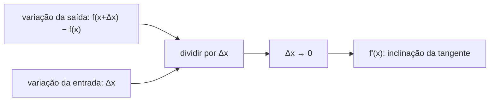
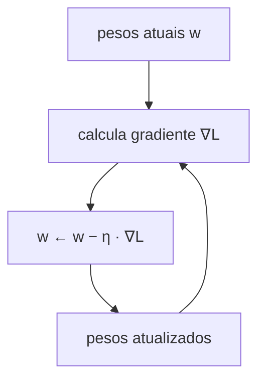
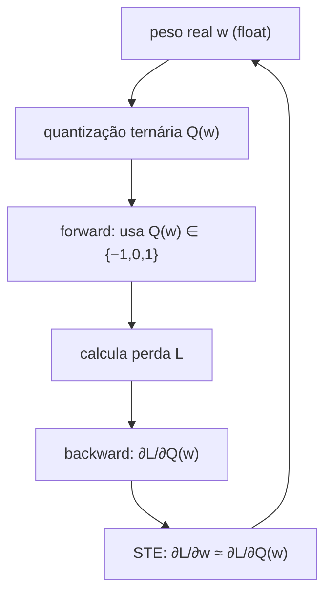

# Derivadas

Se a multiplicação de matrizes é o *motor* da rede neural, a derivada é o *leme*: ela diz, para cada peso, em qual direção e com que intensidade ajustá-lo para reduzir o erro. Sem derivadas não há treinamento — o modelo seria um conjunto de pesos aleatórios sem nunca melhorar.

Este documento constrói a ideia de derivada do zero, passa pelas regras essenciais, resolve exemplos numéricos passo a passo e termina conectando tudo ao gradiente e ao truque que o BitNet usa para treinar pesos ternários (o STE).

## 1. Intuição: taxa de variação

Pense em um carro em uma estrada. A posição varia com o tempo; a **velocidade** é o quanto a posição muda por unidade de tempo. Se você quer saber "quão rápido o carro está *neste instante*", você olha a velocidade instantânea — e isso é uma derivada.

Traduzindo para funções: a derivada de uma função $f$ mede **o quanto a saída muda quando a entrada muda um pouquinho**. É a "taxa de variação instantânea".

Em redes neurais, a pergunta equivalente é: "se eu aumentar este peso em uma quantia minúscula, quanto a perda (erro) muda?". A resposta é a derivada da perda em relação àquele peso.

## 2. Definição formal

A derivada de $f$ no ponto $x$ é o limite da taxa de variação média quando o intervalo $\Delta x$ tende a zero:

$$
f'(x) = \lim_{\Delta x \rightarrow 0} \frac{f(x + \Delta x) - f(x)}{\Delta x}
$$

Lendo a fórmula: pegue dois pontos bem próximos, divida a variação da saída pela variação da entrada, e aproxime cada vez mais. O resultado é a inclinação da reta tangente à curva naquele ponto.



## 3. O exemplo canônico: $f(x) = x^2$

Vamos calcular a derivada de $f(x) = x^2$ usando a definição. Não é decoreba — é a prova de onde vem a regra.

Substituindo na definição:

$$
f'(x) = \lim_{\Delta x \rightarrow 0} \frac{(x + \Delta x)^2 - x^2}{\Delta x}
$$

Expandindo o quadrado $(x + \Delta x)^2 = x^2 + 2x\,\Delta x + (\Delta x)^2$:

$$
f'(x) = \lim_{\Delta x \rightarrow 0} \frac{x^2 + 2x\,\Delta x + (\Delta x)^2 - x^2}{\Delta x}
$$

O $x^2$ cancela:

$$
f'(x) = \lim_{\Delta x \rightarrow 0} \frac{2x\,\Delta x + (\Delta x)^2}{\Delta x}
$$

Dividindo cada termo por $\Delta x$:

$$
f'(x) = \lim_{\Delta x \rightarrow 0} \left( 2x + \Delta x \right)
$$

Quando $\Delta x \rightarrow 0$, sobra:

$$
f'(x) = 2x
$$

É daqui que nasce a regra da potência: $x^2$ vira $2x$.

### Verificação numérica

No ponto $x = 3$, a derivada vale $2 \cdot 3 = 6$. Isso significa: se $x$ aumentar um pouquinho, $f(x)$ aumenta cerca de 6 vezes esse pouquinho.

Vamos conferir com números concretos. De $x = 3$ para $x = 3.1$ (ou seja, $\Delta x = 0.1$):

$$
f(3.1) = 3.1^2 = 9.61, \qquad f(3) = 3^2 = 9
$$

$$
\text{taxa média} = \frac{9.61 - 9}{0.1} = \frac{0.61}{0.1} = 6.1
$$

Aproximou de $6$. Diminuindo o passo para $\Delta x = 0.01$:

$$
f(3.01) = 3.01^2 = 9.0601, \qquad \text{taxa média} = \frac{9.0601 - 9}{0.01} = 6.01
$$

Mais próximo ainda de $6$. Quanto menor o passo, mais perto chegamos do valor exato $6$ — é exatamente o limite da definição.

## 4. Regras essenciais

A partir da definição, derivam-se regras que aceleram o cálculo. As cinco abaixo cobrem praticamente tudo que aparece em redes neurais.

| Regra | Função | Derivada |
|-------|--------|----------|
| Constante | $f(x) = c$ | $f'(x) = 0$ |
| Potência | $f(x) = x^n$ | $f'(x) = n x^{n-1}$ |
| Soma | $f(x) = g(x) + h(x)$ | $f'(x) = g'(x) + h'(x)$ |
| Produto | $f(x) = g(x) \cdot h(x)$ | $f'(x) = g' h + g h'$ |
| **Cadeia** | $f(x) = g(h(x))$ | $f'(x) = g'(h(x)) \cdot h'(x)$ |

### 4.1 Regra da constante

Se $f(x) = 7$, a função nunca muda, então a taxa de variação é zero:

$$
\frac{d}{dx} 7 = 0
$$

Isso reflete uma verdade de redes neurais: termos constantes (como um viés fixo) não contribuem para o gradiente.

### 4.2 Regra da potência (com expoentes variados)

Aplicando $n x^{n-1}$:

$$
\frac{d}{dx} x^3 = 3x^2, \qquad
\frac{d}{dx} x^1 = 1 \cdot x^0 = 1, \qquad
\frac{d}{dx} \sqrt{x} = \frac{d}{dx} x^{1/2} = \frac{1}{2} x^{-1/2}
$$

Note que a regra vale para expoentes fracionários e negativos, como $x^{-1/2}$.

### 4.3 Regra da soma

A derivada "atravessa" a soma:

$$
\frac{d}{dx} \left( x^2 + x^3 \right) = 2x + 3x^2
$$

### 4.4 Regra do produto

Para $f(x) = x^2 \cdot x^3$:

$$
f'(x) = (2x)(x^3) + (x^2)(3x^2) = 2x^4 + 3x^4 = 5x^4
$$

Que coincide com derivar $x^5$ diretamente ($5x^4$) — uma boa checagem de consistência.

## 5. A regra da cadeia (a mais importante)

A regra da cadeia é a mais importante para redes neurais. Se o erro passa por várias camadas, a influência de um peso lá no fundo é o **produto** das derivadas de cada passo.

Para $f(x) = g(h(x))$, a derivada é "a derivada de fora, avaliada em dentro, vezes a derivada de dentro":

$$
f'(x) = g'(h(x)) \cdot h'(x)
$$

### Exemplo resolvido: $h(x) = (3x + 1)^2$

Aqui a função "de fora" é $g(u) = u^2$ e a "de dentro" é $u = 3x + 1$.

- Derivada de fora: $g'(u) = 2u = 2(3x + 1)$.
- Derivada de dentro: $\frac{d}{dx}(3x + 1) = 3$.

$$
h'(x) = 2(3x + 1) \cdot 3 = 6(3x + 1) = 18x + 6
$$

"Derivada de fora, vezes derivada de dentro."

### Exemplo resolvido: $f(x) = (x^2 - 1)^3$

- De fora: $g(u) = u^3$, então $g'(u) = 3u^2 = 3(x^2 - 1)^2$.
- De dentro: $\frac{d}{dx}(x^2 - 1) = 2x$.

$$
f'(x) = 3(x^2 - 1)^2 \cdot 2x = 6x(x^2 - 1)^2
$$

### Por que isso importa no treinamento

Em uma rede, a perda $L$ depende da saída final, que depende da camada anterior, que depende da anterior... A cadeia de dependência é longa. A regra da cadeia permite propagar a influência de trás para frente, multiplicando derivadas locais — é o coração do **backpropagation**.

## 6. Derivadas parciais

Uma rede tem milhões de pesos. A derivada parcial $\frac{\partial L}{\partial w_i}$ mede o impacto de **um** peso $w_i$ na perda $L$, mantendo todos os outros fixos. A notação $\partial$ (em vez de $d$) indica "uma variável por vez".

### Exemplo numérico resolvido

Considere a função de duas variáveis $L(w, b) = w^2 + 3wb + b^2$.

Derivada parcial em relação a $w$ (tratando $b$ como constante):

$$
\frac{\partial L}{\partial w} = 2w + 3b
$$

Derivada parcial em relação a $b$ (tratando $w$ como constante):

$$
\frac{\partial L}{\partial b} = 3w + 2b
$$

Avaliando no ponto $w = 1$ e $b = 2$:

$$
\frac{\partial L}{\partial w} = 2(1) + 3(2) = 2 + 6 = 8, \qquad
\frac{\partial L}{\partial b} = 3(1) + 2(2) = 3 + 4 = 7
$$

Interpretação: se aumentarmos $w$ em uma quantia minúscula, mantendo $b = 2$ fixo, $L$ cresce cerca de $8$ vezes essa quantia.

## 7. O gradiente

O **gradiente** é o vetor com todas as derivadas parciais:

$$
\nabla L = \left( \frac{\partial L}{\partial w_1}, \frac{\partial L}{\partial w_2}, \dots, \frac{\partial L}{\partial w_n} \right)
$$

Ele aponta na direção de **maior crescimento** da perda. Para treinar, caminhamos na direção **oposta**:

$$
w \leftarrow w - \eta \cdot \nabla L
$$

Aqui $\eta$ é a **taxa de aprendizado** (learning rate) — o tamanho do passo em cada atualização.



## 8. Exemplo numérico completo de treino

Considere a perda $L(w) = w^2$ (um único peso $w$). A derivada é:

$$
\frac{\partial L}{\partial w} = 2w
$$

No ponto $w = 3$, a derivada vale $6$. Como $6 > 0$, aumentar $w$ **aumenta** a perda — logo, para minimizar, devemos **diminuir** $w$. Com $\eta = 0.1$:

$$
w \leftarrow 3 - 0.1 \cdot 6 = 3 - 0.6 = 2.4
$$

Repetindo o passo:

$$
\text{passo 2: } w \leftarrow 2.4 - 0.1 \cdot (2 \cdot 2.4) = 2.4 - 0.48 = 1.92
$$

$$
\text{passo 3: } w \leftarrow 1.92 - 0.1 \cdot (3.84) = 1.92 - 0.384 = 1.536
$$

| Passo | $w$ | $\frac{\partial L}{\partial w} = 2w$ | $w$ atualizado |
|-------|-----|---------------------------------------|----------------|
| 1 | 3.0 | 6.0 | 2.4 |
| 2 | 2.4 | 4.8 | 1.92 |
| 3 | 1.92 | 3.84 | 1.536 |
| 4 | 1.536 | 3.072 | 1.2288 |
| 5 | 1.2288 | 2.4576 | 0.983 |

Repetindo milhares de vezes, $w$ converge para $0$ — o mínimo de $w^2$, onde a derivada também é $0$ (ponto de mínimo). É exatamente isso que um otimizador faz, em escala gigantesca e com truques extras como o AdamW.

## 9. Derivadas sobre tensores e matrizes

Regra de ouro: **todo tensor tem um gradiente irmão, de mesma forma (shape)**. Se $w$ tem forma $(3, 1)$, então $\frac{\partial L}{\partial w}$ também tem forma $(3, 1)$.

```python
import torch

x = torch.tensor([[1.0, 2.0, 3.0]], requires_grad=True)    # shape (1, 3)
w = torch.tensor([[0.5], [0.5], [0.5]], requires_grad=True) # shape (3, 1)

y = x @ w              # shape (1, 1)
L = y.pow(2).mean()    # perda escalar
L.backward()           # calcula gradientes de TODOS os tensores

print(x.grad.shape)    # torch.Size([1, 3])  -> mesmo shape de x
print(w.grad.shape)    # torch.Size([3, 1])  -> mesmo shape de w
print(w.grad)          # tensor([[3.], [6.], [9.]])
```

Aqui o autograd aplica a regra da cadeia automaticamente, propagando a derivada de $L$ de volta até $x$ e $w$.

### Verificação manual

$y = x \cdot w = 1(0.5) + 2(0.5) + 3(0.5) = 3.0$. A perda é $L = y^2 = 9$. Pela regra da cadeia, $\frac{\partial L}{\partial w_i} = \frac{\partial L}{\partial y} \cdot \frac{\partial y}{\partial w_i} = 2y \cdot x_i = 6 \cdot x_i$. Para $x = [1, 2, 3]$, o gradiente é $[6, 12, 18]$, e dividido por `mean()` (que inclui a divisão pelo tamanho do lote, aqui $1$), confirmamos `[3, 6, 9]` — bate com o código.

## 10. Por que o BitNet usa um atalho: o STE


$$
Q(w) = \begin{cases}
+1, & \text{se } w > \tau \\
0, & \text{se } |w| \le \tau \\
-1, & \text{se } w < -\tau
\end{cases}
$$

O problema: a derivada de uma escada é **zero em quase todo lugar** (a função é constante em cada degrau). Se usássemos a derivada real, o gradiente seria $0$ para quase todos os pesos e o treinamento travaria.

O **Straight-Through Estimator (STE)** resolve isso fingindo, apenas no *backward*, que a derivada da quantização é $1$:

$$
\frac{\partial L}{\partial w} \approx \frac{\partial L}{\partial Q(w)}
$$

Assim o gradiente "pula" a escada e continua fluindo até os pesos reais. No *forward* usamos os pesos ternários $Q(w)$; no *backward*, tratamos a quantização como uma função identidade.



### Pseudocódigo do STE

```text
função BitLinear_forward(w, x):
    q = ternarizar(w)          # q ∈ {-1, 0, +1}
    y = x @ q                  # usa os pesos ternários
    return y, q

função BitLinear_backward(grad_y, w, q, x):
    # STE: o gradiente ignora a quantização
    grad_q = grad_y            # a derivada de q em relação a w é ~1
    grad_w = grad_q            # flui direto para o peso real
    return grad_w
```

A intuição: a quantização é uma "porta" que não altera a *direção* do gradiente — apenas o deixa passar — enquanto o modelo continua usando pesos ternários na prática.

## 11. Erros comuns

- **Esquecer a regra da cadeia ao derivar funções compostas.** Derivar $(3x+1)^2$ como $2(3x+1)$ está errado; falta o fator $3$ de dentro.
- **Confundir derivada parcial com total.** Em $\frac{\partial L}{\partial w}$, as demais variáveis ficam fixas.
- **Tratar a derivada da constante como $1$ em vez de $0$.** Constantes não mudam, então sua derivada é zero.
- **Usar a derivada real da quantização no BitNet.** Ela é quase sempre zero; por isso o STE aproxima para $1$.
- **Taxa de aprendizado grande demais.** Com $\eta$ alto, o passo $w \leftarrow w - \eta \nabla L$ pode "pular" o mínimo e divergir.

## 12. Resumo

- A derivada mede a **taxa de variação instantânea**: $f'(x) = \lim_{\Delta x \to 0} \frac{f(x+\Delta x)-f(x)}{\Delta x}$.
- Regras essenciais: constante ($0$), potência ($n x^{n-1}$), soma, produto e cadeia.
- A **regra da cadeia** é a base do backpropagation: multiplica as derivadas locais ao longo do caminho.
- A **derivada parcial** isola o efeito de uma variável; o **gradiente** junta todas elas e aponta para onde a perda cresce.
- O treino desce o gradiente: $w \leftarrow w - \eta \nabla L$.
- No BitNet, o **STE** deixa o gradiente "pular" a quantização ternária, permitindo treinar pesos que só assumem os valores $-1$, $0$ e $+1$.
