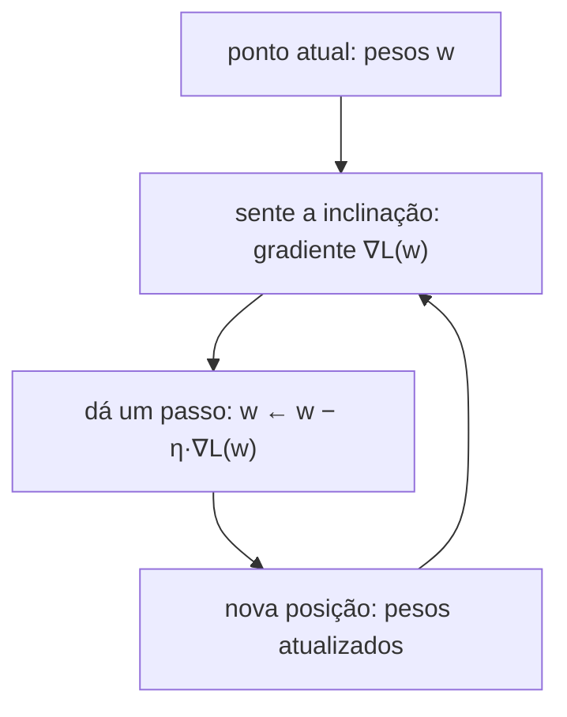
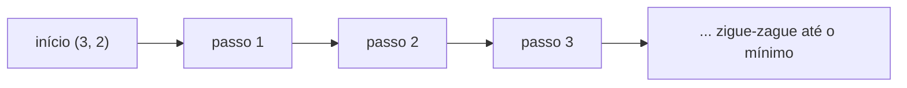
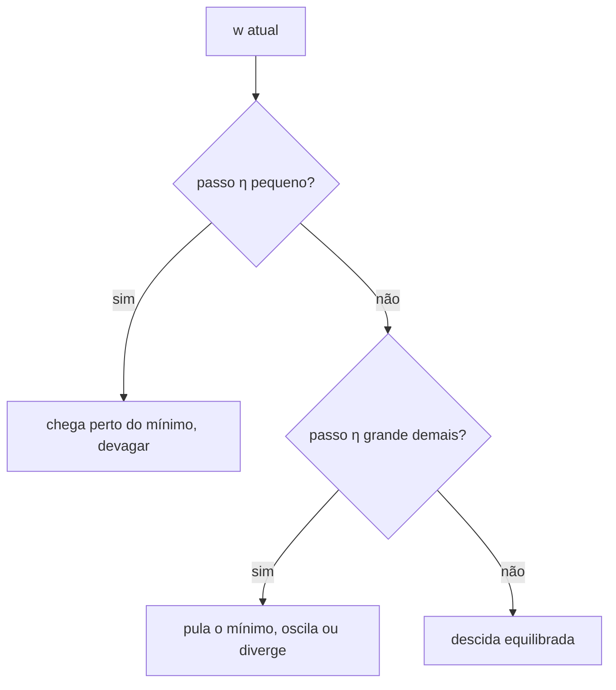
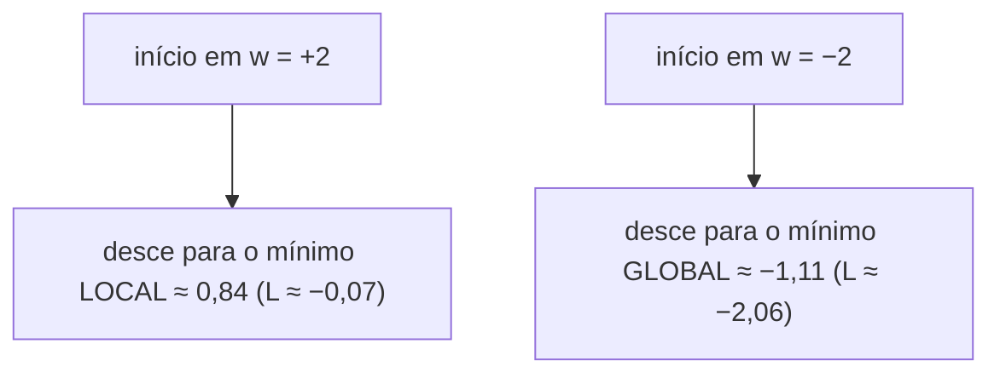

# Descida do gradiente

> "Se você quer descer uma montanha sem enxergar nada, dê sempre um passo na direção oposta à subida mais íngreme." — esta frase resume, em uma linha, todo o mecanismo de aprendizado de uma rede neural.


## 1. Intuição: caminhar morro abaixo no escuro

Imagine que você está no meio de uma montanha coberta de névoa. Você não vê o topo nem o vale, mas consegue sentir, com os pés, a inclinação do terreno onde está. Para descer, você usa uma estratégia muito simples:

1. Sinta a inclinação do terreno no ponto atual (isso é o **gradiente**).
2. Dê um passo na direção em que o terreno **desce** (isso é andar contra o gradiente).
3. Pare no novo ponto e repita.

Se o terreno é uma função matemática — a **função de perda** $L(w)$ que queremos minimizar — a "inclinação" é a derivada (ou, em várias variáveis, o gradiente) $\nabla L(w)$. O "passo" é controlado por um número positivo pequeno chamado **taxa de aprendizado** $\eta$.

Em um modelo de linguagem, $w$ é o vetor de **bilhões** de pesos, e $L$ é o erro que o modelo comete ao prever o próximo token. "Descer a montanha" significa "diminuir o erro", ou seja, fazer o modelo acertar mais.



## 2. O conceito em uma fórmula

Dada uma função de perda $L(w)$ que queremos minimizar, a regra de atualização do gradiente descendente é:

$$
w_{t+1} = w_t - \eta \cdot \nabla L(w_t)
$$

Onde:

- $w_t$ são os parâmetros no passo $t$;
- $\nabla L(w_t)$ é o gradiente da perda em relação aos parâmetros, avaliado em $w_t$;
- $\eta > 0$ é a taxa de aprendizado (o tamanho do passo).

O sinal de **menos** é o coração do algoritmo: o gradiente aponta para onde a função **cresce** mais rápido, então andamos na direção **oposta** para fazê-la **diminuir**.

> A direção de maior crescimento é $\nabla L$; a direção de maior decréscimo é $-\nabla L$. Por isso o sinal negativo.

## 3. Descida em 1D: o exemplo mínimo

Vamos usar a função de perda mais simples possível, um "copo" centrado na origem:

$$
L(w) = w^2
$$

Sabemos (de derivadas) que sua derivada é:

$$
\frac{dL}{dw} = 2w
$$

O mínimo está em $w = 0$, onde $L(0) = 0$. Vamos partir de $w_0 = 3$ e usar $\eta = 0{,}1$. A atualização é:

$$
w_{t+1} = w_t - \eta \cdot 2 w_t = w_t (1 - 2\eta)
$$

### Iteração completa, passo a passo

**Passo 1.** Gradiente em $w=3$: $g = 2 \cdot 3 = 6$. Atualização: $w \leftarrow 3 - 0{,}1 \cdot 6 = 3 - 0{,}6 = 2{,}4$.

**Passo 2.** Gradiente em $w=2{,}4$: $g = 4{,}8$. Atualização: $w \leftarrow 2{,}4 - 0{,}48 = 1{,}92$.

**Passo 3.** Gradiente em $w=1{,}92$: $g = 3{,}84$. Atualização: $w \leftarrow 1{,}92 - 0{,}384 = 1{,}536$.

**Passo 4.** $g = 3{,}072$. $w \leftarrow 1{,}536 - 0{,}3072 = 1{,}2288$.

**Passo 5.** $g = 2{,}4576$. $w \leftarrow 1{,}2288 - 0{,}24576 = 0{,}98304$.

Repare em duas coisas:

1. O valor de $w$ se aproxima de $0$ a cada passo.
2. O **tamanho do passo diminui** conforme nos aproximamos do mínimo, porque o gradiente fica menor.

Para $L(w) = w^2$, a atualização $w \leftarrow (1 - 2\eta) w$ é uma multiplicação por um fator constante $0{,}8$ a cada passo. Ou seja, o erro decai geometricamente:

$$
w_t = (1 - 2\eta)^t \, w_0 = 0{,}8^t \cdot 3
$$

Na prática, redes reais têm perdas muito mais complicadas e o fator de encolhimento não é constante — mas a intuição "cada passo aproxima do mínimo, com passos cada vez menores" permanece.

| Passo | $w$ antes | Gradiente $2w$ | $w$ depois | $L(w)$ |
|-------|-----------|----------------|------------|--------|
| 1 | 3,000 | 6,000 | 2,400 | 5,76 |
| 2 | 2,400 | 4,800 | 1,920 | 3,69 |
| 3 | 1,920 | 3,840 | 1,536 | 2,36 |
| 4 | 1,536 | 3,072 | 1,229 | 1,51 |
| 5 | 1,229 | 2,458 | 0,983 | 0,97 |

### Um mínimo deslocado

Para ver que o método encontra mínimos que não estão em zero, use $L(w) = (w - 5)^2$. A derivada é $2(w-5)$, e a atualização se torna:

$$
w_{t+1} = w_t - \eta \cdot 2(w_t - 5)
$$

Partindo de $w_0 = 2$ com $\eta = 0{,}1$:

- Passo 1: $g = 2(2-5) = -6$. $w \leftarrow 2 - 0{,}1(-6) = 2{,}6$.
- Passo 2: $g = 2(2{,}6-5) = -4{,}8$. $w \leftarrow 2{,}6 + 0{,}48 = 3{,}08$.
- Passo 3: $g = 2(3{,}08-5) = -3{,}84$. $w \leftarrow 3{,}08 + 0{,}384 = 3{,}464$.

O gradiente é **negativo** enquanto $w < 5$, então o sinal de menos vira um sinal de mais e $w$ **sobe** em direção ao mínimo $5$. É exatamente o comportamento correto.

## 4. Descida em 2D: quando há mais de um peso

Redes reais têm milhões de pesos, mas já em duas dimensões aparecem todos os fenômenos importantes. Considere:

$$
L(w_1, w_2) = w_1^2 + w_2^2
$$

O gradiente é o vetor das derivadas parciais:

$$
\nabla L = \left( \frac{\partial L}{\partial w_1},\; \frac{\partial L}{\partial w_2} \right) = (2w_1,\; 2w_2)
$$

A atualização acontece **em cada coordenada ao mesmo tempo**:

$$
w_1 \leftarrow w_1 - \eta \cdot 2 w_1, \qquad w_2 \leftarrow w_2 - \eta \cdot 2 w_2
$$

Partindo de $(w_1, w_2) = (2, -1)$ com $\eta = 0{,}2$:

| Passo | $w_1$ | $w_2$ | Gradiente | $L$ |
|-------|-------|-------|-----------|-----|
| 0 | 2,0 | -1,0 | (4, -2) | 5,00 |
| 1 | 1,2 | -0,6 | (2,4; -1,2) | 1,80 |
| 2 | 0,72 | -0,36 | (1,44; -0,72) | 0,648 |
| 3 | 0,432 | -0,216 | (0,864; -0,432) | 0,233 |

O ponto $(0,0)$ é o mínimo, e a trajetória se aproxima dele em linha reta (porque as duas coordenadas encolhem com o mesmo fator).

### A elipse: quando uma direção encolhe mais devagar

Uma situação mais realista — e que justifica o momentum (próximo documento) — é quando a perda é "esticada" em uma direção:

$$
L(w_1, w_2) = w_1^2 + 25\, w_2^2
$$

O gradiente é $(2w_1,\; 50 w_2)$. A direção $w_2$ tem curvatura **50 vezes** maior, então o gradiente é dominado por $w_2$, e o passo em $w_1$ fica pequeno. O resultado é uma trajetória em zigue-zague que "rasteja" em direção ao mínimo:



Este é o primeiro sinal de que o gradiente "puro" pode ser lento: ele segue a descida mais íngreme **local**, mas não necessariamente a rota mais curta **global**. O momentum existe justamente para suavizar esse zigue-zague.

## 5. O passo (taxa de aprendizado): o hiperparâmetro mais sensível

O tamanho do passo $\eta$ decide o equilíbrio entre velocidade e estabilidade. Voltemos a $L(w) = w^2$, onde $w_{t+1} = (1 - 2\eta) w_t$. O fator $|1 - 2\eta|$ determina o destino:

| $\eta$ | Fator $1 - 2\eta$ | Comportamento |
|--------|-------------------|---------------|
| $0{,}01$ | $0{,}98$ | Desce muito devagar |
| $0{,}1$ | $0{,}8$ | Descida suave e estável |
| $0{,}5$ | $0$ | Chega ao mínimo em **um** passo |
| $1{,}0$ | $-1$ | Oscila eternamente entre $w$ e $-w$ |
| $1{,}1$ | $-1{,}2$ | Diverge (explode) |

Interpretação dos extremos:

- **$\eta$ pequeno demais**: o treino é seguro, mas avança a passos de formiga; pode demorar demais para convergir (ou parecer que travou).
- **$\eta$ grande demais**: o passo "pula" por cima do mínimo e pode acabar **mais longe** do que começou. Para $\eta > 1$ em $w^2$, o método diverge para o infinito.




## 6. Mínimo local versus mínimo global

Um **mínimo global** é o menor valor de $L$ em todo o domínio. Um **mínimo local** é um ponto de onde $L$ não consegue diminuir "olhando só ao redor", mas que não é o menor de todos.

Em uma dimensão, um mínimo local satisfaz:

$$
\frac{dL}{dw} = 0 \quad \text{e} \quad \frac{d^2 L}{dw^2} > 0
$$

A primeira condição diz "a inclinação é nula"; a segunda diz "a curvatura é para cima" (é um vale, não um pico nem uma planície).

### Um exemplo com dois vales

Considere a função de "poço duplo inclinado":

$$
L(w) = w^4 - 2w^2 + w
$$

A derivada é:

$$
\frac{dL}{dw} = 4w^3 - 4w + 1
$$

Ela tem três pontos críticos (raízes aproximadas): um **máximo local** em $w \approx 0{,}269$, um **mínimo local** em $w \approx 0{,}838$ e um **mínimo global** em $w \approx -1{,}107$.

O ponto crucial: **a descida do gradiente só desce**. Ela não sabe nada sobre o que existe longe. O resultado depende do ponto de partida:

- **Começando em $w = +2$** (na bacia direita): o gradiente empurra para a esquerda e o método converge para o mínimo **local** $w \approx 0{,}838$, com $L \approx -0{,}07$.
- **Começando em $w = -2$** (na bacia esquerda): o método converge para o mínimo **global** $w \approx -1{,}107$, com $L \approx -2{,}06$.



A lição é profunda: o gradiente descendente **garante chegar a algum mínimo local, mas não ao melhor**. Em redes neurais com bilhões de parâmetros, a paisagem é tão alta-dimensional que quase todos os mínimos locais têm perda parecida com a do global — por isso o método funciona na prática, mesmo sem encontrar o mínimo perfeito.

## 7. Gradiente estocástico: uma primeira olhada

Até aqui, calculamos o gradiente **exato** da perda. Em aprendizado de máquina, a perda é a média sobre um conjunto de dados de $N$ exemplos:

$$
L(w) = \frac{1}{N} \sum_{i=1}^{N} \ell_i(w)
$$

O gradiente exato exigiria percorrer **todos** os $N$ exemplos a cada passo:

$$
\nabla L(w) = \frac{1}{N} \sum_{i=1}^{N} \nabla \ell_i(w)
$$

Quando $N$ é enorme (bilhões de tokens em um modelo de linguagem), isso é inviável a cada passo. A ideia do **gradiente descendente estocástico** (SGD) é substituir o gradiente exato por uma estimativa calculada sobre um **subconjunto pequeno e aleatório** dos dados (um *mini-batch*):

$$
\nabla L(w) \approx \frac{1}{B} \sum_{i \in \mathcal{B}} \nabla \ell_i(w)
$$

onde $\mathcal{B}$ é um mini-batch de $B$ exemplos sorteados ao acaso. Essa estimativa é **ruidosa** — flutua em torno do gradiente verdadeiro — mas, em média, aponta na direção certa. Esse ruído, longe de ser apenas um incômodo, ajuda a **escapar de mínimos locais rasos** e é o tema central do documento seguinte (SGD e momentum).

## 8. Código: descida do gradiente em Python

### Em 1D, com PyTorch (autograd)

```python
import torch

w = torch.tensor(3.0, requires_grad=True)
eta = 0.1

def perda(w):
    return w ** 2

historico = []
for passo in range(6):
    L = perda(w)             # forward
    L.backward()             # autograd calcula grad = 2w
    with torch.no_grad():
        w -= eta * w.grad    # passo da descida
        w.grad.zero_()       # zera o gradiente acumulado
    historico.append((passo, w.item(), L.item()))

for passo, wv, Lv in historico:
    print(f"passo {passo}: w={wv:.4f}, L={Lv:.4f}")
```

Saída esperada:

```text
passo 0: w=2.4000, L=5.7600
passo 1: w=1.9200, L=3.6864
passo 2: w=1.5360, L=2.3593
passo 3: w=1.2288, L=1.5100
passo 4: w=0.9830, L=0.9664
passo 5: w=0.7864, L=0.6185
```

### Em 2D, com dois pesos

```python
import torch

w = torch.tensor([2.0, -1.0], requires_grad=True)
eta = 0.2

def perda(w):
    return (w ** 2).sum()

for passo in range(5):
    L = perda(w)
    L.backward()
    with torch.no_grad():
        w -= eta * w.grad
        w.grad.zero_()
    print(f"passo {passo}: w={w.tolist()}, L={L.item():.4f}")
```

### Implementação manual (sem autograd)

Para fixar o conceito, aqui está a mesma ideia com a derivada calculada na mão:

```python
def descida_1d(w0, eta, passos):
    w = w0
    trajetoria = [w]
    for _ in range(passos):
        grad = 2 * w          # derivada de L(w) = w^2
        w = w - eta * grad
        trajetoria.append(w)
    return trajetoria

print(descida_1d(w0=3.0, eta=0.1, passos=5))
# [3.0, 2.4, 1.92, 1.536, 1.2288, 0.98304]
```

## 9. Pseudocódigo geral

```text
entrada: pesos w0, taxa eta, número de passos T
w = w0
para t = 1 até T:
    g = gradiente_da_perda(w)   # forward + backward (autograd)
    w = w - eta * g             # passo de descida
    registrar w e L(w)
devolver w
```

## 11. Erros comuns

- **Esquecer o sinal de menos.** Usar $w \leftarrow w + \eta \nabla L$ faz a **subida** do gradiente: maximiza a perda em vez de minimizar, e o modelo diverge.
- **Não zerar o gradiente.** Em PyTorch, `backward()` acumula. Sem `zero_()`, os gradientes somam-se entre passos e a descida fica incorreta.
- **Taxa de aprendizado grande demais.** O passo pula o mínimo, a perda oscila ou explode. Em $w^2$, $\eta > 1$ diverge.
- **Taxa de aprendizado pequena demais.** O treino fica lento a ponto de parecer travado.
- **Achar que o gradiente aponta para o mínimo.** Ele aponta para o **crescimento** mais íngreme; o mínimo está na direção oposta.
- **Confundir mínimo local com global.** A descida do gradiente só garante um mínimo local; o ponto de partida decide qual vale será encontrado.
- **Calcular o gradiente sobre todos os dados a cada passo.** Com bilhões de exemplos, é necessário usar mini-batches (SGD), não o gradiente exato.

## 12. Resumo

- A descida do gradiente atualiza os pesos por $w \leftarrow w - \eta \nabla L(w)$.
- O sinal negativo anda **contra** o gradiente, descendo a função de perda.
- Em $L(w) = w^2$, o método converge geometricamente para o mínimo $w=0$.
- Em 2D, o gradiente é um vetor e cada coordenada é atualizada ao mesmo tempo.
- O passo $\eta$ é o hiperparâmetro mais sensível: pequeno demais é lento, grande demais diverge.
- O gradiente descendente encontra um **mínimo local**; o resultado depende do ponto de partida.
- O SGD troca o gradiente exato por uma estimativa sobre mini-batches, viabilizando dados enormes.
