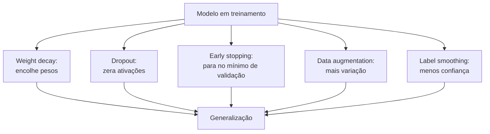

# Dropout e outras regularizações

## Intuição: equipes que não dependem de ninguém

Imagine uma empresa onde um único funcionário é tão essencial que, se ele faltar, a empresa para. O dia em que esse funcionário fica doente, tudo desmorona. Agora imagine uma empresa que treina **todos** para fazerem o trabalho de forma cruzada: se alguém faltar, os outros cobrem. A segunda empresa é muito mais **robusta**.

O **dropout** aplica uma forma dessa ideia a redes neurais: durante o treinamento, zera aleatoriamente parte das ativações, de acordo com a variante usada. Isso pode reduzir a dependência de caminhos ou unidades específicas; não garante como o modelo distribuirá o conhecimento.

> O dropout reduz a dependência excessiva de unidades específicas, mas não garante que cada neurônio aprenda uma representação útil por conta própria.

É uma forma de regularização complementar ao weight decay: enquanto o weight decay encolhe a **magnitude** dos pesos, o dropout reduz a **codependência** entre os neurônios.

## Conceito: desligar neurônios aleatoriamente

### O que acontece em um passo

A cada passo de treinamento, o dropout sorteia uma máscara e zera parte das ativações. A granularidade da máscara (por elemento, canal ou outra dimensão) depende da camada e da variante usada. Ativações zeradas não contribuem para o forward nem recebem gradiente por esse caminho. A probabilidade de zerar é o parâmetro $p$.

- $p = 0.5$: cada elemento abrangido pela máscara tem 50% de chance de ser zerado; é uma taxa alta em muitos usos.
- $p = 0.1$: cada elemento abrangido tem 10% de chance de ser zerado; o efeito depende da camada e da tarefa.
- $p = 0.0$: dropout desligado (comportamento padrão de uma camada sem dropout).

### O que acontece na avaliação

Durante a avaliação e a inferência, as camadas `Dropout` do PyTorch deixam de aplicar a máscara. Com *inverted dropout*, as ativações que sobrevivem durante o treino são escaladas para preservar seu valor esperado; na avaliação, não é preciso aplicar essa escala.

Por isso o dropout aplica uma correção de escala. Duas abordagens são usadas:

1. **"Inverted dropout"** (a usada pelo PyTorch): durante o treino, os neurônios que **permanecem** têm sua saída multiplicada por $\frac{1}{1-p}$. Assim, o valor esperado da soma se mantém igual ao da avaliação, e não é preciso fazer nada na avaliação.
2. **Abordagem clássica**: multiplica-se por $(1-p)$ na avaliação, e nada no treino.

O PyTorch usa a primeira (inverted dropout), o que torna a troca treino/avaliação transparente — basta chamar `model.eval()` para desligar o dropout automaticamente.

### A matemática do valor esperado

Suponha uma saída $h$ de um neurônio, e uma máscara aleatória $m \in \{0, 1\}$ com $P(m=1) = 1-p$ (probabilidade de **permanecer**). No inverted dropout, a saída vira:

$$
h' = \frac{m \cdot h}{1-p}
$$

O valor esperado de $h'$ é:

$$
\mathbb{E}[h'] = \frac{\mathbb{E}[m] \cdot h}{1-p} = \frac{(1-p) \cdot h}{1-p} = h
$$

Ou seja, em média, a saída com dropout é **igual** à saída sem dropout. Isso preserva a "escala" dos sinais entre treino e avaliação, e é a razão pela qual o fator $\frac{1}{1-p}$ aparece na implementação.

## Por que o dropout ajuda

### Quebra de codependência

Sem dropout, unidades podem se adaptar umas às outras. Uma máscara aleatória pode reduzir essa dependência em algumas configurações; não obriga cada unidade a funcionar de forma independente nem impede que o modelo memorize exemplos.

### Equivalência a um ensemble

Uma interpretação útil é que cada máscara de treino ativa uma sub-rede diferente, com pesos compartilhados entre as máscaras. Isso lembra um ensemble implícito, mas não equivale em geral a treinar e depois calcular a média exata de todas as sub-redes. É uma intuição, não uma garantia de melhor generalização.

Essa visão ajuda a interpretar o ruído de treino; o efeito real na variância e no sobreajuste depende dos dados, da arquitetura e da taxa escolhida.

### Exemplo numérico de desligamento

Considere quatro elementos de ativação com valores $h = [2.0, 1.0, 3.0, 0.5]$, com $p = 0.5$ (logo, fator $\frac{1}{1-p} = 2$).

1. Sorteamos uma máscara, por exemplo $m = [1, 0, 1, 0]$ (elementos 1 e 3 ficam, 2 e 4 são zerados).
2. Aplicamos a máscara: $m \odot h = [2.0, 0.0, 3.0, 0.0]$.
3. Multiplicamos pelo fator de correção: $h' = 2 \cdot [2.0, 0.0, 3.0, 0.0] = [4.0, 0.0, 6.0, 0.0]$.

A soma original era $2 + 1 + 3 + 0.5 = 6.5$. A soma com dropout foi $4 + 6 = 10$. Repare que é maior — mas é apenas **uma** realização. Em média, sobre muitas máscaras, a soma esperada é:

$$
\mathbb{E}\!\left[\sum h'\right] = \sum \frac{(1-p)\,h}{1-p} = \sum h = 6.5
$$

O fator $2$ compensa, em valor esperado, o fato de que apenas metade dos elementos permanece ativa nessa configuração. Uma amostra isolada pode ficar acima ou abaixo da soma original.

## O dropout no PyTorch

### Uso básico

```python
import torch
import torch.nn as nn

torch.manual_seed(0)

drop = nn.Dropout(p=0.5)

x = torch.ones(1, 8)   # 8 ativações, todas valendo 1

drop.train()           # modo treino: dropout ATIVO
print("Treino:", drop(x).tolist()[0])
# Exemplo de saída: [0.0, 2.0, 2.0, 0.0, 2.0, 2.0, 0.0, 2.0]

drop.eval()            # modo avaliação: dropout DESLIGADO
print("Eval:", drop(x).tolist()[0])
# [1.0, 1.0, 1.0, 1.0, 1.0, 1.0, 1.0, 1.0]
```

Repare nos detalhes:

- No treino, as ativações que **sobrevivem** valem $2.0 = \frac{1}{1-0.5} \cdot 1$ (inverted dropout), e as demais valem $0.0$.
- Na avaliação, tudo volta a $1.0$, sem escala — a correção já foi feita durante o treino.

### Onde inserir o dropout

O dropout é frequentemente inserido entre camadas, mas a posição depende da arquitetura e da tarefa. Em blocos de sequência, variantes podem atuar nas ativações, nas conexões residuais ou nos pesos de atenção; essas escolhas não são intercambiáveis.

1. Em ativações de uma subcamada antes da conexão residual.
2. Dentro de uma rede feed-forward.
3. Em embeddings ou pesos de atenção, quando a arquitetura prevê essas variantes.

Exemplo de um bloco com dropout:

```python
import torch.nn as nn

class BlocoComDropout(nn.Module):
    def __init__(self, d_model, p=0.1):
        super().__init__()
        self.norm1 = nn.LayerNorm(d_model)
        self.proj = nn.Linear(d_model, d_model)
        self.drop1 = nn.Dropout(p)

        self.norm2 = nn.LayerNorm(d_model)
        self.ffn = nn.Sequential(
            nn.Linear(d_model, 4 * d_model),
            nn.SiLU(),
            nn.Dropout(p),
            nn.Linear(4 * d_model, d_model),
        )
        self.drop2 = nn.Dropout(p)

    def forward(self, x):
        x = x + self.drop1(self.proj(self.norm1(x)))
        x = x + self.drop2(self.ffn(self.norm2(x)))
        return x
```

O exemplo ilustra uma opção de bloco pré-normalizado: subcamada → dropout → conexão residual. A ordem exata é uma decisão arquitetural; não existe uma posição universalmente correta para todo modelo.

## Dropout em LLMs: quando usar

### A nuance dos modelos grandes

Em modelos de linguagem, a escolha de usar dropout e seu valor dependem da arquitetura, dos dados e do regime de treino. Algumas configurações usam pouco ou nenhum dropout; outras o mantêm em pontos específicos. Considere:

1. **Regularização:** o ruído introduzido pode reduzir sobreajuste, mas também pode dificultar o ajuste se for excessivo.
2. **Custo de otimização:** o efeito na convergência precisa ser medido no regime de treinamento escolhido.
3. **Interações:** máscaras, normalização, quantização e outras escolhas podem interagir; avalie o conjunto, não apenas um parâmetro isolado.

Ao comparar valores de $p$, use uma divisão de validação representativa e mantenha constantes as demais condições sempre que possível.

### Quando usar dropout vs. não usar

| Cenário | Recomendação |
|---------|--------------|
| Dados abundantes e pouco sinal de sobreajuste | Compare com dropout baixo ou desligado |
| Conjunto pequeno e sobreajuste observado | Teste dropout e outras formas de regularização |
| Modelo profundo | Avalie dropout junto com normalização e conexões residuais |
| Inferência | Sempre desligado (`model.eval()`) |

## Outras técnicas de regularização

Dropout não é a única ferramenta. Técnicas diferentes podem ajudar a tratar sobreajuste ou estabilidade, e a escolha depende do problema.

### Data augmentation (aumento de dados)

Uma forma de aumentar a variação vista pelo modelo é transformar exemplos de maneira compatível com a tarefa. Em linguagem, isso pode incluir:

- **Paráfrase**: reescrever a mesma frase de formas diferentes.
- **Tradução de ida e volta**: traduzir para outro idioma e voltar, gerando variações.
- **Perturbação**: trocar, inserir ou apagar palavras sinônimas.
- **Embaralhamento de ordem** (com cuidado, em tarefas que permitem).

Aumento de dados só é útil quando as transformações preservam o significado ou o rótulo da tarefa. Tradução, paráfrase e perturbação podem introduzir erros ou alterar a distribuição; valide as transformações antes de usá-las.


### Label smoothing (suavização de rótulos)

Na entropia cruzada, um alvo one-hot atribui massa total à classe correta. O *label smoothing* substitui esse alvo por uma distribuição mais suave:

$$
y_{\text{smooth}} = (1 - \alpha) \cdot y_{\text{one-hot}} + \frac{\alpha}{K} \cdot \mathbf{1}
$$

Onde $K$ é o número de classes e $\alpha$ controla o quanto o alvo é suavizado. A convenção exata varia; a fórmula acima distribui parte da massa uniformemente pelas classes, inclusive a classe correta. Isso pode reduzir confiança excessiva em alguns cenários, mas o efeito na calibração e na geração precisa ser avaliado.

### Normas de gradiente (gradient clipping)


Clipping de gradiente limita a norma do gradiente antes da atualização. Pode ajudar a conter atualizações muito grandes, mas não é uma garantia contra sobreajuste e não substitui o diagnóstico de estabilidade.

```python
grad_norm = torch.nn.utils.clip_grad_norm_(model.parameters(), max_norm=1.0)
```

O limite `1.0` é apenas ilustrativo; escolha-o com base no modelo e monitore a norma antes e depois do clipping.

### Outras técnicas de resumo

| Técnica | Atua principalmente em | Observação |
|---|---|---|
| Weight decay | Atualização ou magnitude dos parâmetros | O efeito depende do otimizador e dos parâmetros incluídos |
| Dropout | Ativações durante o treino | Desligado em avaliação em camadas que respeitam o modo do modelo |
| Early stopping | Duração do treino | Requer validação e guardar o melhor estado |
| Label smoothing | Distribuição dos alvos | Pode alterar calibração e qualidade |
| Gradient clipping | Norma do gradiente | Técnica de estabilidade, não regularização equivalente |
| Aumento de dados | Variação dos exemplos | Transformações precisam preservar a tarefa |

## Diagrama: o efeito combinado das regularizações



Essas técnicas atuam por mecanismos diferentes e podem ser combinadas, mas a combinação não garante melhor generalização. Avalie seus efeitos em dados reservados.

## Código: experimento com dropout

Um experimento simples para sentir o efeito do dropout na prática:

```python
import torch
import torch.nn as nn

torch.manual_seed(0)

# Dataset pequeno e ruidoso (propenso a overfitting)
X = torch.randn(200, 20)
Y = (X[:, 0] * 2 + X[:, 1] ** 2 > 0).float().unsqueeze(1)

def make_model(p):
    return nn.Sequential(
        nn.Linear(20, 256),
        nn.ReLU(),
        nn.Dropout(p),
        nn.Linear(256, 256),
        nn.ReLU(),
        nn.Dropout(p),
        nn.Linear(256, 1),
    )

def treinar(model, passos=2000):
    opt = torch.optim.AdamW(model.parameters(), lr=1e-3)
    perda = nn.BCEWithLogitsLoss()
    model.train()
    for _ in range(passos):
        opt.zero_grad()
        pred = model(X)
        L = perda(pred, Y)
        L.backward()
        opt.step()
    return L.item()

# Sem dropout
sem = make_model(0.0)
print("Sem dropout, perda de treino:", round(treinar(sem), 4))

# Com dropout p=0.5
com = make_model(0.5)
print("Com dropout (p=0.5), perda de treino:", round(treinar(com), 4))
```

Compare as perdas de treino para observar como a máscara afeta o ajuste. Este exemplo não mede validação, então seus resultados não permitem concluir qual modelo generaliza melhor; para isso, reserve exemplos que não participem das atualizações.

## Erros comuns

- **Deixar o dropout ligado na avaliação.** Esquecer `model.eval()` mantém ativas as máscaras de camadas Dropout do PyTorch, tornando as saídas aleatórias. Use o modo apropriado ao avaliar ou gerar texto.
- **Assumir que um mesmo valor de $p$ serve para todos os modelos.** Valores altos removem mais ativações e podem dificultar o ajuste; escolha por experimento e validação.
- **Achar que dropout substitui weight decay.** São complementares: um ataca codependência, o outro ataca magnitude. Um não dispensa o outro.
- **Inserir dropout em qualquer ponto sem avaliar o efeito.** Aplicá-lo aos logits, por exemplo, altera diretamente a distribuição prevista; escolha a posição conforme a arquitetura e valide os resultados.
- **Assumir que a ordem é sempre a mesma.** Dropout interage com normalização e conexões residuais; siga a arquitetura e valide a escolha.
- **Esquecer o fator de escala.** Se implementar dropout manualmente (sem `nn.Dropout`), lembre-se do fator $\frac{1}{1-p}$ no treino (inverted dropout), senão a saída fica subescalada na avaliação.

## Resumo

- O **dropout** zera aleatoriamente parte das ativações durante o treino; sua máscara pode operar em diferentes granularidades.
- A probabilidade $p$ controla a fração desligada; o PyTorch usa **inverted dropout**, com fator $\frac{1}{1-p}$ no treino.
- Na avaliação, o dropout é **desligado** via `model.eval()`, e a correção de escala garante consistência.
- O dropout pode ser interpretado como um conjunto de sub-redes com pesos compartilhados; essa analogia não garante redução de variância em todo problema.
- O valor de $p$ deve ser escolhido por validação; não existe um limite universal para todos os modelos de linguagem.
- Técnicas diferentes atuam por mecanismos distintos; sua combinação deve ser validada em vez de presumida como mais eficaz.
