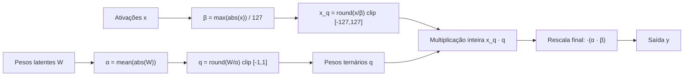

# As escalas alpha e beta

> "Ternarizar um peso sem escalar é como afinar um instrumento sem definir o volume: a direção pode estar certa, mas a magnitude se perde — e o modelo 'morre'."


---

## 1. Intuição: por que um número extra é necessário?

Quando você quantiza um peso real $w$ para o conjunto ternário $\{-1, 0, +1\}$, algo se perde: a **magnitude**. Um peso real de $0.4$ e um peso real de $4.0$ seriam, ambos, arredondados para valores da mesma "casa" ($0$ e $+1$, respectivamente, dependendo da escala), mas a informação de *quanto* cada um vale é crucial para o modelo.

Pense em uma camada que recebe uma entrada e produz uma saída. Se todos os pesos fossem forçados a valer exatamente $\{-1, 0, +1\}$ sem nenhum fator de correção, a saída da camada teria uma escala fixa que não corresponde à escala real dos dados. O modelo perderia a capacidade de amplificar ou atenuar sinais.

A solução é separar a informação em duas partes:

1. **A direção** (ou o "formato") do peso, representada pelo valor ternário $q \in \{-1, 0, +1\}$.
2. **A magnitude**, representada por uma escala real $\alpha$.

A reconstrução é simples:

$$
w \approx \alpha \cdot q
$$

Assim, um peso ternário $+1$ com escala $\alpha = 0.7$ vale efetivamente $0.7$; o mesmo $+1$ com $\alpha = 3.0$ vale $3.0$. A escala é o "controle de volume" da camada.

---

## 2. Conceito: as duas escalas e seus papéis


| Símbolo | O que escala | Como é calculada | Natureza |
|---|---|---|---|
| $\alpha$ | Pesos ternários | média dos valores absolutos dos pesos: $\alpha = \frac{1}{n}\sum_i |w_i|$ | aprendida, suave |
| $\beta$ | Ativações | máximo valor absoluto das ativações, dividido por $127$: $\beta = \frac{\max(|x|)}{127}$ | dinâmica, por tensor |

A rescala final de uma camada combina as duas:

$$
\text{saída} = \big( x_q \cdot q \big) \cdot \alpha \cdot \beta
$$

Por que duas e não uma só? Porque elas atuam em momentos e objetos diferentes:

- $\alpha$ normaliza os **pesos** para que seu valor ternário fique bem distribuído no conjunto $\{-1, 0, +1\}$.
- $\beta$ normaliza as **ativações** para que caibam com boa resolução no intervalo de 8 bits $[-127, 127]$.

---

## 3. A escala alpha: média dos valores absolutos dos pesos

### 3.1 Definição

A escala $\alpha$ de uma matriz de pesos $W \in \mathbb{R}^{m \times n}$ é:

$$
\alpha = \frac{1}{m n} \sum_{i=1}^{m} \sum_{j=1}^{n} |W_{ij}|
$$

Em notação compacta, usando a média do valor absoluto:

$$
\alpha = \text{mean}(|W|)
$$

### 3.2 Por que a média (e não o máximo)?

Se usássemos o máximo (como fazemos para as ativações), um único peso grande "dilataria" a escala e comprimiria todos os demais pesos para perto de zero. Como os pesos ternários são discretos ($\{-1,0,+1\}$), o que queremos é que uma fração saudável deles caia em $-1$ ou $+1$, e outra fração caia em $0$ (sparsidade). A **média** de $|W|$ equilibra isso naturalmente: pesos com módulo próximo da média tendem a ser arredondados para $\pm 1$, e pesos com módulo muito menor tendem a $0$.

### 3.3 Exemplo numérico

Considere uma camada com $6$ pesos latentes:

$$
W = [0.3,\; -0.7,\; 0.1,\; 1.4,\; -0.2,\; 0.9]
$$

**Passo 1 — média dos módulos:**

$$
\alpha = \frac{|0.3| + |-0.7| + |0.1| + |1.4| + |-0.2| + |0.9|}{6}
= \frac{0.3 + 0.7 + 0.1 + 1.4 + 0.2 + 0.9}{6}
= \frac{3.6}{6} = 0.6
$$

**Passo 2 — reescala:**

$$
\frac{W}{\alpha} = \frac{[0.3, -0.7, 0.1, 1.4, -0.2, 0.9]}{0.6}
= [0.5, -1.17, 0.17, 2.33, -0.33, 1.5]
$$

**Passo 3 — arredondamento e clip:**

$$
q = \text{round}(W/\alpha)\big|_{\text{clip}[-1,1]} = [1, -1, 0, 1, 0, 1]
$$

**Passo 4 — reconstrução:**

$$
W \approx \alpha \cdot q = 0.6 \cdot [1, -1, 0, 1, 0, 1] = [0.6, -0.6, 0, 0.6, 0, 0.6]
$$

Observe que o peso original $1.4$ virou $0.6$ (magnitude corrigida pela média) e o $0.1$ virou $0$ (sparsidade). A escala $\alpha$ capturou a "magnitude média" da camada.

---

## 4. A escala beta: máximo absoluto das ativações

### 4.1 Definição

A escala $\beta$ de um tensor de ativações $x$ é:

$$
\beta = \frac{\max(|x|)}{127}
$$

Ela mapeia o maior valor absoluto da ativação para o teto do intervalo de 8 bits ($127$). Todos os demais valores são escalados proporcionalmente.

### 4.2 Por que dividir por 127?

Porque a ativação é quantizada para 8 bits com sinal, cobrindo $[-127, 127]$. Dividir o máximo por $127$ garante que o valor mais extremo caiba exatamente no teto, maximizando a resolução disponível.

### 4.3 Exemplo numérico

Reaproveitando o vetor da seção de ativações:

$$
x = [0.0,\; 0.5,\; -1.0,\; 2.5,\; -3.2]
$$

$$
\max(|x|) = 3.2
$$

$$
\beta = \frac{3.2}{127} \approx 0.02520
$$

A quantização produz $x_q = [0, 20, -40, 99, -127]$ (como já detalhado no documento de quantização de ativações), e a desquantização recupera $x \approx \beta \cdot x_q$.

---

## 5. A rescala final: alpha vezes beta

### 5.1 Onde as duas escalas se encontram

Considere a operação de uma camada ternária com ativações quantizadas. O forward completo é:

$$
y = \Big( x_q \cdot q^{\top} \Big) \cdot \alpha \cdot \beta
$$

onde:

- $x_q$ é a ativação quantizada (inteira, 8 bits).
- $q$ é o peso ternário ($\{-1, 0, +1\}$).
- $\alpha = \text{mean}(|W|)$ recupera a magnitude dos pesos.
- $\beta = \max(|x|)/127$ recupera a magnitude das ativações.

O fator $\alpha \cdot \beta$ é a **rescala final** que devolve ao resultado a magnitude correta.

### 5.2 Exemplo numérico completo de ponta a ponta

Suponha uma camada com um único neurônio, um único peso, e entrada de dimensão 1 (para ilustrar). Seja:

- Peso latente: $w = 0.9$.
- Ativação de entrada: $x = 1.6$.

**Pesos:**

$$
\alpha = \text{mean}(|0.9|) = 0.9
$$

$$
q = \text{round}\left(\frac{0.9}{0.9}\right) = \text{round}(1.0) = 1
$$

**Ativações:**

$$
\beta = \frac{\max(|1.6|)}{127} = \frac{1.6}{127} \approx 0.01260
$$

$$
x_q = \text{round}\left(\frac{1.6}{0.01260}\right) = \text{round}(127.0) = 127
$$

**Multiplicação inteira:**

$$
x_q \cdot q = 127 \cdot 1 = 127
$$

**Rescala final:**

$$
y = 127 \cdot \alpha \cdot \beta = 127 \cdot 0.9 \cdot 0.01260 = 1.44
$$

Compare com o resultado "real" (sem quantização):

$$
y_{\text{real}} = w \cdot x = 0.9 \cdot 1.6 = 1.44
$$

O resultado é **exato** nesse caso porque $x = 1.6$ e $w = 0.9$ caíram precisamente nos níveis de quantização. Em geral haverá um pequeno erro, mas a estrutura $\alpha \cdot \beta$ garante que a magnitude esteja sempre correta.

### 5.3 Por que a ordem das escalas não importa (mas a presença importa)

Matematicamente, $\alpha \cdot \beta$ é um único fator escalar. Poderíamos fundi-lo em um só número $k = \alpha \cdot \beta$. A razão de mantê-las separadas é **conceitual e operacional**:

- $\alpha$ é calculada a partir dos pesos (e aprende junto com eles via STE).
- $\beta$ é calculada a partir das ativações (dinamicamente, a cada forward).

Mantê-las separadas permite que cada uma responda à sua própria fonte de informação, e permite otimizações de hardware (como pré-computar $\alpha$ na preparação de inferência, enquanto $\beta$ depende da entrada).

---

## 6. Diagrama do fluxo das escalas



---

## 7. Por que sem escala o modelo "morre"

Esta é a pergunta central, e merece uma análise cuidadosa.

### 7.1 O que acontece sem $\alpha$

Se removermos $\alpha$ (ou fixarmos $\alpha = 1$), todos os pesos ternários passam a valer exatamente $\{-1, 0, +1\}$. Considere a dinâmica de uma camada com $n$ entradas:

$$
y = \sum_{i=1}^{n} q_i x_i, \quad q_i \in \{-1, 0, +1\}
$$

A variância de $y$ fica aproximadamente fixa e determinada pelo número de pesos não-nulos, **independentemente da escala correta dos dados**. Duas consequências desastrosas:

1. **Saturação das ativações**: sem a capacidade de atenuar, os valores explodem ao longo das camadas (ou colapsam para zero), levando o modelo a um regime onde os gradientes desaparecem ou explodem.
2. **Perda de capacidade expressiva**: a camada deixa de poder representar multiplicações por fatores como $0.1$ ou $10.0$, que são essenciais para casar a escala entre camadas.

O sintoma: a perda fica em um platô alto, ou dispara para `NaN`, e o modelo "morre" — não aprende nada útil.

### 7.2 O que acontece sem $\beta$

Se removermos $\beta$, a ativação quantizada perde sua referência de magnitude. A camada não sabe mais "quão grande" é a entrada, e a informação de escala do sinal de entrada se perde na fronteira entre a quantização e a multiplicação. Em uma rede profunda, esse erro se acumula camada a camada, distorcendo completamente a representação.

### 7.3 O papel conjunto: casamento de escala

O verdadeiro papel de $\alpha$ e $\beta$ é **casar a escala entre camadas**. Cada camada ternária recebe um sinal com certa magnitude, e deve produzir um sinal com magnitude compatível com a próxima camada. As escalas fazem esse casamento de forma aprendida ($\alpha$) e dinâmica ($\beta$), mantendo o fluxo de informação na faixa ideal.

### 7.4 A analogia do amplificador

> Um peso ternário sem escala é como um amplificador com apenas três posições fixas: $+1$, $0$ e $-1$. A escala $\alpha$ é o "ganho" do amplificador. Sem ele, você não consegue tocar uma música suave nem um estrondo — só três volumes fixos, quase sempre errados para o sinal de entrada.

---

## 8. Implementação em Python

### 8.1 Cálculo de alpha e beta

```python
import torch

def compute_alpha(weight: torch.Tensor) -> torch.Tensor:
    # Média dos valores absolutos dos pesos (com piso para evitar zero)
    return weight.abs().mean().clamp(min=1e-5)

def compute_beta(x: torch.Tensor, qmax: int = 127) -> torch.Tensor:
    # Máximo valor absoluto das ativações dividido pelo teto de 8 bits
    return (x.abs().max() / qmax).clamp(min=1e-5)
```

### 8.2 A camada ternária completa com alpha e beta

```python
def ternary_linear_scaled(x: torch.Tensor, weight: torch.Tensor) -> torch.Tensor:
    # Escala alpha dos pesos (não detachada: propaga gradiente de magnitude)
    alpha = compute_alpha(weight)

    # Quantiza pesos para {-1, 0, +1} com STE
    w_scaled = weight / alpha
    w_q = torch.round(w_scaled).clamp(-1, 1)
    w_ste = (w_q - w_scaled).detach() + w_scaled

    # Escala beta das ativações (detachada: max é não-suave)
    beta = compute_beta(x).detach()

    # Quantiza ativações para 8 bits com STE
    x_scaled = x / beta
    x_q = torch.round(x_scaled).clamp(-127, 127)
    x_ste = (x_q - x_scaled).detach() + x_scaled

    # Multiplicação (inteira no hardware real) e rescala final alpha * beta
    y = torch.matmul(x_ste, w_ste.t())

    return y * alpha * beta
```

### 8.3 Exemplo numérico em código

```python
weight = torch.tensor([0.3, -0.7, 0.1, 1.4, -0.2, 0.9])
x = torch.tensor([0.0, 0.5, -1.0, 2.5, -3.2])

alpha = compute_alpha(weight)
beta = compute_beta(x)

print("alpha =", round(alpha.item(), 4))   # ~0.6
print("beta  =", round(beta.item(), 5))    # ~0.0252
print("alpha * beta =", round((alpha * beta).item(), 5))

# Quantização dos pesos
q = torch.round(weight / alpha).clamp(-1, 1)
print("q (ternário) =", q.int().tolist())  # [1, -1, 0, 1, 0, 1]
```

---

## 9. Pseudocódigo

```text
FUNÇÃO treinar_camada_ternaria(x, W):
    # --- Pesos ---
    alpha   <- média(|W|), com mínimo 1e-5
    w_escal <- W / alpha
    q       <- round(w_escal), clip em [-1, 1]
    w_ste   <- q + (q - w_escal) detachado      # STE

    # --- Ativações ---
    beta    <- máximo(|x|) / 127, com mínimo 1e-5
    x_escal <- x / beta
    x_q     <- round(x_escal), clip em [-127, 127]
    x_ste   <- x_q + (x_q - x_escal) detachado  # STE

    # --- Forward ---
    y_q     <- x_ste × w_ste^T                   # multiplicação
    y       <- y_q × alpha × beta                # rescala final
    RETORNAR y
FIM-FUNÇÃO
```

---

# CRÍTICO: REMOVA o .detach(). A escala PRECISA propagar gradiente de magnitude!
scale = w.abs().mean().clamp(min=1e-5)

weight_scaled = w / scale
weight_quantized = torch.round(weight_scaled).clamp(-1, 1)
weight_ste = (weight_quantized - weight_scaled).detach() + weight_scaled

output = F.linear(x, weight_ste) * scale
scale = self.weight.abs().mean().clamp(min=1e-5)
quantized = torch.round(self.weight / scale).clamp(-1, 1)
self._inference_weight = (quantized * scale).contiguous()
self._inference_scale = float(scale.float().item())
flowchart TB
    L["Perda"] --> G1["Gradiente de direção (via STE)"]
    L --> G2["Gradiente de magnitude (via média |W|)"]
    G1 --> W["Atualiza sinal de cada peso"]
    G2 --> S["Atualiza escala α da camada"]
    W --> T["Pesos ternários q"]
    S --> Y["Rescala α (e β nas ativações)"]
    T --> M["Multiplicação"]
    Y --> M
    M --> O["Saída"]
