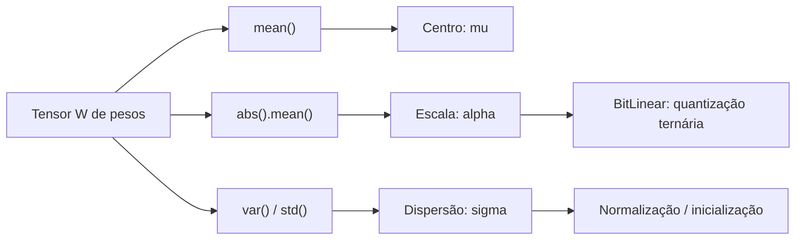

# Estatística: média, variância e desvio padrão

## Visão geral

Esta página cobre os fundamentos estatísticos que sustentam praticamente todas as decisões de escalonamento dentro de uma rede neural. Quando você vê um tensor com milhões de números, a primeira pergunta que deve fazer não é "quais são todos esses valores?", mas sim "onde eles estão e o quanto eles se espalham?". É exatamente isso que a média, a variância e o desvio padrão respondem.


## Intuição: por que precisamos resumir números?

Imagine que você tem um vetor de pesos de uma camada:

$$W = [2.0,\; 3.0,\; 1.0,\; 4.0,\; 0.0]$$

Olhando para esses cinco números, é difícil responder rápido a perguntas como "esses pesos são grandes ou pequenos?" ou "tem algum peso muito fora do padrão?". Precisamos de **uma medida de centro** e **uma medida de dispersão**.

- A **média** (ou valor esperado) diz onde fica o centro do conjunto.
- A **variância** diz o quanto os valores se afastam desse centro, em unidades ao quadrado.
- O **desvio padrão** traz essa dispersão de volta para a unidade original dos dados.

Essas três ideias bastam para explicar o comportamento de um lote de ativações dentro de um transformer.

## Média aritmética

### Definição

Dado um conjunto de $n$ valores $x_1, x_2, \dots, x_n$, a média aritmética é:

$$
\bar{x} = \frac{1}{n} \sum_{i=1}^{n} x_i
$$

A barra sobre o $x$ indica "média". Em texto de deep learning você também vai ver $\mu$ (mu) para a média de uma população ou de um lote de ativações.

### Exemplo numérico resolvido

Considere o vetor de pesos:

$$W = [2.0,\; 3.0,\; 1.0,\; 4.0,\; 0.0]$$

Temos $n = 5$ valores. Somamos tudo:

$$
\sum_{i=1}^{5} x_i = 2.0 + 3.0 + 1.0 + 4.0 + 0.0 = 10.0
$$

Dividimos por $n$:

$$
\bar{x} = \frac{10.0}{5} = 2.0
$$

A média é $2.0$. Interpretação: se todos os pesos fossem iguais e a soma total permanecesse a mesma, cada um valeria $2.0$.

### Média ponderada e a média sobre o eixo do tensor

Em PyTorch, a média quase nunca é calculada sobre "todos os números" de forma plana. Calculamos sobre um **eixo** (dimensão). Por exemplo, em um tensor de ativações de shape `[batch, seq_len, hidden]`, a média costuma ser tirada sobre a última dimensão (`hidden`) porque é ali que estão as características que queremos normalizar.

Seja $X \in \mathbb{R}^{m \times n}$ uma matriz. A média ao longo do eixo das colunas (dim=1) produz um vetor de tamanho $m$:

$$
\mu_j = \frac{1}{n} \sum_{k=1}^{n} X_{j,k}
$$

onde $j$ indexa a linha. Esse padrão de "média por linha" é a espinha dorsal da normalização por camada.

## Mediana

### Definição

A mediana é o valor que separa a metade menor da metade maior do conjunto ordenado. Para ordenar os valores:

$$x_{(1)} \leq x_{(2)} \leq \dots \leq x_{(n)}$$

- Se $n$ é ímpar, a mediana é o valor do meio: $x_{(\frac{n+1}{2})}$.
- Se $n$ é par, a mediana é a média dos dois valores centrais: $\frac{x_{(n/2)} + x_{(n/2 + 1)}}{2}$.

### Exemplo resolvido

Com $W = [2.0, 3.0, 1.0, 4.0, 0.0]$, ordenamos:

$$[0.0,\; 1.0,\; 2.0,\; 3.0,\; 4.0]$$

$n = 5$ é ímpar, então a mediana é o terceiro valor: $2.0$. Neste caso coincidiu com a média porque o conjunto é simétrico.

Considere agora $V = [1.0, 1.0, 1.0, 100.0]$. A média é:

$$
\bar{v} = \frac{1 + 1 + 1 + 100}{4} = \frac{103}{4} = 25.75
$$

A mediana, porém, é a média dos dois valores centrais $\frac{1 + 1}{2} = 1.0$. Note a diferença brutal: o outlier $100$ puxa a média para cima, mas a mediana permanece em $1.0$. Por isso a mediana é dita **robusta** a outliers.

### Por que a média aparece mais que a mediana em redes neurais?

Porque a média é **diferenciável** e barata de calcular em GPU, além de se encaixar naturalmente na estatística de segunda ordem (variância). A mediana exige ordenação, o que é caro e não diferenciável de forma estável. Em treino de LLM, a média domina.

## Variância

### Definição

A variância mede o desvio quadrático médio em relação à média:

$$
\sigma^2 = \frac{1}{n} \sum_{i=1}^{n} (x_i - \mu)^2
$$

Aqui $\sigma^2$ (sigma ao quadrado) é a variância populacional. O motivo de elevar ao quadrado é que desvios positivos e negativos se anulariam se somados diretamente:

$$
\sum_{i=1}^{n} (x_i - \mu) = 0
$$

O quadrado torna todos os desvios não negativos e ainda pune mais os desvios grandes (crescimento quadrático).

### Exemplo resolvido passo a passo

Usando $W = [2.0, 3.0, 1.0, 4.0, 0.0]$ com $\mu = 2.0$:

1. Desvios: $(2.0 - 2.0) = 0.0$, $(3.0 - 2.0) = 1.0$, $(1.0 - 2.0) = -1.0$, $(4.0 - 2.0) = 2.0$, $(0.0 - 2.0) = -2.0$.
2. Quadrados: $0.0^2 = 0.0$, $1.0^2 = 1.0$, $(-1.0)^2 = 1.0$, $2.0^2 = 4.0$, $(-2.0)^2 = 4.0$.
3. Soma: $0.0 + 1.0 + 1.0 + 4.0 + 4.0 = 10.0$.
4. Dividir por $n$: $\sigma^2 = \frac{10.0}{5} = 2.0$.

A variância é $2.0$. Como a unidade ficou ao quadrado (se os pesos fossem "volt", a variância seria "volt²"), a interpretação direta é difícil. Por isso usamos o desvio padrão.

### Variância amostral vs populacional

Em estatística clássica, quando temos uma amostra (não a população inteira), divide-se por $n - 1$ (correção de Bessel):

$$
s^2 = \frac{1}{n - 1} \sum_{i=1}^{n} (x_i - \bar{x})^2
$$

No treino de redes, o "lote" é tratado como população da iteração, então divide-se por $n$ (sem correção). É por isso que o `torch.var` tem o argumento `unbiased=True` por padrão, mas em camadas de normalização costumamos querer `unbiased=False`.

### Identidade útil da variância

Uma identidade que acelera o cálculo em GPUs:

$$
\sigma^2 = \frac{1}{n} \sum_{i=1}^{n} x_i^2 - \mu^2
$$

Ou seja, a variância é "a média dos quadrados menos o quadrado da média". Com $W$:

- Média dos quadrados: $\frac{2^2 + 3^2 + 1^2 + 4^2 + 0^2}{5} = \frac{4 + 9 + 1 + 16 + 0}{5} = \frac{30}{5} = 6.0$.
- Quadrado da média: $2.0^2 = 4.0$.
- Variância: $6.0 - 4.0 = 2.0$. Confere.

## Desvio padrão

### Definição

O desvio padrão é a raiz quadrada da variância:

$$
\sigma = \sqrt{\sigma^2} = \sqrt{\frac{1}{n} \sum_{i=1}^{n} (x_i - \mu)^2}
$$

Ele devolve a dispersão para a unidade original dos dados. No nosso exemplo:

$$
\sigma = \sqrt{2.0} \approx 1.414
$$

Interpretação: em média, os pesos se afastam do centro ($2.0$) por cerca de $1.41$ unidades.

### Regra empírica (para distribuições aproximadamente gaussianas)

Para dados com forma de sino:
- Cerca de $68\%$ dos valores ficam em $[\mu - \sigma, \mu + \sigma]$.
- Cerca de $95\%$ ficam em $[\mu - 2\sigma, \mu + 2\sigma]$.
- Cerca de $99.7\%$ ficam em $[\mu - 3\sigma, \mu + 3\sigma]$.

Essa regra motiva a inicialização de pesos: se queremos que a variância das ativações permaneça constante camada após camada, controlamos $\sigma$ dos pesos na inicialização.

## RMS (Root Mean Square)

### Definição

O valor RMS (raiz da média dos quadrados) é:

$$
\text{RMS}(x) = \sqrt{\frac{1}{n} \sum_{i=1}^{n} x_i^2}
$$

Compare com o desvio padrão: o RMS **não subtrai a média** antes de elevar ao quadrado. Quando a média é zero ($\mu = 0$), o RMS coincide com o desvio padrão:

$$
\mu = 0 \implies \sigma = \text{RMS}(x)
$$

Essa é a intuição central do RMSNorm, que veremos na página de normalização.

### Exemplo resolvido

Com $W = [2.0, 3.0, 1.0, 4.0, 0.0]$:

$$
\text{RMS} = \sqrt{\frac{2^2 + 3^2 + 1^2 + 4^2 + 0^2}{5}} = \sqrt{\frac{30}{5}} = \sqrt{6.0} \approx 2.449
$$

Repare que $\text{RMS} \approx 2.449$ enquanto $\sigma \approx 1.414$. A diferença acontece porque a média $2.0$ não foi removida.

## A média do valor absoluto: `mean()` e `abs().mean()`

### Por que `abs().mean()`?

No `BitLinear`, a quantização ternária precisa de um fator de escala que resuma a magnitude típica dos pesos. Duas candidatas naturais são:

1. O desvio padrão: $\sigma = \sqrt{\frac{1}{n} \sum x_i^2 - \mu^2}$.
2. A média dos valores absolutos: $\frac{1}{n} \sum_{i=1}^{n} |x_i|$.

A média dos valores absolutos é mais barata (não precisa de raiz quadrada nem de elevar ao quadrado) e é mais robusta que o desvio padrão na presença de valores extremos. Por isso vemos `w.abs().mean()` como o escalar que dimensiona os pesos ternários.

### Exemplo resolvido

Com $W = [2.0, 3.0, 1.0, 4.0, 0.0]$:

$$
\frac{1}{n} \sum |x_i| = \frac{2.0 + 3.0 + 1.0 + 4.0 + 0.0}{5} = \frac{10.0}{5} = 2.0
$$

A média dos valores absolutos é $2.0$. Esse escalar, $\alpha = 2.0$, é o que multiplica a matriz ternária no `BitLinear`.

### Relação entre as três escalas

Para uma variável $x$ com média zero e distribuição aproximadamente gaussiana, valem as aproximações:

$$
\frac{1}{n}\sum |x_i| \approx \sqrt{\frac{2}{\pi}}\, \sigma \approx 0.798\, \sigma
$$

$$
\text{RMS}(x) = \sigma \quad (\text{quando } \mu = 0)
$$

Ou seja, com média zero, o desvio padrão e o RMS coincidem, enquanto a média dos valores absolutos fica cerca de $20\%$ menor. Todas as três servem como "escala característica" dos dados, e escolher uma ou outra é uma decisão de custo computacional e robustez.

## Código em PyTorch

Abaixo, um exemplo completo que reproduz os números calculados à mão.

```python
import torch

W = torch.tensor([2.0, 3.0, 1.0, 4.0, 0.0])

media = W.mean()
var_pop = W.var(unbiased=False)          # divide por n
var_amostral = W.var(unbiased=True)       # divide por n-1
desvio_padrao = W.std(unbiased=False)
rms = W.pow(2).mean().sqrt()
media_abs = W.abs().mean()

print("média:", media.item())             # 2.0
print("variância populacional:", var_pop.item())    # 2.0
print("variância amostral:", var_amostral.item())   # 2.5
print("desvio padrão:", desvio_padrao.item())        # 1.4142
print("RMS:", rms.item())                  # 2.4495
print("média |x|:", media_abs.item())      # 2.0

# média sobre um eixo (padrão de normalização)
X = torch.randn(2, 5)                  # [batch, features]
mu_linha = X.mean(dim=-1, keepdim=True)  # média por linha
sigma_linha = X.std(dim=-1, keepdim=True)
print("forma da média por linha:", mu_linha.shape)   # [2, 1]
```

### Por que `keepdim=True`?

Quando normalizamos `X` como `(X - mu) / sigma`, precisamos que as formas casem por *broadcasting*. `keepdim=True` mantém a dimensão reduzida como `1`, de modo que a subtração e a divisão aconteçam corretamente ao longo do eixo.

### Instabilidade numérica e `clamp`

A variância é calculada como média dos quadrados menos quadrado da média. Em ponto flutuante de 32 bits, quando os valores são muito grandes ou muito pequenos, essa subtração pode produzir pequenos números negativos, e a raiz quadrada vira `NaN`. Por isso bibliotecas adicionam um `eps` e, às vezes, um `clamp`:

```python
var = (X - X.mean(dim=-1, keepdim=True)).pow(2).mean(dim=-1, keepdim=True)
var = var.clamp(min=1e-12)
sigma = (var + 1e-5).sqrt()
```

## Fluxo em diagrama



## Erros comuns

- **Confundir variância populacional e amostral**: usar `var()` padrão (amostral) quando se quer normalizar um lote (populacional). Em `LayerNorm`, o correto é `unbiased=False`.
- **Esquecer a raiz quadrada**: calcular a variância e usá-la como divisor da normalização. A normalização divide por $\sigma$, não por $\sigma^2$.
- **Não usar `keepdim`**: tentar subtrair `mu` (forma `[batch]`) de `X` (forma `[batch, features]`) sem `keepdim=True` pode quebrar o broadcasting ou dar resultado errado.
- **Ignorar `eps`**: dividir por um desvio padrão zero causa `NaN`. Sempre some um `eps` pequeno antes da raiz ou da divisão.
- **Confundir RMS com desvio padrão**: quando $\mu \neq 0$ eles diferem. O RMSNorm assume implicitamente média próxima de zero.
- **Achar que `abs().mean()` e `mean()` são iguais**: `mean()` pode ser próximo de zero (valores se cancelam), enquanto `abs().mean()` mede magnitude. No BitLinear, é o `abs().mean()` que importa.

## Resumo

- A **média** $\mu = \frac{1}{n}\sum x_i$ localiza o centro dos dados.
- A **mediana** é robusta a outliers, mas cara e não diferenciável; por isso a média domina em deep learning.
- A **variância** $\sigma^2 = \frac{1}{n}\sum (x_i - \mu)^2$ mede dispersão em unidades quadráticas.
- O **desvio padrão** $\sigma = \sqrt{\sigma^2}$ devolve a dispersão à unidade original.
- O **RMS** $\sqrt{\frac{1}{n}\sum x_i^2}$ coincide com $\sigma$ quando $\mu = 0$, e é a base do RMSNorm do RetNet.
- A média dos valores absolutos $\frac{1}{n}\sum \lvert x_i \rvert$ é a escala $\alpha$ usada no `BitLinear` do BitNet.
