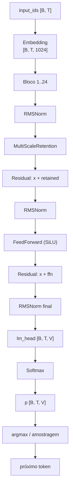

# O forward pass completo: do token à previsão


## Visão geral

Um modelo de linguagem é, no fundo, uma função que recebe uma sequência de inteiros (os IDs dos tokens) e devolve, para cada posição, a probabilidade de cada token do vocabulário ser o próximo. O caminho completo pode ser resumido em sete passos:

1. **Tokenização** — o texto vira uma lista de inteiros.
2. **Embedding** — cada inteiro vira um vetor denso.
4. **Normalização final** — o estado final é estabilizado.
5. **Cabeça de saída** — o vetor final é projetado para o tamanho do vocabulário, produzindo **logits**.
6. **Softmax** — logits viram probabilidades que somam 1.
7. **Escolha** — o `argmax` (ou uma amostragem) seleciona o próximo token.

Tudo isso acontece a cada passo de treinamento, uma vez para cada lote de dados. Entender o forward pass é pré-requisito para entender a função de perda e o backpropagation: só medimos o erro e propagamos gradientes através do que, de fato, foi calculado aqui.

## Intuição: o que significa "rodar o modelo"

Pense no modelo como uma máquina de **preencher lacunas**. Você entrega o prefixo `"o gato"` e pergunta: *o que vem depois?* Internamente, a máquina não trabalha com letras — ela trabalha com números. Cada palavra vira um número; cada número vira um vetor; os vetores passam por operações de matriz; e o resultado final é um placar dizendo "a palavra X merece 65% de chance, a Y merece 20%...".

O *forward pass* é justamente o momento em que essa máquina é percorrida da entrada para a saída. Nada é treinado durante o forward — os pesos são fixos (ou seja, são "só leitura" nesse instante). O que se obtém é uma previsão, que em seguida será comparada com a resposta certa pela função de perda.

## O vocabulário e o token

Antes de qualquer vetor, existe o **vocabulário**: a lista finita de símbolos que o modelo conhece. Ele pode conter palavras inteiras, subpalavras, pontuação e tokens especiais como `<pad>` (preenchimento) e `<bos>` (início de sequência). Cada símbolo recebe um índice inteiro.

> Exemplo: um vocabulário minúsculo com cinco entradas `["<pad>", "o", "gato", "come", "peixe"]` mapeia a palavra "gato" para o índice $2$.


## Do token ao vetor: o embedding

### A tabela de embedding


A operação é uma simples **busca de linha**: o token de índice $i$ é substituído pela linha $i$ da tabela.

$$
\text{embedding}(i) = E_i \quad\in\quad \mathbb{R}^{d_{model}}
$$

Para uma sequência inteira, o resultado é uma matriz de formato `[T, d_model]` (ou `[B, T, d_model]` em um lote):

| Etapa | Formato (shape) |
|---|---|
| `input_ids` | `[B, T]` |
| `embeddings` | `[B, T, d_model]` = `[B, T, 1024]` |

### Weight tying


## O corpo do modelo: camadas


1. `RMSNorm` (normalização).
2. **MultiScaleRetention** (o substituto da atenção).
3. conexão residual ($x \leftarrow x + \text{saída}$).
4. `RMSNorm` novamente.
5. **FeedForward** com ativação SiLU.
6. conexão residual novamente.

### Normalização RMSNorm

A `RMSNorm` estabiliza os números, mantendo a escala dos vetores sob controle. Para um vetor $x$ de dimensão $d$, ela calcula a raiz da média dos quadrados e divide cada componente por ela:

$$
\text{RMS}(x) = \sqrt{\frac{1}{d}\sum_{i=1}^{d} x_i^2}, \qquad
\tilde{x}_i = \frac{x_i}{\text{RMS}(x) + \varepsilon}
$$

O parâmetro $\varepsilon$ (um número minúsculo, como $10^{-6}$) evita divisão por zero. Em seguida, um vetor de ganhos $\gamma$ (aprendido, inicializado em 1) é multiplicado componente a componente. A normalização é essencial para que, após dezenas de camadas e centenas de passos de treino, os valores não "explodam" nem "desapareçam".

### Retenção multi-escala (RetNet)


$$
\text{Retention}(Q,K,V) = \left( Q K^\top \odot D \right) V
$$


Os passos internos, com shapes:

1. Projetar $x$ em consultas, chaves e valores com três camadas lineares ternárias (`q_proj`, `k_proj`, `v_proj`): cada uma leva `[B, T, d_model]` $\rightarrow$ `[B, T, d_model]`.
2. Reformatar para cabeças: `[B, T, H, D]` $\rightarrow$ transposto para `[B, H, T, D]`, com $H = 16$ cabeças e $D = 64$ a dimensão por cabeça (note que $H \cdot D = 1024 = d_{model}$).
3. Calcular as pontuações: $Q K^\top / \sqrt{D}$, resultando em `[B, H, T, T]`.
4. Multiplicar pela máscara de decaimento `[H, T, T]` (transmitida sobre o lote).
5. Multiplicar por $V$: `[B, H, T, T]` $\times$ `[B, H, T, D]` $\rightarrow$ `[B, H, T, D]`.
6. Desfazer a transposição e achatamento: `[B, T, d_model]`, e aplicar a projeção de saída `out_proj`.

Durante a **geração** (inferência), essa mesma rede roda em modo recorrente com um estado de tamanho fixo, sem recalcular tudo — mas isso é outro capítulo; no treino usamos a forma paralela acima.

### Feed-forward e SiLU

A sub-rede feed-forward dá "profundidade" à transformação. Ela expande a dimensão para $4 \cdot d_{model}$ (arredondado para múltiplo de 64, ou seja, $4096$), aplica a ativação **SiLU** e contrai de volta:

$$
\text{SiLU}(x) = x \cdot \sigma(x) = \frac{x}{1 + e^{-x}}
$$


### Conexões residuais

Cada sub-bloco termina somando sua saída à entrada: $x \leftarrow x + \text{sub}(x)$. Essa soma é o que permite treinar redes muito profundas: o gradiente consegue "escorregar" de volta pela identidade ($+x$) sem se perder, e cada bloco aprende apenas um **refinamento** em cima do que já existia.

## A cabeça de saída: logits

Depois das 24 camadas, aplicamos uma última `RMSNorm` e então a cabeça de linguagem (`lm_head`). Ela é uma camada linear que projeta cada vetor de dimensão $d_{model}$ para um vetor de dimensão $V$ (tamanho do vocabulário):

$$
z = x \, W^\top \quad\in\quad \mathbb{R}^{V}
$$

Cada componente $z_j$ é um **logit**: uma pontuação crua que mede o quão plausível é o token $j$ como próximo. Logits não são probabilidades — podem ser negativos e não somam 1. Por causa do weight tying, $W$ é exatamente a matriz de embedding $E$, transposta.

O formato final dos logits para o lote inteiro é `[B, T, V]`.

## Softmax: de logits a probabilidades

O softmax converte logits em probabilidades. Para um vetor $z$:

$$
p_j = \frac{e^{z_j}}{\sum_{k=1}^{V} e^{z_k}}
$$

O resultado é um vetor $p$ com componentes em $[0,1]$ que somam exatamente 1. Na prática, subtraímos o maior logit antes de exponenciar para evitar overflow numérico (técnica do log-sum-exp). A partir de $p$, o modelo "decide": o `argmax` escolhe o token mais provável, ou uma amostragem sorteia segundo $p$.

## Um exemplo numérico de ponta a ponta

Vamos percorrer tudo à mão com um mini-modelo. Vocabulário de $V = 5$: `["<pad>", "o", "gato", "come", "peixe"]` (índices 0 a 4), e dimensão $d_{model} = 3$ para caber no papel. Entrada: `"o gato"` (índices `[1, 2]`), e queremos prever o próximo token.

### Passo 1 — tokenização

A frase vira `input_ids = [1, 2]`.

### Passo 2 — embedding (busca de linha)

Definimos uma tabela de embedding $E$ de formato `[5, 3]`:

$$
E =
\begin{bmatrix}
0.0 & 0.0 & 0.0 \\
1.0 & 0.0 & 2.0 \\
0.5 & 1.5 & 1.0 \\
0.2 & 0.1 & 1.8 \\
1.2 & 0.8 & 0.6
\end{bmatrix}
$$

O token `"o"` (linha 1) vira $e_1 = [1.0, 0.0, 2.0]$; o token `"gato"` (linha 2) vira $e_2 = [0.5, 1.5, 1.0]$.

### Passo 3 — camada linear (simplificada no lugar da retenção)

Para manter o exemplo legível, o "corpo" do mini-modelo é uma única camada linear com matriz $W_h$ (formato `[3, 3]`):

$$
W_h =
\begin{bmatrix}
 0.5 &  0.2 & -0.1 \\
-0.3 &  1.0 &  0.4 \\
 0.0 & -0.5 &  0.8
\end{bmatrix}
$$

Calculamos o estado do último token (a previsão só depende dele, no modelo autoregressivo):

$$
h = e_2 \, W_h
$$

Componente a componente:

$$
h_0 = 0.5 \cdot 0.5 + 1.5 \cdot (-0.3) + 1.0 \cdot 0.0 = 0.25 - 0.45 = -0.20
$$

$$
h_1 = 0.5 \cdot 0.2 + 1.5 \cdot 1.0 + 1.0 \cdot (-0.5) = 0.1 + 1.5 - 0.5 = 1.10
$$

$$
h_2 = 0.5 \cdot (-0.1) + 1.5 \cdot 0.4 + 1.0 \cdot 0.8 = -0.05 + 0.6 + 0.8 = 1.35
$$

Logo $h = [-0.20, 1.10, 1.35]$.

### Passo 4 — RMSNorm

Soma dos quadrados:

$$
0.20^2 + 1.10^2 + 1.35^2 = 0.04 + 1.21 + 1.8225 = 3.0725
$$

Média: $3.0725 / 3 \approx 1.02417$; raiz: $\sqrt{1.02417} \approx 1.0120$. Dividindo cada componente (ganho $\gamma = 1$):

$$
\tilde{h} = \left[ \frac{-0.20}{1.0120},\; \frac{1.10}{1.0120},\; \frac{1.35}{1.0120} \right] \approx [-0.1976,\; 1.0870,\; 1.3340]
$$

### Passo 5 — cabeça de saída (logits)

A matriz da cabeça $W_o$ tem formato `[5, 3]` (uma linha por token do vocabulário):

$$
W_o =
\begin{bmatrix}
 0.3 &  0.1 &  0.2 \\
 0.1 & -0.4 &  0.3 \\
 0.5 &  0.2 &  0.1 \\
 0.1 &  0.6 &  0.9 \\
-0.2 &  0.3 &  0.7
\end{bmatrix}
$$

Os logits são $z = W_o \tilde{h}^\top$. Para o token `"come"` (linha 3):

$$
z_3 = 0.1 \cdot (-0.1976) + 0.6 \cdot 1.0870 + 0.9 \cdot 1.3340 \approx -0.0198 + 0.6522 + 1.2006 = 1.8330
$$

Repetindo para todos, obtemos:

$$
z \approx [0.3162,\; -0.0544,\; 0.2520,\; 1.8330,\; 1.2994]
$$

O maior logit é o do índice 3 — o token `"come"` já é o favorito.

### Passo 6 — softmax

Subtraímos o máximo ($1.8330$) para estabilidade, obtendo os logits deslocados $[-1.5168, -1.8874, -1.5810, 0.0, -0.5336]$. Exponenciais:

$$
e^{-1.5168} \approx 0.2194,\quad e^{-1.8874} \approx 0.1515,\quad e^{-1.5810} \approx 0.2058,\quad e^{0} = 1.0,\quad e^{-0.5336} \approx 0.5865
$$

Soma: $0.2194 + 0.1515 + 0.2058 + 1.0 + 0.5865 = 2.1632$. Dividindo cada termo:

$$
p \approx [0.1014,\; 0.0700,\; 0.0951,\; 0.4623,\; 0.2712]
$$

A soma é $1.0000$, como esperado. O modelo dá $46.23\%$ de chance a `"come"`, $27.12\%$ a `"peixe"` e assim por diante.

### Passo 7 — argmax e perda

O `argmax` de $p$ é o índice 3 (`"come"`), que é exatamente a resposta esperada. A perda (entropia cruzada) é o negativo do log da probabilidade do token correto:

$$
\mathcal{L} = -\ln(0.4623) \approx 0.7714
$$

Este número é o "erro" que o backpropagation tentará reduzir no passo seguinte.

## Código: mini-modelo completo

```python
import torch
import torch.nn.functional as F

V, D = 5, 3          # vocabulário, dimensão do embedding
vocab = ["<pad>", "o", "gato", "come", "peixe"]

E = torch.tensor([
    [0.0, 0.0, 0.0],
    [1.0, 0.0, 2.0],
    [0.5, 1.5, 1.0],
    [0.2, 0.1, 1.8],
    [1.2, 0.8, 0.6],
])

W_h = torch.tensor([
    [ 0.5,  0.2, -0.1],
    [-0.3,  1.0,  0.4],
    [ 0.0, -0.5,  0.8],
])

W_o = torch.tensor([
    [ 0.3,  0.1,  0.2],
    [ 0.1, -0.4,  0.3],
    [ 0.5,  0.2,  0.1],
    [ 0.1,  0.6,  0.9],
    [-0.2,  0.3,  0.7],
])

def rmsnorm(x, eps=1e-6):
    rms = torch.sqrt((x ** 2).mean(-1, keepdim=True) + eps)
    return x / rms

def forward(input_ids):
    x = E[input_ids]              # [T, D]  embedding (lookup)
    h = x @ W_h                   # [T, D]  camada linear
    h = rmsnorm(h)                # [T, D]  normalização
    logits = h[-1] @ W_o.T        # [V]     cabeça (só o último token)
    p = torch.softmax(logits, dim=-1)
    return logits, p

ids = torch.tensor([1, 2])        # "o gato"
logits, p = forward(ids)
print("logits:", logits.round(decimals=4))
print("p:", p.round(decimals=4))
print("argmax:", vocab[int(torch.argmax(p))])

alvo = torch.tensor([3])          # token correto: "come"
loss = F.cross_entropy(logits.unsqueeze(0), alvo)
print("loss:", round(loss.item(), 4))
```

Rodando, a saída reproduz exatamente os números calculados à mão: `argmax` igual a `come` e `loss` $\approx 0.7714$.

# --- BitLinear: camada linear com pesos ternários (-1, 0, +1) ---
def bitlinear_forward(w, x):
    scale = w.abs().mean().clamp(min=1e-5)        # escala dos pesos
    qw = torch.round(w / scale).clamp(-1, 1)      # pesos ternários
    ste = (qw - w / scale).detach() + w / scale   # straight-through
    return F.linear(x, ste) * scale               # MatMul barata + rescala

# --- MultiScaleRetention: retenção com decaimento ---
def retention_forward(x, q_proj, k_proj, v_proj, out_proj, gammas, head_dim):
    B, T, D = x.shape
    H = D // head_dim
    q = q_proj(x).view(B, T, H, head_dim).transpose(1, 2)  # [B,H,T,D]
    k = k_proj(x).view(B, T, H, head_dim).transpose(1, 2)
    v = v_proj(x).view(B, T, H, head_dim).transpose(1, 2)

    scores = q @ k.transpose(-2, -1) / (head_dim ** 0.5)   # [B,H,T,T]
    n = torch.arange(T).unsqueeze(1)
    m = torch.arange(T).unsqueeze(0)
    dist = (n - m).clamp(min=0)
    causal = (n - m >= 0).float()
    decay = (gammas.view(-1, 1, 1) ** dist) * causal        # [H,T,T]
    out = (scores * decay.unsqueeze(0)) @ v                 # [B,H,T,D]
    out = out.transpose(1, 2).contiguous().view(B, T, D)
    return out_proj(out)

# --- Bloco completo ---
def block_forward(x, norm1, retention, norm2, ffn):
    x = x + retention(norm1(x))
    x = x + ffn(norm2(x))
    return x

# --- Modelo inteiro ---
def model_forward(input_ids, embeddings, layers, norm_f, lm_head):
    x = embeddings(input_ids)          # [B,T,1024]
    for layer in layers:               # 24 blocos
        x = layer(x)                   # [B,T,1024]
    x = norm_f(x)                      # [B,T,1024]
    return lm_head(x)                  # [B,T,V]
```

Note duas diferenças em relação ao mini-modelo: (1) cada camada linear é **ternária** via `BitLinear`; (2) o "corpo" usa retenção em vez de uma simples camada linear. O restante — embedding, normalização final, cabeça e softmax — é idêntico.

## Tabela de shapes completa

| Etapa | Operação | Formato de saída |
|---|---|---|
| Entrada | tokenização | `[B, T]` |
| Embedding | `nn.Embedding` | `[B, T, 1024]` |
| Bloco: norma 1 | `RMSNorm` | `[B, T, 1024]` |
| Bloco: projeções q/k/v | `BitLinear` | `[B, T, 1024]` cada |
| Bloco: rearranjo em cabeças | `view + transpose` | `[B, 16, T, 64]` |
| Bloco: pontuações | `Q @ K^T / sqrt(64)` | `[B, 16, T, T]` |
| Bloco: decaimento | `gamma^dist * causal` | `[16, T, T]` |
| Bloco: mistura de valores | `scores @ V` | `[B, 16, T, 64]` |
| Bloco: projeção de saída | `out_proj` | `[B, T, 1024]` |
| Bloco: residual | `x + retained` | `[B, T, 1024]` |
| Bloco: feed-forward | `fc1 -> SiLU -> fc2` | `[B, T, 4096] -> [B, T, 1024]` |
| Final | `RMSNorm` | `[B, T, 1024]` |
| Cabeça | `lm_head` | `[B, T, V]` |
| Softmax | `softmax(dim=-1)` | `[B, T, V]` |

## Diagrama detalhado



O interior da retenção:

```mermaid
flowchart LR
    X["x [B,T,1024]"] --> Q["q_proj"]
    X --> K["k_proj"]
    X --> V["v_proj"]
    Q --> QK["Q @ Kᵀ / √D<br/>[B,16,T,T]"]
    K --> QK
    QK --> D["× decaimento γ^dist<br/>[16,T,T]"]
    D --> M["@ V"]
    V --> M
    M --> O["out_proj<br/>[B,T,1024]"]
