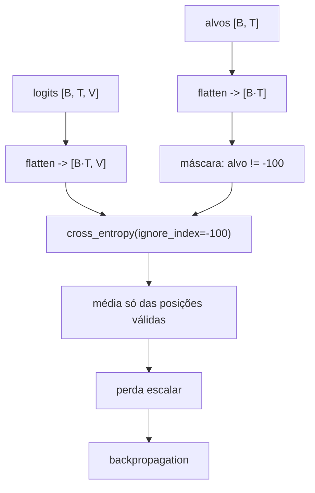

# Função de perda (loss): medir o erro

> Depois que o forward pass produz uma distribuição de probabilidade, precisamos responder a uma pergunta simples: *o modelo acertou?* A função de perda transforma essa pergunta em um número — um escalar que resume o erro de uma previsão ou de um lote inteiro. Treinar é, literalmente, fazer esse número descer.

## Visão geral

A função de perda (ou *loss*) é a ponte entre "o modelo previu algo" e "o modelo deve melhorar". Ela recebe a previsão (logits ou probabilidades) e a resposta correta (o token-alvo) e devolve um único número: quanto maior o número, pior o modelo. O algoritmo de treinamento (gradiente descendente + backpropagation) usa o **gradiente** desse número para ajustar os pesos.

Para modelos de linguagem, a perda padrão é a **entropia cruzada** (*cross-entropy*), que neste contexto se reduz a uma forma muito simples:

$$
\mathcal{L} = -\log p_c
$$

onde $p_c$ é a probabilidade que o modelo atribuiu ao token correto. Toda a riqueza desta página está em entender *por quê* essa fórmula é a escolhida, como ela se comporta e como ela se generaliza para um lote inteiro com padding.

## Intuição: uma régua que pune confiança errada

Imagine que o modelo deva prever a próxima palavra depois de `"o gato"` e a resposta certa é `"come"`. O modelo dá três respostas possíveis em três cenários:

| Probabilidade dada a "come" | O modelo está... | Perda $-\log p_c$ |
|---|---|---|
| $0.90$ | quase certo e certo | $0.105$ |
| $0.46$ | hesitante, mas escolhe certo | $0.771$ |
| $0.10$ | quase errado | $2.303$ |
| $0.01$ | muito errado | $4.605$ |

Duas observações saltam aos olhos. Primeiro, a perda é **sempre não negativa** e vale $0$ apenas quando $p_c = 1$ (certeza total na resposta certa). Segundo, a perda **cresce cada vez mais rápido** conforme $p_c$ cai: cair de $0.90$ para $0.46$ custa só $+0.67$, mas cair de $0.10$ para $0.01$ custa $+2.30$. Isso é a assinatura do logaritmo, e é exatamente o comportamento que queremos: errar feio deve doer muito mais do que errar de raspão.

## Conceito: a distribuição-alvo one-hot

Em cada posição da sequência, sabemos qual é o token correto. Representamos esse conhecimento como uma distribuição **one-hot**: um vetor $y$ do tamanho do vocabulário com $1$ na posição correta e $0$ em todas as outras. Para um vocabulário de 5 tokens e resposta `"come"` (índice 3):

$$
y = [0,\; 0,\; 0,\; 1,\; 0]
$$

O modelo, por sua vez, produz uma distribuição prevista $p$ que, em geral, espalha massa por vários tokens (não é one-hot). A perda mede a **divergência** entre $y$ (o que deveria ser) e $p$ (o que o modelo acha).

## A entropia cruzada: definição

A entropia cruzada entre $y$ e $p$ é:

$$
H(y, p) = -\sum_{j=1}^{V} y_j \log p_j
$$

Como $y$ é one-hot, todos os termos da soma se anulam exceto o da classe correta ($y_c = 1$), e a expressão colapsa para:

$$
H(y, p) = -\log p_c
$$

Este é o formato que usamos o tempo todo: **o negativo do logaritmo da probabilidade atribuída à resposta correta**.

### De onde vem o logaritmo: máxima verossimilhança

A escolha não é arbitrária. Treinar um modelo de linguagem é, em essência, **maximizar a probabilidade do texto real**. Para uma sequência de $T$ tokens, a probabilidade conjunta é o produto das probabilidades condicionais:

$$
P(x_1, \dots, x_T) = \prod_{t=1}^{T} p(x_t \mid x_{<t})
$$

Produtos de muitos números entre $0$ e $1$ ficam absurdamente pequenos (pense em $0.5^{1000}$), o que estoura a precisão do computador. Aplicamos o **logaritmo**, que transforma produto em soma:

$$
\log P = \sum_{t=1}^{T} \log p(x_t \mid x_{<t})
$$

Finalmente, multiplicamos por $-1$ para transformar "maximizar" em "minimizar" (convenção de otimizadores), chegando à entropia cruzada acumulada:

$$
\mathcal{L} = -\sum_{t=1}^{T} \log p(x_t \mid x_{<t})
$$

Ou seja: **minimizar a entropia cruzada é exatamente maximizar a verossimilhança do texto**. Esse vínculo é o motivo teórico pelo qual todo LLM usa essa perda.

### Por que o log especificamente?

O logaritmo cumpre três papéis de uma vez:

1. **Transforma produto em soma**, evitando números minúsculos e tornando o cálculo estável e paralelizável.
2. **Pune fortemente os erros graves**: como $\log$ cresce devagar, dar $p_c = 0.01$ em vez de $0.1$ multiplica a perda por $\log(0.1)/\log(0.01) = (-2.303)/(-4.605) = 0.5$... mais precisamente, a perda de $0.01$ é o **dobro** da de $0.1$, enquanto a probabilidade caiu $10\times$. Erros de confiança são caros.
3. **Gera um gradiente limpo**: combinado com o softmax, o gradiente da entropia cruzada em relação aos logits é a diferença simples $p - y$, que é trivial de calcular no backpropagation.

## Exemplo numérico completo

Vamos reusar o mini-modelo da página de forward pass. O modelo previu, para `"o gato"`, a distribuição:

$$
p = [0.1014,\; 0.0700,\; 0.0951,\; 0.4623,\; 0.2712]
$$

sobre o vocabulário `["<pad>", "o", "gato", "come", "peixe"]`. A resposta correta é `"come"` (índice 3), então $p_c = 0.4623$.

### Passo 1 — identificar a probabilidade correta

$p_c = p_3 = 0.4623$.

### Passo 2 — aplicar o logaritmo natural

$$
\ln(0.4623) \approx -0.7714
$$

### Passo 3 — negar

$$
\mathcal{L} = -\ln(0.4623) = -(-0.7714) = 0.7714
$$

Essa é a perda de um único token. Para conferir com a fórmula completa da soma (que, com o alvo one-hot, deveria dar o mesmo):

$$
H(y,p) = -[0 \cdot \ln 0.1014 + 0 \cdot \ln 0.0700 + 0 \cdot \ln 0.0951 + 1 \cdot \ln 0.4623 + 0 \cdot \ln 0.2712]
$$

Todos os termos com $y_j = 0$ somem, e o que sobra é $-\ln 0.4623 = 0.7714$, confirmando.

### Uma tabela de sensibilidade

Para o mesmo alvo, veja como a perda reage a diferentes previsões:

| $p_c$ previsto | $\ln p_c$ | perda $-\ln p_c$ |
|---|---|---|
| $0.99$ | $-0.010$ | $0.010$ |
| $0.70$ | $-0.357$ | $0.357$ |
| $0.50$ | $-0.693$ | $0.693$ |
| $0.10$ | $-2.303$ | $2.303$ |
| $0.001$ | $-6.908$ | $6.908$ |

O valor $\ln 2 \approx 0.693$ é um marco importante: probabilidade $0.5$ custa exatamente $0.693$ nats. Perplexidade (veremos abaixo) converte isso de volta para uma escala intuitiva.

## A perda de um lote

Um único token não treina ninguém. Na prática, processamos um lote de sequências de uma vez e calculamos a perda **média** sobre todas as posições válidas.

### Os formatos em um lote

Os logits do lote têm formato `[B, T, V]` (lote, posições, vocabulário) e os alvos, `[B, T]` (lote, posições). Antes de calcular a perda, "achatamos" (flatten) as duas primeiras dimensões:

- logits: `[B, T, V]` $\rightarrow$ `[B·T, V]`
- alvos: `[B, T]` $\rightarrow$ `[B·T]`

A entropia cruzada é então a média sobre os $N = B \cdot T$ pares (logit, alvo):

$$
\mathcal{L} = \frac{1}{N}\sum_{i=1}^{N} -\log p_{y_i}^{(i)}
$$

onde $p^{(i)}$ é a distribuição prevista para o exemplo $i$ e $y_i$ é o índice do token correto daquele exemplo.

### Exemplo numérico de lote

Considere um lote com $B = 2$ sequências e $T = 3$ posições. Para cada posição, registramos a probabilidade $p_c$ que o modelo deu ao token correto:

| Sequência | Posição 0 | Posição 1 | Posição 2 |
|---|---|---|---|
| 0 | $p_c = 0.70$ | $p_c = 0.20$ | $p_c = 0.90$ |
| 1 | $p_c = 0.50$ | (padding) | (padding) |

As perdas por posição (somente as válidas):

$$
-\ln(0.70) \approx 0.357, \quad -\ln(0.20) \approx 1.609, \quad -\ln(0.90) \approx 0.105, \quad -\ln(0.50) \approx 0.693
$$

Soma: $0.357 + 1.609 + 0.105 + 0.693 = 2.764$. Há 4 posições válidas, então a média é:

$$
\mathcal{L} = \frac{2.764}{4} = 0.691
$$

Note o detalhe crucial: dividimos por **4** (posições válidas), não por **6** (posições totais do lote). As duas posições de padding da sequência 1 não entram nem no numerador nem no denominador. Se entrassem, diluiriam (ou inflariam) a perda de forma espúria — é isso que o `ignore_index` resolve.

## O `ignore_index` e o padding

### O problema do padding

Sequências de um lote têm comprimentos diferentes. Para empilhá-las numa matriz retangular `[B, T]`, preenchemos as posições que faltam com um token especial de padding (por exemplo, índice `0`). Mas essas posições **não são texto real** — o modelo não deve ser punido nem recompensado por "prever" padding.

Sem tratamento, o padding viraria um alvo legítimo: o modelo aprenderia a "prever padding", o que é inútil e ainda distorce a média da perda (que é sensível a quantas posições existem).

### A solução: `ignore_index`

O PyTorch aceita um valor especial `ignore_index` (convencionalmente `-100`): toda posição cujo alvo é igual a esse valor é **ignorada** no cálculo da perda. Ela não contribui para a soma e não conta no denominador da média.

```python
import torch
import torch.nn.functional as F

# lote de 2 sequências, vocab de 5, comprimento máximo 3
logits = torch.randn(2, 3, 5)          # [B, T, V]

# alvos: a sequência 1 só tem 1 token real; o resto é padding
alvos = torch.tensor([
    [2, 3, 4],      # sequência completa
    [1, -100, -100] # só a posição 0 é real
])

loss = F.cross_entropy(
    logits.reshape(-1, 5),   # [B*T, V]
    alvos.reshape(-1),       # [B*T]
    ignore_index=-100,
)
print("perda do lote:", round(loss.item(), 4))
```

Internamente, o PyTorch descarta os pares com alvo `-100` e calcula a média apenas sobre os demais.

### Diagrama do fluxo de uma perda de lote



### Reduções disponíveis

A `cross_entropy` aceita três modos de redução:

| `reduction` | Comportamento | Uso típico |
|---|---|---|
| `'mean'` | média sobre as posições válidas | treino (padrão) |
| `'sum'` | soma (sem dividir) | quando o denominador é controlado à mão |
| `'none'` | devolve a perda por posição | diagnóstico, máscaras customizadas |


## Relação com a perplexidade

A perda média por token tem uma interpretação famosa quando exponenciada: a **perplexidade** (PPL).

$$
\text{PPL} = e^{\mathcal{L}_{\text{média}}}
$$

onde $\mathcal{L}_{\text{média}}$ é a perda média por token (em nats, log natural). A perplexidade pode ser lida como "o número médio de alternativas igualmente prováveis entre as quais o modelo se sente indeciso".

### Exemplos

- Perda média $0.693 = \ln 2$ $\Rightarrow$ $\text{PPL} = e^{0.693} = 2.0$: o modelo está tão confuso quanto alguém escolhendo entre 2 opções.
- Perda média $2.303$ $\Rightarrow$ $\text{PPL} = e^{2.303} = 10.0$: confuso como entre 10 opções.
- Perda média $0$ $\Rightarrow$ $\text{PPL} = 1.0$: modelo perfeito.

Como a exponencial é monótona, minimizar a perda e minimizar a perplexidade são a mesma coisa; a perplexidade só é mais "humanamente legível" porque cresce de forma linear com a quantidade de incerteza (uma PPL de 100 é intuitivamente "pior" que 10, enquanto a diferença entre $0.693$ e $2.303$ é menos óbvia).

### Uma identidade útil

A perda de um único token pode ser reescrita em termos do log-sum-exp dos logits:

$$
-\log p_c = -\log\left(\frac{e^{z_c}}{\sum_j e^{z_j}}\right) = -z_c + \log\left(\sum_j e^{z_j}\right)
$$

Essa forma é a que as bibliotecas implementam por trás dos panos, pois o log-sum-exp é numericamente estável mesmo com logits grandes.

## Código: calculando a perda de várias formas

```python
import torch
import torch.nn.functional as F

# logits de um único exemplo (vocab de 5)
z = torch.tensor([0.3162, -0.0544, 0.2520, 1.8330, 1.2994])
alvo = torch.tensor([3])          # token correto: "come"

# 1. API direta
loss = F.cross_entropy(z.unsqueeze(0), alvo)
print("cross_entropy:", round(loss.item(), 4))          # 0.7714

# 2. manual, via softmax
p = torch.softmax(z, dim=-1)
manual = -torch.log(p[3])
print("manual -log p_c:", round(manual.item(), 4))      # 0.7714

# 3. manual, via log-sum-exp (estável)
lse = torch.logsumexp(z, dim=-1)
stable = -z[3] + lse
print("via logsumexp:", round(stable.item(), 4))        # 0.7714

# 4. redução 'none' para diagnóstico (posição a posição)
logits_b = torch.randn(2, 3, 5)
alvos_b = torch.tensor([[2, 3, 4], [1, -100, -100]])
por_posicao = F.cross_entropy(
    logits_b.reshape(-1, 5), alvos_b.reshape(-1),
    ignore_index=-100, reduction='none',
)
print("perda por posição:", por_posicao.round(decimals=4))
print("média manual (ignorando -100):", por_posicao[por_posicao > 0].mean().round(decimals=4))
```

O último bloco mostra o coração do `ignore_index`: as posições ignoradas recebem valor de perda `0.0`, e a média é tomada apenas sobre as demais.

## Erros comuns

- **Usar logits direto na fórmula manual sem softmax**: a identidade $-\log p_c$ exige $p$ (probabilidade), não $z$ (logit). Confundir os dois dá perda negativa ou absurda.
- **Esquecer o `ignore_index`**: posições de padding entram na média e distorcem a perda.
- **Aplicar `softmax` + `log` + `nll_loss` na mão**: redundante e numericamente instável. Use `cross_entropy` direto sobre logits.
- **Confundir base do logaritmo**: a entropia cruzada do PyTorch usa log natural (unidade *nats*). Para obter *bits*, divida por $\ln 2$.
- **Dividir pela contagem errada na média**: a média deve ser sobre as posições **válidas**, não sobre o total de entradas do tensor.
- **Usar `reduction='sum'` sem dividir pelo tamanho do lote**: a magnitude da perda passa a depender do tamanho do lote, o que desestabiliza a taxa de aprendizado.
- **Achar que perda zero é atingível**: com vocabulário grande e texto real, a perda nunca chega a zero; o que importa é a tendência e a perplexidade relativa.

## Resumo

- A perda transforma a comparação "previu vs. correto" em um único escalar não negativo.
- A perda padrão de LLMs é a **entropia cruzada**, que com alvo one-hot se reduz a $\mathcal{L} = -\log p_c$.
- O logaritmo converte o produto de probabilidades em soma, estabiliza o cálculo e pune fortemente erros confiantes.
- Minimizar entropia cruzada equivale a **maximizar a verossimilhança do texto**.
- A perda de um lote é a média sobre as posições válidas, com `ignore_index=-100` descartando o padding.
- A **perplexidade** é $e^{\text{perda média}}$ e dá uma escala intuitiva à incerteza do modelo.
