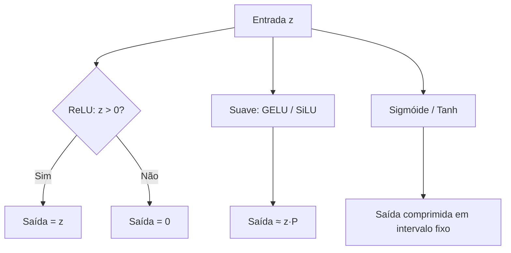

# Funções de ativação

> "Sem não-linearidade, cem camadas lineares continuam sendo uma única transformação linear. A função de ativação é o que dá às redes neurais o poder de aproximar qualquer função."

---

## 1. Intuição: por que precisamos quebrar a linha reta?

Imagine que você quer separar, em um plano, pontos azuis e pontos vermelhos. Se os pontos estão separados por uma reta, um único neurônio (que traça uma fronteira linear) resolve. Mas se os pontos estão organizados em círculos concêntricos — azuis no centro, vermelhos em volta — nenhuma reta consegue separá-los.

A função de ativação é o ingrediente que permite "dobrar" o espaço de decisão. Ela pega a saída linear da soma ponderada e a transforma de forma **não-linear**, permitindo que uma rede profunda aproxime curvas, superfícies e fronteiras de decisão arbitrariamente complexas.

### 1.1 O argumento decisivo: composição de lineares é linear

Suponha duas camadas lineares, sem ativação:

$$
\mathbf{h} = \mathbf{W}^{(1)} \mathbf{x} + \mathbf{b}^{(1)}
$$

$$
\mathbf{y} = \mathbf{W}^{(2)} \mathbf{h} + \mathbf{b}^{(2)}
$$

Substituindo a primeira na segunda:

$$
\mathbf{y} = \mathbf{W}^{(2)} \left(\mathbf{W}^{(1)} \mathbf{x} + \mathbf{b}^{(1)}\right) + \mathbf{b}^{(2)}
$$

$$
\mathbf{y} = \left(\mathbf{W}^{(2)} \mathbf{W}^{(1)}\right) \mathbf{x} + \left(\mathbf{W}^{(2)} \mathbf{b}^{(1)} + \mathbf{b}^{(2)}\right)
$$

Definindo $\mathbf{W}' = \mathbf{W}^{(2)} \mathbf{W}^{(1)}$ e $\mathbf{b}' = \mathbf{W}^{(2)} \mathbf{b}^{(1)} + \mathbf{b}^{(2)}$, vemos que duas camadas lineares equivalem a **uma única** camada linear:

$$
\mathbf{y} = \mathbf{W}' \mathbf{x} + \mathbf{b}'
$$

Ou seja: **sem ativação, profundidade não serve para nada**. Uma rede de 100 camadas lineares é matematicamente idêntica a uma única camada linear. É a não-linearidade que faz cada camada adicionar poder de representação.

---

## 2. O que é uma função de ativação?

Uma função de ativação é uma função $\sigma : \mathbb{R} \rightarrow \mathbb{R}$ aplicada elemento a elemento sobre a pré-ativação $z$:

$$
a = \sigma(z), \quad z = \mathbf{w} \cdot \mathbf{x} + b
$$

Ela deve ser, idealmente:

- **Não-linear**: para quebrar a linearidade da composição.
- **Diferenciável** (na prática, diferenciável em quase todos os pontos): para permitir o gradiente descendente.
- **Computacionalmente barata**: pois é aplicada bilhões de vezes.

---

## 3. A sigmoide

A sigmoide "espreme" qualquer número real para o intervalo $(0, 1)$:

$$
\sigma(z) = \frac{1}{1 + e^{-z}}
$$

### 3.1 Propriedades

- Domínio: $\mathbb{R}$, imagem: $(0, 1)$.
- Suave e monotonicamente crescente.
- Interpretável como probabilidade.

### 3.2 Derivada

A derivada da sigmoide tem uma forma elegante e computacionalmente útil:

$$
\sigma'(z) = \sigma(z) \cdot (1 - \sigma(z))
$$

### 3.3 Exemplo numérico

Para $z = 0.5$:

$$
\sigma(0.5) = \frac{1}{1 + e^{-0.5}} \approx \frac{1}{1 + 0.607} \approx 0.622
$$

Derivada:

$$
\sigma'(0.5) = 0.622 \cdot (1 - 0.622) \approx 0.622 \cdot 0.378 \approx 0.235
$$

### 3.4 Problema: saturação

Para $|z|$ grande, a derivada tende a zero:

$$
\lim_{z \to +\infty} \sigma'(z) = 0, \qquad \lim_{z \to -\infty} \sigma'(z) = 0
$$

Isso causa o **problema do gradiente que desaparece** (*vanishing gradient*): em redes profundas, os gradientes se multiplicam camada a camada e podem se tornar tão pequenos que o treinamento estagna. Por isso, a sigmoide caiu em desuso nas camadas ocultas, permanecendo útil apenas em saídas de classificação binária.

---

## 4. A Tanh (tangente hiperbólica)

A tanh é uma versão "centralizada" da sigmoide, com imagem em $(-1, 1)$:

$$
\tanh(z) = \frac{e^{z} - e^{-z}}{e^{z} + e^{-z}}
$$

### 4.1 Propriedades

- Imagem: $(-1, 1)$, centrada em zero.
- Melhor que a sigmoide para camadas ocultas porque produz saídas com média próxima de zero.

### 4.2 Derivada

$$
\tanh'(z) = 1 - \tanh^2(z)
$$

### 4.3 Exemplo numérico

Para $z = 0.5$:

$$
\tanh(0.5) = \frac{e^{0.5} - e^{-0.5}}{e^{0.5} + e^{-0.5}} \approx \frac{1.649 - 0.607}{1.649 + 0.607} \approx 0.462
$$

Derivada:

$$
\tanh'(0.5) = 1 - (0.462)^2 \approx 1 - 0.213 = 0.787
$$

A tanh ainda sofre de saturação nos extremos, mas sua centralização a torna preferível à sigmoide em camadas ocultas.

---

## 5. A ReLU (Unidade Linear Retificada)

A ReLU é a função que dominou a última década de deep learning:

$$
\mathrm{ReLU}(z) = \max(0, z)
$$

### 5.1 Propriedades

- Para $z > 0$: retorna $z$ (linear).
- Para $z \le 0$: retorna $0$ (constante).

### 5.2 Derivada

$$
\mathrm{ReLU}'(z) = \begin{cases} 1, & z > 0 \\ 0, & z \le 0 \end{cases}
$$

### 5.3 Exemplo numérico

- $\mathrm{ReLU}(2.5) = 2.5$, derivada $= 1$.
- $\mathrm{ReLU}(-1.0) = 0.0$, derivada $= 0$.
- $\mathrm{ReLU}(0) = 0.0$, derivada indefinida (na prática, atribui-se $0$).

### 5.4 Vantagens e desvantagens

**Vantagens:**

- Computacionalmente trivial: é só uma comparação.
- Derivada constante $1$ para valores positivos, evitando o *vanishing gradient*.

**Desvantagens:**

- O problema do **neurônio morto** (*dying ReLU*): se um neurônio recebe sempre $z \le 0$, seu gradiente é $0$ e ele para de aprender para sempre.

---

## 6. A GELU (Gaussian Error Linear Unit)

A GELU suaviza a ReLU ponderando a entrada pela probabilidade acumulada de uma normal padrão:

$$
\mathrm{GELU}(z) = z \cdot \Phi(z)
$$

onde $\Phi(z)$ é a função de distribuição acumulada da normal padrão:

$$
\Phi(z) = \frac{1}{2}\left(1 + \mathrm{erf}\left(\frac{z}{\sqrt{2}}\right)\right)
$$

### 6.1 Intuição

A GELU comporta-se como uma "ReLU suave": para $z$ muito negativo, $\Phi(z) \to 0$ e a saída tende a $0$; para $z$ muito positivo, $\Phi(z) \to 1$ e a saída tende a $z$. A transição, porém, é suave e não em "quina" como na ReLU.

### 6.2 Derivada

A derivada envolve a função de densidade normal $\phi(z)$:

$$
\mathrm{GELU}'(z) = \Phi(z) + z \cdot \phi(z)
$$

### 6.3 Exemplo numérico

Para $z = 0.5$:

$$
\Phi(0.5) \approx 0.6915
$$

$$
\mathrm{GELU}(0.5) = 0.5 \cdot 0.6915 \approx 0.346
$$

### 6.4 Uso

A GELU é a ativação padrão dos **Transformers modernos** (BERT, GPT). É mais cara que a ReLU por envolver $\mathrm{erf}$, mas entrega treinamento ligeiramente melhor em modelos grandes.

---

## 7. A SiLU / Swish

A SiLU (também chamada Swish) multiplica a entrada pela sigmoide:

$$
\mathrm{SiLU}(z) = z \cdot \sigma(z) = \frac{z}{1 + e^{-z}}
$$

### 7.1 Derivada

$$
\mathrm{SiLU}'(z) = \sigma(z) + z \cdot \sigma(z)(1 - \sigma(z))
$$

### 7.2 Exemplo numérico

Para $z = 0.5$:

$$
\sigma(0.5) \approx 0.622
$$

$$
\mathrm{SiLU}(0.5) = 0.5 \cdot 0.622 \approx 0.311
$$

### 7.3 Propriedades

- Semelhante à GELU: é uma ReLU suave.
- Não é monotonicamente crescente (tem um leve "mergulho" negativo próximo de zero), o que alguns autores apontam como vantagem para regularização.

---

## 8. Tabela comparativa

| Função | Fórmula | Imagem | Derivada | Problema principal |
|---|---|---|---|---|
| Sigmóide | $\dfrac{1}{1+e^{-z}}$ | $(0,1)$ | $\sigma(1-\sigma)$ | Vanishing gradient |
| Tanh | $\dfrac{e^z - e^{-z}}{e^z + e^{-z}}$ | $(-1,1)$ | $1 - \tanh^2$ | Vanishing gradient |
| ReLU | $\max(0, z)$ | $[0,\infty)$ | $\{0,1\}$ | Neurônio morto |
| GELU | $z \cdot \Phi(z)$ | $(-\varepsilon, \infty)$ | $\Phi + z\phi$ | Custo computacional |
| SiLU/Swish | $z \cdot \sigma(z)$ | $(-\varepsilon, \infty)$ | $\sigma + z\sigma(1-\sigma)$ | Custo computacional |

---

## 9. Visualização das formas (diagrama)



Aqui representamos as três "famílias" de ativação: a ReLU (com corte brusco), as suaves (GELU/SiLU, que cortam de forma gradual) e as saturadas (sigmóide/tanh, que comprimem em intervalo fixo).

---

## 10. Gráficos textuais das curvas

Para uma ideia qualitativa da forma (valores aproximados da saída em função de $z$):

**ReLU:** para $z$ de $-2$ a $2$, a saída é $[0, 0, 0, 1, 2]$.

**GELU/SiLU:** para $z$ de $-2$ a $2$, a saída é aproximadamente $[-0.05, -0.08, 0, 0.62, 1.76]$ — suave, ligeiramente negativa antes de zero.

**Sigmóide:** para $z$ de $-2$ a $2$, a saída é aproximadamente $[0.12, 0.27, 0.5, 0.73, 0.88]$ — sempre entre $0$ e $1$.

**Tanh:** para $z$ de $-2$ a $2$, a saída é aproximadamente $[-0.96, -0.76, 0, 0.76, 0.96]$ — sempre entre $-1$ e $1$.

---

## 11. Código

### 11.1 Implementação do zero

```python
import math

def sigmoide(z):
    return 1.0 / (1.0 + math.exp(-z))

def tanh(z):
    return math.tanh(z)

def relu(z):
    return max(0.0, z)

def gelu(z):
    return 0.5 * z * (1.0 + math.erf(z / math.sqrt(2.0)))

def silu(z):
    return z * sigmoide(z)

for z in [-2.0, -1.0, 0.0, 1.0, 2.0]:
    print(f"z={z:+.1f} | sig={sigmoide(z):.3f} | tanh={tanh(z):.3f} | "
          f"relu={relu(z):.3f} | gelu={gelu(z):.3f} | silu={silu(z):.3f}")
```

### 11.2 Usando PyTorch

```python
import torch
import torch.nn as nn

z = torch.tensor([-2.0, -1.0, 0.0, 1.0, 2.0])

ativacoes = {
    "sigmoid": nn.Sigmoid(),
    "tanh":     nn.Tanh(),
    "relu":     nn.ReLU(),
    "gelu":     nn.GELU(),
    "silu":     nn.SiLU(),
}

for nome, fn in ativacoes.items():
    print(nome, fn(z).tolist())
```

### 11.3 Verificando a derivada numericamente

```python
import torch

def derivada_numerica(f, x, h=1e-4):
    return (f(x + h) - f(x - h)) / (2 * h)

x = torch.tensor(0.5)
f_sigmoid = torch.sigmoid
print("Analitica:", f_sigmoid(x) * (1 - f_sigmoid(x)).item())
print("Numerica: ", derivada_numerica(f_sigmoid, x).item())
```

---

## 13. Erros comuns

### 13.1 Usar sigmoide em camadas ocultas profundas

Causa gradientes que desaparecem e treinamento lento. Prefira ReLU, GELU ou SiLU nas ocultas e reserve a sigmoide para saída binária.

### 13.2 Esquecer a não-linearidade

Como vimos, empilhar camadas lineares sem ativação é equivalente a uma única camada linear. Sempre intercale camadas lineares com ativação.

### 13.3 Aplicar softmax antes da hora

A softmax deve ser aplicada apenas na última camada (sobre os logits), não em cada camada intermediária.

### 13.4 Ignorar a escala

Funções como GELU e SiLU assumem entradas razoavelmente normalizadas. Pré-ativações com escala enorme podem saturar a sigmoide/tanh ou tornar a ReLU instável. Normalização de camada (*LayerNorm*) ajuda a controlar isso.

---

## 14. Resumo

- A não-linearidade é indispensável: sem ela, profundidade é inútil.
- Sigmóide e tanh saturam e sofrem de *vanishing gradient*; são melhores para saídas.
- ReLU é barata e evita gradiente que desaparece, mas sofre de neurônios mortos.
- A derivada de cada função é o que alimenta o gradiente descendente.

---

*Próximo passo natural: ver como essas ativações se encaixam dentro das camadas lineares e embeddings — o documento sobre camadas lineares e embeddings detalha exatamente isso.*
