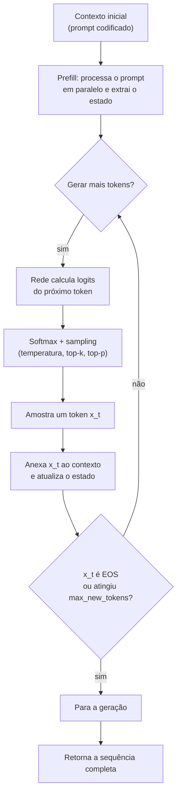
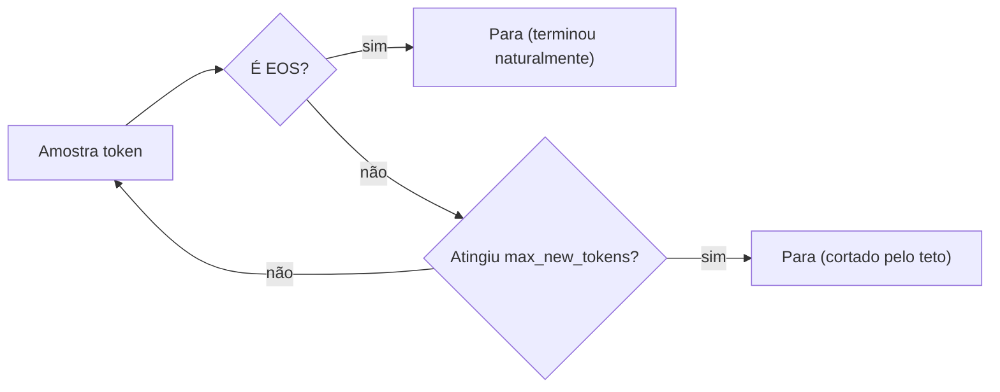

# Geração autorregressiva

## Visão geral


> A ideia central em uma frase: a saída de um modelo de linguagem é uma *sequência*, e a única forma tratável de construir uma sequência longa é quebrá-la em passos condicionais — cada novo token depende de todos os tokens que vieram antes.

## Intuição: completar uma frase palavra por palavra

### O que acontece quando você pede uma continuação

Imagine que você digita o início de uma frase e pede ao modelo para continuar:

```text
O rato roeu a roupa do rei de...
```

Como o modelo decide a próxima palavra? Ele calcula, para **cada** palavra possível do vocabulário, uma probabilidade de ser a continuação. Depois escolhe uma (de forma determinística ou aleatória, como veremos na página sobre sampling) e a anexa à frase. Se escolher "roma", a frase vira:

```text
O rato roeu a roupa do rei de roma
```

E então o processo recomeça: agora o modelo calcula a probabilidade da próxima palavra *dado o texto completo até aqui*, incluindo a palavra "roma" que acabou de escrever. É por isso que o método se chama **autorregressivo** ("auto" = si mesmo, "regressivo" = voltando ao passado): a geração *se alimenta de si mesma*.

### Por que não gerar tudo de uma vez?

Uma pergunta natural: por que o modelo não gera a frase inteira em uma única passada, como quem imprime um cartaz pronto? A resposta tem duas partes.

1. **O tamanho do espaço de busca explode.** Se o vocabulário tem $V$ tokens e queremos uma frase de $T$ tokens, existem $V^{T}$ sequências possíveis. Para $V \approx 32000$ e $T = 20$, isso é da ordem de $32000^{20}$, um número impraticável. Escolher a melhor sequência entre todas é um problema de busca impossível de resolver de forma exata.

2. **A estrutura da linguagem é sequencial.** Cada palavra condiciona as seguintes. A forma natural de modelar isso é fatorar a probabilidade conjunta em condicionais — exatamente o que a autorregressão faz.

## Conceito: a decomposição em probabilidades condicionais

### A regra da cadeia

Seja $x = (x_1, x_2, \dots, x_T)$ uma sequência de tokens. A probabilidade de toda a sequência pode ser **fatorada** pela regra da cadeia:

$$
P(x_1, x_2, \dots, x_T) = P(x_1) \cdot P(x_2 \mid x_1) \cdot P(x_3 \mid x_1, x_2) \cdots P(x_T \mid x_1, \dots, x_{T-1})
$$

Que escrevemos de forma compacta:

$$
P(x_1, \dots, x_T) = \prod_{t=1}^{T} P(x_t \mid x_{<t})
$$

onde $x_{<t} = (x_1, \dots, x_{t-1})$ é o prefixo de tudo que veio antes da posição $t$. A notação $P(x_t \mid x_{<t})$ deve ser lida como "a probabilidade do token na posição $t$, dado todo o histórico anterior".

### O que o modelo calcula a cada passo

Em cada passo $t$, a rede recebe o histórico $x_{<t}$ e produz uma distribuição de probabilidade sobre o vocabulário inteiro:

$$
p_t = \text{softmax}(z_t) = \left[\, P(x_t = v_1 \mid x_{<t}),\; P(x_t = v_2 \mid x_{<t}),\; \dots,\; P(x_t = v_V \mid x_{<t}) \,\right]
$$

onde $z_t$ são os logits (as pontuações cruas) e $V$ é o tamanho do vocabulário. O novo token $x_t$ é então *amostrado* dessa distribuição:

$$
x_t \sim p_t
$$

Esse token é anexado ao histórico, formando o novo prefixo $x_{\le t} = (x_1, \dots, x_t)$, e o ciclo se repete.

### Por que o modelo "só enxerga o passado"

Um ponto essencial: em $P(x_t \mid x_{<t})$, o token na posição $t$ **não pode depender** de tokens futuros $x_{t+1}, x_{t+2}, \dots$. Isso é chamado de **causalidade** (ou mascaramento causal). Durante a geração, os tokens futuros simplesmente não existem ainda — então o modelo é obrigado, por construção, a respeitar essa restrição. No RetNet, essa causalidade aparece na máscara triangular da matriz de decaimento $D_{nm} = \gamma^{n-m} \cdot \mathbb{1}[m \le n]$, que zera qualquer influência de posições $m > n$.

### Exemplo numérico progressivo

Para fixar, vamos usar um vocabulário minúsculo de 4 tokens, representados por índices:

| Índice | Token |
|---|---|
| 0 | `cachorro` |
| 1 | `gato` |
| 2 | `comeu` |
| 3 | `<EOS>` |

Suponha que começamos com o histórico vazio e pedimos uma sequência. O modelo calcula a distribuição do **primeiro** token:

$$
p_1 = [0.60,\; 0.35,\; 0.05,\; 0.00]
$$

Isso significa: $P(x_1 = \text{cachorro}) = 0.60$, $P(x_1 = \text{gato}) = 0.35$, e assim por diante. Suponha que a amostragem escolha o token `gato` (índice 1). Agora o histórico é `[gato]`, e o modelo calcula a distribuição do **segundo** token *dado* que o primeiro foi `gato`:

$$
p_2 = P(x_2 \mid \text{gato}) = [0.02,\; 0.03,\; 0.90,\; 0.05]
$$

Note como a distribuição mudou drasticamente: dado "gato", a palavra "comeu" agora tem $0.90$ de probabilidade. Suponha que escolhemos `comeu` (índice 2). O histórico vira `[gato, comeu]`, e o modelo calcula o **terceiro** token:

$$
p_3 = P(x_3 \mid \text{gato}, \text{comeu}) = [0.45,\; 0.30,\; 0.05,\; 0.20]
$$

Agora "cachorro" voltou a ser plausível (o gato pode ter comido o cachorro em um texto inusitado, ou a ração — o vocabulário aqui é artificial). Suponha que o modelo escolha `<EOS>` (índice 3). Isso sinaliza **fim da geração**. A sequência final é:

```text
gato comeu <EOS>
```

A probabilidade conjunta dessa sequência, pela regra da cadeia, é:

$$
P(\text{gato}, \text{comeu}, \text{EOS}) = 0.35 \times 0.90 \times 0.20 = 0.063
$$

Ou seja, aproximadamente $6.3\%$ de chance de o modelo produzir exatamente essa sequência ao amostrar com essas distribuições.

## O loop de geração passo a passo

### Visão de alto nível

O loop de geração é, no fundo, um `while` com quatro fases por iteração:

1. **Calcular logits**: passar o contexto atual pela rede e obter as pontuações do próximo token.
2. **Transformar em probabilidades**: aplicar softmax (e, opcionalmente, temperatura, top-k e top-p — detalhados na página de sampling).
3. **Amostrar ou escolher o token**: selecionar um token da distribuição.
4. **Anexar e checar parada**: adicionar o token ao contexto e verificar se devemos parar (EOS ou limite de tokens).

Vamos formalizar esse fluxo em diagrama.



### O papel do `max_new_tokens`

`max_new_tokens` é o número **máximo** de tokens *novos* que o modelo pode produzir, além do prompt de entrada. Ele é um teto de segurança: mesmo que o modelo nunca gere um token de fim (EOS), a geração é interrompida quando esse teto é atingido. Sem ele, um modelo que entrasse em repetição infinita (ou nunca "soubesse" terminar) geraria texto para sempre.

Observe a diferença sutil mas importante:

- **`max_new_tokens`** conta apenas os tokens **gerados** (exclui o prompt).
- O **tamanho total do contexto** ao final é `len(prompt) + tokens_gerados`.


```python
limit = max_new_tokens
```

Esse limite controla apenas quantos tokens novos podem ser produzidos. O runtime também precisa respeitar a capacidade de contexto do modelo, por exemplo usando cache, janela deslizante ou truncamento quando aplicável. Não há uma regra universal que limite tokens novos ao tamanho da janela, pois o prompt já ocupa parte dela e as estratégias de contexto variam.

### A condição de parada por EOS

O token `<EOS>` (end-of-sequence) é um token **especial** que o modelo aprende a emitir para sinalizar que terminou. Quando a amostragem produz esse token, o loop é interrompido imediatamente, **antes** de anexar o token à saída final. O EOS não aparece no texto mostrado ao usuário — ele é um marcador de controle, não conteúdo.

Existem, portanto, duas condições de parada independentes:

1. **EOS**: o modelo decidiu que a resposta terminou.
2. **Limite de tokens**: o teto de `max_new_tokens` foi atingido.

A geração para **assim que a primeira** dessas condições ocorrer.



### Pseudocódigo do loop

```text
função gerar(prompt, max_new_tokens):
    contexto = codificar(prompt)               # lista de ids de tokens
    estado = prefill(contexto)                 # processa o prompt e extrai o estado

    para i de 1 até max_new_tokens:
        logits = rede(contexto, estado)        # logits do próximo token
        probabilidades = softmax(logits)       # (com temperatura/top-k/top-p)
        próximo = amostrar(probabilidades)     # escolhe um token

        se próximo == EOS:
            parar                              # terminou naturalmente

        contexto = contexto + [próximo]        # anexa o novo token
        estado = atualizar(estado, próximo)    # estado recorrente dá um passo

    retornar contexto
```

### Código real simplificado


```python
import torch
import torch.nn.functional as F

def gerar(model, tokenizer, prompt, max_new_tokens, temperature=0.7):
    device = next(model.parameters()).device

    # 1. Codifica o prompt em ids de token
    prompt_ids = tokenizer.encode(prompt, add_special_tokens=False, return_tensors="pt")
    prompt_ids = prompt_ids.to(device)

    # 2. Prefill: processa o prompt inteiro em paralelo e obtém o estado recorrente
    with torch.inference_mode():
        logits, estados = model.prefill(prompt_ids)

    gerados = []
    eos_id = tokenizer.eos_token_id

    # 3. Loop autorregressivo
    for _ in range(max_new_tokens):
        # 3a. Converte logits em probabilidades e amostra o próximo token
        if temperature <= 0:
            proximo = torch.argmax(logits, dim=-1, keepdim=True)   # guloso
        else:
            probs = F.softmax(logits / temperature, dim=-1)
            proximo = torch.multinomial(probs, num_samples=1)       # amostragem

        token_id = int(proximo.item())

        # 3b. Condição de parada: token de fim
        if eos_id is not None and token_id == eos_id:
            break

        # 3c. Anexa o token gerado
        gerados.append(token_id)

        # 3d. Um passo recorrente: computa logits do próximo token com estado fixo
        logits, estados = model.recurrent(proximo, estados)

    # 4. Decodifica a sequência gerada de volta para texto
    return tokenizer.decode(gerados, skip_special_tokens=True)
```

Repare nos dois métodos do modelo que fazem todo o trabalho:

- **`prefill`**: processa o prompt de uma vez (em paralelo) e devolve tanto os logits do último token quanto o **estado recorrente** do RetNet. É a "partida" da geração.
- **`recurrent`**: processa **um único token** de cada vez, atualizando o estado em $O(1)$. É o coração do loop autorregressivo.

## Por que a geração é inerentemente sequencial

### O gargalo do "um token por vez"

A autorregressão impõe uma **dependência de dados**: para calcular $P(x_{t+1} \mid x_{\le t})$, precisamos saber qual foi o $x_t$ escolhido. Como essa escolha depende do passo anterior, não há como paralelizar os passos de geração entre si — cada token depende do anterior. É por isso que a geração é, por natureza, um processo **sequencial**, e a latência de gerar $T$ tokens é proporcional a $T$:

$$
\text{tempo de geração} \approx T \cdot \text{tempo por token}
$$

O treino é diferente: lá todos os tokens são conhecidos de antemão (vêm do corpus), então a rede pode processar a sequência inteira **em paralelo**. Essa assimetria entre treino (paralelo) e geração (sequencial) é central para entender por que arquiteturas eficientes na geração — como o RetNet — são valiosas.

### A autofeedback: uma fonte de deriva

Como cada token amostrado alimenta o próximo, erros pequenos **se acumulam**. Se o modelo amostra um token improvável no passo $t$, esse token vira contexto no passo $t+1$ e pode puxar a distribuição para um caminho que o modelo nunca teria escolhido se tivesse "planejado" a frase inteira. Esse fenômeno, conhecido como **deriva de exposição** (*exposure bias*), explica por que modelos treinados com amostragem (em vez de sempre pegar o token mais provável) podem divergir do estilo do corpus. A temperatura e os filtros de sampling existem, em parte, para administrar esse equilíbrio.

## Erros comuns

- **Confundir `max_new_tokens` com tamanho total**: `max_new_tokens` conta apenas os tokens gerados, não inclui o prompt. Pedir `max_new_tokens = 50` com um prompt de 100 tokens produz até 150 tokens no total.
- **Esquecer a condição de EOS**: sem checar o token de fim, o modelo gera até o teto de tokens mesmo quando a resposta "terminou" — e pode começar a repetir ou inventar conteúdo.
- **Re-fazer o prefill a cada passo**: processar o prompt de novo a cada token é um desperdício. O prefill deve acontecer **uma vez**, e os passos seguintes usam o estado recorrente.
- **Gerar sem limite superior**: um loop `while True` sem `max_new_tokens` pode travar a aplicação se o modelo nunca emitir EOS.
- **Achar que a geração é paralelizável entre tokens**: a dependência autorregressiva é estritamente sequencial; não dá para gerar o token $t+1$ antes de decidir o token $t$.
- **Ignorar a causalidade**: usar a forma paralela (do treino) na geração e esquecer a máscara causal faria o modelo "enxergar o futuro", vazando informação que não deveria existir.
- **Não converter logits em probabilidades antes de amostrar**: amostrar diretamente sobre logits (que podem ser negativos e não somam 1) produz resultados incorretos.
- **Achar que o EOS aparece no texto final**: o token de fim é um marcador de controle, não deve ser exibido; ele só interrompe o loop.

## Resumo

- A geração autorregressiva produz texto **um token por vez**, anexando cada token ao contexto antes de prever o próximo.
- A probabilidade de uma sequência é fatorada pela regra da cadeia: $P(x_1, \dots, x_T) = \prod_{t=1}^{T} P(x_t \mid x_{<t})$.
- A cada passo, o modelo calcula uma distribuição $p_t = \text{softmax}(z_t)$ e amostra $x_t \sim p_t$.
- O loop tem quatro fases: **calcular logits → aplicar softmax/sampling → amostrar token → anexar e checar parada**.
- Existem duas condições de parada: o token **EOS** (término natural) e o teto **`max_new_tokens`** (limite de segurança).
- A geração é **intrinsecamente sequencial** por causa da dependência entre tokens, ao contrário do treino, que é paralelo.
- O estado recorrente do RetNet tem **tamanho constante**, o que mantém a memória fixa durante toda a geração.
