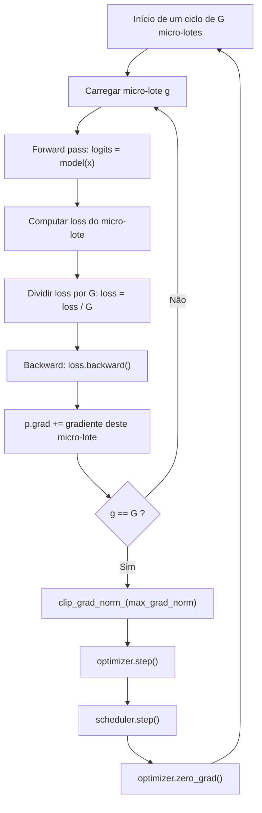

# Gradient Accumulation: simulando lotes maiores que a memória

## 1. O problema de partida

Todo treinamento de um modelo de linguagem começa com a mesma tensão: a **memória da GPU é finita**, mas o desejo de usar **lotes grandes** é infinito. Um lote grande produz gradientes mais estáveis, com menos ruído, porque a média amostral do gradiente se aproxima do gradiente verdadeiro da população de dados. Um lote pequeno, por outro lado, cabe facilmente na memória, mas cada passo do otimizador fica barulhento e a direção de descida oscila muito.

A pergunta central deste material é: **como obter a qualidade de um lote grande sem ter memória para ele?**

A resposta tem nome: *gradient accumulation* (acumulação de gradientes). Em vez de tentar encaixar `B` exemplos de uma só vez na VRAM, processamos a sequência em `G` fatias menores — chamadas *micro-lotes* — e **somamos os gradientes** de cada fatia antes de dar o passo do otimizador. Sob as condições descritas adiante, o gradiente resultante equivale ao de um lote de tamanho `B`, enquanto as ativações são calculadas para um micro-lote por vez.

> **Intuição em uma frase:** acumular permite distribuir o lote efetivo ao longo do tempo, mas a memória ainda limita o tamanho de cada micro-lote processado de uma vez.

A redução do pico de memória depende de **diminuir o tamanho do micro-lote**. Aumentar apenas `G` mantendo o mesmo micro-lote não reduz o pico; os pesos, gradientes e estados do otimizador também continuam ocupando memória durante o treino.

## 2. Intuição: o que "acumular" significa de verdade

Imagine que você precisa carregar 32 caixas para o andar de cima, mas só consegue segurar 2 por viagem. Você não desiste das 32 caixas — você faz 16 viagens e deposita tudo no mesmo destino. A cada viagem, o "peso" chega ao mesmo lugar e se soma ao que já estava lá.

No treinamento, as caixas são os exemplos, as viagens são os micro-lotes, e o destino é o **buffer de gradiente** (`p.grad`) que vive dentro de cada parâmetro do modelo. O passo do otimizador só acontece depois que as 16 viagens terminam, ou seja, depois que o gradiente acumulado representa os 32 exemplos completos.

Sem acumulação, cada micro-lote de 2 exemplos provocaria um `optimizer.step()` imediato: 16 passos de otimização para 32 exemplos, cada um enxergando apenas 2 exemplos de contexto. Com acumulação, os mesmos 32 exemplos geram **um único passo** de otimização, enxergando a média de todos eles.

A beleza do mecanismo está no fato de que o `backward()` do PyTorch **acumula por padrão**: quando você chama `loss.backward()` duas vezes seguidas, o gradiente do segundo chamado é *somado* ao do primeiro dentro de `p.grad`. Só quando você chama `optimizer.zero_grad()` (ou `set_to_none=True`) é que o buffer é zerado. A acumulação de gradientes explora exatamente esse comportamento nativo.

## 3. A matemática por trás da equivalência

### 3.1 O gradiente de um lote é a média dos gradientes

Considere um lote $\mathcal{B}$ com $N$ exemplos. A função de perda média sobre o lote é

$$
\mathcal{L}_{\mathcal{B}}(\theta) = \frac{1}{N} \sum_{i=1}^{N} \mathcal{L}_i(\theta)
$$

onde $\mathcal{L}_i(\theta)$ é a perda do $i$-ésimo exemplo e $\theta$ é o vetor de parâmetros do modelo. Pela linearidade do operador gradiente, vale

$$
\nabla_{\theta} \mathcal{L}_{\mathcal{B}} = \frac{1}{N} \sum_{i=1}^{N} \nabla_{\theta} \mathcal{L}_i
$$

A regra da cadeia é o que permite esse desmembramento: o gradiente de uma soma é a soma dos gradientes, e o gradiente de uma constante vezes uma função é a constante vezes o gradiente.

### 3.2 Dividindo o lote em G micro-lotes

Agora particionamos o lote $\mathcal{B}$ em $G$ micro-lotes disjuntos, cada um com $m$ exemplos, de modo que

$$
N = m \cdot G
$$

Cada micro-lote $g \in \{1, 2, \dots, G\}$ tem perda média

$$
\mathcal{L}^{(g)}(\theta) = \frac{1}{m} \sum_{i \in g} \mathcal{L}_i(\theta)
$$

O truque da acumulação é escrever a perda do lote inteiro como a **média das perdas dos micro-lotes**:

$$
\mathcal{L}_{\mathcal{B}} = \frac{1}{G} \sum_{g=1}^{G} \mathcal{L}^{(g)}
$$

Verificamos expandindo:

$$
\frac{1}{G} \sum_{g=1}^{G} \frac{1}{m} \sum_{i \in g} \mathcal{L}_i = \frac{1}{G \cdot m} \sum_{i=1}^{N} \mathcal{L}_i = \frac{1}{N} \sum_{i=1}^{N} \mathcal{L}_i = \mathcal{L}_{\mathcal{B}}
$$

Portanto, se a cada micro-lote nós fizermos

$$
\text{loss\_escalada} = \frac{\mathcal{L}^{(g)}}{G}
$$

e chamarmos `backward()` em cada um, a soma dos gradientes acumulados será

$$
\sum_{g=1}^{G} \nabla_{\theta} \left( \frac{\mathcal{L}^{(g)}}{G} \right) = \frac{1}{G} \sum_{g=1}^{G} \nabla_{\theta} \mathcal{L}^{(g)} = \nabla_{\theta} \mathcal{L}_{\mathcal{B}}
$$

Ou seja, **exatamente** o gradiente do lote inteiro de $N = m \cdot G$ exemplos. A divisão por $G$ é o passo que garante a equivalência; sem ela, a soma dos gradientes seria $G$ vezes maior do que o desejado.

### 3.3 Por que dividir a loss e não escalar o learning rate

Há duas formas matematicamente idênticas de implementar acumulação:

2. **Somar as losses sem dividir** e, no final, dividir o gradiente acumulado por `G` (ou multiplicar o learning rate por `G`).

Dividir a loss é mais simples e robusto: o fator `1/G` entra automaticamente em cada `p.grad`, de modo que o `clip_grad_norm_` e o otimizador enxergam um gradiente na escala correta, sem precisar de passos extras. Multiplicar o learning rate funciona, mas acopla a escala do gradiente ao hiperparâmetro de taxa, o que confunde qualquer clipping posterior.

### 3.4 O batch efetivo

Definimos o **batch efetivo** como o número de exemplos que influencia um único passo do otimizador:

$$
\text{batch}_{\text{efetivo}} = \text{micro\_batch\_size} \cdot \text{gradient\_accumulation\_steps} = m \cdot G
$$


$$
2 \cdot 16 = 32
$$


## 4. Exemplo numérico resolvido (progressivo)

### 4.1 Configuração do exemplo

Vamos supor um cenário pequeno e didático:

| Parâmetro | Valor |
|-----------|-------|
| `micro_batch_size` ($m$) | 2 |
| `gradient_accumulation_steps` ($G$) | 4 |
| Batch efetivo ($N$) | $2 \cdot 4 = 8$ |
| Learning rate | $\eta = 1 \times 10^{-3}$ |

### 4.2 Losses dos micro-lotes

Suponha que, ao processar os 4 micro-lotes, o modelo produza as seguintes losses (médias dos 2 exemplos de cada fatia):

| Micro-lote $g$ | $\mathcal{L}^{(g)}$ | $\mathcal{L}^{(g)} / G$ |
|----------------|---------------------|-------------------------|
| 1 | 4.00 | 1.00 |
| 2 | 3.50 | 0.875 |
| 3 | 4.20 | 1.05 |
| 4 | 3.80 | 0.95 |

A loss do lote inteiro (que "nunca calculamos de uma vez", mas que é o alvo) seria a média:

$$
\mathcal{L}_{\mathcal{B}} = \frac{4.00 + 3.50 + 4.20 + 3.80}{4} = \frac{15.50}{4} = 3.875
$$

### 4.3 Verificando a equivalência da soma

Se somarmos as losses escaladas, obtemos

$$
1.00 + 0.875 + 1.05 + 0.95 = 3.875 = \mathcal{L}_{\mathcal{B}}
$$

A soma das losses escaladas por $1/G$ é **numericamente idêntica** à loss do lote inteiro. Como o gradiente é linear, a soma dos gradientes acumulados também coincide com o gradiente do lote inteiro, a menos de erros de arredondamento em ponto flutuante (que discutimos no material de precisão mista).

### 4.4 Um parâmetro simples

Para concretizar, imagine um único parâmetro escalar $\theta = 2.0$ e uma loss local $\mathcal{L}_i = (y_i - \theta)^2$ com alvos $y_1 = 5$ e $y_2 = 7$ no primeiro micro-lote.

- Gradiente local de $y_1$: $\frac{\partial}{\partial \theta}(5 - \theta)^2 = -2(5 - \theta) = -2(5 - 2) = -6$
- Gradiente local de $y_2$: $-2(7 - 2) = -10$

A loss do micro-lote 1 (média) tem gradiente:

$$
\nabla \mathcal{L}^{(1)} = \frac{-6 + (-10)}{2} = -8
$$

Após dividir por $G = 4$, o gradiente acumulado deste micro-lote é

$$
\frac{-8}{4} = -2
$$

Repetindo o processo nos outros três micro-lotes e somando, o gradiente acumulado total será exatamente $\frac{1}{4}\left( \nabla\mathcal{L}^{(1)} + \nabla\mathcal{L}^{(2)} + \nabla\mathcal{L}^{(3)} + \nabla\mathcal{L}^{(4)} \right)$, o gradiente do lote de 8 exemplos. O passo de otimização aplica

$$
\theta \leftarrow \theta - \eta \cdot \nabla_{\theta}\mathcal{L}_{\mathcal{B}}
$$

Sem a divisão por $G$, o gradiente seria 4 vezes maior, e o otimizador daria um passo equivalente a um learning rate de $4 \times 10^{-3}$ — uma mudança silenciosa e perigosa de hiperparâmetro.

## 5. Fluxo do algoritmo



O ponto crítico do diagrama é a seta `F -> G`: o `backward()` **não substitui** o gradiente, ele **adiciona**. O `zero_grad()` só acontece uma vez a cada $G$ micro-passos, logo após o `optimizer.step()`.

## 6. Pseudocódigo completo

```text
ALGORITMO TreinamentoComAcumulacao(modelo, dados, m, G, eta):
    otimizador = AdamW(modelo.parametros(), lr = eta)
    otimizador.zero_grad()                    // limpa o buffer de gradientes

    micro_passo = 0

    PARA CADA micro_lote de tamanho m EM dados:
        logits = modelo(micro_lote.x)
        perda  = CrossEntropy(logits, micro_lote.y)

        // CRÍTICO: dividir por G para obter a média do lote completo
        perda_escalada = perda / G

        perda_escalada.backward()             // acumula em p.grad

        micro_passo = micro_passo + 1

        SE micro_passo MOD G == 0:
            clip_grad_norm_(modelo.parametros(), max_norm)
            otimizador.step()                 // aplica o gradiente acumulado
            agendador.step()
            otimizador.zero_grad()            // zera somente agora
        FIM SE
    FIM PARA
FIM ALGORITMO
```

## 9. Erros comuns e como evitá-los

| Erro | Sintoma | Correção |
|------|---------|----------|
| Esquecer de dividir a loss por `G` | Loss explode, gradiente 16× maior, treino diverge | `loss = raw_loss / G` antes do `backward()` |
| `zero_grad()` a cada micro-lote | Acumulação anulada; cada passo enxerga só `m` exemplos | Zerar apenas após `optimizer.step()` |
| Chamar `optimizer.step()` a cada micro-lote | Não há acumulação real; equivale a batch pequeno | Guardar o `step()` com `micro_step % G == 0` |
| Não tratar o lote final parcial | Gradientes do fim da época são descartados | Adicionar `is_last_batch` como gatilho |
| Fazer clipping dentro do micro-lote | Clipping na escala errada (antes de somar) | Clippar o gradiente **acumulado**, no limite |
| Aplicar `scheduler.step()` por micro-lote | Warmup/decay termina prematuramente | Scheduler avança junto com o otimizador |
| Somar `.item()` das losses e confundir com gradiente | A métrica de log não reflete a média correta | Logar `raw_loss.item()` (loss real do micro-lote), não a escalada |


```python
round(total_loss.item(), 4)
```

## 10. Quando a acumulação é (ou não) a ferramenta certa

- **Use acumulação** quando o lote desejado não cabe na VRAM, mas micro-lotes menores cabem.
- **Não use acumulação** para "parecer" que tem batch grande sem alterar o learning rate: a escala do learning rate é definida pelo batch efetivo, e mudanças de batch efetivo frequentemente pedem reajuste de taxa (heurísticas como a regra de raiz quadrada $\eta \propto \sqrt{N}$ ou a linear $\eta \propto N$).

## 11. Resumo

1. A acumulação de gradientes processa o lote em $G$ micro-lotes e **soma** os gradientes antes do passo do otimizador.
2. A equivalência com um lote grande vem da linearidade do gradiente: $\nabla(\frac{1}{N}\sum_i \mathcal{L}_i) = \frac{1}{N}\sum_i \nabla\mathcal{L}_i$.
3. O truque essencial é dividir a loss de cada micro-lote por $G$, de modo que a soma reproduza a média.
5. `zero_grad()` e `optimizer.step()` acontecem somente no limite de acumulação; o `backward()` acumula em `p.grad`.
