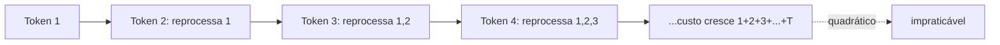
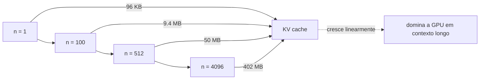
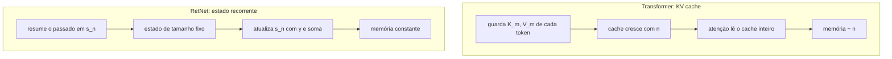

# KV cache e estado recorrente

## Visão geral

Gerar texto rápido não é só questão de poder de processamento — é, acima de tudo, uma questão de **memória e estado**. Quando um modelo produz token por token, ele precisa decidir o que fazer com todo o histórico já processado: **recalcular** tudo do zero a cada passo, **guardar** os resultados intermediários (cache) ou **resumir** o passado em um estado compacto.


> A ideia central em uma frase: o passado precisa ser lembrado de alguma forma; a diferença entre arquiteturas é *quanto* de memória elas gastam para lembrá-lo — e se esse gasto cresce ou fica constante.

## Intuição: o custo de "reler o passado"

### Recalcular tudo a cada passo

Imagine um modelo ingênuo de geração que, a cada novo token, refaz todo o cálculo desde o início do texto. Para gerar o token de número $n$, ele reprocessa os $n-1$ tokens anteriores. O custo total de gerar $T$ tokens seria a soma:

$$
1 + 2 + 3 + \dots + T = \frac{T(T+1)}{2} \approx \frac{T^2}{2}
$$

Ou seja, custo **quadrático**: gerar um texto com o dobro do tamanho custa cerca de quatro vezes mais. Para qualquer texto minimamente longo, isso é impraticável — é a diferença entre responder em milissegundos e em horas.



### A saída óbvia: não recalcular, guardar

Se o problema é reprocessar o passado, a solução óbvia é **não** reprocessá-lo: guarde o resultado do trabalho já feito e reutilize. É exatamente isso que o cache faz. Mas surge uma pergunta crucial: **o que exatamente guardar?** E aqui as arquiteturas divergem.

A resposta depende de como o modelo "lembra" do passado. Se a memória é uma lista de vetores que cresce com o texto (como no Transformer), guardar tudo consome memória crescente. Se a memória é um resumo de tamanho fixo (como no RetNet), guardar é barato.

## Conceito: por que a atenção precisa de um cache

### O que a atenção calcula a cada passo

No Transformer, a atenção do token na posição $n$ pondera todos os tokens anteriores:

$$
\text{Attention}(Q, K, V) = \text{softmax}\!\left(\frac{Q K^\top}{\sqrt{d}}\right) V
$$

As projeções $Q = X W_q$, $K = X W_k$, $V = X W_v$ dependem de todos os tokens da entrada. Na geração autorregressiva, o token $n+1$ calcula:

$$
Q_{n+1} = x_{n+1} W_q, \quad K_{n+1} = x_{n+1} W_k, \quad V_{n+1} = x_{n+1} W_v
$$

e precisa combinar $Q_{n+1}$ com **todos** os $K$ e $V$ anteriores. Os tokens anteriores não mudam entre um passo e outro — seus $K_m$ e $V_m$ são sempre os mesmos. Recalculá-los a cada passo é puro desperdício.

### O KV cache: guardar K e V de cada token

A solução é guardar, para cada token já processado, o seu par $(K_m, V_m)$. Ao gerar o token $n+1$, calculamos apenas $K_{n+1}$ e $V_{n+1}$ do novo token, **anexamos** à lista, e calculamos a atenção do novo token contra a lista inteira:

```text
passo n+1:
    K_cache.append(K_{n+1})
    V_cache.append(V_{n+1})
    attention = softmax(Q_{n+1} · K_cacheᵀ / √d) · V_cache
```

O custo de computação por token cai para **linear** no comprimento do histórico — muito melhor que o quadrático do recálculo. Mas o custo de **memória** continua crescendo.

### Quanto de memória o KV cache consome

Para cada camada e cada cabeça, guardamos um vetor de chave e um vetor de valor por token. Se o modelo tem $L$ camadas, $H$ cabeças, dimensão por cabeça $d_h$, e a sequência tem $n$ tokens, o número total de elementos guardados é:

$$
\text{elementos} = 2 \cdot L \cdot H \cdot d_h \cdot n
$$

O fator $2$ vem de guardar tanto $K$ quanto $V$. Em termos de bytes (com `bfloat16`, 2 bytes por elemento):

$$
\text{bytes} = 2 \cdot L \cdot H \cdot d_h \cdot n \cdot 2 = 4 \cdot L \cdot H \cdot d_h \cdot n
$$

Como $d_{\text{model}} = H \cdot d_h$, podemos reescrever:

$$
\text{bytes} = 4 \cdot L \cdot d_{\text{model}} \cdot n
$$

### Exemplo numérico progressivo


- **1 token**: $4 \cdot 24 \cdot 1024 \cdot 1 = 98\,304$ bytes $\approx 96$ KB.
- **100 tokens**: $4 \cdot 24 \cdot 1024 \cdot 100 = 9\,830\,400$ bytes $\approx 9.4$ MB.
- **512 tokens**: $4 \cdot 24 \cdot 1024 \cdot 512 \approx 50.3$ MB.
- **4096 tokens**: $4 \cdot 24 \cdot 1024 \cdot 4096 \approx 402$ MB.

O padrão é claro: a memória do cache cresce **linearmente** com $n$:

$$
\text{memória} \sim n
$$

Para contexto muito longo (dezenas de milhares de tokens), esse cache pode dominar completamente a memória da GPU — às vezes maior que os próprios pesos do modelo. É por isso que "contexto longo" é sinônimo de "memória cara" nos Transformers.



## Conceito: o estado fixo do RetNet

### Do cache crescente ao resumo constante

O RetNet evita o problema trocando a *lista* de pares $(K_m, V_m)$ por um **único estado** $s_n$ que resume todo o passado. A atualização, por cabeça, é:

$$
s_n = \gamma\, s_{n-1} + K_n^\top V_n
$$

com $s_0 = 0$. A saída é:

$$
o_n = \frac{Q_n\, s_n}{\sqrt{d}}
$$

A mágica está na estrutura: $s_n$ tem dimensão $d_h \times d_h$, **independente** do comprimento da sequência. Não importa se você processou 10 ou 10 000 tokens — o estado ocupa sempre o mesmo espaço.

### Por que um resumo funciona

Desdobrando a recorrência, vemos que $s_n$ contém exatamente a informação necessária, ponderada pelo decaimento:

$$
s_n = \sum_{m=1}^{n} \gamma^{n-m}\, K_m^\top V_m
$$

O fator $\gamma^{n-m}$ faz o passado distante **escorrer** (esquecer) gradualmente, de modo que o estado não precisa guardar "tudo para sempre" — ele retém o que é recente e relevante, com peso decrescente por distância. É um resumo *com esquecimento*, e é justamente esse esquecimento que permite que um vetor de tamanho fixo carregue a memória necessária.

### A forma do estado no código


```python
(1, 16, 64, 64)
```

O método `recurrent` faz exatamente as duas operações da fórmula — a multiplicação pelo decaimento e a soma do termo novo:

```python
def recurrent(self, x, state):
    q = self.q_proj(x).view(batch, self.num_heads, self.head_dim)
    k = self.k_proj(x).view(batch, self.num_heads, self.head_dim)
    v = self.v_proj(x).view(batch, self.num_heads, self.head_dim)
    state.mul_(self.gammas.view(1, -1, 1, 1).to(state.dtype))   # γ · s_{n-1}
    state.add_(k.unsqueeze(-1) * v.unsqueeze(-2))               # + K_nᵀ V_n
    output = torch.matmul(q.unsqueeze(-2), state).squeeze(-2) / math.sqrt(self.head_dim)
    return self.out_proj(output), state
```

Compare com o que seria necessário em um Transformer: a cada passo, `K_cache` e `V_cache` cresceriam em um token, e a atenção leria a lista inteira. No RetNet, o estado é **atualizado no lugar** (`mul_` e `add_`), sempre com o mesmo tamanho.

## Comparação direta: KV cache vs. estado recorrente



### Tabela comparativa

| Aspecto | Transformer (KV cache) | RetNet (estado recorrente) |
|---|---|---|
| O que guarda | pares $(K_m, V_m)$ por token | um estado $s_n$ por cabeça/camada |
| Tamanho | cresce linearmente com $n$ | fixo ($d_h \times d_h$ por cabeça) |
| Memória total | $\sim 4 L d_{\text{model}} n$ | $\sim 2 L H d_h^2$ (constante) |
| Atualização por token | anexa $K, V$ ao cache | $s_n = \gamma s_{n-1} + K_n^\top V_n$ |
| Custo de memória em contexto longo | pode dominar a GPU | irrelevante |
| Complexidade de implementação | moderada (gerenciar cache) | baixa (um tensor por camada) |
| Esquecimento | não há (atenção pondera tudo) | sim, via $\gamma^{n-m}$ |

### O mesmo número, lado a lado

Com $L = 24$, $d_{\text{model}} = 1024$, $H = 16$, $d_h = 64$, `bfloat16`:

| Comprimento $n$ | Memória do KV cache | Memória do estado RetNet |
|---|---|---|
| $1$ | $\approx 96$ KB | $\approx 3.1$ MB |
| $512$ | $\approx 50$ MB | $\approx 3.1$ MB |
| $4096$ | $\approx 402$ MB | $\approx 3.1$ MB |
| $32768$ | $\approx 3.2$ GB | $\approx 3.1$ MB |

Observe a inversão interessante: para sequências **curtas**, o estado do RetNet é até maior que o KV cache de um token; mas, como ele **não cresce**, para sequências longas ele se torna milhões de vezes menor. A vantagem do estado recorrente aparece exatamente no regime em que o Transformer sofre.

## Código: as duas abordagens em contraste

### Transformer com KV cache (simplificado)

```python
import torch
import torch.nn.functional as F

def gerar_com_kv_cache(model, prompt_ids, max_new_tokens):
    # Supõe um modelo de atenção que aceita um cache explícito
    kv_cache = None
    gerados = []

    # Prefill: processa o prompt e monta o cache
    logits, kv_cache = model(prompt_ids, kv_cache=None)
    proximo = torch.argmax(logits[:, -1, :], dim=-1, keepdim=True)

    for _ in range(max_new_tokens):
        gerados.append(proximo.item())
        # A cada passo, o cache CRESCE com o novo token
        logits, kv_cache = model(proximo, kv_cache=kv_cache)
        proximo = torch.argmax(logits[:, -1, :], dim=-1, keepdim=True)

    return gerados
```

Aqui, `kv_cache` é uma estrutura que acumula um par $(K, V)$ por token. Quanto mais tokens gerados, maior a estrutura — e maior o consumo de memória e o tempo de varredura da atenção.

## Por que a memória constante importa na prática

### Latência e previsibilidade

Com memória constante, a latência de cada token é **previsível** e **uniforme** do primeiro ao último token. Em um Transformer, a atenção fica progressivamente mais lenta conforme o cache cresce (pois varre uma lista maior). No RetNet, cada passo custa o mesmo $O(1)$ de atualização do estado.

### Custo assintótico

O custo de memória e de atualização por token é:

- Transformer: $O(n)$ por passo (lê um cache de tamanho $n$), total $O(n^2)$ de trabalho acumulado.
- RetNet: $O(1)$ por passo (atualiza um estado fixo), total $O(n)$ de trabalho acumulado.

$$
\text{Transformer: } \sum_{m=1}^{n} m \sim n^2, \qquad \text{RetNet: } \sum_{m=1}^{n} 1 \sim n
$$

### Decodificação em dispositivos com pouca memória


## Erros comuns

- **Confundir "recorrente" com "não guarda nada"**: o RetNet guarda estado, sim — apenas de **tamanho fixo**. A diferença é que ele não cresce.
- **Achar que o KV cache é gratuito**: ele elimina o recálculo, mas paga com memória linear; para contexto longo, pode dominar a GPU.
- **Recalcular tudo a cada passo**: é a opção ingênua de custo $O(n^2)$ que o cache (ou o estado) existe justamente para evitar.
- **Achar que o estado do RetNet cresce com o texto**: o estado tem forma $(1, H, d_h, d_h)$ e nunca muda de tamanho.
- **Esquecer o fator de escala na saída**: na forma recorrente, $o_n = Q_n s_n / \sqrt{d}$ — a divisão por $\sqrt{d}$ deve ser mantida, como na atenção.
- **Alocar estado novo a cada passo**: o correto é atualizar no lugar (`mul_`, `add_`) para evitar alocação e overhead.
- **Ignorar o decaimento $\gamma$**: sem $\gamma$, o estado acumula sem esquecer e pode divergir; $\gamma$ é o que torna o resumo de tamanho fixo estável.
- **Comparar memória sem fixar o mesmo comprimento**: para sequências curtas o KV cache pode parecer menor; a vantagem do estado aparece no regime longo.

## Resumo

- Recalcular o passado a cada token custa $O(n^2)$ e é impraticável; por isso usamos cache ou estado.
- O **KV cache** do Transformer guarda os pares $(K_m, V_m)$ de cada token, eliminando o recálculo mas consumindo memória **linear** $\sim 4 L d_{\text{model}} n$.
- O **estado recorrente** do RetNet resume o passado em $s_n = \gamma s_{n-1} + K_n^\top V_n$, com tamanho **fixo** $d_h \times d_h$ por cabeça.
- O custo assintótico é $O(n)$ para o RetNet contra $O(n^2)$ acumulado (por varredura de cache) no Transformer.
