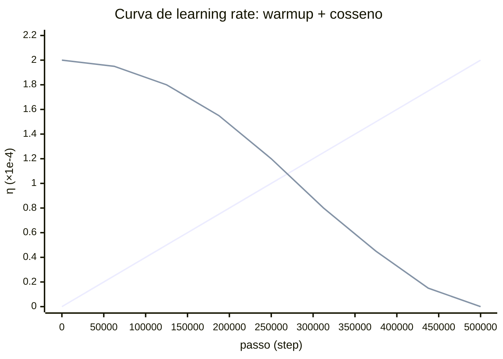

# Learning rate e schedulers

## Intuição: o tamanho do passo na descida

Volte à imagem da montanha na névoa. O gradiente diz a **direção** em que o terreno desce mais rápido. Mas quem decide o **tamanho** do passo é a taxa de aprendizado (learning rate, $\eta$). Passo grande demais e você salta por cima do vale, oscilando sem parar. Passo pequeno demais e você avança milímetros, levando uma eternidade para chegar.

O que a maioria das pessoas não percebe é que o passo **não precisa ser constante**. No começo da descida, quando você ainda está longe do vale e o terreno é íngreme e instável, convém dar passos curtos. No meio, quando o caminho é suave, convém dar passos largos. No fim, perto do fundo do vale, convém reduzir de novo para se encaixar no ponto mais baixo sem saltitar.


> "A taxa de aprendizado não é um número, é uma curva. Desenhá-la bem é a diferença entre convergir em horas ou nunca convergir."

## Conceito: o que é a taxa de aprendizado

Na atualização do gradiente descendente, a taxa de aprendizado multiplica o gradiente:

$$
w_{t} = w_{t-1} - \eta \cdot \nabla L(w_{t-1})
$$

Ela converte "direção" em "deslocamento". Se o gradiente é o vetor de descida, $\eta$ é o tamanho do passo nessa direção.

### Os três regimes da taxa de aprendizado

Para a perda $L(w) = w^2$ (cujo mínimo é $w = 0$ e cujo gradiente é $2w$), o comportamento depende de $\eta$:

1. **$\eta$ pequeno demais.** Com $\eta = 0{,}01$: $w_{t} = w_{t-1} - 0{,}01 \cdot 2 w_{t-1} = 0{,}98 \, w_{t-1}$. A cada passo o peso encolhe apenas 2%. Converge, mas rastejando.

2. **$\eta$ no ponto certo.** Com $\eta = 0{,}5$: $w_{t} = w_{t-1} - 0{,}5 \cdot 2 w_{t-1} = 0$. Converge em **um único passo** para o mínimo exato.

3. **$\eta$ grande demais.** Com $\eta = 1{,}1$: $w_{t} = w_{t-1} - 1{,}1 \cdot 2 w_{t-1} = -1{,}2 \, w_{t-1}$. O peso troca de sinal e **cresce em módulo** a cada passo: $2 \to -2{,}4 \to 2{,}88 \to -3{,}456 \dots$ A perda diverge.

A tabela resume, partindo de $w_0 = 2$:

| $\eta$  | Fator por passo | Passos até $|w| < 0{,}1$ | Resultado |
|---------|-----------------|------------------------------|-----------|
| 0,01    | 0,98            | ~149                         | lento, estável |
| 0,5     | 0,00            | 1                            | convergência imediata |
| 1,1     | -1,2            | nunca (diverge)              | explosão |

O valor ideal de $\eta$ depende da curvatura da perda — e, em redes profundas, cada parâmetro tem uma curvatura própria. É por isso que otimizadores adaptativos (como o AdamW) existem; mas o scheduler continua sendo necessário para mudar a **escala global** ao longo do tempo.

## Por que aquecer (warmup)

O **warmup** (aquecimento) é a fase inicial em que $\eta$ começa em zero (ou perto disso) e sobe linearmente até o valor alvo. Por que não começar direto no valor máximo?

1. **Gradientes enormes no início.** No primeiro passo, os pesos são aleatórios e a perda está longe do mínimo. Os gradientes tendem a ser grandes. Um passo grande nesse momento pode jogar os pesos para uma região ruim da qual o treino nunca se recupera.

2. **As estatísticas do otimizador ainda não existem.** O AdamW começa com $m_0 = 0$ e $v_0 = 0$. Nos primeiros passos, a correção de viés infla as estimativas e a normalização ainda é instável. Um $\eta$ pequeno nessa fase compensa essa instabilidade.

3. **O `bfloat16` é mais sensível no início.** Com a precisão reduzida, um passo grande no começo amplifica o erro de arredondamento. O warmup dá tempo para o sistema "assentar".


## Decaimento cosseno: a fórmula

Depois do warmup, o scheduler mais comum em modelos de linguagem é o **cosseno**. A ideia é começar no valor máximo e descer suavemente até quase zero, seguindo metade de um período de cosseno. A forma geral do `get_cosine_schedule_with_warmup` (usada pelo Hugging Face `transformers`) é:

$$
\eta(t) =
\begin{cases}
\eta_{\text{max}} \cdot \dfrac{t}{T_{\text{warm}}}, & t < T_{\text{warm}} \\[8pt]
\eta_{\text{min}} + \dfrac{\eta_{\text{max}} - \eta_{\text{min}}}{2}
\left( 1 + \cos\left( \pi \cdot \dfrac{t - T_{\text{warm}}}{T_{\text{total}} - T_{\text{warm}}} \right) \right), & t \geq T_{\text{warm}}
\end{cases}
$$

Onde:

- $t$ é o passo atual (step);
- $T_{\text{warm}}$ é o número de passos de aquecimento (`warmup_steps`);
- $T_{\text{total}}$ é o número total de passos de treino;
- $\eta_{\text{max}}$ é a taxa de aprendizado alvo escolhida para o experimento;
- $\eta_{\text{min}}$ é a taxa final (frequentemente $0$, mas no `transformers` costuma ser um valor pequeno, como $0$ por padrão ou uma fração).

O argumento do cosseno percorre de $0$ a $\pi$ conforme $t$ vai de $T_{\text{warm}}$ a $T_{\text{total}}$. Como $\cos(0) = 1$ e $\cos(\pi) = -1$, o termo $\frac{1 + \cos(\cdot)}{2}$ percorre de $1$ a $0$, fazendo $\eta$ descer de $\eta_{\text{max}}$ a $\eta_{\text{min}}$ suavemente.

### Por que cosseno e não uma reta?

Um decaimento linear desce em ritmo constante. O cosseno desce **devagar no começo** (mantém o aprendizado alto por mais tempo, explorando) e **depressa no fim** (encaixa no mínimo). Isso costuma dar convergência melhor em redes profundas, porque a maior parte do aprendizado acontece na fase intermediária, com $\eta$ ainda alto.

## Gráfico da curva de learning rate

A curva completa tem três trechos: subida linear (warmup), platô suave no topo e descida em cosseno até o fim.




```text
η
2e-4 ┤          ╭─────────────────────╮
     │        ╱                        ╲
     │      ╱                            ╲
     │    ╱                                ╲
     │  ╱                                    ╲
     │╱                                        ╲___
   0 ┼────────────────────────────────────────────── step
     0       5000                         250000  500000
     └warmup┘└────── decaimento cosseno ───────────┘
```

Repare que o pico é atingido exatamente no passo `warmup_steps = 5000`, e a descida começa ali, atingindo ~metade em $250000$ e quase zero em $500000$.

## Exemplo numérico do scheduler


### Dentro do warmup ($t < 5000$)

Para $t = 2500$ (metade do aquecimento):

$$
\eta(2500) = 2 \times 10^{-4} \cdot \frac{2500}{5000} = 2 \times 10^{-4} \cdot 0{,}5 = 1 \times 10^{-4}
$$

Para $t = 5000$ (fim do aquecimento):

$$
\eta(5000) = 2 \times 10^{-4} \cdot \frac{5000}{5000} = 2 \times 10^{-4}
$$

### Depois do warmup ($t \geq 5000$)

A fração de progresso no cosseno é $\frac{t - 5000}{500000 - 5000} = \frac{t - 5000}{495000}$.

Para $t = 5000$ (início do cosseno):

$$
\eta(5000) = \frac{2 \times 10^{-4}}{2} \left( 1 + \cos(0) \right) = 2 \times 10^{-4}
$$

Para $t = 252500$ (metade do treino): a fração é $\frac{247500}{495000} = 0{,}5$, e o argumento do cosseno é $\pi \cdot 0{,}5 = \frac{\pi}{2}$, cujo cosseno é $0$:

$$
\eta(252500) = \frac{2 \times 10^{-4}}{2} \left( 1 + 0 \right) = 1 \times 10^{-4}
$$

Para $t = 500000$ (fim): a fração é $1$, o argumento é $\pi$, e $\cos(\pi) = -1$:

$$
\eta(500000) = \frac{2 \times 10^{-4}}{2} \left( 1 - 1 \right) = 0
$$

Tabela consolidada:

| Passo $t$   | Fase        | $\eta(t)$ (×$10^{-4}$) |
|-------------|-------------|------------------------|
| 0           | warmup      | 0,00                   |
| 2500        | warmup      | 1,00                   |
| 5000        | pico        | 2,00                   |
| 252500      | cosseno     | 1,00                   |
| 500000      | fim         | 0,00                   |

## Código: o scheduler na prática

### A chamada do Hugging Face


Depois, a cada passo de otimização (a cada `gradient_accumulation_steps`), o loop chama `lr_scheduler.step()`. É por isso que o scheduler anda uma vez por passo **do otimizador**, não por microbatch.

### Uma implementação didática do cosseno

Sem depender da biblioteca, dá para escrever a regra manualmente:

```python
import math

def cosine_lr(step, max_lr, min_lr, warmup_steps, total_steps):
    if step < warmup_steps:
        return max_lr * step / warmup_steps
    progress = (step - warmup_steps) / (total_steps - warmup_steps)
    return min_lr + 0.5 * (max_lr - min_lr) * (1 + math.cos(math.pi * progress))

max_lr = 2e-4
min_lr = 0.0
warmup = 5000
total = 500000

for step in [0, 2500, 5000, 252500, 500000]:
    print(f"step {step:>7}: lr = {cosine_lr(step, max_lr, min_lr, warmup, total):.2e}")
```

Saída esperada:

```text
step       0: lr = 0.00e+00
step    2500: lr = 1.00e-04
step    5000: lr = 2.00e-04
step  252500: lr = 1.00e-04
step  500000: lr = 0.00e+00
```

### Como acompanhar a taxa

Durante o treino, a taxa efetiva pode ser consultada diretamente no otimizador:

```python
current_lr = optimizer.param_groups[0]['lr']
```

Esse é o valor de taxa de aprendizado em vigor naquele momento. Registrá-lo junto com o passo permite reconstruir e conferir a curva realmente aplicada.

## Como interpretar a curva durante o treino


1. **Subida linear no começo.** Os primeiros `warmup_steps` devem mostrar uma reta subindo. Se o gráfico começa já no máximo, o warmup não está sendo aplicado.

2. **Platô/descida suave depois.** Após o pico, a curva desce em cosseno, quase imperceptível no início e mais acentuada no fim.

3. **Degraus discretos.** Como o scheduler avança a cada passo do otimizador (após o acúmulo de gradientes), a curva pode parecer levemente "degrau" quando ampliada, em vez de perfeitamente lisa. Isso é normal.

4. **Retomada de treino.** Prefira salvar e restaurar o estado do scheduler junto com o checkpoint. Recriar o scheduler sem restaurar seu progresso pode reiniciar o warmup ou deslocar a curva.

5. **Interação com o AdamW.** A taxa $\eta$ escala a atualização adaptativa, mas não é necessariamente um limite superior rígido para a mudança de cada parâmetro. O tamanho depende também dos momentos, do gradiente e do método de otimização.

## Pseudocódigo do scheduler com warmup

```text
entrada: passo t, eta_max, eta_min, passos_warmup, passos_total
se t < passos_warmup:
    eta = eta_max * t / passos_warmup          # aquecimento linear
senão:
    progresso = (t - passos_warmup) / (passos_total - passos_warmup)
    eta = eta_min + (eta_max - eta_min) / 2 * (1 + cos(pi * progresso))
aplicar eta ao otimizador (param_groups['lr'])
```

## Erros comuns

- **Achar que warmup e decaimento são a mesma coisa.** Warmup é a **subida** inicial; decaimento é a **descida** final. São fases opostas da mesma curva.
- **Contar passos errado.** O scheduler anda por passo de otimizador. Com acúmulo de gradientes, o número de passos do scheduler é menor que o número de microbatchs.
- **Esquecer de chamar `scheduler.step()`.** Sem isso, $\eta$ fica fixo no valor inicial para sempre, e todo o benefício do decaimento se perde.
- **Achar que $\eta$ é o passo real.** É o **teto** do passo do AdamW. O passo real é menor e varia por parâmetro.
- **Olhar só o valor final de $\eta$.** A **forma** da curva importa tanto quanto o valor de pico: um cosseno bem desenhado mantém o aprendizado alto no meio e suave no fim.

## Resumo

- A taxa de aprendizado $\eta$ controla o tamanho do passo no gradiente descendente; pequena demais rasteja, grande demais diverge.
- O **warmup** sobe $\eta$ de $0$ ao valor alvo linearmente nos primeiros passos, protegendo o treino dos gradientes grandes e das estatísticas instáveis do início.
- O **decaimento cosseno** desce $\eta$ de $\eta_{\text{max}}$ a $\eta_{\text{min}}$ seguindo $\frac{1 + \cos(\cdot)}{2}$, mantendo o aprendizado alto no meio e suave no fim.
- Registrar `optimizer.param_groups[0]['lr']` por passo permite observar a taxa efetivamente aplicada.
