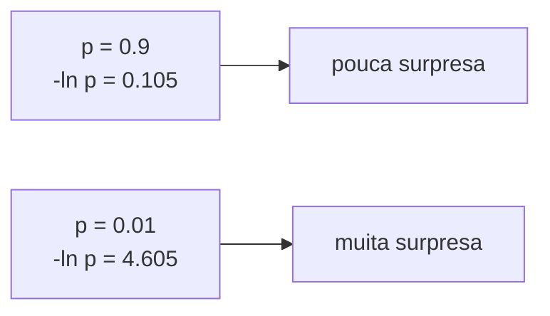

# Logaritmos e exponenciais

> "O logaritmo é a máquina que transforma multiplicações cansativas em somas confortáveis. E o exponencial é a máquina que desfaz o trabalho dela."


## 1. A intuição: dois processos que se desfazem

Pense em duas perguntas que se respondem mutuamente:

- **Pergunta exponencial**: "Se eu começar com $1$ e multiplicar por uma taxa $r$ durante $t$ períodos, quanto tenho no final?" Resposta: $e^{rt}$ (no caso contínuo).
- **Pergunta logarítmica**: "Quantos períodos $t$ são necessários para, partindo de $1$, chegar a um valor $V$?" Resposta: $t = \frac{1}{r}\ln V$.

O logaritmo responde à pergunta inversa da exponencial. Por isso dizemos que $\ln$ é a **função inversa** de $e^x$:

$$
\ln(e^x) = x \quad \text{e} \quad e^{\ln x} = x
$$

Se você aplicar as duas em sequência, volta ao ponto de partida. É exatamente como "somar $3$" e "subtrair $3$" se desfazem — só que aqui o papel das operações é entre multiplicação e potência.

## 2. A base $e$: por que ela é especial

Qualquer número positivo serve de base de logaritmo (base $10$, base $2$ etc.). Mas a base $e \approx 2.71828$ tem uma propriedade que a torna a base natural do cálculo: a taxa de crescimento de $e^x$ é ela mesma.

Formalmente, a derivada de $e^x$ é $e^x$:

$$
\frac{d}{dx} e^x = e^x
$$

Isso significa que, em qualquer ponto, a inclinação da curva é igual ao próprio valor. Nenhuma outra base tem essa propriedade, e é ela que faz $e^x$ e $\ln x$ aparecerem em toda a otimização por gradiente (que é o motor do treino de redes neurais). O logaritmo natural $\ln$ é o logaritmo na base $e$, ou seja, $\ln x = \log_e x$.

### O número $e$ como limite

O $e$ surge do crescimento com capitalização contínua:

$$
e = \lim_{n \to \infty} \left(1 + \frac{1}{n}\right)^n
$$

### Exemplo numérico

Para $n = 1000$, calcule $\left(1 + \frac{1}{1000}\right)^{1000} = (1.001)^{1000} \approx 2.7169$, que já está perto de $e \approx 2.71828$. Conforme $n$ cresce, a aproximação melhora.

## 3. As propriedades que importam

As propriedades do logaritmo são a ferramenta central de todo este documento. Para quaisquer números positivos $a$ e $b$ e qualquer expoente $r$:

| Propriedade | Fórmula | Nome |
|-------------|---------|------|
| Produto vira soma | $\ln(ab) = \ln a + \ln b$ | log do produto |
| Quociente vira diferença | $\ln\!\left(\frac{a}{b}\right) = \ln a - \ln b$ | log do quociente |
| Potência vira multiplicação | $\ln(a^r) = r \ln a$ | log da potência |
| Inversão de sinal | $\ln\!\left(\frac{1}{a}\right) = -\ln a$ | recíproco |
| Log de 1 | $\ln 1 = 0$ | caso base |
| Log de $e$ | $\ln e = 1$ | caso base |

### A propriedade-estrela: produto vira soma

A razão de o logaritmo dominar a ciência de dados é a primeira linha da tabela. Multiplicar números pequenos é perigoso (o produto colapsa para $0$), mas somar seus logaritmos é seguro. Para um produto de $T$ fatores:

$$
\ln\left(\prod_{t=1}^{T} a_t\right) = \sum_{t=1}^{T} \ln a_t
$$

### Exemplo numérico resolvido

Calcule $\ln(12)$ usando as propriedades, sabendo que $\ln 2 \approx 0.693$ e $\ln 3 \approx 1.099$.

**Solução:** Como $12 = 2 \times 2 \times 3 = 2^2 \times 3$:

$$
\ln 12 = \ln(2^2 \times 3) = 2 \ln 2 + \ln 3 = 2(0.693) + 1.099 = 2.485
$$

Verificação: $e^{2.485} \approx 12.0$. Bate. Repare que transformamos uma multiplicação $2^2 \times 3$ em uma soma de duas parcelas.

## 4. Por que usamos log na função de perda

A pergunta central do treino de um LLM é: "quão boa é a previsão do modelo?" Para respondê-la, medimos a probabilidade que o modelo atribui ao token correto, e tomamos o negativo do seu logaritmo.

### A intuição da surpresa

Se um evento muito provável acontece (o modelo acertou com $p = 0.9$), a surpresa é pequena. Se um evento improvável acontece ($p = 0.01$), a surpresa é grande. O logaritmo captura essa intuição: como $p \le 1$, temos $\ln p \le 0$, e $- \ln p \ge 0$. Quanto menor $p$, maior $- \ln p$.

$$
\text{surpresa} = -\ln p
$$



### Exemplo numérico

| Probabilidade $p$ | $-\ln p$ | Interpretação |
|-------------------|----------|---------------|
| $0.99$ | $\approx 0.010$ | quase nenhuma surpresa |
| $0.5$ | $\approx 0.693$ | surpresa moderada |
| $0.1$ | $\approx 2.303$ | surpresa grande |
| $0.01$ | $\approx 4.605$ | surpresa enorme |

### Três razões para usar log (e não a probabilidade crua)

1. **Estabilidade numérica**: como vimos, produtos de probabilidades sofrem underflow; a soma de logs não.
2. **Convexidade para otimização**: a perda $-\ln p$ é bem-comportada para o gradiente descendente, o que torna o treino mais suave.
3. **Interpretação aditiva**: somar surpresas é intuitivo; multiplicar probabilidades não.

### A entropia cruzada

Quando queremos comparar a distribuição prevista $\mathbf{p}$ com a distribuição verdadeira $\mathbf{q}$, usamos a **entropia cruzada**:

$$
H(\mathbf{q}, \mathbf{p}) = -\sum_{i=1}^{K} q_i \ln p_i
$$

No caso do treino com rótulos *one-hot*, a distribuição verdadeira tem $q_{\text{correto}} = 1$ e $q_i = 0$ para todo o resto. A soma inteira colapsa para um único termo:

$$
H(\mathbf{q}, \mathbf{p}) = -\ln p_{\text{correto}}
$$

Ou seja, a entropia cruzada para um único exemplo é exatamente a surpresa do token correto. É a perda mais usada em modelos de linguagem.

### Exemplo numérico

Suponha um vocabulário de $3$ tokens e previsões $p = (0.6, 0.3, 0.1)$. O token correto é o primeiro. Então:

$$
\text{loss} = -\ln 0.6 \approx 0.511
$$

Se o modelo tivesse previsto $p = (0.9, 0.05, 0.05)$ para o mesmo token correto, a perda cairia para $-\ln 0.9 \approx 0.105$ — melhor, porque o modelo estava mais confiante no certo.

## 5. O logsumexp: somar exponenciais sem explodir

A função softmax tem no denominador uma soma de exponenciais: $\sum_j e^{z_j}$. Se algum logit $z_j$ for grande (digamos $z_j = 1000$), então $e^{1000}$ estoura a representação de ponto flutuante e vira `inf`. A função **logsumexp** resolve isso de forma elegante, com um único truque de deslocamento.

### A definição

O logsumexp é o logaritmo da soma de exponenciais:

$$
\operatorname{LSE}(\mathbf{z}) = \ln\left(\sum_{j=1}^{K} e^{z_j}\right)
$$

### O truque da estabilidade

Subtraia o maior valor $m = \max_j z_j$ de todos os logits antes de exponenciar:

$$
\operatorname{LSE}(\mathbf{z}) = m + \ln\left(\sum_{j=1}^{K} e^{z_j - m}\right)
$$

Isso é válido porque:

$$
\sum_j e^{z_j} = e^{m} \sum_j e^{z_j - m}
$$

e, tomando $\ln$ dos dois lados, o $e^m$ vira $m$ fora do log. O ganho é enorme: agora todos os termos dentro da soma têm $z_j - m \le 0$, então $e^{z_j - m} \le 1$, e a soma nunca estoura.

### Exemplo numérico resolvido

Calcule $\operatorname{LSE}$ de $\mathbf{z} = (1000, 1001, 1002)$ com e sem o truque.

**Sem o truque (ingênuo):**

$$
e^{1000} + e^{1001} + e^{1002} = \infty \quad (\text{overflow em float})
$$

**Com o truque** ($m = 1002$):

$$
e^{-2} + e^{-1} + e^{0} = 0.1353 + 0.3679 + 1 = 1.5032
$$

Então:

$$
\operatorname{LSE} = 1002 + \ln 1.5032 \approx 1002 + 0.4076 = 1002.4076
$$

### Logsoftmax via logsumexp

O softmax e o logaritmo se combinam na função **logsoftmax**, que devolve os log-probabilidades diretamente sem nunca calcular os exponenciais intermediários que estouram:

$$
\log p_i = z_i - \operatorname{LSE}(\mathbf{z})
$$

```python
import math

def logsumexp(z):
    m = max(z)
    soma = sum(math.exp(x - m) for x in z)
    return m + math.log(soma)

def logsoftmax(z):
    lse = logsumexp(z)
    return [x - lse for x in z]

z = [1000.0, 1001.0, 1002.0]
logp = logsoftmax(z)
print(logp)               # ~[-2.4076, -1.4076, -0.4076]

# Recuperando as probabilidades (somam 1)
probs = [math.exp(l) for l in logp]
print(probs)              # ~[0.09, 0.2447, 0.6652]
print(sum(probs))         # 1.0
```

Note que o logit mais alto ($1002$) recebe o maior log-prob ($\approx -0.41$) e a maior probabilidade ($\approx 0.665$), como esperado.

## 6. Perplexidade: onde exponencial e log se encontram

A **perplexidade** é uma métrica comum para modelos de linguagem e pode ser expressa usando as funções apresentadas neste documento.

### A definição

A perplexidade é o exponencial da entropia cruzada média:

$$
\text{PPL} = e^{\text{loss média}} = e^{-\frac{1}{T}\sum_{t=1}^{T} \ln p_t}
$$

Usando a propriedade do produto, podemos reescrever:

$$
\text{PPL} = \left(\prod_{t=1}^{T} p_t\right)^{-\frac{1}{T}}
$$

### O que ela significa

A perplexidade pode ser lida como **"o número médio de opções igualmente prováveis entre as quais o modelo está, na prática, escolhendo"**. Se o modelo estiver perfeitamente confiante e certo ($p_t = 1$ para todo token), a perplexidade é $1$ — o melhor valor possível. Se o modelo estiver perdido, escolhendo ao acaso entre $K$ opções igualmente prováveis, cada $p_t = \frac{1}{K}$, e a perplexidade é exatamente $K$.

### Exemplo numérico progressivo

**Caso 1 — modelo perfeito.** Uma sequência de $3$ tokens, todos com $p_t = 1.0$:

$$
\text{loss média} = -\frac{1}{3}(\ln 1 + \ln 1 + \ln 1) = -\frac{1}{3}(0 + 0 + 0) = 0
$$

$$
\text{PPL} = e^0 = 1
$$

**Caso 2 — modelo uniforme com $K = 10$.** Cada token tem $p_t = 0.1$:

$$
\text{loss média} = -\ln 0.1 = 2.303
$$

$$
\text{PPL} = e^{2.303} \approx 10
$$

Perplexidade $10$ = "o modelo está como se escolhesse entre $10$ opções iguais".

**Caso 3 — intermediário.** Probabilidades $p = (0.5, 0.2, 0.1)$:

$$
\text{loss média} = -\frac{1}{3}(\ln 0.5 + \ln 0.2 + \ln 0.1) = -\frac{1}{3}(-4.605) = 1.535
$$

$$
\text{PPL} = e^{1.535} \approx 4.64
$$

Perplexidade $\approx 4.64$: o modelo se comporta como se estivesse escolhendo entre cerca de $4.64$ opções.

### Por que exponencial no final

Aplicamos $e$ no final por uma razão simples: a loss está em escala logarítmica (bits de surpresa, aditiva e estável), mas para **humanos** uma escala linear é mais fácil de interpretar. O exponencial "desfaz" o log e devolve um número no mundo real, na mesma unidade que o tamanho do vocabulário.

## 8. Erros comuns

- **Confundir $\ln$ com $\log_{10}$**: em aprendizado de máquina, "log" quase sempre significa logaritmo natural $\ln$ (base $e$). Verifique a base antes de comparar números.
- **Tomar $\ln$ de zero ou de número negativo**: $\ln 0 = -\infty$ e $\ln$ de negativo não existe nos reais; sempre some um $\epsilon$ (suavização) antes.
- **Exponenciar números grandes diretamente**: $e^{1000}$ estoura para `inf`; use o truque do logsumexp.
- **Esquecer que a perda é o negativo do log**: minimizar $-\ln p$ é maximizar $p$; inverter o sinal inverte a direção da otimização.
- **Interpretar perplexidade como erro percentual**: perplexidade não é taxa de erro; é um número de "opções equivalentes", sempre $\ge 1$.
- **Comparar perplexidade entre vocabulários de tamanhos diferentes**: perplexidade depende de $K$; só compare modelos com o mesmo tokenizador/vocabulário.

## 9. Resumo

- $e^x$ e $\ln x$ são inversas: $\ln(e^x) = x$ e $e^{\ln x} = x$.
- A base $e \approx 2.71828$ é especial porque a derivada de $e^x$ é $e^x$, o que a torna natural para otimização por gradiente.
- As propriedades-chave: $\ln(ab) = \ln a + \ln b$ e $\ln(a^r) = r \ln a$. O log transforma produto em soma.
- Usamos log na perda para estabilidade numérica, convexidade e interpretação aditiva; a surpresa é $-\ln p$.
- A entropia cruzada para rótulos one-hot reduz-se a $-\ln p_{\text{correto}}$.
- O logsumexp calcula $\ln\left(\sum e^{z_j}\right)$ com o truque $m + \ln\left(\sum e^{z_j - m}\right)$, evitando overflow.
- O logsoftmax devolve $\log p_i = z_i - \operatorname{LSE}(\mathbf{z})$ sem nunca estourar.
- A perplexidade é $e^{\text{loss média}}$ e mede o número de opções igualmente prováveis equivalentes.
