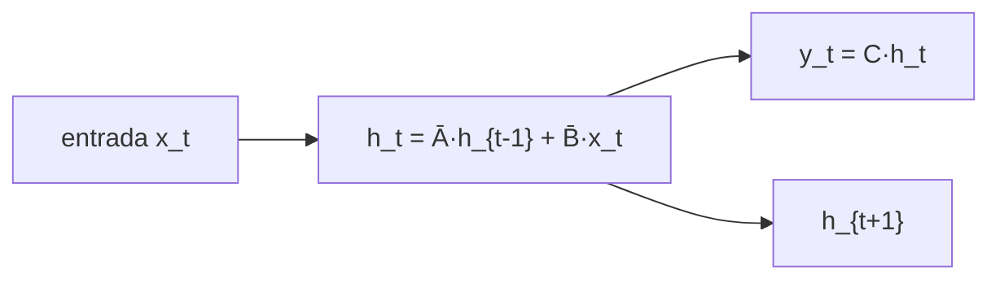
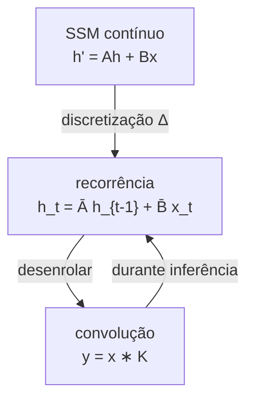
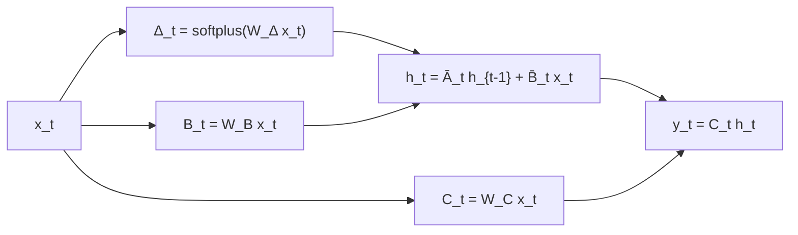
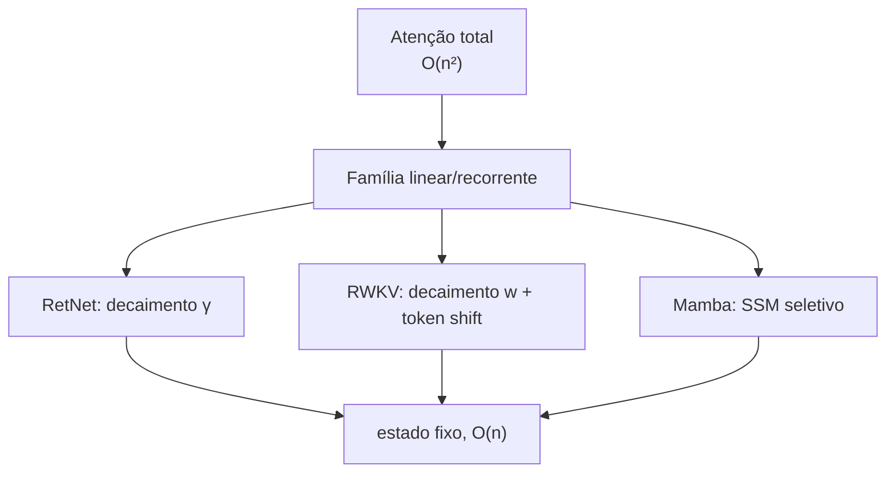

# Mamba e modelos de espaço de estado (SSM)

> "Um sistema linear com estado pode resumir uma sequência inteira em um vetor. O Mamba mostrou que, se você deixar os parâmetros dependerem da entrada, esse vetor vira um mecanismo de atenção seletiva — sem custo quadrático."

---

## 1. Intuição: o passado como um estado físico

Imagine um carro andando em linha reta. Para prever onde ele estará no futuro, você não precisa decorar toda a trajetória — bastam duas grandezas: **posição** e **velocidade**. Essas duas grandezas formam o **estado** do sistema. A cada instante, o estado novo é uma combinação linear do estado antigo mais a ação externa (aceleração).

Essa é a ideia dos **modelos de espaço de estado** (State Space Models, SSM): resumir toda a história da sequência em um vetor de estado $h$, que é atualizado por uma transformação linear a cada token.



A beleza: o estado tem tamanho fixo (como uma RNN), e a atualização é linear, o que permite reescrever tudo como uma **convolução** (paralelizável) quando a sequência é conhecida.

---

## 2. O modelo de espaço de estado

### 2.1 Forma contínua

Um SSM linear contínuo é descrito por duas equações. A primeira atualiza o estado (dinâmica); a segunda produz a saída (observação):

$$
h'(t) = A\, h(t) + B\, x(t)
$$

$$
y(t) = C\, h(t) + D\, x(t)
$$

Onde:

- $x(t)$ é a entrada (escalar ou vetor).
- $h(t)$ é o estado interno, de dimensão $N$.
- $A$ é a matriz de dinâmica ($N \times N$), que governa como o estado evolui.
- $B$ é a matriz de entrada ($N \times 1$), que projeta a entrada no estado.
- $C$ é a matriz de saída ($1 \times N$), que lê o estado.
- $D$ é o termo direto (muitas vezes ignorado, $D = 0$).

### 2.2 Discretização

Redes neurais processam sequências discretas, então precisamos converter o sistema contínuo em uma recorrência discreta com passo $\Delta$:

$$
h_t = \bar{A}\, h_{t-1} + \bar{B}\, x_t
$$

$$
y_t = C\, h_t
$$

As matrizes discretizadas $\bar{A}$ e $\bar{B}$ são obtidas por um esquema de **zero-order hold** (ZOH):

$$
\bar{A} = e^{\Delta A}
$$

$$
\bar{B} = (\Delta A)^{-1} \left( e^{\Delta A} - I \right) \Delta B
$$

Na prática, usa-se a aproximação de Euler para simplificar:

$$
\bar{A} \approx I + \Delta A, \qquad \bar{B} \approx \Delta B
$$

### 2.3 Exemplo numérico de discretização

Considere $A = -0.5$, $B = 1.0$ e $\Delta = 0.1$ (escalar, um único estado). Pelo ZOH:

$$
\bar{A} = e^{0.1 \cdot (-0.5)} = e^{-0.05} \approx 0.9512
$$

$$
\bar{B} = \frac{e^{-0.05} - 1}{-0.5} \cdot 1.0 = \frac{-0.0488}{-0.5} \approx 0.0975
$$

Pela aproximação de Euler:

$$
\bar{A} \approx 1 + 0.1 \cdot (-0.5) = 0.95, \qquad \bar{B} \approx 0.1 \cdot 1.0 = 0.1
$$

Os valores são próximos; a aproximação de Euler é mais barata e suficiente para fins didáticos.

---

## 3. A visão de convolução

Quando a sequência inteira $x_1, \dots, x_T$ já é conhecida, podemos desenrolar a recorrência. Partindo de $h_0 = 0$:

$$
h_1 = \bar{B} x_1
$$

$$
h_2 = \bar{A} \bar{B} x_1 + \bar{B} x_2
$$

$$
h_3 = \bar{A}^2 \bar{B} x_1 + \bar{A} \bar{B} x_2 + \bar{B} x_3
$$

E a saída $y_t = C h_t$ se torna uma **convolução** da entrada com um kernel fixo:

$$
y_t = \sum_{j=1}^{t} C \bar{A}^{t-j} \bar{B}\, x_j
$$

O kernel da convolução é a sequência:

$$
K = \left( C \bar{B},\; C \bar{A} \bar{B},\; C \bar{A}^2 \bar{B},\; \dots \right)
$$

Isso é enorme: a recorrência (sequencial) pode virar uma convolução (paralelizável) sempre que a sequência está completa — exatamente a mesma dualidade paralelo/recorrente que vimos no RetNet e no RWKV.



---

## 4. O problema do SSM "puro" e a solução HiPPO

Um SSM linear clássico tem um defeito: com $A$ fixo, a "memória" decai de forma exponencial e não consegue manter dependências de muito longo alcance de forma confiável. A teoria **HiPPO** mostrou como escolher $A$ para que o estado comprima a história de forma ótima (guardando, essencialmente, coeficientes de Legendre da sequência). O resultado é uma matriz $A$ especial que permite memória longa estável.

O **S4** (Structured State Spaces, 2021) combinou SSM com essa inicialização HiPPO e com um algoritmo rápido para a convolução, tornando o treino viável. Foi o marco que colocou os SSMs no radar do deep learning para sequências.

---

## 5. Mamba: seleção de estado (S6)

O salto do **Mamba** (2023) foi observar que um SSM "puro" é **linear e invariante no tempo** (LTI): os parâmetros $A, B, C, \Delta$ são os mesmos para qualquer entrada. Isso limita a capacidade de *selecionar* o que importa. O Mamba propõe o **S6** (selective state spaces): deixar $B$, $C$ e $\Delta$ dependerem da entrada $x_t$:

$$
B_t = f_B(x_t), \qquad C_t = f_C(x_t), \qquad \Delta_t = f_{\Delta}(x_t)
$$

O efeito é uma **seleção de conteúdo**: o modelo decide, para cada token, o quanto atualizar o estado ($\Delta_t$) e o que escrever/ler ($B_t, C_t$). Isso aproxima o SSM da atenção, que também pondera por conteúdo.

### 5.1 O custo da seleção

Seleção tem um preço: como $B_t, C_t$ agora dependem da entrada, o kernel de convolução deixa de ser fixo, e a convolução clássica não pode mais ser usada na inferência. O Mamba resolve isso com um algoritmo de **scan** (varredura associativa) implementado de forma eficiente em GPU, e com a recorrência:

$$
h_t = \bar{A}_t\, h_{t-1} + \bar{B}_t\, x_t
$$

$$
y_t = C_t\, h_t
$$

onde $\bar{A}_t, \bar{B}_t$ são discretizados com o passo $\Delta_t$ dependente da entrada.



### 5.2 O passo seletivo como "porta"

Repare na semelhança com o que já vimos: $\Delta_t$ controla quanto o estado se atualiza — o análogo da porta de esquecimento do LSTM e do decaimento $\gamma$ do RetNet. A diferença é que, no Mamba, essa "porta" é calculada a partir da entrada em cada passo, em vez de ser um parâmetro global.

---

## 6. Exemplo numérico progressivo

Vamos rodar um SSM escalar por três passos, com parâmetros fixos (para simplificar, sem seleção): $\bar{A} = 0.9$, $\bar{B} = 1.0$, $C = 1.0$, $h_0 = 0$.

Entrada: $x = [2, 1, 4]$.

**Passo 1** ($x_1 = 2$):

$$
h_1 = 0.9 \cdot 0 + 1.0 \cdot 2 = 2.0
$$

$$
y_1 = 1.0 \cdot 2.0 = 2.0
$$

**Passo 2** ($x_2 = 1$):

$$
h_2 = 0.9 \cdot 2.0 + 1.0 \cdot 1 = 1.8 + 1.0 = 2.8
$$

$$
y_2 = 2.8
$$

**Passo 3** ($x_3 = 4$):

$$
h_3 = 0.9 \cdot 2.8 + 1.0 \cdot 4 = 2.52 + 4.0 = 6.52
$$

$$
y_3 = 6.52
$$

Observe como o primeiro token ($x_1 = 2$) ainda influencia o terceiro passo: sua contribuição é $\bar{A}^{2} \bar{B} x_1 = 0.9^2 \cdot 1 \cdot 2 = 1.62$, que aparece dentro de $h_3 = 6.52$. O decaimento $\bar{A} = 0.9$ faz a influência diminuir a cada passo, mas nunca zerar.

### 6.1 Conferindo com a convolução

O kernel é $K = (C\bar{B}, C\bar{A}\bar{B}, C\bar{A}^2\bar{B}) = (1.0, 0.9, 0.81)$. A convolução causal da entrada $x = [2, 1, 4]$:

$$
y_1 = K_0 x_1 = 1.0 \cdot 2 = 2.0
$$

$$
y_2 = K_1 x_1 + K_0 x_2 = 0.9 \cdot 2 + 1.0 \cdot 1 = 1.8 + 1.0 = 2.8
$$

$$
y_3 = K_2 x_1 + K_1 x_2 + K_0 x_3 = 0.81 \cdot 2 + 0.9 \cdot 1 + 1.0 \cdot 4 = 1.62 + 0.9 + 4.0 = 6.52
$$

Os resultados batem: recorrência e convolução são duas faces da mesma operação.

---

## 7. Código

### 7.1 SSM escalar do zero

```python
import math

def ssm_recorrente(x, Abar, Bbar, C):
    h = 0.0
    y = []
    for xt in x:
        h = Abar * h + Bbar * xt
        y.append(C * h)
    return y

x = [2.0, 1.0, 4.0]
print(ssm_recorrente(x, 0.9, 1.0, 1.0))  # [2.0, 2.8, 6.52]
```

### 7.2 Discretização ZOH

```python
import math

def discretiza(A, B, delta):
    Abar = math.exp(delta * A)
    Bbar = ((math.exp(delta * A) - 1.0) / A) * delta * B if A != 0 else delta * B
    return Abar, Bbar

print(discretiza(-0.5, 1.0, 0.1))  # ~ (0.9512, 0.0975)
```

### 7.3 Pseudocódigo do bloco Mamba (S6)

```text
Entrada: x_t, estado h_{t-1}

Delta_t = softplus( W_delta · x_t + b_delta )   # passo seletivo (> 0)
B_t = W_B · x_t                                 # matriz de entrada seletiva
C_t = W_C · x_t                                 # matriz de saída seletiva
Abar_t = exp( Delta_t · A )                     # A pode ser fixo (HiPPO)
Bbar_t = Delta_t · B_t                          # aproximação de Euler
h_t = Abar_t · h_{t-1} + Bbar_t · x_t           # atualização do estado
y_t = C_t · h_t                                 # saída
```

---

## 8. Relação com RetNet e RWKV

As três famílias convergem para a mesma forma fundamental: **um estado fixo atualizado linearmente com decaimento**, com um toque de "seleção por conteúdo".

| Aspecto | Mamba (SSM) | RetNet | RWKV |
|---|---|---|---|
| Estado | $h_t = \bar{A}_t h_{t-1} + \bar{B}_t x_t$ | $s_t = \gamma s_{t-1} + k_t^T v_t$ | $(a_t, b_t)$ com decaimento $w$ |
| Decaimento | $\bar{A}$ (matriz, possivelmente seletiva) | $\gamma$ (escalar por cabeça) | $w$ (vetor por canal) |
| Seleção por conteúdo | sim, via $B_t, C_t, \Delta_t$ | parcial (via $Q, K$) | parcial (via chaves $k_i$) |
| Modo paralelo | convolução (LTI) / scan (seletivo) | forma paralela (mask $D$) | soma prefixada |
| Não-linearidade | entre blocos | GELU/SiLU no FFN | ReLU² no channel-mixing |

A relação mais profunda: **a retenção do RetNet é um SSM com decaimento escalar e estado do tipo $s_t = k_t^T v_t$**. A diferença está no formato do estado (o RetNet guarda um produto externo, o Mamba guarda um vetor) e na forma da seleção.



---

## 9. Panorama atual

- **Mamba (S6)**: introduziu a seleção de estado, competindo com Transformers em várias tarefas com custo linear.
- **Mamba-2**: reformulou o SSM seletivo em termos de **atenção linear estruturada** (structured state space duality — SSD), unificando a teoria de SSMs e de atenção linear em um mesmo arcabouço matemático.
- **Modelos híbridos (Jamba, Zamba, etc.)**: misturam blocos de atenção (para memória exata) com blocos Mamba/SSM (para contexto longo barato), buscando o melhor dos dois mundos.
- **Motores de treino por scan**: a eficiência da varredura associativa tornou os SSMs competitivos em hardware moderno.

A tendência é clara: a comunidade está caminhando para arquiteturas que combinam atenção esparsa ou linear com recorrência, abandonando a suposição de que "atenção total sempre" é o único caminho.

---

## 11. Erros comuns

1. **Confundir SSM com RNN**: a recorrência do SSM é **linear** (a não-linearidade fica entre blocos), o que permite a forma de convolução; uma RNN genérica tem não-linearidade dentro do passo e não admite essa conversão trivial.
2. **Ignorar a discretização**: aplicar a matriz contínua $A$ diretamente como se fosse discreta muda o comportamento; o passo $\Delta$ controla a velocidade de esquecimento.
3. **Achar que seleção é grátis**: ao tornar $B, C, \Delta$ dependentes da entrada, perde-se a convolução clássica e é preciso o algoritmo de scan — o custo de implementação e de memória muda.
4. **Esquecer o termo direto $D$**: em muitos usos ele é zero, mas em modelos de visão (como o Vision Mamba) ele pode importar.
5. **Achar que estado fixo = memória perfeita**: o estado continua sendo um resumo de dimensão finita; SSMs trocam qualidade de recuperação exata por eficiência, como o RetNet e o RWKV.

---

## 12. Resumo

- Um SSM resume a sequência em um estado $h$ atualizado por uma transformação linear: $h_t = \bar{A} h_{t-1} + \bar{B} x_t$, $y_t = C h_t$.
- A **discretização** (passo $\Delta$) converte o sistema contínuo em recorrência discreta.
- A recorrência linear equivale a uma **convolução** causal, permitindo treino paralelo.
- O **HiPPO/S4** deu estabilidade de memória longa; o **Mamba (S6)** adicionou **seleção de estado** ($B, C, \Delta$ dependentes da entrada), aproximando SSMs da atenção.
- Mamba, RetNet e RWKV compartilham a mesma espinha: estado fixo, decaimento e custo linear em $n$.

---
