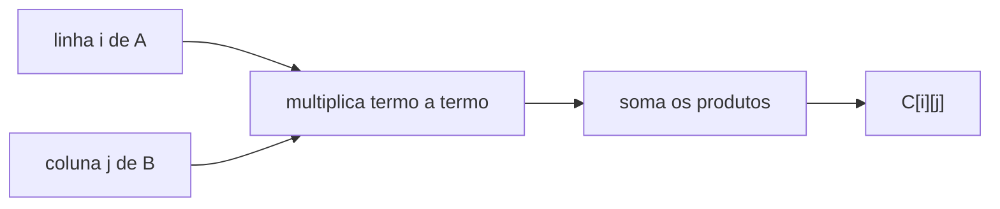

# Multiplicação de matrizes


Este documento constrói a operação do zero, resolve exemplos progressivos com números negativos e flutuantes, e mostra por que a arquitetura BitNet (pesos ternários) muda radicalmente o custo dessa operação em comparação com modelos em FP16/FP32.

## 1. Intuição: por que matrizes

Uma matriz é uma tabela retangular de números organizada em **linhas** e **colunas**. Uma matriz $m \times n$ tem $m$ linhas e $n$ colunas.

Em aprendizado de máquina, matrizes aparecem naturalmente quando agrupamos vetores:

- Uma matriz de **dados** $X$ guarda vários exemplos: cada linha é um exemplo, cada coluna é uma característica.
- Uma matriz de **pesos** $W$ guarda os parâmetros aprendidos pelo modelo.

Multiplicar matrizes é a forma compacta de aplicar uma transformação linear a um monte de vetores de uma só vez. É por isso que a operação domina o treinamento e a inferência.

## 2. A regra das dimensões

Para multiplicar uma matriz $A$ de forma $(m \times n)$ por uma matriz $B$ de forma $(n \times p)$:

- O número de **colunas de $A$** deve ser igual ao número de **linhas de $B$**.
- O resultado tem forma $(m \times p)$.

$$
(m \times n) \cdot (n \times p) = (m \times p)
$$

A dimensão **do meio** ($n$) precisa coincidir: ela "some" no resultado.

| $A$ | $B$ | Resultado $C = AB$ | Válido? |
|-----|-----|--------------------|---------|
| $(2 \times 3)$ | $(3 \times 4)$ | $(2 \times 4)$ | Sim |
| $(4 \times 5)$ | $(5 \times 1)$ | $(4 \times 1)$ | Sim |
| $(2 \times 3)$ | $(4 \times 3)$ | — | Não ($3 \neq 4$) |
| $(3 \times 1)$ | $(1 \times 3)$ | $(3 \times 3)$ | Sim |

> Regra de bolso: "as dimensões internas têm que casar; as externas definem o resultado". Se $A$ é $m \times n$ e $B$ é $n \times p$, o "meio" $n$ casa e o resultado é $m \times p$.

## 3. O cálculo, célula por célula

Cada elemento $C_{ij}$ do resultado é o **produto escalar** da linha $i$ de $A$ com a coluna $j$ de $B$:

$$
C_{ij} = \sum_{k=1}^{n} A_{ik} \cdot B_{kj}
$$

Para cada célula, percorra a linha e a coluna em paralelo, multiplicando e somando.



## 4. Exemplo 1 — vetor linha × vetor coluna $(1 \times 2) \cdot (2 \times 1)$

$$
A = \begin{bmatrix} 2 & 3 \end{bmatrix}, \qquad
B = \begin{bmatrix} 4 \\ 5 \end{bmatrix}
$$

$$
C = 2 \cdot 4 + 3 \cdot 5 = 8 + 15 = 23
$$

O resultado é um escalar (matriz $1 \times 1$): **23**. Isso é exatamente um produto escalar — a multiplicação de matrizes generaliza o produto escalar que vimos no documento sobre vetores.

## 5. Exemplo 2 — $(2 \times 1) \cdot (1 \times 2)$

Invertendo a ordem, o resultado agora é uma matriz $2 \times 2$:

$$
A = \begin{bmatrix} 2 \\ 3 \end{bmatrix}, \qquad
B = \begin{bmatrix} 4 & 5 \end{bmatrix}
$$

$$
C = \begin{bmatrix}
2 \cdot 4 & 2 \cdot 5 \\
3 \cdot 4 & 3 \cdot 5
\end{bmatrix}
= \begin{bmatrix} 8 & 10 \\ 12 & 15 \end{bmatrix}
$$

> Repare que **a ordem importa**: $(1 \times 2)(2 \times 1)$ dá um número, enquanto $(2 \times 1)(1 \times 2)$ dá uma matriz $2 \times 2$. A multiplicação de matrizes **não é comutativa**: em geral $AB \neq BA$.

## 6. Exemplo 3 — $(3 \times 2) \cdot (2 \times 3)$, com negativos

$$
A = \begin{bmatrix}
1 & 2 \\
3 & 4 \\
-1 & 0
\end{bmatrix}, \qquad
B = \begin{bmatrix}
5 & -2 & 1 \\
0 & 3 & 4
\end{bmatrix}
$$

O resultado terá forma $(3 \times 3)$. Calculando a primeira linha de $C$ (linha 1 de $A$ contra cada coluna de $B$):

$$
\begin{aligned}
C_{11} &= 1 \cdot 5 + 2 \cdot 0 = 5 + 0 = 5 \\
C_{12} &= 1 \cdot (-2) + 2 \cdot 3 = -2 + 6 = 4 \\
C_{13} &= 1 \cdot 1 + 2 \cdot 4 = 1 + 8 = 9
\end{aligned}
$$

Segunda linha (linha 2 de $A$):

$$
\begin{aligned}
C_{21} &= 3 \cdot 5 + 4 \cdot 0 = 15 \\
C_{22} &= 3 \cdot (-2) + 4 \cdot 3 = -6 + 12 = 6 \\
C_{23} &= 3 \cdot 1 + 4 \cdot 4 = 3 + 16 = 19
\end{aligned}
$$

Terceira linha (linha 3 de $A$):

$$
\begin{aligned}
C_{31} &= (-1) \cdot 5 + 0 \cdot 0 = -5 \\
C_{32} &= (-1) \cdot (-2) + 0 \cdot 3 = 2 \\
C_{33} &= (-1) \cdot 1 + 0 \cdot 4 = -1
\end{aligned}
$$

$$
C = \begin{bmatrix}
5 & 4 & 9 \\
15 & 6 & 19 \\
-5 & 2 & -1
\end{bmatrix}
$$

Note como os negativos entram naturalmente: um produto de dois negativos dá positivo ($(-1)(-2) = 2$), e um produto com zero simplesmente some da soma.

## 7. Exemplo 4 — $(2 \times 2) \cdot (2 \times 2)$, com flutuantes

Com números reais, o raciocínio é idêntico — só muda a aritmética:

$$
A = \begin{bmatrix} 0.5 & -1.5 \\ 2.25 & 0.0 \end{bmatrix}, \qquad
B = \begin{bmatrix} 1.0 & 0.25 \\ -0.5 & 3.0 \end{bmatrix}
$$

$$
\begin{aligned}
C_{11} &= 0.5 \cdot 1.0 + (-1.5) \cdot (-0.5) = 0.5 + 0.75 = 1.25 \\
C_{12} &= 0.5 \cdot 0.25 + (-1.5) \cdot 3.0 = 0.125 - 4.5 = -4.375 \\
C_{21} &= 2.25 \cdot 1.0 + 0.0 \cdot (-0.5) = 2.25 + 0 = 2.25 \\
C_{22} &= 2.25 \cdot 0.25 + 0.0 \cdot 3.0 = 0.5625 + 0 = 0.5625
\end{aligned}
$$

$$
C = \begin{bmatrix}
1.25 & -4.375 \\
2.25 & 0.5625
\end{bmatrix}
$$

## 8. Exemplo 5 — $(4 \times 4) \cdot (4 \times 4)$, caso completo

Este é o exemplo mais próximo da realidade: matrizes maiores, misturando negativos e flutuantes. Para não nos perdermos, seguimos o mesmo método: uma linha, coluna por coluna.

$$
A = \begin{bmatrix}
1.0 & -2.0 & 0.5 & 3.0 \\
-1.5 & 2.0 & 0.0 & -0.5 \\
0.0 & 1.0 & -1.0 & 2.0 \\
2.0 & 0.5 & -0.5 & 1.0
\end{bmatrix}, \qquad
B = \begin{bmatrix}
2.0 & 0.0 & -1.0 & 1.0 \\
1.0 & -1.0 & 0.5 & 0.0 \\
0.0 & 2.0 & -0.5 & 1.5 \\
-1.0 & 1.0 & 0.0 & 2.0
\end{bmatrix}
$$

### Linha 1 de $A$

$$
\begin{aligned}
C_{11} &= 1.0(2.0) + (-2.0)(1.0) + 0.5(0.0) + 3.0(-1.0) = 2 - 2 + 0 - 3 = -3.0 \\
C_{12} &= 1.0(0.0) + (-2.0)(-1.0) + 0.5(2.0) + 3.0(1.0) = 0 + 2 + 1 + 3 = 6.0 \\
C_{13} &= 1.0(-1.0) + (-2.0)(0.5) + 0.5(-0.5) + 3.0(0.0) = -1 - 1 - 0.25 + 0 = -2.25 \\
C_{14} &= 1.0(1.0) + (-2.0)(0.0) + 0.5(1.5) + 3.0(2.0) = 1 + 0 + 0.75 + 6 = 7.75
\end{aligned}
$$

### Linha 2 de $A$

$$
\begin{aligned}
C_{21} &= (-1.5)(2.0) + 2.0(1.0) + 0.0(0.0) + (-0.5)(-1.0) = -3 + 2 + 0 + 0.5 = -0.5 \\
C_{22} &= (-1.5)(0.0) + 2.0(-1.0) + 0.0(2.0) + (-0.5)(1.0) = 0 - 2 + 0 - 0.5 = -2.5 \\
C_{23} &= (-1.5)(-1.0) + 2.0(0.5) + 0.0(-0.5) + (-0.5)(0.0) = 1.5 + 1 + 0 + 0 = 2.5 \\
C_{24} &= (-1.5)(1.0) + 2.0(0.0) + 0.0(1.5) + (-0.5)(2.0) = -1.5 + 0 + 0 - 1 = -2.5
\end{aligned}
$$

### Linha 3 de $A$

$$
\begin{aligned}
C_{31} &= 0.0(2.0) + 1.0(1.0) + (-1.0)(0.0) + 2.0(-1.0) = 0 + 1 + 0 - 2 = -1.0 \\
C_{32} &= 0.0(0.0) + 1.0(-1.0) + (-1.0)(2.0) + 2.0(1.0) = 0 - 1 - 2 + 2 = -1.0 \\
C_{33} &= 0.0(-1.0) + 1.0(0.5) + (-1.0)(-0.5) + 2.0(0.0) = 0 + 0.5 + 0.5 + 0 = 1.0 \\
C_{34} &= 0.0(1.0) + 1.0(0.0) + (-1.0)(1.5) + 2.0(2.0) = 0 + 0 - 1.5 + 4 = 2.5
\end{aligned}
$$

### Linha 4 de $A$

$$
\begin{aligned}
C_{41} &= 2.0(2.0) + 0.5(1.0) + (-0.5)(0.0) + 1.0(-1.0) = 4 + 0.5 + 0 - 1 = 3.5 \\
C_{42} &= 2.0(0.0) + 0.5(-1.0) + (-0.5)(2.0) + 1.0(1.0) = 0 - 0.5 - 1 + 1 = -0.5 \\
C_{43} &= 2.0(-1.0) + 0.5(0.5) + (-0.5)(-0.5) + 1.0(0.0) = -2 + 0.25 + 0.25 + 0 = -1.5 \\
C_{44} &= 2.0(1.0) + 0.5(0.0) + (-0.5)(1.5) + 1.0(2.0) = 2 + 0 - 0.75 + 2 = 3.25
\end{aligned}
$$

Resultado final:

$$
C = \begin{bmatrix}
-3.0 & 6.0 & -2.25 & 7.75 \\
-0.5 & -2.5 & 2.5 & -2.5 \\
-1.0 & -1.0 & 1.0 & 2.5 \\
3.5 & -0.5 & -1.5 & 3.25
\end{bmatrix}
$$

> Se você acompanhou cada célula, percebeu o padrão: é sempre "anda na linha, desce na coluna, multiplica e soma". A dificuldade está só no volume de contas, nunca na regra em si. Computadores fazem isso bilhões de vezes por segundo.

## 9. A camada linear: $Y = X W^T + b$

Toda camada de uma rede neural aplica uma transformação linear do tipo:

$$
Y = X W^T + b
$$

Aqui $X$ é a matriz de entradas (forma $m \times d$), $W$ é a matriz de pesos (forma $d_{saída} \times d$), $W^T$ é a sua transposta (forma $d \times d_{saída}$) e $b$ é o vetor de viés (forma $d_{saída}$).

> Por que $W^T$ e não $W$ diretamente? É uma convenção de organização. Muitas bibliotecas armazenam cada linha de $W$ como o vetor de pesos de **um neurônio de saída**. Para fazer a conta linha×coluna bater, transpoem-se os pesos. O que importa é o resultado: $Y$ tem forma $(m \times d_{saída})$ — um valor de saída para cada exemplo e cada neurônio.

### Exemplo numérico da camada linear

Considere $m = 2$ exemplos, $d = 3$ entradas e $d_{saída} = 2$ neurônios de saída:

$$
X = \begin{bmatrix}
1.0 & 0.5 & -1.0 \\
0.0 & 2.0 & 1.5
\end{bmatrix}, \qquad
W = \begin{bmatrix}
0.5 & 1.0 & -0.5 \\
-1.0 & 0.0 & 2.0
\end{bmatrix}, \qquad
b = \begin{bmatrix} 0.1 & -0.2 \end{bmatrix}
$$

Aqui $W$ é $2 \times 3$ (2 neurônios, 3 pesos cada). Sua transposta $W^T$ é $3 \times 2$:

$$
W^T = \begin{bmatrix}
0.5 & -1.0 \\
1.0 & 0.0 \\
-0.5 & 2.0
\end{bmatrix}
$$

Calculando $X W^T$ (forma $2 \times 2$):

$$
\begin{aligned}
(XW^T)_{11} &= 1.0(0.5) + 0.5(1.0) + (-1.0)(-0.5) = 0.5 + 0.5 + 0.5 = 1.5 \\
(XW^T)_{12} &= 1.0(-1.0) + 0.5(0.0) + (-1.0)(2.0) = -1 + 0 - 2 = -3.0 \\
(XW^T)_{21} &= 0.0(0.5) + 2.0(1.0) + 1.5(-0.5) = 0 + 2 - 0.75 = 1.25 \\
(XW^T)_{22} &= 0.0(-1.0) + 2.0(0.0) + 1.5(2.0) = 0 + 0 + 3 = 3.0
\end{aligned}
$$

Somando o viés $b$ linha a linha:

$$
Y = \begin{bmatrix}
1.5 + 0.1 & -3.0 + (-0.2) \\
1.25 + 0.1 & 3.0 + (-0.2)
\end{bmatrix}
= \begin{bmatrix}
1.6 & -3.2 \\
1.35 & 2.8
\end{bmatrix}
$$

Em código, é literalmente uma linha:

```python
import torch

X = torch.tensor([[1.0, 0.5, -1.0],
                  [0.0, 2.0, 1.5]])       # (2, 3)
W = torch.tensor([[0.5, 1.0, -0.5],
                  [-1.0, 0.0, 2.0]])      # (2, 3) -> transposta vira (3, 2)
b = torch.tensor([0.1, -0.2])             # (2,)

Y = X @ W.T + b                           # (2, 2)
print(Y)
# tensor([[ 1.6000, -3.2000],
#         [ 1.3500,  2.8000]])
```

## 10. A diferença crucial: BitNet (ternário) vs. FP16/FP32


### 10.1 Modelo tradicional (FP16/FP32)

Em um modelo convencional, cada peso é um número de ponto flutuante de 16 ou 32 bits. O produto escalar de cada célula exige multiplicar dois números reais:

$$
\sum_k X_{ik} \cdot W_{kj}
\quad\text{(mult. de ponto flutuante)}
$$

Multiplicadores de ponto flutuante são caros em hardware: consomem área de silício, energia e ciclos de clock. E como há bilhões de pesos e cada um participa de inúmeras multiplicações, esse custo domina a conta total.

### 10.2 BitNet / BitLinear (ternário)

No **BitLinear** do BitNet, os pesos são **ternários**: só podem valer $-1$, $0$ ou $+1$. A mesma soma vira:

$$
\sum_k X_{ik} \cdot w_{kj}, \qquad w_{kj} \in \{-1, 0, +1\}
$$

As três possibilidades de multiplicação se reduzem a operações triviais:

| Peso $w_{kj}$ | Termo $X_{ik} \cdot w_{kj}$ | Operação real |
|---------------|------------------------------|----------------|
| $+1$ | $X_{ik}$ | Manter o valor |
| $-1$ | $-X_{ik}$ | Inverter o sinal |
| $0$ | $0$ | Ignorar (zerar) |

Ou seja, a multiplicação **não precisa de multiplicador de ponto flutuante** — só somas e negações, muito mais baratas e rápidas em hardware. É por isso que modelos ternários podem ser muito mais eficientes em energia e memória.

### 10.3 Mesmo exemplo, peso ternário

Retomando o vetor do exemplo 1, mas com pesos ternários:

$$
A = \begin{bmatrix} 2.0 & -3.0 & 1.5 \end{bmatrix}, \qquad
w = \begin{bmatrix} 1 \\ -1 \\ 0 \end{bmatrix}
$$

$$
C = 2.0 \cdot (1) + (-3.0) \cdot (-1) + 1.5 \cdot (0) = 2.0 + 3.0 + 0 = 5.0
$$

Passo a passo: o primeiro termo mantém $2.0$; o segundo inverte o sinal de $-3.0$, dando $+3.0$; o terceiro zera $1.5$. Nenhuma multiplicação real foi feita — foi "soma, inverte o sinal, ignora".

### 10.4 Comparação resumida

| Aspecto | FP16/FP32 | BitNet (ternário) |
|---------|-----------|-------------------|
| Valores de peso | Reais contínuos | $\{-1, 0, +1\}$ |
| Bits por peso | 16 ou 32 | 2 (ou menos) |
| Multiplicação | Multiplicador FP | Soma / negação |
| Custo em hardware | Alto | Muito baixo |
| Precisão do modelo | Referência | Ligeiramente menor |

> O BitNet troca um pouco de precisão por muita eficiência. Como vimos, a operação é a mesma multiplicação de matrizes — o que muda é que os pesos deixam de ser números reais e passam a ser sinais, transformando multiplicações em somas.

## 11. Erros comuns

- **Multiplicar matrizes com dimensões incompatíveis.** Sempre confira se as "dimensões internas" casam antes de qualquer conta.
- **Assumir que $AB = BA$.** A ordem importa, e na maioria dos casos a troca nem é possível.
- **Esquecer o viés na camada linear.** O $+b$ é somado **depois** da multiplicação, e é transmitido (broadcast) para cada linha do lote.
- **Confundir transposta com inversa.** $W^T$ apenas troca linhas por colunas; não "desfaz" nada.
- **Erro de sinal no produto de negativos.** $(-a)(-b) = +ab$; revisar o sinal é a causa mais frequente de erro manual.

## 12. Resumo

- A multiplicação de matrizes $(m \times n)(n \times p) = (m \times p)$ exige que a dimensão interna case.
- Cada célula $C_{ij}$ é o produto escalar da linha $i$ de $A$ pela coluna $j$ de $B$.
- A camada linear é $Y = X W^T + b$, uma multiplicação de matrizes gigante mais um viés.
- No BitNet, pesos ternários ($-1, 0, +1$) transformam multiplicações em somas e negações, reduzindo drasticamente o custo de hardware — mantendo exatamente a mesma operação que estudamos aqui.
