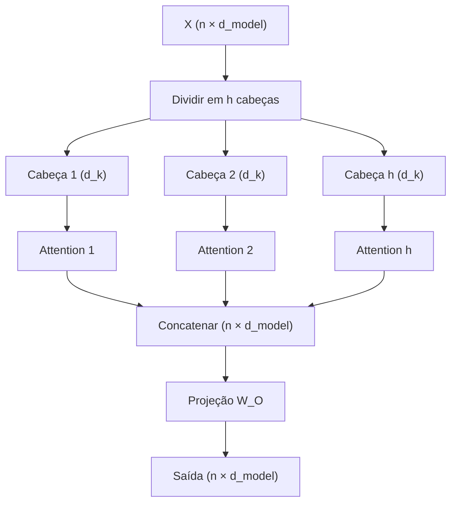

# Multi-head attention

> Uma única cabeça de atenção enxerga a sequência por um único "filtro". A **multi-head attention** instala várias cabeças em paralelo, cada uma com seus próprios $W_Q$, $W_K$ e $W_V$, para que o modelo consiga prestar atenção a **relações diferentes ao mesmo tempo** — sintaxe, semântica, referência, posição. Esta página mostra como dividir, concatenar e projetar, com shapes e código completos.

## Visão geral

Na atenção de cabeça única, todas as interações entre tokens passam por um único conjunto de projeções. Isso é limitante: uma relação do tipo "sujeito–verbo" e uma relação do tipo "pronome–antecedente" podem exigir "perguntas" muito diferentes, e forçá-las a dividir o mesmo espaço de Query/Key pode criar interferência.

A solução é **multiplicar a quantidade de cabeças**. Em vez de uma atenção só, rodamos $h$ atenções independentes em paralelo, cada uma sobre uma **fatia** do vetor do token, e depois combinamos os resultados. O modelo ganha a liberdade de especializar cada cabeça em um tipo de relação.

## Intuição: vários especialistas lendo o mesmo texto

Imagine um comitê de $h$ leitores analisando a mesma frase:

- Um leitor foca em **quem é o sujeito** de cada verbo.
- Outro foca em **a que se refere cada pronome**.
- Outro foca em **palavras próximas** (vizinhança local).
- Outro foca em **conexões de longo alcance** (começo do texto).

Cada leitor produz uma opinião. No final, um redator **combina** todas as opiniões em um único resumo. A multi-head attention é exatamente isso: cada cabeça é um leitor especialista, e a projeção final é o redator que sintetiza.

## Conceito: dividir, atender, concatenar, projetar

O processo tem quatro etapas:

1. **Dividir**: o vetor de dimensão $d_{model}$ é separado em $h$ partes de dimensão $d_k$ cada.
2. **Atender**: cada cabeça calcula a atenção (Q, K, V) de forma independente.
3. **Concatenar**: as saídas das $h$ cabeças são coladas de volta em um único vetor de dimensão $d_{model}$.
4. **Projetar**: uma matriz $W_O$ mistura tudo em uma saída final.

Formalmente, para a cabeça $r$:

$$
\text{head}_r = \text{Attention}\!\left(Q_r, K_r, V_r\right)
$$

com:

$$
Q_r = X W_Q^{(r)}, \quad K_r = X W_K^{(r)}, \quad V_r = X W_V^{(r)}
$$

E a saída completa:

$$
\text{MultiHead}(X) = \text{Concat}\!\left(\text{head}_1, \dots, \text{head}_h\right) W_O
$$

## A matemática detalhada

Seja $d_{model}$ a dimensão do modelo e $h$ o número de cabeças. Escolhemos $d_k = d_v = d_{model} / h$ (a configuração mais comum). Cada cabeça opera sobre um subespaço de dimensão $d_k$:

$$
\text{head}_r = \text{softmax}\!\left(\frac{Q_r K_r^{\top}}{\sqrt{d_k}}\right) V_r
$$

Cada cabeça produz $n \times d_v$. Concatenar ao longo da última dimensão dá $n \times (h \cdot d_v) = n \times d_{model}$. A projeção final $W_O \in \mathbb{R}^{d_{model} \times d_{model}}$ combina as cabeças.

O custo total é interessante: como cada cabeça usa dimensão $d_k = d_{model}/h$, o custo de cada atenção é proporcional a $(d_{model}/h)^2$, e há $h$ cabeças, então o custo total em relação à dimensão é:

$$
h \cdot \left(\frac{d_{model}}{h}\right)^2 = \frac{d_{model}^2}{h}
$$

Ou seja, **dividir em cabeças reduz o custo por cabeça** ao mesmo tempo em que dá diversidade de representação. O custo do produto $Q K^{\top}$ sobre os tokens ($n^2$) permanece, mas é dividido pelo paralelismo das cabeças.

## Shapes de ponta a ponta

Considere um exemplo típico: $n = 4$ tokens, $d_{model} = 8$, $h = 2$ cabeças, logo $d_k = d_v = 4$.

| Tensor | Shape | Significado |
|--------|-------|-------------|
| $X$ | $4 \times 8$ | entrada (4 tokens, dim 8) |
| $W_Q^{(r)}, W_K^{(r)}$ | $8 \times 4$ | projeção de query/key da cabeça $r$ |
| $W_V^{(r)}$ | $8 \times 4$ | projeção de value da cabeça $r$ |
| $Q_r, K_r, V_r$ | $4 \times 4$ | query/key/value da cabeça $r$ |
| $\text{head}_r$ | $4 \times 4$ | saída da cabeça $r$ |
| $\text{Concat}$ | $4 \times 8$ | as 2 cabeças coladas |
| $W_O$ | $8 \times 8$ | projeção final |
| $\text{saída}$ | $4 \times 8$ | mesma dimensão da entrada |

O ponto-chave: a entrada e a saída do bloco de atenção têm **o mesmo shape** $n \times d_{model}$, o que permite os residuais e o empilhamento.

## Exemplo numérico em miniatura

Para acompanhar na mão, usemos $d_{model} = 6$, $h = 2$, $d_k = 3$, e $n = 2$ tokens:

$$
x_1 = [1, 0, 1, 0, 1, 0], \qquad x_2 = [0, 1, 0, 1, 0, 1]
$$

**Dividir**: a cabeça 1 recebe as três primeiras coordenadas, a cabeça 2 as três últimas:

$$
x_1^{(1)} = [1, 0, 1], \quad x_2^{(1)} = [0, 1, 0]
$$

$$
x_1^{(2)} = [0, 1, 0], \quad x_2^{(2)} = [1, 0, 1]
$$

Cada cabeça calcula sua própria atenção sobre sua fatia, produzindo duas saídas de dimensão 3. **Concatenar** devolve a dimensão 6, e **$W_O$** mistura as duas fatias. O resultado é que a cabeça 1 pode aprender relações que vivem nas coordenadas $\{1,2,3\}$, e a cabeça 2 nas coordenadas $\{4,5,6\}$, sem interferir uma na outra.

## O que cada cabeça aprende

Embora nada force essa especialização, na prática as cabeças tendem a se diferenciar. Estudos de interpretabilidade em transformers de linguagem identificam padrões recorrentes:

| Tipo de cabeça | O que ela detecta | Exemplo |
|----------------|-------------------|---------|
| **Sintática** | relações gramaticais | sujeito de um verbo |
| **Semântica** | similaridade de significado | palavras do mesmo tema |
| **De referência** | a que um pronome aponta | "ele" → "João" |
| **De posição** | vizinhança local | token anterior / próximo |
| **De cópia** | repetir um token da entrada | copiar nomes próprios |

A beleza é que **nenhum desses papéis é programado**: eles emergem do treino. Cada cabeça descobre seu nicho porque tem projeções próprias e, portanto, liberdade para se especializar.

## Código em PyTorch

### Implementação completa

```python
import torch
import torch.nn as nn
import torch.nn.functional as F

class MultiHeadAttention(nn.Module):
    def __init__(self, d_model, n_heads):
        super().__init__()
        assert d_model % n_heads == 0
        self.d_model = d_model
        self.n_heads = n_heads
        self.d_k = d_model // n_heads

        # projeções conjuntas para todas as cabeças
        self.W_q = nn.Linear(d_model, d_model, bias=False)
        self.W_k = nn.Linear(d_model, d_model, bias=False)
        self.W_v = nn.Linear(d_model, d_model, bias=False)
        self.W_o = nn.Linear(d_model, d_model, bias=False)

    def forward(self, x, mask=None):
        n = x.size(0)

        # projeta e separa em cabeças: (h, n, d_k)
        q = self.W_q(x).view(n, self.n_heads, self.d_k).transpose(0, 1)
        k = self.W_k(x).view(n, self.n_heads, self.d_k).transpose(0, 1)
        v = self.W_v(x).view(n, self.n_heads, self.d_k).transpose(0, 1)

        # scores por cabeça
        scores = q @ k.transpose(-2, -1) / (self.d_k ** 0.5)

        # máscara causal (broadcast para todas as cabeças)
        if mask is not None:
            scores = scores.masked_fill(mask == 0, float("-inf"))

        attn = F.softmax(scores, dim=-1)
        heads = attn @ v                     # (h, n, d_k)

        # concatena e projeta de volta
        out = heads.transpose(0, 1).contiguous().view(n, self.d_model)
        out = self.W_o(out)
        return out
```

### Verificando os shapes

```python
d_model, n_heads = 8, 2
mha = MultiHeadAttention(d_model, n_heads)

x = torch.randn(4, d_model)                 # 4 tokens, dim 8
out = mha(x)
print("entrada:", x.shape)                  # (4, 8)
print("saída:", out.shape)                  # (4, 8)  -> preserva a dimensão
```

### Usando a implementação do PyTorch

```python
mha = nn.MultiheadAttention(embed_dim=8, num_heads=2, batch_first=True)
x = torch.randn(2, 4, 8)                    # batch=2, tokens=4, dim=8
out, attn_weights = mha(x, x, x)
print("out:", out.shape)                    # (2, 4, 8)
print("pesos:", attn_weights.shape)         # (2, 2, 4, 4) -> por cabeça
```

## Fluxo em diagrama



## Erros comuns

- **Esquecer o assert de divisibilidade**: $d_{model}$ deve ser múltiplo de $h$, senão a divisão em cabeças não fecha.
- **Transpor na ordem errada**: confundir as dimensões ao separar/concatenar as cabeças é a fonte mais comum de bugs de shape.
- **Compartilhar pesos entre cabeças**: se todas usam a mesma $W_Q, W_K, W_V$, perde-se a diversidade — vira uma cabeça só.
- **Achar que mais cabeças é sempre melhor**: cabeças demais reduzem $d_k$ e podem limitar a expressividade por cabeça; há um equilíbrio.
- **Ignorar a máscara em todas as cabeças**: a máscara causal deve valer para **todas** as cabeças, não só a primeira.
- **Esquecer a projeção $W_O$**: concatenar sem projetar deixa as cabeças "soltas", sem se misturar.

## Resumo

- A multi-head attention roda **$h$ atenções em paralelo**, cada uma com projeções próprias.
- O vetor de dimensão $d_{model}$ é **dividido** em $h$ fatias de dimensão $d_k = d_{model}/h$.
- Cada cabeça calcula $\text{softmax}\!\left(\frac{Q_r K_r^{\top}}{\sqrt{d_k}}\right) V_r$ de forma independente.
- As saídas são **concatenadas** de volta a $d_{model}$ e passam pela projeção final $W_O$.
- Entrada e saída têm o **mesmo shape**, permitindo residuais e empilhamento.
- As cabeças tendem a se **especializar** (sintaxe, semântica, referência, posição) de forma emergente.
