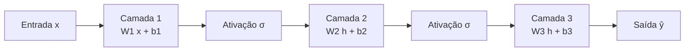

# O neurônio artificial

> "A unidade que soma, pondera e decide. Todo o resto — camadas, modelos, painéis de treino — é apenas bilhões de cópias desta pequena máquina de multiplicar e comparar."

---

## 1. Intuição: uma porta lógica que aprende sozinha

Antes de falar de redes neurais profundas, de BitNet ternário, de RetNet ou de qualquer arquitetura moderna, precisamos entender a menor peça de todas: o **neurônio artificial**. Ele é uma função matemática extremamente simples, mas quando você coloca milhões deles lado a lado e os treina com gradiente descendente, o conjunto passa a se comportar como um sistema capaz de reconhecer padrões, prever a próxima palavra e até raciocinar.

A melhor forma de pensar em um neurônio artificial é compará-lo a uma **decisão ponderada**. Imagine que você está decidindo se deve ou não sair de casa hoje. Você recebe vários sinais:

- Está chovendo? (sim = 1, não = 0)
- Você tem um compromisso importante? (sim = 1, não = 0)
- Está cansado? (sim = 1, não = 0)

Cada um desses sinais tem um **peso** diferente na sua decisão. Um compromisso importante "pesa" muito mais que o cansaço, por exemplo. No final, você soma todas as influências e, se o total ultrapassar um certo limite, você decide sair.

O neurônio artificial faz exatamente isso, mas em números reais e de forma contínua.

---

## 2. Comparação com o neurônio biológico

O neurônio biológico recebe estímulos através dos **dendritos**, integra esses estímulos no **corpo celular (soma)** e, se o potencial elétrico acumulado ultrapassar um limiar, dispara um impulso pelo **axônio**.

O neurônio artificial é uma idealização matemática desse processo:

| Componente biológico | Equivalente artificial | Símbolo matemático |
|---|---|---|
| Dendritos (entradas) | Vetor de entrada | $\mathbf{x} = [x_1, x_2, \dots, x_n]$ |
| Sinapses (força da conexão) | Pesos | $\mathbf{w} = [w_1, w_2, \dots, w_n]$ |
| Corpo celular (integração) | Soma ponderada | $z = \sum_i w_i x_i$ |
| Limiar de disparo | Viés | $b$ |
| Frequência de disparo | Função de ativação | $\sigma(z)$ |
| Axônio (saída) | Valor de saída | $\hat{y} = \sigma(z + b)$ |

A grande diferença é que, no neurônio biológico, o disparo é "tudo ou nada" (um pulso discreto), enquanto no neurônio artificial clássico a saída pode ser um número real contínuo, dependendo da função de ativação escolhida.

---

## 3. A matemática: soma ponderada + viés + ativação

### 3.1 A soma ponderada

Dado um vetor de entrada $\mathbf{x} \in \mathbb{R}^n$ e um vetor de pesos $\mathbf{w} \in \mathbb{R}^n$, a **soma ponderada** (também chamada de *logit* ou *pré-ativação*) é definida como:

$$
z = \sum_{i=1}^{n} w_i \cdot x_i
$$

Que em notação de produto escalar é simplesmente:

$$
z = \mathbf{w} \cdot \mathbf{x}
$$

### 3.2 O viés (bias)

O viés $b$ é um número que desloca o resultado da soma ponderada, permitindo que o neurônio dispare mesmo quando todas as entradas são zero:

$$
z = \sum_{i=1}^{n} w_i \cdot x_i + b
$$

Pense no viés como o "nível base de inclinação" do neurônio. Sem ele, um neurônio com entrada nula sempre produziria a mesma saída, independentemente dos pesos.

### 3.3 A função de ativação

Por fim, o valor $z$ passa por uma **função de ativação** $\sigma(\cdot)$, que introduz não-linearidade (veremos em detalhes no documento sobre funções de ativação):

$$
\hat{y} = \sigma(z) = \sigma\left(\sum_{i=1}^{n} w_i \cdot x_i + b\right)
$$

Juntando tudo, a expressão completa do neurônio artificial é:

$$
\hat{y} = \sigma\left(\sum_{i=1}^{n} w_i \cdot x_i + b\right)
$$

---

## 4. Exemplo numérico completo, resolvido passo a passo

Vamos construir um neurônio concreto para resolver um problema: decidir se um texto é "positivo" ou "negativo". Para simplificar, usamos apenas dois sinais de entrada.

**Configuração do neurônio:**

- Entradas: $\mathbf{x} = [x_1, x_2]$
- Pesos: $\mathbf{w} = [0.8, -0.5]$
- Viés: $b = 0.1$
- Ativação: função sigmoide $\sigma(z) = \frac{1}{1 + e^{-z}}$

### Passo 1 — Definir a entrada

Suponha um exemplo com $x_1 = 2.0$ (contagem de palavras positivas) e $x_2 = 1.0$ (contagem de palavras negativas):

$$
\mathbf{x} = \begin{bmatrix} 2.0 \\ 1.0 \end{bmatrix}
$$

### Passo 2 — Calcular a soma ponderada

Multiplicamos cada entrada pelo seu peso e somamos:

$$
z = (0.8 \cdot 2.0) + (-0.5 \cdot 1.0) + 0.1
$$

$$
z = 1.6 - 0.5 + 0.1 = 1.2
$$

### Passo 3 — Aplicar a ativação

$$
\hat{y} = \sigma(1.2) = \frac{1}{1 + e^{-1.2}}
$$

Calculando $e^{-1.2} \approx 0.301$:

$$
\hat{y} = \frac{1}{1 + 0.301} = \frac{1}{1.301} \approx 0.769
$$

### Passo 4 — Interpretar o resultado

A saída $\hat{y} \approx 0.769$ significa que o neurônio "acha" com 76,9% de confiança que o texto é positivo. Se o limiar de decisão for $0.5$, classificamos como positivo.

**Agora vamos ver o que acontece com outra entrada.** Suponha $\mathbf{x} = [0.0, 3.0]$ (nenhuma palavra positiva, três negativas):

$$
z = (0.8 \cdot 0.0) + (-0.5 \cdot 3.0) + 0.1 = 0 - 1.5 + 0.1 = -1.4
$$

$$
\hat{y} = \sigma(-1.4) = \frac{1}{1 + e^{1.4}} \approx \frac{1}{1 + 4.055} \approx 0.198
$$

Agora a saída é $\approx 0.198$, indicando que o neurônio "acha" que o texto é negativo (abaixo do limiar de $0.5$). Repare como o mesmo neurônio, com os mesmos pesos, produz decisões diferentes conforme a entrada muda — esse é o coração do aprendizado.

---

## 5. O neurônio em código

### 5.1 Implementação "do zero" (sem frameworks)

```python
import math

def sigmoide(z):
    return 1.0 / (1.0 + math.exp(-z))

def neuronio(x, w, b, ativacao=sigmoide):
    z = sum(wi * xi for wi, xi in zip(w, x)) + b
    return ativacao(z), z

w = [0.8, -0.5]
b = 0.1

x1 = [2.0, 1.0]
saida1, z1 = neuronio(x1, w, b)
print(f"Entrada {x1} -> z = {z1:.3f}, saida = {saida1:.3f}")

x2 = [0.0, 3.0]
saida2, z2 = neuronio(x2, w, b)
print(f"Entrada {x2} -> z = {z2:.3f}, saida = {saida2:.3f}")
```

### 5.2 Implementação com PyTorch

```python
import torch
import torch.nn as nn

class Neuronio(nn.Module):
    def __init__(self, n_entradas):
        super().__init__()
        self.linear = nn.Linear(n_entradas, 1)

    def forward(self, x):
        return torch.sigmoid(self.linear(x))

neur = Neuronio(n_entradas=2)
with torch.no_grad():
    neur.linear.weight.copy_(torch.tensor([[0.8, -0.5]]))
    neur.linear.bias.copy_(torch.tensor([0.1]))

x = torch.tensor([[2.0, 1.0]])
print(neur(x))
```

Aqui vemos algo fundamental: o `nn.Linear(n_entradas, 1)` **é** o neurônio artificial. Ele contém a matriz de pesos $\mathbf{W}$ e o vetor de viés $b$, e sua operação `forward` é exatamente a soma ponderada. Veremos isso em detalhes no documento de camadas lineares.

---

## 6. De um neurônio para uma camada de milhares

Um único neurônio só consegue traçar uma única "fronteira de decisão" linear. Para aprender funções complexas, empilhamos muitos neurônios em **camadas** e empilhamos várias camadas em uma **rede profunda**.

### 6.1 Uma camada = uma multiplicação matriz-vetor

Se temos $m$ neurônios recebendo $n$ entradas, cada neurônio $j$ calcula:

$$
z_j = \sum_{i=1}^{n} w_{j,i} \cdot x_i + b_j
$$

Todos os $m$ neurônios juntos podem ser escritos como uma multiplicação matriz-vetor:

$$
\mathbf{z} = \mathbf{W} \mathbf{x} + \mathbf{b}
$$

Onde:

$$
\mathbf{W} = \begin{bmatrix}
w_{1,1} & w_{1,2} & \cdots & w_{1,n} \\
w_{2,1} & w_{2,2} & \cdots & w_{2,n} \\
\vdots & \vdots & \ddots & \vdots \\
w_{m,1} & w_{m,2} & \cdots & w_{m,n}
\end{bmatrix}, \quad
\mathbf{z} = \begin{bmatrix} z_1 \\ z_2 \\ \vdots \\ z_m \end{bmatrix}, \quad
\mathbf{b} = \begin{bmatrix} b_1 \\ b_2 \\ \vdots \\ b_m \end{bmatrix}
$$

### 6.2 Exemplo numérico de uma camada

Vamos criar uma camada com $m = 2$ neurônios e $n = 3$ entradas.

**Pesos e viés:**

$$
\mathbf{W} = \begin{bmatrix} 0.5 & -0.2 & 1.0 \\ 0.1 & 0.4 & -0.3 \end{bmatrix}, \quad \mathbf{b} = \begin{bmatrix} 0.0 \\ 0.2 \end{bmatrix}
$$

**Entrada:**

$$
\mathbf{x} = \begin{bmatrix} 1.0 \\ 2.0 \\ 0.5 \end{bmatrix}
$$

**Cálculo do primeiro neurônio:**

$$
z_1 = (0.5 \cdot 1.0) + (-0.2 \cdot 2.0) + (1.0 \cdot 0.5) + 0.0
$$

$$
z_1 = 0.5 - 0.4 + 0.5 + 0.0 = 0.6
$$

**Cálculo do segundo neurônio:**

$$
z_2 = (0.1 \cdot 1.0) + (0.4 \cdot 2.0) + (-0.3 \cdot 0.5) + 0.2
$$

$$
z_2 = 0.1 + 0.8 - 0.15 + 0.2 = 0.95
$$

Resultado da camada: $\mathbf{z} = [0.6, 0.95]$. Cada neurônio produziu um número, e o conjunto forma um novo vetor de características que alimenta a próxima camada.

### 6.3 Empilhando camadas

Uma rede profunda é uma sequência de camadas:

$$
\mathbf{h}^{(1)} = \sigma\left(\mathbf{W}^{(1)} \mathbf{x} + \mathbf{b}^{(1)}\right)
$$

$$
\mathbf{h}^{(2)} = \sigma\left(\mathbf{W}^{(2)} \mathbf{h}^{(1)} + \mathbf{b}^{(2)}\right)
$$

$$
\hat{\mathbf{y}} = \sigma\left(\mathbf{W}^{(3)} \mathbf{h}^{(2)} + \mathbf{b}^{(3)}\right)
$$

O fluxo de dados segue uma direção: entrada $\rightarrow$ camada 1 $\rightarrow$ camada 2 $\rightarrow$ camada 3 $\rightarrow$ saída. Veja o diagrama:



### 6.4 Código de uma rede com milhares de neurônios

```python
import torch
import torch.nn as nn

class MLP(nn.Module):
    def __init__(self):
        super().__init__()
        self.camada1 = nn.Linear(512, 2048)   # 512 entradas, 2048 neuronios
        self.camada2 = nn.Linear(2048, 2048)  # 2048 neuronios
        self.camada3 = nn.Linear(2048, 512)   # 512 saidas
        self.ativacao = nn.ReLU()

    def forward(self, x):
        h = self.ativacao(self.camada1(x))
        h = self.ativacao(self.camada2(h))
        return self.camada3(h)

rede = MLP()
x = torch.randn(4, 512)   # lote de 4 amostras, 512 caracteristicas
saida = rede(x)
print(saida.shape)        # torch.Size([4, 512])
```

Note que nada mudou conceitualmente: cada neurônio continua fazendo a mesma soma ponderada + viés + ativação. O que mudou foi apenas a **escala** — agora são milhares deles organizados em matrizes.

---

## 8. Erros comuns

### 8.1 Esquecer o viés

Um erro frequente é omitir o termo $b$. Sem o viés, a fronteira de decisão é forçada a passar pela origem, o que limita severamente o que o neurônio pode aprender.

### 8.2 Confundir saída com probabilidade

Nem toda função de ativação produz valores em $[0, 1]$. A ReLU, por exemplo, produz valores em $[0, \infty)$. Só a sigmoide (e a softmax para múltiplas classes) pode ser interpretada diretamente como probabilidade.

### 8.3 Achar que mais neurônios é sempre melhor

Mais neurônios aumentam a capacidade de representação, mas também aumentam o risco de *overfitting* (decorar os dados de treino) e o custo computacional. No contexto de BitNet, neurônios extras custam menos que em ponto flutuante, mas ainda assim a escolha de largura é um hiperparâmetro importante.

### 8.4 Ignorar a ordem das operações

A ordem correta é sempre: soma ponderada $\rightarrow$ viés $\rightarrow$ ativação. Aplicar a ativação antes da soma, ou aplicar a ativação na entrada, muda completamente a semântica do neurônio.

---

## 9. Resumo

- O neurônio artificial calcula $\hat{y} = \sigma\left(\sum_{i=1}^{n} w_i x_i + b\right)$.
- Ele mimetiza o neurônio biológico: dendritos (entradas), sinapses (pesos), soma (integração), axônio (saída).
- Uma camada é uma multiplicação matriz-vetor $\mathbf{z} = \mathbf{W}\mathbf{x} + \mathbf{b}$ seguida de ativação.
- Milhares de neurônios organizados em camadas formam redes profundas capazes de aprender funções complexas.
- O `nn.Linear` do PyTorch é a materialização direta desse conceito.

---

*Próximo passo natural: entender por que a função de ativação é indispensável — é o que o documento de funções de ativação explora em profundidade.*
