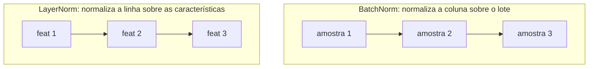
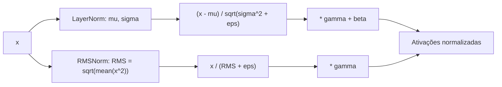

# Normalização: LayerNorm e RMSNorm

## Visão geral

Dentro de uma rede neural profunda, os valores que circulam entre camadas tendem a mudar de magnitude de forma imprevisível. Às vezes crescem demais e explodem; às vezes encolhem demais e desaparecem. A normalização é o conjunto de técnicas que mantém esses valores em uma faixa controlada, permitindo que o treino seja estável e rápido.


## Intuição: por que os valores crescem e encolhem?

### O efeito da multiplicação em cadeia

Uma rede é uma composição de camadas. Considere uma sequência de $L$ camadas lineares, cada uma aplicando $x_{\ell+1} = W_\ell x_\ell$. Se cada $W_\ell$ multiplica a norma de $x$ por um fator médio $c$, então após $L$ camadas:

$$
\|x_L\| \approx c^{L} \|x_0\|
$$

Se $c > 1$, o valor cresce exponencialmente (**explosão de gradiente/ativação**). Se $c < 1$, o valor tende a zero (**desvanecimento**). Em qualquer dos dois casos, o sinal útil se degrada.

### Exemplo numérico

Se $c = 1.2$ e $L = 50$:

$$
1.2^{50} \approx 9100
$$

A magnitude se multiplicou por cerca de 9100. Se $c = 0.8$:

$$
0.8^{50} \approx 0.0000143
$$

O sinal praticamente sumiu. Nenhum otimizador lida bem com essas escalas extremas. A normalização insere um "freio" entre as camadas que reescala cada vetor para uma norma controlada, quebrando essa cascata exponencial.

### O que normalizar significa de fato

Dado um vetor $x \in \mathbb{R}^{d}$, normalizar significa produzir $\hat{x}$ com propriedades estatísticas controladas, tipicamente:

- Média próxima de zero: $\mu(\hat{x}) \approx 0$.
- Variância (ou norma) próxima de um: $\sigma^2(\hat{x}) \approx 1$.

## Normalização por batch vs por camada

### BatchNorm

O BatchNorm normaliza cada **característica** (coluna) usando as estatísticas calculadas **ao longo do lote** (as linhas). Para uma característica $k$:

$$
\hat{x}_{i,k} = \frac{x_{i,k} - \mu_k}{\sqrt{\sigma_k^2 + \epsilon}}
$$

onde $\mu_k$ e $\sigma_k^2$ são a média e a variância da coluna $k$ sobre todas as amostras do lote.

**Problemas em sequências**: o BatchNorm depende do tamanho do lote (lotes pequenos geram estatísticas ruidosas), exige tratamento especial entre treino e inferência (running statistics), e não se encaixa bem em sequências de comprimento variável. Por isso transformadores abandonaram o BatchNorm.

### LayerNorm

O LayerNorm normaliza **cada amostra individualmente**, usando as estatísticas calculadas **ao longo das características** (a última dimensão). Para a amostra $i$:

$$
\hat{x}_{i} = \frac{x_{i} - \mu_i}{\sqrt{\sigma_i^2 + \epsilon}} \odot \gamma + \beta
$$

onde $\mu_i$ e $\sigma_i^2$ são a média e a variância do vetor $x_i$ (todas as características daquela amostra). Os vetores $\gamma$ e $\beta$ são parâmetros aprendidos de escala e deslocamento, com o mesmo tamanho $d$ das características.

**Vantagens**: independe do tamanho do lote, funciona igual em treino e inferência, e se adapta naturalmente a sequências. É por isso que o LayerNorm virou padrão nos transformers.

### Comparação lado a lado

| Aspecto | BatchNorm | LayerNorm |
|---|---|---|
| Eixo da estatística | Lote (linhas) | Características (colunas) |
| Depende do lote? | Sim | Não |
| Treino vs inferência | Diferente (running stats) | Igual |
| Adequado a sequências | Não | Sim |
| Parâmetros aprendidos | $\gamma, \beta$ por característica | $\gamma, \beta$ por característica |

### Diagrama comparativo



## LayerNorm em detalhe

### Definição formal

Para um vetor $x \in \mathbb{R}^{d}$:

$$
\mu = \frac{1}{d} \sum_{j=1}^{d} x_j
$$

$$
\sigma^2 = \frac{1}{d} \sum_{j=1}^{d} (x_j - \mu)^2
$$

$$
\hat{x}_j = \frac{x_j - \mu}{\sqrt{\sigma^2 + \epsilon}}
$$

$$
y_j = \gamma_j \hat{x}_j + \beta_j
$$

O $\epsilon$ (eps) é um valor pequeno (por exemplo $10^{-5}$) adicionado para evitar divisão por zero.

### Exemplo numérico completo

Considere $x = [1.0, 3.0, 5.0, 7.0]$, com $d = 4$.

**Passo 1 — média:**

$$
\mu = \frac{1.0 + 3.0 + 5.0 + 7.0}{4} = \frac{16.0}{4} = 4.0
$$

**Passo 2 — desvios:**

$$
x - \mu = [1.0 - 4.0, 3.0 - 4.0, 5.0 - 4.0, 7.0 - 4.0] = [-3.0, -1.0, 1.0, 3.0]
$$

**Passo 3 — variância:**

$$
\sigma^2 = \frac{(-3)^2 + (-1)^2 + 1^2 + 3^2}{4} = \frac{9 + 1 + 1 + 9}{4} = \frac{20}{4} = 5.0
$$

**Passo 4 — desvio padrão com eps** (usando $\epsilon = 0$ para simplificar):

$$
\sqrt{\sigma^2} = \sqrt{5.0} \approx 2.2361
$$

**Passo 5 — normalizar:**

$$
\hat{x} = \left[\frac{-3.0}{2.2361}, \frac{-1.0}{2.2361}, \frac{1.0}{2.2361}, \frac{3.0}{2.2361}\right] \approx [-1.3416, -0.4472, 0.4472, 1.3416]
$$

**Passo 6 — verificação.** A média de $\hat{x}$ é $0$ e o desvio padrão é $1$:

$$
\mu(\hat{x}) = \frac{-1.3416 - 0.4472 + 0.4472 + 1.3416}{4} = 0
$$

$$
\sigma^2(\hat{x}) = \frac{1.8 + 0.2 + 0.2 + 1.8}{4} \approx 1.0
$$

**Passo 7 — aplicar parâmetros.** Se $\gamma = [1.0, 1.0, 1.0, 1.0]$ e $\beta = [0.0, 0.0, 0.0, 0.0]$ (inicialização padrão), $y = \hat{x}$. Caso contrário, $y_j = \gamma_j \hat{x}_j + \beta_j$.

### Por que $\gamma$ e $\beta$?

Se a normalização zerar a média e fixar a variância em 1, a rede perde a liberdade de escolher a escala ideal de cada característica. Os parâmetros $\gamma$ (escala) e $\beta$ (deslocamento) devolvem essa liberdade, permitindo que a rede aprenda a melhor representação logo após a normalização.

## RMSNorm

### Motivação: é possível normalizar sem subtrair a média?

O LayerNorm calcula a média $\mu$ e a subtrai de cada elemento, e depois calcula a variância. Isso envolve **duas passadas** sobre o vetor (uma para $\mu$, outra para $\sigma^2$) e a operação de subtração da média. O RMSNorm observa que, em redes profundas, o que mais importa para a estabilidade é controlar a **escala** do vetor, e não necessariamente centralizá-lo. Então propõe dividir apenas pela raiz da média dos quadrados (RMS), sem subtrair a média.

### Definição formal

$$
\text{RMS}(x) = \sqrt{\frac{1}{d} \sum_{j=1}^{d} x_j^2}
$$

$$
\hat{x}_j = \frac{x_j}{\text{RMS}(x) + \epsilon}
$$

$$
y_j = \gamma_j \hat{x}_j
$$

Note duas diferenças em relação ao LayerNorm:
1. Não há subtração da média.
2. Não há parâmetro $\beta$ (bias), apenas $\gamma$.

### Exemplo numérico completo

Usando o mesmo vetor $x = [1.0, 3.0, 5.0, 7.0]$.

**Passo 1 — quadrados:**

$$
x^2 = [1^2, 3^2, 5^2, 7^2] = [1.0, 9.0, 25.0, 49.0]
$$

**Passo 2 — média dos quadrados:**

$$
\frac{1}{d}\sum x_j^2 = \frac{1.0 + 9.0 + 25.0 + 49.0}{4} = \frac{84.0}{4} = 21.0
$$

**Passo 3 — RMS:**

$$
\text{RMS}(x) = \sqrt{21.0} \approx 4.5826
$$

**Passo 4 — normalizar:**

$$
\hat{x} = \left[\frac{1.0}{4.5826}, \frac{3.0}{4.5826}, \frac{5.0}{4.5826}, \frac{7.0}{4.5826}\right] \approx [0.2182, 0.6547, 1.0911, 1.5275]
$$

**Passo 5 — verificação.** O RMS de $\hat{x}$ deve ser 1:

$$
\text{RMS}(\hat{x}) = \sqrt{\frac{0.2182^2 + 0.6547^2 + 1.0911^2 + 1.5275^2}{4}} \approx \sqrt{\frac{0.0476 + 0.4286 + 1.1905 + 2.3333}{4}} = \sqrt{\frac{4.0}{4}} = 1.0
$$

Confere. Repare que, diferentemente do LayerNorm, a média de $\hat{x}$ **não** é zero:

$$
\mu(\hat{x}) \approx \frac{0.2182 + 0.6547 + 1.0911 + 1.5275}{4} \approx 0.8729
$$

A média continua positiva, mas a escala foi controlada. O RMSNorm só garante norma unitária (média dos quadrados igual a 1), não centralização.

### Diferença conceitual resumida

| | LayerNorm | RMSNorm |
|---|---|---|
| Subtrai a média? | Sim | Não |
| Divide por | $\sqrt{\sigma^2 + \epsilon}$ | $\text{RMS} + \epsilon$ |
| Parâmetros | $\gamma$ e $\beta$ | Apenas $\gamma$ |
| Passadas sobre o vetor | 2 (média, depois variância) | 1 (só a soma dos quadrados) |
| Garantia | média 0, variância 1 | norma RMS 1 |

## Efeito no treino

### Estabilidade do gradiente

A normalização reduz a covariância interna entre camadas (o "internal covariate shift" original do BatchNorm). Ao manter as ativações em escala unitária, os gradientes que fluem de volta não explodem nem desvanecem, permitindo taxas de aprendizado maiores e convergência mais rápida.

### Suavização da paisagem de perda

Trabalhos posteriores mostraram que a normalização não apenas estabiliza as estatísticas, mas também **suaviza** a superfície da função de perda, tornando o gradiente mais lipschitziano. Isso explica por que modelos com normalização toleram taxas de aprendizado mais altas e inicializações menos cuidadosas.

### Custo computacional

O RMSNorm é mais barato que o LayerNorm. Para cada vetor de tamanho $d$, o LayerNorm faz cerca de $2d$ operações a mais (calcular $\mu$, subtrair $\mu$ de cada elemento, calcular $\sigma^2$), enquanto o RMSNorm precisa apenas da soma dos quadrados. Em um modelo com dezenas de camadas e milhões de vetores por passo, essa economia se acumula.

## Código em PyTorch

### Implementação manual do LayerNorm

```python
import torch

def layer_norm(x, gamma, beta, eps=1e-5):
    mu = x.mean(dim=-1, keepdim=True)
    var = ((x - mu) ** 2).mean(dim=-1, keepdim=True)
    x_hat = (x - mu) / torch.sqrt(var + eps)
    return x_hat * gamma + beta

x = torch.tensor([1.0, 3.0, 5.0, 7.0])
gamma = torch.ones(4)
beta = torch.zeros(4)
y = layer_norm(x, gamma, beta)
print("LayerNorm manual:", y)
print("média:", y.mean().item(), "var:", y.var(unbiased=False).item())
```

### Implementação manual do RMSNorm

```python
def rms_norm(x, gamma, eps=1e-6):
    rms = torch.sqrt((x ** 2).mean(dim=-1, keepdim=True))
    x_hat = x / (rms + eps)
    return x_hat * gamma

y_rms = rms_norm(x, gamma)
print("RMSNorm manual:", y_rms)
print("RMS do resultado:", torch.sqrt((y_rms ** 2).mean()).item())
```

### Usando as APIs nativas

```python
import torch.nn as nn

# LayerNorm nativo
ln = nn.LayerNorm(4)
y_ln = ln(x)
print("LayerNorm nativo:", y_ln)

# RMSNorm nativo (torch >= 2.4)
try:
    rn = nn.RMSNorm(4)
    y_rn = rn(x)
    print("RMSNorm nativo:", y_rn)
except AttributeError:
    print("nn.RMSNorm indisponível nesta versão do PyTorch")
```

## Fluxo em diagrama



## Erros comuns

- **Usar BatchNorm em sequências**: gera dependência do lote e comportamento inconsistente entre treino e inferência.
- **Esquecer o `eps`**: divisão por zero quando a variância ou o RMS é nulo (ex.: vetor constante).
- **Confundir eixo da normalização**: normalizar sobre o lote em vez da última dimensão destrói a independência entre amostras.
- **Aplicar `gamma`/`beta` com dimensão errada**: os parâmetros devem ter o mesmo tamanho da última dimensão (`hidden`), não do lote ou da sequência.
- **Achar que RMSNorm centraliza**: o RMSNorm **não** zera a média. Não confunda com LayerNorm.
- **Normalizar depois da camada em vez de antes**: a pré-normalização é o padrão moderno; a pós-normalização pode degradar o fluxo de gradiente residual.
- **Ignorar que a normalização é por token**: cada token de uma sequência é normalizado independentemente usando apenas suas próprias características.

## Resumo

- A multiplicação em cadeia de camadas faz ativações explodirem ou desvanecerem; a normalização reescala cada vetor para uma escala controlada.
- O **BatchNorm** normaliza sobre o lote e não serve bem para sequências; o **LayerNorm** normaliza cada amostra sobre suas características e virou padrão.
- O **LayerNorm** centraliza e reescala: $\hat{x}_j = \frac{x_j - \mu}{\sqrt{\sigma^2 + \epsilon}} \gamma_j + \beta_j$.
- O **RMSNorm** divide apenas pelo RMS: $\hat{x}_j = \frac{x_j}{\text{RMS}(x) + \epsilon} \gamma_j$, sem subtrair a média e sem bias.
- O RMSNorm é mais barato (uma passada em vez de duas) e é a escolha do RetNet e do BitNet.
- A pré-normalização (`x -> Norm -> Subcamada -> x + ...`) melhora o fluxo de gradiente residual.
