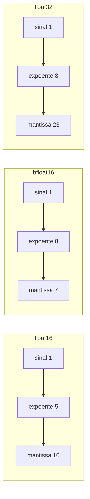
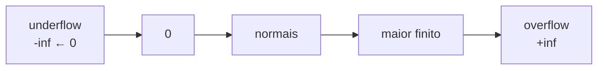

# Como os números vivem no computador

> "O computador não guarda números: ele guarda padrões de bits. O significado é uma convenção que nós inventamos por cima."


A jornada inteira gira em torno de uma única pergunta: **como representar a reta real, que é contínua e infinita, dentro de uma máquina que só tem um número finito de combinações de zeros e uns?**

## 1. A intuição: bits são só chaves num armário

Imagine um armário com $N$ gavetas. Cada gaveta tem um número pintado na frente, e dentro dela você pode colocar qualquer objeto. Se você quer me dizer "qual objeto eu devo pegar", basta me dizer o **número da gaveta**. Com $N$ gavetas, você consegue transmitir uma escolha entre $N$ possibilidades.

Um número binário é exatamente isso. Com $b$ bits, você tem $2^b$ "gavetas" (combinações possíveis), numeradas de $0$ até $2^b - 1$. Por exemplo:

| Bits | Combinações possíveis ($2^b$) | Intervalo de inteiros sem sinal |
|------|-------------------------------|---------------------------------|
| 4 | 16 | 0 a 15 |
| 8 | 256 | 0 a 255 |
| 16 | 65.536 | 0 a 65.535 |
| 32 | 4.294.967.296 | 0 a 4.294.967.295 |

A consequência mais importante de toda esta seção é esta: **um número de bits fixo só consegue representar um conjunto finito de valores distintos**. Todo o resto (números fracionários, números enormes, números minúsculos) precisa de um truque para "caber" nesse conjunto finito. Esse truque se chama *codificação*.

## 2. Inteiros: a representação mais honesta

Um inteiro sem sinal de $b$ bits é escrito da direita para a esquerda, onde cada posição vale uma potência de $2$. Se os bits são $x_{b-1} x_{b-2} \cdots x_1 x_0$, então:

$$
N = \sum_{i=0}^{b-1} x_i \cdot 2^i
$$

### Exemplo numérico resolvido

Considere o byte `10110011` (8 bits). Lendo da direita para a esquerda:

$$
N = 1\cdot 2^0 + 1\cdot 2^1 + 0\cdot 2^2 + 0\cdot 2^3 + 1\cdot 2^4 + 1\cdot 2^5 + 0\cdot 2^6 + 1\cdot 2^7
$$

$$
N = 1 + 2 + 0 + 0 + 16 + 32 + 0 + 128 = 179
$$

Então `10110011` em base 2 equivale a $179$ em base 10. Repare que a soma $\sum$ percorre exatamente os $b$ bits, e cada bit $x_i$ só pode ser $0$ ou $1$ (isto é, $x_i \in \{0, 1\}$).

Para números com sinal, o padrão mais comum é o **complemento de dois**: o bit mais à esquerda vale $-2^{b-1}$ em vez de $+2^{b-1}$. Com 8 bits, `11111111` representa $-1$, e o intervalo passa a ser de $-128$ até $127$.

### Por que inteiros são "seguros"

Dentro do intervalo, todo inteiro é representado **exatamente** — não existe arredondamento. O problema é que o mundo dos modelos de linguagem não é feito só de inteiros: ele é feito de pesos como $0.0012$, gradientes como $-3.7 \times 10^{-6}$ e probabilidades como $0.998$. Para esses, precisamos de algo mais sofisticado.

## 3. Ponto flutuante: a notação científica do computador

A ideia central é idêntica à notação científica que você usa na escola. Em vez de escrever $0.000000037$, você escreve:

$$
3.7 \times 10^{-8}
$$

Onde $3.7$ é a **mantissa** (os dígitos significativos) e $-8$ é o **expoente** (o deslocamento da vírgula). O padrão IEEE 754 faz a mesma coisa, mas em base $2$ em vez de base $10$:

$$
\text{valor} = (-1)^{\text{sinal}} \cdot (1 + \text{parte fracionária}) \cdot 2^{\text{expoente} - \text{viés}}
$$

Cada campo da representação tem um papel:

- **Sinal** (1 bit): $0$ para positivo, $1$ para negativo.
- **Expoente** ($e$ bits): um inteiro que desloca a vírgula binária.
- **Mantissa** ($m$ bits): os dígitos depois da vírgula, já que o dígito da frente é sempre $1$ (a chamada *normalização*).

### Os três formatos que importam em treino de LLM

| Formato | Sinal | Expoente | Mantissa | Total | Viés do expoente | Maior valor finito |
|---------|-------|----------|----------|-------|------------------|--------------------|
| float32 | 1 | 8 | 23 | 32 | 127 | $\approx 3.4 \times 10^{38}$ |
| float16 | 1 | 5 | 10 | 16 | 15 | 65504 |
| bfloat16 | 1 | 8 | 7 | 16 | 127 | $\approx 3.4 \times 10^{38}$ |

Observe algo sutil e importantíssimo: **float16 e bfloat16 têm o mesmo tamanho (16 bits), mas distribuem os bits de forma completamente diferente**. O float16 dá 10 bits à mantissa (mais precisão, menor alcance), enquanto o bfloat16 copia o expoente de 8 bits do float32 (mesmo alcance, menos precisão). É por isso que o bfloat16 se tornou o formato favorito de treino: ele raramente sofre *overflow* durante o cálculo, mesmo sacrificando dígitos significativos.



### Exemplo numérico: converter 6.5 para float32

Vamos converter o número $6.5$ para a representação float32, passo a passo.

**Passo 1 — decompor.** $6.5 = 6 + 0.5 = 110_2 + 0.1_2 = 110.1_2$.

**Passo 2 — normalizar.** Deslocamos a vírgula para ficar logo depois do primeiro $1$:

$$
110.1_2 = 1.101_2 \times 2^2
$$

**Passo 3 — extrair os campos.** O sinal é $0$ (positivo). O expoente real é $2$, e com o viés de $127$ armazenamos $2 + 127 = 129 = 10000001_2$. A mantissa é a parte fracionária `101`, completada com zeros até 23 bits: `10100000000000000000000`.

**Passo 4 — juntar.** O número final em memória é:

```
0 10000001 10100000000000000000000
```

Quando o processador lê isso, faz a operação inversa e devolve exatamente $6.5$. Repare que $6.5$ "coube" perfeitamente porque sua fração binária é finita. Nem todo número tem essa sorte.

### Exemplo numérico: por que 0.1 é um pesadelo

O número $0.1$ é uma fração finita em base 10, mas em base 2 ele vira uma dízima infinita:

$$
0.1_{10} = 0.0001100110011001100110011\ldots_2
$$

Como a mantissa tem apenas 23 bits, o computador precisa **truncar ou arredondar** a dízima. O resultado é que `0.1 + 0.2` em Python não dá exatamente `0.3`:

```python
print(0.1 + 0.2)          # 0.30000000000000004
print(0.1 + 0.2 == 0.3)   # False
```

Isso não é um bug da linguagem: é a consequência inevitável de representar um número infinito com bits finitos. A lição prática para quem mexe com treino de modelos é **nunca comparar floats com igualdade exata**; use uma tolerância.

## 4. Precisão, overflow e underflow

Três fenômenos dominam a vida de qualquer um que trabalha com ponto flutuante.

### Precisão (quantização do espaço)

O conjunto de floats é **denso perto do zero e esparso longe do zero**. Entre $0.5$ e $1.0$ existem tantos floats quantos entre $1.0$ e $2.0$ — a cada dobra de magnitude, o "espaçamento" entre números vizinhos dobra. Isso significa que a precisão absoluta piora para números grandes.

### Overflow

Quando um resultado ultrapassa o maior valor finito representável, o computador devolve `inf` (infinito). No float16, o teto é $65504$. No treino de modelos, um gradiente que explode vira `inf`, e a partir daí a rede inteira se corrompe — é a famosa *explosão de gradiente*. O bfloat16 mitiga isso exatamente porque o teto é o mesmo do float32.

### Underflow

Quando um número fica pequeno demais para a precisão disponível, ele pode virar $0$ ou um valor *subnormal*. Para o float32, o menor número normal positivo é cerca de $1.18 \times 10^{-38}$. Em cálculos de probabilidade, produtos de muitos valores entre $0$ e $1$ podem ficar muito pequenos. Usar **logaritmos** transforma esses produtos em somas, como explicado no material sobre logaritmos e exponenciais.



## 5. Arredondamento e o modo round-to-nearest

Como os floats são finitos, toda operação que produz um valor "entre" dois floats vizinhos precisa escolher um deles. O modo padrão do IEEE 754 é **round-to-nearest-even** (arredondar para o vizinho mais próximo, desempatando para o par). Isso reduz o viés estatístico acumulado ao longo de milhões de operações.

Consequências práticas:

- A soma de muitos números pequenos **não é associativa**: $(a + b) + c \neq a + (b + c)$ em ponto flutuante.
- Somar números de magnitudes muito diferentes perde os menores (eles são "engolidos").
- A ordem das operações importa, e compiladores/otimizadores podem reordenar contas mudando o resultado.

```python
x = 1e16
print((x + 1.0) - x)   # 0.0  (o 1.0 foi engolido)
print(x + (1.0 - x))   # 1.0  (ordem diferente, resultado correto)
```

## 6. Por que "1.58 bits" é possível


### O raciocínio da entropia

Suponha que você decide que cada peso de um modelo só pode assumir três valores: $-1$, $0$ e $+1$. Com três símbolos igualmente prováveis, a quantidade de informação (entropia) necessária para codificar um símbolo é:

$$
H = \log_2 3 \approx 1.585
$$

Esse número, $\log_2 3 \approx 1.58$, é a **entropia de Shannon** de uma distribuição uniforme sobre três estados. A intuição é: se você tem $3$ opções, não precisa de $2$ bits completos (que dariam $4$ opções); precisa de "um pouco menos", porque $2^1 = 2 < 3 \le 4 = 2^2$.

### O truque do BitNet ternário


Na prática, muitas implementações guardam os pesos em 2 bits por simplicidade (porque $2$ bits acomodam $4$ estados, que comporta $3$ valores com folga), mas o **limite teórico de informação** continua sendo $1.58$ bits. A frase "1.58-bit" é, portanto, uma referência a esse limite de entropia, não ao tamanho bruto de um ponteiro em memória.

### Comparação de tamanho

| Representação | Bits por peso | Peso relativo (float32 = 1x) |
|---------------|---------------|-------------------------------|
| float32 | 32 | $1\times$ |
| float16 | 16 | $0.5\times$ |
| int8 (quantização) | 8 | $0.25\times$ |
| ternário empacotado | $\log_2 3 \approx 1.58$ | $\approx 0.049\times$ |

Uma rede com 1 bilhão de parâmetros em float32 ocupa cerca de $4$ GB. A mesma rede ternária, no limite teórico de $1.58$ bits, ocupa cerca de $0.2$ GB — uma redução de mais de $20\times$. É essa economia que torna viável rodar modelos grandes em hardware modesto.

### A matemática do valor central (escala)

Pesos ternários puros ($-1$, $0$, $+1$) sozinhos não bastam: a rede também precisa saber a *magnitude* dos pesos. Por isso o BitNet separa cada peso em duas partes:

$$
w = \alpha \cdot \tilde{w}, \quad \tilde{w} \in \{-1, 0, +1\}
$$

Onde $\alpha$ é um **fator de escala** por camada (um único float compartilhado por todos os pesos daquela camada) e $\tilde{w}$ é o ternário. A operação de quantização que mapeia um peso real $w$ para o ternário mais próximo é:

$$
\tilde{w} = \text{RoundClip}\!\left(\frac{w}{\alpha}, -1, 1\right)
$$

A escala $\alpha$ é frequentemente calculada como a média dos valores absolutos da camada:

$$
\alpha = \frac{1}{n} \sum_{i=1}^{n} \left| w_i \right|
$$

Assim, cada camada guarda $n$ ternários de $\approx 1.58$ bits e **um único** fator $\alpha$ em float. O custo do fator de escala é desprezível quando $n$ é grande. Isso é o que torna a representação ternária tanto compacta quanto expressiva.

```python
def quantizar_ternario(pesos):
    alpha = sum(abs(w) for w in pesos) / len(pesos)
    ternarios = []
    for w in pesos:
        r = w / alpha
        if r > 0.5:
            ternarios.append(1)
        elif r < -0.5:
            ternarios.append(-1)
        else:
            ternarios.append(0)
    return alpha, ternarios

pesos = [0.9, -0.1, -1.7, 0.3, 2.1]
alpha, t = quantizar_ternario(pesos)
print("alpha =", alpha)   # ~1.02
print("ternarios =", t)   # [1, 0, -1, 0, 1]
```

Repare que a multiplicação por um ternário vira, na prática, uma soma com sinal — a multiplicação matriz-vetor deixa de exigir multiplicadores reais e passa a exigir apenas adições e negações. Isso é o segredo da eficiência energética do BitNet: somas consomem muito menos energia que multiplicações.

## 7. Fluxo de uma conversão completa

Vamos consolidar tudo em um pseudocódigo que converte um decimal fracionário qualquer para a sua forma binária em ponto flutuante, na notação científica binária.

```text
ENTRADA: um número real x (decimal)

1. Se x == 0, retorne "0.0 x 2^0".
2. Determine o sinal: s = (x < 0) ? 1 : 0.
3. Tome o valor absoluto: x = |x|.
4. Separe a parte inteira e a parte fracionária:
   inteiro = parte_inteira(x)
   fracao  = x - inteiro
5. Converta `inteiro` para binário por divisões sucessivas por 2.
6. Converta `fracao` para binário por multiplicações sucessivas por 2,
   parando quando fracao == 0 ou ao atingir o limite de bits.
7. Normalize: desloque a vírgula para ficar após o primeiro 1.
   Anote o expoente real e.
8. Some o viés: expoente_armazenado = e + vies.
9. Empacote: sinal | expoente_armazenado | mantissa.
SAÍDA: representação IEEE 754.
```

### Exercício resolvido: 0.75 em float16

Converta $0.75$ para float16 (5 bits de expoente, viés $15$, 10 bits de mantissa).

**Passo 1:** $0.75 = 0.11_2$ (pois $0.5 + 0.25 = 0.75$).

**Passo 2:** Normalizar: $0.11_2 = 1.1_2 \times 2^{-1}$.

**Passo 3:** Expoente real $-1$; armazenado: $-1 + 15 = 14 = 01110_2$.

**Passo 4:** Mantissa: parte fracionária `1`, completada até 10 bits: `1000000000`.

**Resultado:**

```
0 01110 1000000000
```

O valor é recuperado como $(-1)^0 \cdot (1 + 0.5) \cdot 2^{-1} = 1.5 \times 0.5 = 0.75$. Correto e exato, porque $0.75$ tem fração binária finita.

## 8. Erros comuns

- **Achar que float tem precisão infinita**: ele tem exatamente a precisão dos bits de mantissa. Todo cálculo acumula um erro de arredondamento.
- **Comparar floats com `==`**: use tolerância, como `abs(a - b) < 1e-9`.
- **Confundir tamanho com precisão**: bfloat16 tem o mesmo alcance do float32, mas metade dos bits de mantissa; ele é ótimo para *range*, não para *precisão*.
- **Ignorar overflow no float16**: o teto $65504$ é fácil de estourar com ativações não normalizadas.
- **Multiplicar muitas probabilidades sem log**: leva a *underflow* para $0$, destruindo informação.
- **Achar que "1.58 bits" significa um tipo nativo de 1.58 bits**: é um limite de entropia, não um formato de hardware; na prática empacotamos ternários em palavras maiores.

## 9. Resumo

- O computador só tem um conjunto finito de padrões de bits, então toda representação numérica é uma convenção sobre esses bits.
- Inteiros são exatos dentro do intervalo; floats são aproximados, mas cobrem uma faixa enorme de magnitudes.
- Um float é `sinal × (1 + mantissa) × 2^(expoente − viés)`.
- float32, float16 e bfloat16 diferem em como distribuem bits entre expoente e mantissa.
- Precisão, overflow e underflow são consequências inevitáveis do espaço finito, e o uso de logaritmos é o antídoto clássico contra underflow.
- Pesos ternários são armazenados como $\alpha \cdot \tilde{w}$, com um único fator de escala por camada, permitindo economia de memória e multiplicações que viram somas.
