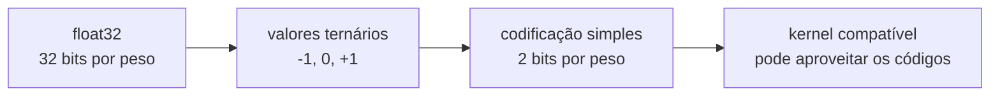
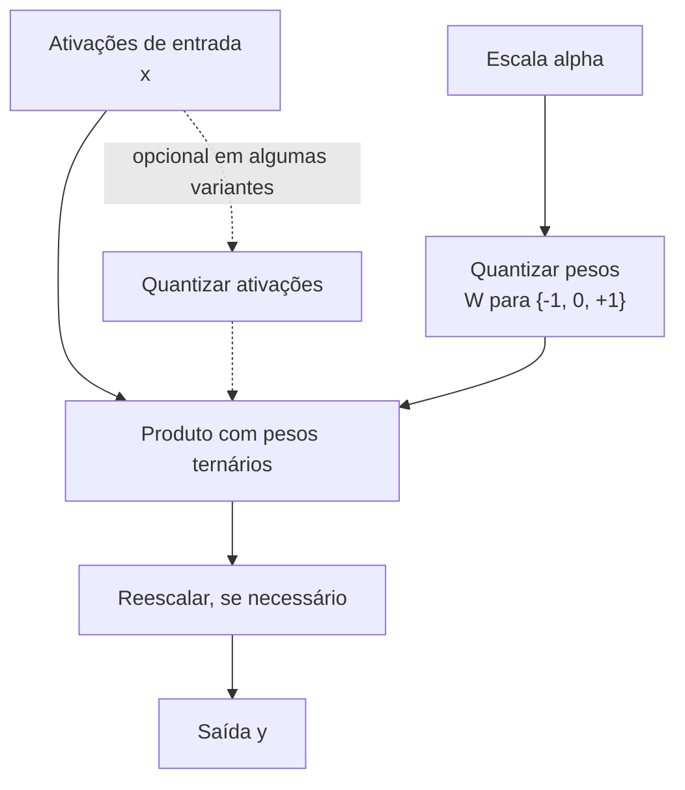
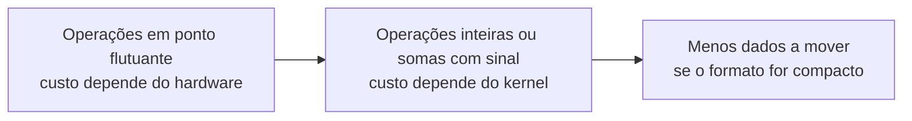

# O que é o BitNet

> "Um peso não precisa ser um número de 32 bits. Ele pode ser apenas um sinal: empurra para um lado, para o outro, ou fica parado."

O **BitNet** é uma família de arquiteturas de redes neurais que usa quantização de baixa precisão, incluindo variantes em que os pesos assumem três estados: $-1$, $0$ ou $+1$. Essa escolha pode reduzir o armazenamento dos pesos e mudar o tipo de operações necessárias, mas seus efeitos em velocidade, consumo e qualidade dependem do treinamento, da implementação e do hardware. Este guia apresenta a intuição, a matemática, exemplos de código e os principais limites da abordagem.

## 1. A intuição: um peso pode ser só um "sentido"

Pense em como um neurônio de uma rede densa calcula a sua saída. Ele recebe um vetor de entradas $x = (x_1, x_2, \ldots, x_n)$, multiplica cada entrada por um peso $w_i$ e soma tudo:

$$
z = \sum_{i=1}^{n} w_i \cdot x_i
$$

Num modelo tradicional, cada $w_i$ é um número real com uma magnitude precisa — algo como $w_i = 0.00371$ ou $w_i = -0.00082$. Essa magnitude importa, porque ela controla *o quanto* cada entrada empurra o resultado para cima ou para baixo.

Em uma variante ternária, muitos pesos são representados por $-1$, $0$ ou $+1$, normalmente com fatores de escala. Isso reduz a resolução da magnitude de cada peso individual; não significa que todas as conexões próximas de zero sejam descartadas da mesma forma em todo método.

Com três valores possíveis, o produto $w_i \cdot x_i$ tem uma forma simples: para $+1$, mantém-se $x_i$; para $-1$, inverte-se o sinal; para $0$, o termo não contribui. Uma implementação pode aproveitar essa estrutura para reduzir operações ou tráfego de memória, desde que o formato e o hardware ofereçam suporte eficiente.

## 2. O que significa "1.58 bits"

A pergunta que todos fazem: como um número pode ter $1.58$ bits, se bits são indivisíveis? A resposta exige separar duas coisas: **o custo teórico de informação** e **o custo prático de armazenamento**.

### 2.1. A entropia de três estados

Se um símbolo pode assumir três valores igualmente prováveis, a quantidade mínima de informação necessária para codificá-lo é a entropia de Shannon:

$$
H = \log_2 3 \approx 1.585
$$

Para três estados equiprováveis, essa é a quantidade média de informação por símbolo; uma codificação simples de comprimento fixo usa 2 bits e deixa um dos quatro códigos sem uso. O limite depende da distribuição dos estados e não determina o tamanho de um arquivo real. O termo "1.58-bit" aparece no nome de uma variante conhecida, BitNet b1.58.

### 2.2. Como isso se compara

| Representação | Bits por peso | Peso relativo (float32 = 1×) |
|---------------|---------------|-------------------------------|
| float32 | 32 | $1\times$ |
| float16 | 16 | $0.5\times$ |
| int8 | 8 | $0.25\times$ |
| ternário (limite teórico) | $\log_2 3 \approx 1.58$ | $\approx 0.05\times$ |
| ternário empacotado em 2 bits | 2 | $0.0625\times$ |

Na prática, dois bits por valor são uma codificação simples: quatro valores ternários cabem em um byte, com uma combinação não utilizada. O limite de entropia não determina automaticamente o tamanho de um arquivo real. Um bilhão de pesos `float32` ocupa cerca de $4$ GB em unidades decimais; codificar esses pesos em dois bits exigiria idealmente cerca de $250$ MB, sem contar escalas, tensores mantidos em outra precisão, metadados e alinhamento.



## 3. A representação ternária, com escala

Usar apenas três valores limita a resolução de magnitude de cada peso. Uma forma comum de acrescentar flexibilidade é separar o peso em **duas partes**:

$$
w = \alpha \cdot \tilde{w}, \qquad \tilde{w} \in \{-1, 0, +1\}
$$

Aqui, $\alpha$ é um **fator de escala** e $\tilde{w}$ é o ternário. Uma variante pode compartilhar uma escala por camada; outras regras usam escalas por canal ou grupo. A escala representa magnitude que não está codificada diretamente no valor ternário.

### 3.1. Como escolher $\alpha$

Como exemplo, uma regra possível calcula $\alpha$ pela **média dos valores absolutos** dos pesos:

$$
\alpha = \frac{1}{nm} \sum_{i=1}^{n} \sum_{j=1}^{m} \left| w_{ij} \right|
$$

Se a matriz de pesos $W$ tem $n$ linhas e $m$ colunas, somamos o valor absoluto de todas as $nm$ entradas e dividimos por $nm$. A intuição: $\alpha$ é o "tamanho típico" de um peso. Dividir $w$ por $\alpha$ normaliza a matriz em relação à magnitude média, uma regra possível para preparar os pesos para o arredondamento ternário.

### 3.2. A quantização em si

Para transformar o peso real $w$ no ternário $\tilde{w}$, dividimos pela escala, arredondamos e limitamos ao intervalo $[-1, +1]$:

$$
q_w = \text{round}\!\left(\frac{w}{\alpha}\right), \qquad \tilde{w} = \text{clip}(q_w, -1, 1)
$$

O resultado $\tilde{w}$ é sempre um inteiro em $\{-1, 0, +1\}$. A função $\text{clip}$ corta qualquer valor acima de $+1$ ou abaixo de $-1$ (o que acontece quando $|w|$ é muito maior que a média).

### 3.3. Exemplo numérico completo

Suponha quatro pesos:

$$
w = [0.003,\; -0.021,\; 0.012,\; -0.0004]
$$

**Passo 1 — escala.** Somamos os valores absolutos:

$$
0.003 + 0.021 + 0.012 + 0.0004 = 0.0364
$$

$$
\alpha = \frac{0.0364}{4} = 0.0091
$$

**Passo 2 — dividir e arredondar.**

$$
q_w = \left[ \text{round}\!\left(\frac{0.003}{0.0091}\right),\; \text{round}\!\left(\frac{-0.021}{0.0091}\right),\; \text{round}\!\left(\frac{0.012}{0.0091}\right),\; \text{round}\!\left(\frac{-0.0004}{0.0091}\right) \right]
$$

Calculando cada fração:

$$
\frac{0.003}{0.0091} \approx 0.33,\quad
\frac{-0.021}{0.0091} \approx -2.31,\quad
\frac{0.012}{0.0091} \approx 1.32,\quad
\frac{-0.0004}{0.0091} \approx -0.044
$$

Arredondando:

$$
q_w = [0,\; -2,\; 1,\; 0]
$$

**Passo 3 — clipar.**

$$
\tilde{w} = \text{clip}\big([0, -2, 1, 0],\; -1,\; 1\big) = [0,\; -1,\; 1,\; 0]
$$

Os pesos viraram $[0, -1, 1, 0]$. O que antes era uma tabela de quatro flutuantes de 32 bits agora são quatro estados ternários — e o único número que preserva a magnitude, $\alpha = 0.0091$, é guardado à parte. Para reconstruir uma aproximação do peso original, fazemos $w \approx \alpha \cdot \tilde{w}$:

$$
0.0091 \cdot [0, -1, 1, 0] = [0,\; -0.0091,\; 0.0091,\; 0]
$$

Não é idêntico ao original. Durante o treinamento, os parâmetros podem se adaptar à quantização, mas isso não garante que a perda de qualidade desapareça.

## 4. O BitLinear: a camada central

Em algumas variantes, **BitLinear** é o nome de uma camada linear que substitui $y = Wx + b$ e quantiza pesos, ativações ou ambos. O fluxo abaixo mostra possibilidades, não uma regra única para todo modelo:



Em fórmulas, com $y$ sendo a saída, $x$ as ativações e $W$ a matriz de pesos:

$$
\alpha = \frac{1}{nm} \sum_{i,j} \left| W_{ij} \right|
$$

$$
\tilde{W} = \text{clip}\!\left( \text{round}\!\left( \frac{W}{\alpha} \right),\; -1,\; 1 \right)
$$

$$
y = \alpha \cdot \left( \tilde{W} \, x \right)
$$

A multiplicação $\tilde{W}x$ pode ser descrita como soma com sinal: cada termo contribui com $+x_j$, $-x_j$ ou zero. Essa é uma simplificação matemática; se ela reduz operações reais depende do formato e do kernel. Algumas variantes também quantizam as ativações e aplicam outra escala.

### 4.1. Pseudocódigo do forward

```python
def bitlinear(x, W, alpha):
    # x: ativações de entrada (contínuas)
    # W: pesos latentes (contínuos, são eles que o otimizador atualiza)
    alpha = W.abs().mean()                      # escala dos pesos
    qw = (W / alpha).round().clip(-1, 1)        # pesos ternários
    y = (x @ qw.T) * alpha                      # MatMul barata + rescala
    return y
```

Em treinamentos que usam STE, os parâmetros atualizados costumam ser os pesos contínuos $W$; os valores $\tilde{W}$ são calculados a partir deles durante o *forward pass*. Outras estratégias de treinamento podem diferir.

## 5. Straight-Through Estimator (STE)

Aqui está o problema central de treinar pesos ternários: a função $\text{round}$ e a função $\text{clip}$ são **degraus** — em quase todos os pontos, a derivada é zero, e nos pontos de salto ela não existe. Se usássemos a derivada real dessas funções, o gradiente morreria imediatamente e a rede não aprenderia nada.

### 5.1. A ideia do "finge que é linear"

O **Straight-Through Estimator** é um truque de treinamento: no *forward*, aplicamos a quantização de verdade; no *backward*, **fingimos que a derivada da quantização é $1$**. Em outras palavras, o gradiente atravessa a operação de quantização como se ela fosse a função identidade.

Formalmente, se $\tilde{w} = Q(w)$ é o valor quantizado, o STE define:

$$
\frac{\partial \tilde{w}}{\partial w} \approx 1
$$

Essa única substituição transforma uma função não diferenciável em uma "porta de passagem" para o gradiente. O gradiente da perda $\mathcal{L}$ em relação ao peso contínuo passa a ser:

$$
\frac{\partial \mathcal{L}}{\partial w} \approx \frac{\partial \mathcal{L}}{\partial \tilde{w}} \cdot 1 = \frac{\partial \mathcal{L}}{\partial \tilde{w}}
$$

### 5.2. Uma implementação elegante

Uma forma didática de escrever o STE em PyTorch é:

```python
def straight_through(w, alpha):
    scaled = w / alpha                       # divisão pela escala (diferenciável)
    quantized = scaled.round().clip(-1, 1)   # ternário (não diferenciável)
    ste = (quantized - scaled).detach() + scaled
    return ste
```

A linha `(quantized - scaled).detach() + scaled` produz numericamente `quantized`, enquanto o autograd propaga o gradiente pela aproximação `scaled`. Esse estimador é enviesado: ele fornece um caminho de gradiente útil, mas não garante a direção verdadeira da melhoria.

### 5.3. Por que isso funciona

O STE pode tornar possível otimizar parâmetros contínuos apesar da quantização discreta. Como a derivada é aproximada, o aprendizado pode ser instável ou convergir para resultados diferentes; os efeitos precisam ser avaliados no modelo e na tarefa.

## 6. Por que isso economiza energia e memória

Representações de menor precisão podem reduzir armazenamento e tráfego de dados em certas implementações; o ganho depende do formato e do hardware.

### 6.1. Energia

Em muitos sistemas, operações de baixa precisão podem reduzir o custo computacional e o movimento de dados em comparação com operações em ponto flutuante de precisão maior. Números de energia por operação variam bastante conforme o processador, a memória e a implementação; por isso, ganhos precisam ser medidos no hardware de destino. Pesos ternários permitem representar cada produto como uma seleção com sinal, mas isso não garante automaticamente uma execução mais rápida.



### 6.2. Memória

A economia potencial de memória vem da codificação dos pesos. Um formato ternário empacotado pode reduzir o tráfego em comparação com pesos de maior precisão, mas escalas, metadados, alinhamento e o formato usado pelo runtime também contam. Essa redução pode ajudar quando o acesso à memória é um gargalo; não garante uma aceleração específica.

### 6.3. A tabela resumo

| Aspecto | Modelo denso | BitNet |
|---------|--------------|--------|
| Bits por peso | 16–32 em formatos comuns | 2 em uma codificação simples; $\log_2 3$ é referência teórica |
| Operação dominante | depende da precisão e implementação | produto ternário pode ser implementado com somas e negações |
| Energia por operação | depende da precisão e do hardware | depende da implementação |
| Tráfego de memória | depende do formato | pode ser menor com empacotamento eficiente |
| Capacidade de linguagem | depende do modelo e do treino | depende do modelo e do treino |

Resultados publicados mostram que modelos quantizados podem alcançar bom desempenho em determinadas escalas e tarefas. A comparação depende da quantidade de parâmetros, dos dados, do orçamento de treinamento, do método de quantização e da métrica escolhida. Não existe garantia de equivalência para todo modelo ou aplicação.

## 7. BitNet e RetNet: escolhas independentes

BitNet trata da representação e da quantização dos pesos. RetNet trata de como processar o contexto usando retenção. As duas ideias respondem a perguntas diferentes e podem ser escolhidas separadamente: um modelo pode usar pesos ternários com atenção Transformer, retenção com pesos convencionais, combinar quantização e retenção ou não usar nenhuma dessas opções.

Ao combinar quantização ternária com retenção, as projeções que calculam consultas, chaves e valores podem ser quantizadas, enquanto a atualização do estado segue a matemática do RetNet. A combinação exige treinamento e kernels compatíveis; não implica que todo runtime consiga executar o modelo de forma eficiente.

## 8. Erros comuns

- **Achar que "1.58 bits" é um tipo de hardware**: é um limite de entropia ($\log_2 3$), não um formato nativo. Na prática empacotamos ternários em palavras maiores (tipicamente 2 bits por peso).
- **Confundir o peso contínuo com o ternário**: em métodos baseados em STE, o otimizador costuma atualizar pesos latentes contínuos e a versão quantizada é derivada deles. Outros métodos de treinamento podem diferir.
- **Esquecer a escala $\alpha$**: pesos ternários puros sem escala perdem toda a magnitude da camada. $\alpha$ é tão essencial quanto os próprios pesos.
- **Presumir que todo método usa o mesmo gradiente**: `round` não tem derivada útil no sentido usual; alguns métodos usam STE ou outro estimador, mas há estratégias de treinamento distintas.
- **Achar que $0$ sempre reduz o custo de execução**: o valor zero cria esparsidade na representação, mas só reduz operações se o formato e o kernel conseguirem aproveitá-la.
- **Comparar 1 peso ternário com 1 peso float sem considerar a escala**: cada camada tem um $\alpha$ extra em float; o custo dele é desprezível quando a camada tem milhares de pesos, mas existe.
- **Ignorar o arredondamento para zero**: valores pequenos de $\frac{w}{\alpha}$ arredondam para $0$, então pesos fracos "morrem". Isso é desejado, mas é preciso lembrar que a magnitude deles se perde na média $\alpha$.

## 9. Resumo

- Variantes ternárias do BitNet representam muitos pesos como $\tilde{w} \in \{-1, 0, +1\}$, normalmente com fatores de escala para preservar a magnitude das camadas.
- O apelido "1.58 bits" vem da entropia $\log_2 3 \approx 1.585$ — o limite teórico de informação de três estados.
- Uma camada **BitLinear** pode quantizar pesos com uma escala; algumas variantes também quantizam ativações com outra escala. As regras variam entre métodos.
- Como quantização discreta não tem derivada convencional útil em todos os pontos, métodos de otimização podem usar STE ou outras aproximações para treinar parâmetros latentes.
- Pesos ternários podem reduzir armazenamento e permitir operações mais simples, mas a velocidade e o consumo dependem de formatos e kernels otimizados.
- BitNet e RetNet são escolhas independentes: uma modifica a representação dos pesos; a outra, o processamento do contexto.
