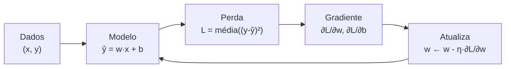
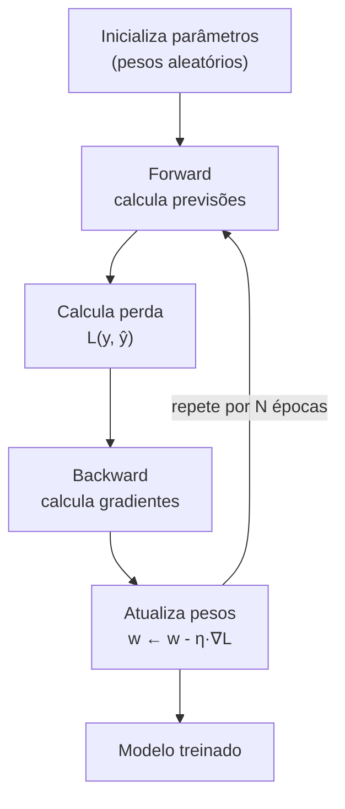
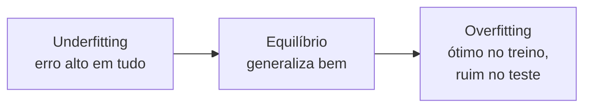

# Aprendizado de máquina: conceitos essenciais

Inteligência artificial (**IA**) é o campo que cria sistemas capazes de executar tarefas que associamos à percepção, à previsão, à linguagem ou à tomada de decisão. Há sistemas de IA baseados em regras e busca; muitos dos mais conhecidos hoje usam **aprendizado de máquina** (*machine learning*, ML), em que um modelo ajusta seus parâmetros a partir de dados.

> Em machine learning, definimos os dados, o modelo e o objetivo de aprendizado. O algoritmo ajusta os parâmetros para que as previsões se aproximem dos resultados desejados e funcionem também em casos novos.

Este guia apresenta a diferença entre regras e aprendizado, os principais tipos de machine learning, como medir erro e ajustar parâmetros, como avaliar generalização e um exemplo de regressão linear resolvido passo a passo. As mesmas ideias ajudam a entender desde modelos estatísticos simples até sistemas de deep learning e IA generativa.

## Inteligência artificial, machine learning e deep learning

Esses termos descrevem níveis relacionados, mas não são sinônimos:

- **Inteligência artificial** é o campo mais amplo: inclui sistemas baseados em regras, busca, planejamento e aprendizado.
- **Machine learning** é uma área da IA em que sistemas identificam padrões nos dados e ajustam parâmetros para executar uma tarefa.
- **Deep learning** é uma família de métodos de machine learning que usa redes neurais com muitas camadas para aprender representações complexas.
- **IA generativa** descreve sistemas que produzem conteúdo, como texto, imagens, áudio ou código. Muitos desses sistemas usam deep learning, mas geração não é a única aplicação de IA.

## Programar regras vs. aprender com exemplos

Imagine que queremos um programa que diga se um e-mail é **spam** ou não.

**Abordagem clássica (regras):** escrevemos uma lista de condições à mão.

```text
se "prêmio" está no assunto → spam
se "urgente" está no assunto → spam
se vem de um endereço conhecido → não spam
...
```

Essa abordagem funciona para casos simples, mas logo desmorona: o spam evolui, as regras ficam gigantescas, e sempre aparece um caso que nenhuma regra cobre.

**Abordagem com aprendizado:** coletamos milhares de e-mails **já rotulados** (cada um marcado como `spam` ou `não spam`) e deixamos um modelo aprender, por conta própria, que combinações de palavras costumam aparecer em spam.

| Aspecto | Programar regras | Aprender com exemplos |
|---------|------------------|-----------------------|
| Quem resolve o problema | o programador, à mão | o modelo, a partir dos dados |
| Manutenção | reescrever regras toda hora | adicionar mais exemplos |
| Casos novos | frágil | generaliza melhor |
| Exigência | entender o problema por completo | ter dados rotulados |

Machine learning não substitui a programação tradicional. É especialmente útil quando descrever todas as regras manualmente é difícil, mas há exemplos ou dados suficientes para aprender um padrão. Reconhecer imagens, estimar demanda e prever o próximo token de um texto são exemplos de tarefas que podem ser abordadas dessa forma.

## Dados, características e rótulos

Todo problema de aprendizado supervisionado tem duas partes:

- **Características (features)**: as entradas, aquilo que observamos.
- **Rótulos (labels)**: a saída desejada, aquilo que queremos prever.

Em um problema de spam:

| Características (entrada) | Rótulo (saída) |
|---------------------------|----------------|
| "ganhe prêmio agora"      | spam |
| "reunião amanhã às 10h"   | não spam |
| "sua conta foi bloqueada" | spam |

Para um modelo de linguagem, a estrutura é auto-supervisionada: as **características** são os tokens anteriores e o **rótulo** é o próximo token.

```text
características: "o gato subiu no"
rótulo:          "telhado"
```

A ideia central é sempre a mesma: temos pares `(entrada, saída)` e queremos um modelo que, dada a entrada, produza uma saída **parecida** com o rótulo.

## Principais formas de aprendizado

O que diferencia as abordagens é o tipo de sinal disponível para orientar o aprendizado:

| Abordagem | Sinal disponível | Exemplo |
|---|---|---|
| **Supervisionado** | exemplos com respostas ou rótulos | classificar e-mails como spam ou legítimos |
| **Não supervisionado** | dados sem rótulos fornecidos | agrupar clientes com comportamentos semelhantes |
| **Auto-supervisionado** | alvos construídos a partir dos próprios dados | prever a próxima parte de um texto |
| **Por reforço** | recompensas ou penalidades após ações | aprender uma estratégia por tentativa e erro |

Essas categorias podem se combinar. Um modelo de linguagem, por exemplo, pode aprender padrões de texto por auto-supervisão e depois ser adaptado com exemplos supervisionados ou feedback humano.

## A função de erro: medir o quanto erramos

Para o modelo aprender, precisamos de uma régua que diga **o quanto ele está errado**. Essa régua é a **função de erro** (também chamada de *perda* ou *loss*).

A perda mais comum para regressão é o **erro quadrático médio** (MSE, do inglês *mean squared error*). Se o modelo prevê $\hat{y}$ e o valor correto é $y$, o erro de um único exemplo é:

$$
L = (y - \hat{y})^2
$$

O quadrado garante duas coisas: o erro é sempre **não negativo**, e erros grandes são **punidos muito mais** do que erros pequenos. Se erramos por 0.1, a perda é $0.01$; se erramos por 10, a perda é $100$ — cem vezes mais.

Quando há vários exemplos, tiramos a **média** dos erros:

$$
L = \frac{1}{n}\sum_{i=1}^{n}\left(y_i - \hat{y}_i\right)^2
$$

> Intuição: a perda é um número único que resume, em um instante, o quão ruim está o modelo. O objetivo do treinamento é fazer esse número **diminuir**.

## Regressão linear: o exemplo mais simples

A **regressão linear** é o problema canônico para entender o ciclo de aprendizado: encontrar a reta que melhor descreve os dados.

O modelo é uma reta:

$$
\hat{y} = w\,x + b
$$

onde $x$ é a entrada, $\hat{y}$ a previsão, e $w$ e $b$ são os **parâmetros** que queremos aprender ($w$ é a inclinação, $b$ o ponto onde a reta corta o eixo vertical).

### Exemplo numérico do zero

Suponha que queremos prever o preço de um produto a partir de um atributo $x$, e temos três exemplos:

| $x$ | $y$ (rótulo) |
|-----|--------------|
| 1 | 2 |
| 2 | 4 |
| 3 | 6 |

Olhando para a tabela, dá para intuir que a relação é $\hat{y} = 2x$ (ou seja, $w = 2$ e $b = 0$). Mas o modelo **não sabe** disso. Vamos começar com uma suposição qualquer, por exemplo $w = 0$ e $b = 0$.

Com $w = 0$ e $b = 0$, o modelo prevê $\hat{y} = 0$ para **tudo**. Vamos calcular o MSE:

$$
\begin{aligned}
\text{exemplo 1: } & (2 - 0)^2 = 4 \\
\text{exemplo 2: } & (4 - 0)^2 = 16 \\
\text{exemplo 3: } & (6 - 0)^2 = 36 \\
\end{aligned}
$$

$$
L = \frac{4 + 16 + 36}{3} = \frac{56}{3} \approx 18.67
$$

A perda inicial é enorme. Agora vamos **ajustar os parâmetros** para reduzi-la.

## Ajustando parâmetros com o gradiente

A perda $L$ depende de $w$ e $b$. Queremos mudar $w$ e $b$ na direção que **diminui** $L$. A derivada parcial $\frac{\partial L}{\partial w}$ nos diz: se aumentarmos $w$ um pouquinho, a perda aumenta ou diminui?

Para o MSE com $\hat{y} = wx + b$, a derivada em relação a $w$ é:

$$
\frac{\partial L}{\partial w} = \frac{1}{n}\sum_{i=1}^{n} 2(\hat{y}_i - y_i)\, x_i
$$

E em relação a $b$:

$$
\frac{\partial L}{\partial b} = \frac{1}{n}\sum_{i=1}^{n} 2(\hat{y}_i - y_i)
$$

A regra de atualização — o coração do treinamento — é:

$$
w \leftarrow w - \eta \cdot \frac{\partial L}{\partial w}, \quad
b \leftarrow b - \eta \cdot \frac{\partial L}{\partial b}
$$

$\eta$ (eta) é a **taxa de aprendizado** (*learning rate*): o tamanho do passo que damos a cada atualização.

### Passo 1, com números

Com $w = 0$, $b = 0$, todos os $\hat{y}_i = 0$. Vamos usar $\eta = 0.01$.

As diferenças $\hat{y}_i - y_i$ são $-2$, $-4$ e $-6$.

$$
\frac{\partial L}{\partial w} = \frac{2}{3}\left[(-2)(1) + (-4)(2) + (-6)(3)\right]
$$

$$
= \frac{2}{3}\left[-2 - 8 - 18\right] = \frac{2}{3}(-28) \approx -18.67
$$

$$
\frac{\partial L}{\partial b} = \frac{2}{3}\left[-2 - 4 - 6\right] = \frac{2}{3}(-12) = -8
$$

Atualizando:

$$
w \leftarrow 0 - 0.01 \cdot (-18.67) = 0.1867
$$

$$
b \leftarrow 0 - 0.01 \cdot (-8) = 0.08
$$

### Passo 2, com números

Agora o modelo é $\hat{y} = 0.1867 x + 0.08$. Previsões:

$$
\begin{aligned}
\hat{y}_1 &= 0.1867 \cdot 1 + 0.08 = 0.2667 \\
\hat{y}_2 &= 0.1867 \cdot 2 + 0.08 = 0.4534 \\
\hat{y}_3 &= 0.1867 \cdot 3 + 0.08 = 0.6401 \\
\end{aligned}
$$

Erros $(\hat{y} - y)$:

$$
0.2667 - 2 = -1.7333,\quad 0.4534 - 4 = -3.5466,\quad 0.6401 - 6 = -5.3599
$$

Nova perda:

$$
L = \frac{(-1.7333)^2 + (-3.5466)^2 + (-5.3599)^2}{3}
= \frac{3.004 + 12.578 + 28.729}{3} \approx 14.77
$$

A perda caiu de $18.67$ para $14.77$: **o modelo melhorou**. Se repetirmos esse processo milhares de vezes, $w$ converge para $2$ e $b$ para $0$, e a perda tende a zero.



## O ciclo de treinamento completo

O exemplo da regressão linear mostra o ciclo básico usado também por muitas redes neurais:



Cada volta no laço é uma **época** (ou, em modelos de linguagem, uma passada sobre o conjunto de dados). O código abaixo implementa o exemplo da regressão linear exatamente como descrevemos:

```python
def treinar(xs, ys, w, b, eta, epochs):
    n = len(xs)
    for epoca in range(epochs):
        # forward: previsões
        preds = [w * x + b for x in xs]
        # perda (MSE)
        erros = [p - y for p, y in zip(preds, ys)]
        perda = sum(e * e for e in erros) / n
        # gradientes
        dw = sum(2 * e * x for e, x in zip(erros, xs)) / n
        db = sum(2 * e for e in erros) / n
        # atualização
        w = w - eta * dw
        b = b - eta * db
    return w, b

xs = [1.0, 2.0, 3.0]
ys = [2.0, 4.0, 6.0]
w, b = treinar(xs, ys, w=0.0, b=0.0, eta=0.01, epochs=1000)
print(w, b)   # ~ (2.0, ~0.0)
```

O padrão `forward → perda → backward → atualiza` é idêntico ao que o PyTorch faz por baixo dos panos com `loss.backward()` e o otimizador AdamW.

## Treino, validação e teste: a divisão sagrada

Se medirmos o desempenho **nos mesmos dados** usados para treinar, o modelo pode "colar": decorar os exemplos em vez de generalizar. Por isso dividimos os dados em três pedaços:

| Conjunto | Para que serve | Quando é usado |
|----------|----------------|----------------|
| **Treino** | ajustar os parâmetros | durante o treinamento |
| **Validação** | escolher configurações (taxa de aprendizado, tamanho do modelo) | entre treinamentos |
| **Teste** | medir o desempenho final | uma única vez, no final |

> Regra de ouro: o modelo **nunca** deve "ver" os dados de teste antes da avaliação final. Se você ajusta o modelo olhando o teste, o teste deixa de ser uma medida honesta de generalização.

Em um modelo de linguagem, o princípio é o mesmo: o modelo aprende com uma parte dos textos, as escolhas de treinamento são comparadas usando dados de validação e o desempenho final é medido em dados reservados que não participaram dessas escolhas.

## Overfitting e underfitting

Dois erros opostos aparecem o tempo todo:

- **Underfitting (subajuste):** o modelo é simples demais e erra até nos dados de treino. Ex.: tentar prever os dados acima com uma reta horizontal.
- **Overfitting (sobreajuste):** o modelo é complexo demais e "decora" os dados de treino, mas falha em exemplos novos.



Um sinal comum de overfitting é a **perda de treino cair enquanto a de validação sobe**. Isso sugere que o modelo está se ajustando aos exemplos de treino sem melhorar em dados novos; pode ser necessário rever os dados, a capacidade do modelo, a regularização ou a duração do treinamento.

## Do modelo simples à IA generativa

Na regressão, a previsão é um número. Em classificação, o modelo estima a qual categoria pertence uma entrada. Em um modelo generativo, ele aprende padrões dos dados e os usa para produzir novas amostras. Um modelo de linguagem, por exemplo, estima qual token pode vir a seguir dado o texto anterior.

O tamanho do modelo não muda o princípio central: definir uma tarefa, fornecer dados adequados, calcular uma medida de erro ou recompensa, ajustar parâmetros e testar o comportamento em exemplos que não foram usados no treinamento. Redes profundas acrescentam muitas camadas e parâmetros, mas continuam dependendo de boas definições do problema, dados representativos e avaliação cuidadosa.

## Limites e responsabilidade

Uma previsão é uma estimativa produzida a partir dos dados e do objetivo de treinamento; não é garantia de verdade, compreensão ou imparcialidade. Dados incompletos, desatualizados ou enviesados podem levar a resultados igualmente problemáticos. Para usos importantes, examine a qualidade dos dados, teste grupos e situações diferentes, proteja informações pessoais e mantenha revisão humana proporcional ao risco.

## Erros comuns

- **Confundir característica com rótulo.** Característica é a entrada; rótulo é o que queremos prever.
- **Avaliar no treino e achar que está bom.** É preciso medir em dados **não vistos** (validação/teste).
- **Usar taxa de aprendizado alta demais.** O passo fica grande e a perda explode em vez de cair.
- **Usar taxa baixa demais.** O treino fica lento e pode travar em um mínimo ruim.
- **Deixar o teste vazar para o treino.** Isso vicia a avaliação e dá uma falsa sensação de qualidade.

## Resumo

- Aprendizado de máquina troca **regras escritas à mão** por **aprender com exemplos**.
- Dados = **características** (entrada) + **rótulos** (saída desejada).
- A **função de erro** (perda) mede o quão ruim o modelo está; o MSE é a mais simples.
- Ajustamos os **parâmetros** movendo-os contra o **gradiente**: $w \leftarrow w - \eta \cdot \nabla L$.
- O ciclo de treino de redes neurais é **forward → perda → backward → atualiza**, repetido sobre lotes de dados.
- **Treino** ajusta os pesos, **validação** escolhe configurações, **teste** mede o desempenho final.
- **Underfitting** e **overfitting** são os dois extremos do desequilíbrio entre simplicidade e complexidade.
- Machine learning inclui aprendizado supervisionado, não supervisionado, auto-supervisionado e por reforço.
- Deep learning é uma parte do machine learning; IA generativa é uma família de aplicações que pode usar esses métodos.
- Resultados confiáveis dependem de dados adequados, avaliação honesta e atenção aos limites e riscos do sistema.
