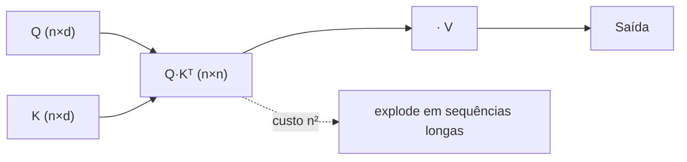
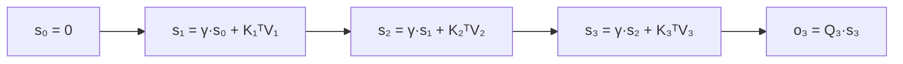
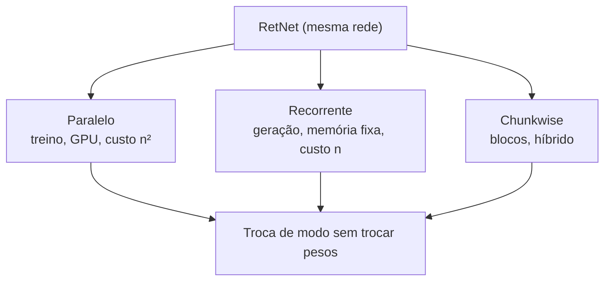
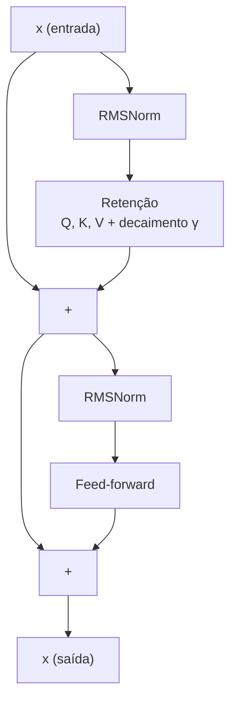

# O que é o RetNet

## Visão geral

O **RetNet** (Retentive Network) é uma arquitetura de modelo de linguagem que propõe uma pergunta ousada: *e se a gente substituísse a atenção — que é cara — por uma operação muito mais barata, sem perder qualidade?* A resposta dos autores (Sun et al., 2023) é a **retenção** (*retention*), uma versão da atenção em que o *softmax* dá lugar a um **decaimento exponencial**.

O RetNet oferece formas paralela, recorrente e por blocos (*chunkwise*) de computar a retenção. Durante a geração, a forma recorrente mantém um estado de tamanho fixo. Este guia apresenta a motivação, a matemática do decaimento e os compromissos em relação a outras arquiteturas.

> A ideia central em uma frase: em vez de cada token olhar para *todos* os tokens anteriores com pesos calculados por softmax, o RetNet faz o passado **escorrer** para o presente com um fator de esquecimento $\gamma$.

## O problema do Transformer

### O custo quadrático

O Transformer calcula a atenção escalada, que, para cada token na posição $n$, pondera **todos** os tokens anteriores (e, no treino, todos de uma vez). O coração da operação é:

$$
\text{Attention}(Q, K, V) = \text{softmax}\!\left(\frac{Q K^\top}{\sqrt{d}}\right) V
$$

O produto $Q K^\top$ tem dimensão $n \times n$ para uma sequência de comprimento $n$. Isso significa que, para dobrar o comprimento do texto, o custo **quadruplica**:

$$
\text{custo} \sim n^2
$$

Para textos longos, isso explode em memória e tempo. Durante a geração, cada novo token precisa re-escanear todo o histórico, guardando um *cache* de chaves e valores que cresce com o texto — o famoso cache KV.

### A intuição por trás da solução

Observação empírica importante: na linguagem, a influência de um token sobre outro **decai com a distância**. A palavra que está a 3 posições de distância geralmente importa mais do que a que está a 300 posições. O softmax, tecnicamente, dá pesos que *podem* decair com a distância, mas o faz de forma **aprendida e implícita**, exigindo calcular todos os pares.

O RetNet pergunta: e se codificássemos esse decaimento **explicitamente**, com uma fórmula fechada, em vez de aprendê-lo? Se a influência decai como $\gamma^{n-m}$ (com $0 < \gamma < 1$), então podemos **reescrever a soma como uma recorrência**, e o custo desaba para linear.

## A solução: decaimento exponencial em vez de softmax

### Substituindo o softmax

Na atenção, o token na posição $n$ calcula um peso para cada token $m \le n$ dado por:

$$
\text{softmax}\left(\frac{Q_n K_m^\top}{\sqrt{d}}\right)
$$

No RetNet, esse peso é substituído por um fator determinístico que só depende da **distância** $n - m$:

$$
\gamma^{n-m}
$$

onde $\gamma$ é um número entre $0$ e $1$ (tipicamente bem próximo de $1$, como $0.97$). A operação de retenção fica:

$$
\text{Retention}(Q, K, V) = \left(Q K^\top \odot D\right) V
$$

onde $\odot$ é a multiplicação elemento a elemento e $D$ é a matriz de decaimento:

$$
D_{nm} = \gamma^{n-m} \cdot \mathbb{1}[m \le n]
$$

A função $\mathbb{1}[m \le n]$ garante **causalidade**: um token só enxerga o passado, nunca o futuro.

### Exemplo numérico da matriz de decaimento

Para uma sequência de 4 tokens e $\gamma = 0.9$, a matriz $D$ (triangular inferior) é:

$$
D =
\begin{bmatrix}
\gamma^{0} & 0 & 0 & 0 \\
\gamma^{1} & \gamma^{0} & 0 & 0 \\
\gamma^{2} & \gamma^{1} & \gamma^{0} & 0 \\
\gamma^{3} & \gamma^{2} & \gamma^{1} & \gamma^{0}
\end{bmatrix}
\approx
\begin{bmatrix}
1 & 0 & 0 & 0 \\
0.9 & 1 & 0 & 0 \\
0.81 & 0.9 & 1 & 0 \\
0.729 & 0.81 & 0.9 & 1
\end{bmatrix}
$$

Note duas coisas: (1) a diagonal é sempre $1$, porque cada token "vê" a si mesmo com peso máximo; (2) cada coluna é a anterior multiplicada por $\gamma$ — é isso que permite a recorrência.

## A retenção em detalhe

### Forma paralela

A forma paralela é a usada no treino, e é quase idêntica à atenção:

$$
\text{Retention}(X) = \left(\frac{Q K^\top}{\sqrt{d}} \odot D\right) V
$$

As projeções são as mesmas do Transformer:

$$
Q = X W_q, \quad K = X W_k, \quad V = X W_v
$$

A diferença essencial é que o softmax é trocado pela máscara de decaimento $D$, que é **fixa** e **conhecida de antemão**.

### Forma recorrente

A mágica do decaimento exponencial é que ele transforma a soma ponderada em uma **recorrência de primeira ordem**. Defina o **estado** na posição $n$:

$$
s_n = \gamma\, s_{n-1} + K_n^\top V_n
$$

com $s_0 = 0$. A saída na posição $n$ é simplesmente:

$$
o_n = Q_n\, s_n
$$

Ou seja, em vez de re-somar todo o passado a cada passo, guardamos um único **estado** $s_n$ que resume tudo o que veio antes. Esse estado tem tamanho fixo $d \times d$ (por cabeça), **independente** do comprimento da sequência.

### Por que a forma recorrente equivale à paralela

Desdobrando a recorrência, vemos o decaimento aparecer naturalmente:

$$
s_n = \sum_{m=1}^{n} \gamma^{n-m}\, K_m^\top V_m
$$

Substituindo na saída:

$$
o_n = Q_n \sum_{m=1}^{n} \gamma^{n-m} K_m^\top V_m = \sum_{m=1}^{n} \gamma^{n-m}\, Q_n K_m^\top V_m
$$

Essa é a forma paralela: o termo $\gamma^{n-m}$ corresponde ao elemento $D_{nm}$. A forma recorrente e a paralela representam a mesma operação, mas organizam os cálculos de maneira diferente.

## Os três modos de computação

A grande vantagem do RetNet é que **a mesma rede** pode ser executada de três formas, cada uma otimizada para uma fase da vida do modelo:

### 1. Modo paralelo (treino)

Durante o treino, a forma paralela processa várias posições simultaneamente e aproveita multiplicações de matrizes otimizadas. A forma matricial completa ainda pode exigir trabalho e memória quadráticos em relação ao comprimento da sequência. A forma *chunkwise* processa blocos e propaga o estado entre eles, oferecendo outro compromisso entre paralelismo e memória.

### 2. Modo recorrente (geração/inferência)

Durante a geração, produzimos um token de cada vez e guardamos apenas o estado $s_n$, que tem tamanho fixo para uma arquitetura definida. Cada novo token atualiza esse estado; assim, o armazenamento do estado não cresce com o comprimento gerado. O custo de uma atualização depende da dimensão do estado, e o custo total cresce com o número de tokens:

$$
\text{custo} \sim n
$$

### 3. Modo chunkwise (meio-termo)

Para sequências muito longas que não cabem inteiras na GPU de uma vez, o modo *chunkwise* processa blocos de tamanho $C$: dentro de cada bloco usa a forma paralela, e entre blocos propaga o estado recorrente. É um híbrido que equilibra paralelismo e memória.

## Multi-Scale Retention

Um único $\gamma$ não é suficiente: algumas relações na linguagem são de longo alcance (precisam de $\gamma$ perto de 1, que esquece devagar), outras são de curto alcance (precisam de $\gamma$ menor, que esquece rápido). A solução do RetNet é usar **várias cabeças, cada uma com um $\gamma$ diferente** — daí o nome *Multi-Scale Retention* (retenção multiescala).

Uma escolha comum para distribuir escalas entre cabeças é usar uma progressão baseada em potências de 2:

$$
\gamma_h = 1 - 2^{-5-h}, \quad h = 0, 1, 2, \dots
$$

Para as primeiras cabeças, isso dá:

| Cabeça $h$ | $\gamma_h$ | Interpretação |
|---|---|---|
| $0$ | $1 - \frac{1}{32} = 0.96875$ | esquece relativamente rápido |
| $1$ | $1 - \frac{1}{64} = 0.984375$ | meio |
| $2$ | $1 - \frac{1}{128} = 0.9921875$ | lembra por mais tempo |
| $3$ | $1 - \frac{1}{256} = 0.99609375$ | longo alcance |
| $\dots$ | $\to 1$ | memória quase total |

Com valores de $\gamma$ diferentes, as cabeças podem representar horizontes de memória distintos: valores menores reduzem mais rapidamente a influência do passado, enquanto valores próximos de 1 a preservam por mais tempo. O número de cabeças e a escala escolhida dependem da arquitetura e do treinamento.

## RetNet vs. Transformer vs. RWKV vs. Mamba

O RetNet não é a única tentativa de escapar do custo quadrático. Vejamos o panorama:

| Aspecto | Transformer | RetNet | RWKV | Mamba |
|---|---|---|---|---|
| Mecanismo | atenção + softmax | retenção + decaimento $\gamma^{n-m}$ | atenção linear + token-shift | espaço de estados seletivo |
| Custo de treino | $n^2$ | $n^2$ (paralelo) | $n$ | $n$ (com scan) |
| Custo de inferência | $n^2$, cache KV cresce | $n$, estado fixo | $n$, estado fixo | $n$, estado fixo |
| Estado recorrente | não (precisa cache) | sim ($s_n$) | sim | sim (contínuo) |
| Codificação de posição | precisa (RoPE etc.) | decaimento embutido | token-shift | embutida |
| Qualidade em longo contexto | referência | comparável | comparável | comparável |

### Um pouco mais sobre cada rival

- **RWKV**: combina uma atenção linear com um mecanismo chamado *token-shift* (mistura o token atual com o anterior antes das projeções). Busca o mesmo objetivo do RetNet — linearidade — mas com um formalismo diferente.
- **Mamba**: usa modelos de espaço de estados (SSM) com parâmetros *seletivos* que dependem da entrada. É mais recente e também atinge custo linear, mas com uma formulação de sistemas dinâmicos contínuos.
- O **RetNet** se destaca pela simplicidade conceitual: é "atenção com softmax trocado por $\gamma^{n-m}$", o que o torna fácil de raciocinar e implementar, e pela possibilidade de **trocar de modo sem trocar pesos**.

## RetNet e BitNet tratam de escolhas diferentes

O RetNet define como uma arquitetura representa e atualiza informações da sequência: usa retenção com decaimento e, na forma recorrente, mantém um estado fixo. O BitNet trata da representação dos pesos, com quantização ternária em certas variantes. Essas opções podem ser estudadas separadamente ou combinadas; a quantização não é requisito para usar retenção.

Ao combinar essas ideias, uma camada pode usar projeções quantizadas para calcular $Q$, $K$ e $V$ enquanto a retenção mantém sua própria regra de memória. A combinação exige avaliar qualidade, estabilidade numérica, treinamento e suporte de execução: reduzir bits não garante, por si só, menor latência ou consumo em todo hardware.

### Diagrama conceitual de retenção

## Erros comuns

- **Confundir retenção com atenção**: a retenção **não** usa softmax; usa a máscara fixa $D_{nm} = \gamma^{n-m}$.
- **Usar $\gamma = 1$**: se $\gamma = 1$, não há esquecimento, e a recorrência acumula tudo sem decair — perde-se a noção de relevância temporal e o estado pode divergir.
- **Esquecer a máscara causal**: sem $\mathbb{1}[m \le n]$, o modelo enxerga o futuro, o que vaza informação no treino e é impossível na geração.
- **Ignorar a escala $\frac{1}{\sqrt{d}}$**: assim como na atenção, a divisão por $\sqrt{d}$ estabiliza os produtos escalares.
- **Achar que as três formas são redes diferentes**: são a *mesma* rede, apenas organizadas de forma distinta; os pesos são idênticos.
- **Não dividir por $\sqrt{d}$ na forma recorrente**: na geração, a saída $Q_n s_n$ também precisa da escala.
- **Usar um único $\gamma$ para tudo**: o multi-scale (várias cabeças com $\gamma$ diferentes) é essencial para cobrir horizontes curtos e longos.
- **Achar que o RetNet elimina todo custo**: o treino paralelo ainda é $n^2$; o ganho linear é na **geração** (e no modo chunkwise).

## Resumo

- O RetNet substitui o softmax da atenção por um **decaimento exponencial** $\gamma^{n-m}$, que codifica explicitamente a distância temporal.
- A retenção tem **forma paralela** $(Q K^\top \odot D) V$ (treino) e **forma recorrente** $s_n = \gamma s_{n-1} + K_n^\top V_n$ (geração), que são matematicamente equivalentes.
- O estado recorrente tem **tamanho fixo**, em contraste com o cache KV do Transformer, que cresce com a sequência. O custo total de geração continua crescendo com o número de tokens processados.
- O **Multi-Scale Retention** usa várias cabeças com $\gamma$ distintos, cobrindo desde memória de curto até longo alcance.
- O RetNet é uma das várias arquiteturas lineares (junto de RWKV e Mamba), destacando-se pela simplicidade e pela troca de modo sem trocar pesos.
- RetNet descreve o mecanismo de contexto; BitNet descreve uma abordagem de quantização dos pesos. São escolhas independentes e podem ser combinadas.
