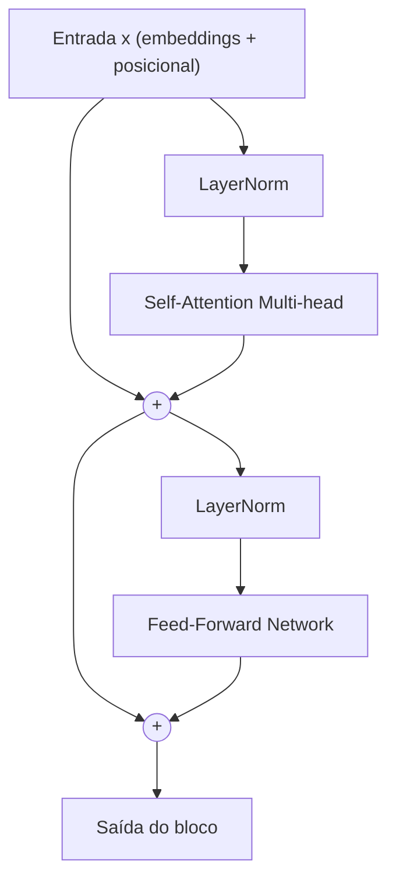

# O que é o Transformer

> "Attention Is All You Need" — o título do artigo de Vaswani et al. (2017) marcou uma mudança importante: o Transformer dispensou recorrência e convolução e passou a usar **atenção** como mecanismo central para relacionar elementos de uma sequência.

## Visão geral

O **Transformer** é uma arquitetura de rede neural desenhada para processar sequências — texto, em especial — de forma **paralela**. Antes dele, a forma dominante de lidar com linguagem eram as redes recorrentes (RNN, LSTM), que liam os tokens **um de cada vez**, guardando um "estado" do que já tinha sido lido. O Transformer quebrou essa limitação: em vez de ler em ordem, ele deixa cada token **olhar diretamente para todos os outros** ao mesmo tempo, ponderando a importância de cada um. Esse olhar simultâneo é a **atenção**.

Este guia apresenta a estrutura de um Transformer, a matemática de um bloco, seus pontos fortes e os custos que motivaram arquiteturas alternativas, como o RetNet.

## Intuição: de ler em fila para olhar tudo de uma vez

Imagine traduzir a frase *"o gato que eu vi estava dormindo"*. Uma rede recorrente leria palavra por palavra e, ao chegar em "estava", precisaria **lembrar** que o sujeito era "gato", lá no início. Essa memória precisa atravessar várias palavras intermediárias sem se perder — um desafio conhecido como *dependência de longo alcance*.

O Transformer resolve isso de forma direta: quando está processando "estava", ele pode **puxar** a informação diretamente de "gato", sem precisar que ela atravesse cada palavra no meio. É como se cada token pudesse consultar uma "lista telefônica" da frase inteira e decidir, por conta própria, quem importa mais.

Isso resolve três dores clássicas de uma só vez:

- **Dependências longas**: a distância entre dois tokens deixa de custar caro.
- **Paralelismo**: como cada token consulta todos os outros de forma independente, o cálculo pode ser feito em paralelo na GPU.
- **Caminho de gradiente curto**: o sinal de erro percorre menos etapas, o que facilita o treino.

## O contexto: por que precisávamos de algo novo

### O gargalo das redes recorrentes

Em uma RNN, o estado oculto no passo $t$ depende do passo anterior:

$$
h_t = f(W_h h_{t-1} + W_x x_t)
$$

Essa recorrência é sequencial por natureza: para calcular $h_t$, você precisa de $h_{t-1}$, que precisa de $h_{t-2}$, e assim por diante. Não dá para paralelizar o eixo do tempo. Em sequências longas, o tempo de treino cresce linearmente, e o gradiente tende a **desaparecer** ou **explodir** ao atravessar muitos passos.

O LSTM aliviou o problema do gradiente com portas (forget gate, input gate), mas manteve a natureza sequencial. O gargalo fundamental permaneceu.

### A sacada da atenção

A atenção não é uma ideia nova — ela já aparecia como um "complemento" dentro de arquiteturas recorrentes para tarefas de tradução (Bahdanau et al., 2015). O artigo de 2017 deu um passo ousado: **remover a recorrência por completo** e deixar a atenção ser o único mecanismo de interação entre tokens. O resto, como dizem, é história.

## A anatomia geral: encoder e decoder

O Transformer original é um modelo **encoder–decoder**:

- **Encoder**: lê a sequência de entrada e produz uma representação rica de cada token.
- **Decoder**: gera a saída token a token, atendendo tanto à entrada (via *cross-attention*) quanto ao que já gerou (via *self-attention* mascarada).

Muitos modelos de linguagem usam apenas o **decoder**: dada uma sequência de tokens, ele prevê o próximo. Outros modelos combinam encoder e decoder ou usam apenas um encoder, conforme a tarefa.

## O bloco do Transformer

A unidade que se repete dezenas ou centenas de vezes em um Transformer é o **bloco**. Cada bloco tem duas subcamadas principais, ambas envolvidas por uma conexão residual e uma normalização:



Vamos detalhar cada peça.

### 1. Self-Attention multi-head

É o coração. Cada token gera três vetores — **Query**, **Key** e **Value** — e usa os produtos escalares entre queries e keys para decidir **quanto de cada value** deve ser coletado. O detalhamento completo com exemplo numérico fica nas páginas dedicadas a *Atenção (Q, K, V)* e *Multi-head attention*; aqui basta a visão de que é a camada que permite a um token "conversar" com todos os outros.

### 2. Feed-Forward Network (FFN)

Após a atenção, cada token passa por uma rede densa de duas camadas, aplicada **posição a posição** (a mesma rede para todos os tokens):

$$
\text{FFN}(x) = W_2 \, \sigma(W_1 x + b_1) + b_2
$$

onde $\sigma$ é uma não-linearidade (ReLU, GELU, SwiGLU, dependendo da versão). A primeira camada costuma expandir a dimensão (tipicamente por um fator 4) e a segunda comprime de volta. É aqui que vive boa parte da "memória factual" do modelo.

### 3. Conexão residual + LayerNorm

Cada subcamada é envolvida assim:

$$
\text{saída} = \text{LayerNorm}\big(x + \text{Subcamada}(x)\big)
$$

A conexão residual ($x + \dots$) cria uma "rodovia" para o gradiente fluir sem se perder em camadas profundas. A LayerNorm estabiliza a distribuição das ativações. Juntas, elas permitem empilhar muitas camadas.

## A matemática do bloco

Seja $x \in \mathbb{R}^{n \times d}$ a entrada do bloco, com $n$ tokens e dimensão $d$. O fluxo é:

$$
x_1 = \text{LayerNorm}(x)
$$

$$
a = \text{MultiHead}(x_1, x_1, x_1)
$$

$$
x_2 = \text{LayerNorm}(x + a)
$$

$$
f = \text{FFN}(x_2)
$$

$$
x_3 = \text{LayerNorm}(x_2 + f)
$$

Cada bloco preserva a dimensão: a saída tem o mesmo shape $n \times d$ da entrada, o que permite empilhar blocos idênticos.

## O papel da codificação posicional

Um detalhe sutil: a atenção, por si só, **não distingue ordem**. Se você embaralhar os tokens de entrada, o resultado da atenção é o mesmo (a menos de permutação). Mas a ordem importa muito em linguagem: *"o cachorro mordeu o homem"* é diferente de *"o homem mordeu o cachorro"*.

A solução é **injetar informação de posição** nos embeddings antes da primeira camada. A versão original usa senos e cossenos:

$$
PE_{(pos, 2i)} = \sin\left(\frac{pos}{10000^{2i/d}}\right)
$$

$$
PE_{(pos, 2i+1)} = \cos\left(\frac{pos}{10000^{2i/d}}\right)
$$

para a posição $pos$ e a dimensão $i$. Hoje muitos modelos usam codificações aprendidas ou a família *RoPE* (rotary), que codifica posição como rotação nos pares de dimensões. O essencial é o mesmo: dar ao modelo uma noção de "quem vem antes de quem".

## Um exemplo numérico de ponta a ponta

Para fixar, considere uma sequência minúscula com $n = 3$ tokens e dimensão $d = 2$ (valores inventados só para acompanhar o fluxo):

$$
x = \begin{bmatrix} 1 & 0 \\ 0 & 1 \\ 1 & 1 \end{bmatrix}
$$

Cada linha é um token. O bloco faz:

1. **Normalizar**: subtrair a média e dividir pelo desvio de cada linha (LayerNorm por token).
2. **Atenção**: produzir uma combinação ponderada das linhas — a linha de um token vira uma mistura das outras conforme a relevância.
3. **Residual**: somar $x$ de volta.
4. **FFN**: aplicar uma transformação não-linear linha a linha.
5. **Residual** novamente.

O ponto-chave: a **atenção** é a única etapa em que as linhas (tokens) **interagem entre si**. FFN, LayerNorm e residuais operam linha a linha, de forma independente. Essa separação de responsabilidades é o que torna o Transformer tão regular e empilhável.

## Código: o esqueleto de um bloco

```python
import torch
import torch.nn as nn
import torch.nn.functional as F

class TransformerBlock(nn.Module):
    def __init__(self, d_model, n_heads, d_ff):
        super().__init__()
        self.attn = MultiHeadAttention(d_model, n_heads)
        self.ffn = nn.Sequential(
            nn.Linear(d_model, d_ff),
            nn.GELU(),
            nn.Linear(d_ff, d_model),
        )
        self.norm1 = nn.LayerNorm(d_model)
        self.norm2 = nn.LayerNorm(d_model)

    def forward(self, x, mask=None):
        # self-attention com residual + norm
        x = x + self.attn(self.norm1(x), mask=mask)
        # feed-forward com residual + norm
        x = x + self.ffn(self.norm2(x))
        return x
```

Note a ordem *pre-norm* (normalizar antes da subcamada), a mais comum em modelos modernos (GPT usa uma variação; muitos LLMs usam exatamente essa). O `mask` cuida de impedir que um token olhe para o futuro, como veremos na página de atenção.

## Por que o Transformer domina

Três motivos práticos se destacam:

| Vantagem | Explicação |
|----------|------------|
| **Paralelismo** | Todo o treino é feito em paralelo na GPU, sem dependência sequencial no eixo do tempo. |
| **Escala** | A arquitetura regular empilha bem: modelos de centenas de bilhões de parâmetros seguem a mesma receita. |
| **Generalização** | A mesma estrutura serve para texto, imagem (ViT), áudio e mais; só muda o tokenizador. |

O custo dessa qualidade é o **crescimento quadrático** da atenção, que discutimos a seguir.

## O calcanhar de Aquiles: o custo quadrático

Na atenção completa, cada token pode comparar sua representação com as dos outros tokens permitidos pela máscara. Para $n$ tokens, isso envolve até $n \times n$ pares de similaridade. O custo de computação cresce aproximadamente com:

$$
\text{custo} \sim n^2
$$

Esse custo motivou arquiteturas alternativas, incluindo o **RetNet**.

## Comparação com o RetNet

O RetNet usa uma operação chamada **retenção** (*retention*), que aplica um **decaimento exponencial** $\gamma$ (entre 0 e 1) à influência de tokens passados:

$$
\text{Retention}(Q, K, V)_n = \sum_{m=1}^{n} \gamma^{n-m} \, Q_n K_m^{\top} V_m
$$

A diferença crucial é que a retenção pode ser reescrita como uma **recorrência** com estado fixo:

$$
s_n = \gamma \, s_{n-1} + K_n^{\top} V_n
$$

Na forma recorrente, cada novo token atualiza um estado de tamanho fixo. O número total de atualizações cresce linearmente com a quantidade de tokens gerados, embora o custo de cada atualização dependa da dimensão do estado:

$$
\text{custo} \sim n
$$

| Aspecto | Transformer | RetNet |
|---------|-------------|--------|
| Interação entre tokens | atenção completa, sem decaimento | retenção com decaimento $\gamma$ |
| Custo de atenção | $n^2$ na forma completa | formas paralela, recorrente e chunkwise |
| Estado na geração | cresce com o texto (cache KV) | fixo |
| Modos de computação | paralelo | paralelo / recorrente / chunkwise |
| Qualidade em longo contexto | referência | comparável |

A intuição por trás do decaimento é que, em muitos contextos, a influência de um token distante tende a diminuir. Essa é uma escolha indutiva, não uma regra universal: o desempenho depende da tarefa, dos dados, da implementação e do orçamento computacional. A página *O que é o RetNet* aprofunda a matemática.

## Mecanismo de contexto e quantização são escolhas independentes

É útil separar duas decisões de arquitetura que respondem a perguntas diferentes:

- **Como processar o contexto?** Um Transformer pode usar atenção; o RetNet pode usar retenção. Essa escolha define como as posições da sequência interagem.
- **Como representar os pesos?** Pesos de precisão convencional ou quantizados — por exemplo, com abordagens da família BitNet — são alternativas para armazenar e calcular as projeções.

BitNet e RetNet podem ser escolhidos de forma independente, inclusive combinados. Também é válido usar um Transformer com pesos convencionais. A quantização não substitui, por si só, o mecanismo de atenção ou retenção; ela muda a representação dos parâmetros e exige considerar precisão, qualidade e suporte do hardware.

## Erros comuns

- **Achar que atenção resolve tudo sozinha**: sem FFN e sem camadas empilhadas, a atenção pura tem expressividade limitada. O bloco inteiro é que importa.
- **Esquecer a codificação posicional**: sem ela, o modelo é invariante a permutação e não aprende ordem.
- **Confundir self-attention com cross-attention**: a primeira é dentro da própria sequência; a segunda entre encoder e decoder (não usada no decoder puro de LLM).
- **Ignorar o custo da atenção completa**: para contextos longos, memória e computação podem se tornar limitantes; alternativas como o RetNet fazem compromissos diferentes.
- **Subestimar a LayerNorm e os residuais**: são elas que permitem empilhar dezenas de camadas sem gradiente sumir.
- **Achar que o Transformer é "só" atenção**: ele é atenção **+** FFN **+** normalização **+** residuais **+** posicional. O nome do artigo é um slogan, não uma lista exaustiva.

## Resumo

- O Transformer processa sequências de forma **paralela**, substituindo a recorrência por **atenção**.
- Cada **bloco** tem self-attention multi-head e um feed-forward, ambos com residual + LayerNorm.
- A **codificação posicional** injeta ordem, já que a atenção sozinha não distingue posição.
- A única etapa onde os tokens interagem é a atenção; FFN e normalizações são posição a posição.
- A atenção completa exige comparar pares de posições e tem custo que cresce aproximadamente com $n^2$.
- O **RetNet** usa retenção com decaimento e pode manter um estado fixo durante a geração.
- O mecanismo de contexto (Transformer ou RetNet) e a representação dos pesos (convencional ou BitNet) são escolhas independentes.
