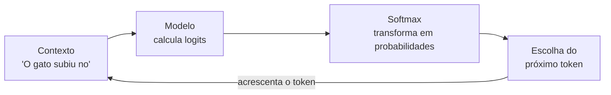

# O que é um modelo de linguagem

Um **modelo de linguagem** é um programa que aprende, a partir de muitos exemplos de texto, a estimar a probabilidade de uma sequência de palavras. Em vez de seguir regras escritas à mão, ele "olha" para uma entrada — chamada de **contexto** — e pergunta: *"dado tudo o que veio antes, qual é a continuação mais provável?"*.

> Muitos modelos de linguagem aprendem a estimar o próximo token a partir do contexto. Esse objetivo ajuda a aprender regularidades de vocabulário, sintaxe e estilo, mas não garante que toda resposta gerada seja verdadeira.

Este guia explica o que é um token, como o texto vira números, o que são logits, como a função softmax transforma números em probabilidades e qual é a diferença entre treinar um modelo e usá-lo para gerar texto.

## Por que "prever o próximo token" é tão poderoso

Parece brincadeira: prever a próxima palavra. Mas pense no que essa tarefa exige. Para completar a frase

> "O gato subiu no ___"

um modelo precisa ter aprendido, só de ler muito texto, que gatos costumam subir em *muro*, *telhado*, *sofá* ou *árvore*. Ele não decora frases inteiras: ele aprende padrões de associação entre palavras, ordem, concordância e sentido.

Essa mesma habilidade, repetida muitas vezes, gera texto inteiro:



O loop acima se repete: cada token escolhido é colado ao final do contexto, e o processo recomeça. É assim que uma frase pequena vira um parágrafo inteiro.

## Tokens e vocabulário

O texto **não** é processado letra por letra. Ele é quebrado em pedaços chamados **tokens**. Um token pode ser uma palavra inteira, um pedaço de palavra, um sinal de pontuação ou um símbolo especial.

```
"O rato roeu a roupa"  →  [O] [rato] [roe] [u] [a] [roupa]
```

Repare que "roeu" virou `[roe] [u]`: o tokenizador pode dividir uma palavra em partes menores. Isso é útil porque permite representar palavras raras combinando pedaços conhecidos.

O conjunto de **todos** os tokens possíveis forma o **vocabulário** do modelo. Um vocabulário típico de um modelo de linguagem moderno tem dezenas de milhares de tokens (30 mil, 50 mil ou mais).

| Conceito | O que é | Exemplo |
|----------|---------|---------|
| Texto | o que o usuário vê | `"oi, tudo bem?"` |
| Token | pedaço do texto | `["oi", ",", "tudo", "bem", "?"]` |
| Vocabulário | todos os tokens possíveis | conjunto de ~50 mil tokens |
| Id | número inteiro de cada token | `oi → 4172`, `? → 30` |

### De texto para número

Cada token recebe um **id** — um número inteiro que o identifica. Toda a matemática do modelo trabalha com esses números, nunca com letras.

```text
texto:        "o gato dorme"
tokenização:  ["o", "gato", "dorme"]
ids:          [ 322,  15432,  8911 ]
```

Uma vez convertido em números, o texto vira um vetor de inteiros. Esse vetor é a **entrada** do modelo.

## Logits: a saída crua do modelo

Quando o modelo recebe um contexto, ele produz, para **cada token do vocabulário**, um número chamado **logit**. O logit de um token indica, grosso modo, o quanto o modelo "acha" que aquele token é uma boa continuação — **antes** de qualquer normalização.

Se o vocabulário tivesse apenas 3 tokens (`a`, `b`, `c`), o modelo poderia produzir:

| Token | Logit |
|-------|-------|
| `a`   | 2.0 |
| `b`   | 1.0 |
| `c`   | 0.1 |

Quanto **maior** o logit, maior a "confiança" bruta do modelo naquele token. Mas esses números ainda não são probabilidades: eles podem ser negativos, somar qualquer coisa e não têm limite. É aí que entra a softmax.

> Os logits podem ter qualquer sinal e qualquer magnitude. Eles são valores internos e crus. Compará-los diretamente já dá uma ideia de ordenação, mas só faz sentido tratá-los como probabilidade depois de normalizá-los.

## Softmax: transformando logits em probabilidades

A função **softmax** recebe um vetor de logits e devolve um vetor de probabilidades que:

1. são todas **não negativas**;
2. somam exatamente **1** (ou 100%).

Para um vetor de logits $z = [z_1, z_2, \dots, z_V]$ de tamanho $V$ (o tamanho do vocabulário), a probabilidade do token $i$ é:

$$
P_i = \frac{e^{z_i}}{\sum_{j=1}^{V} e^{z_j}}
$$

O número $e \approx 2{,}71828$ é a base dos logaritmos naturais. Elevar $e$ a cada logit garante que tudo seja positivo; dividir pela soma garante que o total dê 1.

### Exemplo 1 — três logits simples

Voltando aos logits $z = [2.0,\; 1.0,\; 0.1]$:

$$
P_a = \frac{e^{2.0}}{e^{2.0} + e^{1.0} + e^{0.1}}
$$

Calculando cada exponencial:

$$
e^{2.0} \approx 7.389,\quad e^{1.0} \approx 2.718,\quad e^{0.1} \approx 1.105
$$

A soma é:

$$
7.389 + 2.718 + 1.105 \approx 11.212
$$

Então:

$$
P_a = \frac{7.389}{11.212} \approx 0.659,\quad
P_b = \frac{2.718}{11.212} \approx 0.242,\quad
P_c = \frac{1.105}{11.212} \approx 0.099
$$

Resultado:

$$
P \approx [0.66,\; 0.24,\; 0.10]
$$

Confira: $0.66 + 0.24 + 0.10 = 1.00$. O maior logit virou a maior probabilidade, mas **todos** continuaram com alguma chance. É isso que dá variedade ao texto.

### Exemplo 2 — logits negativos

E se os logits forem negativos? Por exemplo $z = [-1.0,\; -1.0,\; -1.0]$. Não há problema: $e$ elevado a um número negativo ainda é positivo.

$$
e^{-1.0} \approx 0.368
$$

Como os três são iguais, a soma é $3 \times 0.368 = 1.104$, e cada probabilidade é:

$$
P_i = \frac{0.368}{1.104} \approx 0.333
$$

Logits idênticos geram probabilidades idênticas — o modelo fica "em dúvida" entre os três.

### Exemplo 3 — logits com valores flutuantes e afastados

Considere $z = [-0.5,\; 3.2,\; -2.7]$. Calculando as exponenciais:

$$
e^{-0.5} \approx 0.607,\quad e^{3.2} \approx 24.53,\quad e^{-2.7} \approx 0.067
$$

Soma:

$$
0.607 + 24.53 + 0.067 \approx 25.20
$$

Probabilidades:

$$
P \approx \left[\frac{0.607}{25.20},\; \frac{24.53}{25.20},\; \frac{0.067}{25.20}\right]
\approx [0.024,\; 0.973,\; 0.003]
$$

Veja como o logit $3.2$ dominou: como a exponencial cresce **muito rápido**, pequenas diferenças nos logits se transformam em diferenças enormes nas probabilidades. O token do meio levou 97,3% da massa.

### O papel da temperatura

Na prática, costuma-se dividir os logits por uma constante $T > 0$ chamada **temperatura** antes de aplicar a softmax:

$$
P_i = \frac{e^{z_i / T}}{\sum_j e^{z_j / T}}
$$

- $T = 1$: comportamento padrão.
- $T \rightarrow 0$: o modelo fica quase **determinístico**, escolhendo quase sempre o token de maior logit.
- $T$ alto (ex.: $T = 2$): as probabilidades ficam mais **achatadas**, o texto fica mais criativo e aleatório.

Com $z = [2.0,\; 1.0,\; 0.1]$ e $T = 2$:

$$
e^{1.0} \approx 2.718,\quad e^{0.5} \approx 1.649,\quad e^{0.05} \approx 1.051
$$

$$
P \approx \left[\frac{2.718}{5.418},\; \frac{1.649}{5.418},\; \frac{1.051}{5.418}\right]
\approx [0.50,\; 0.30,\; 0.19]
$$

Repare que a temperatura maior "espalhou" a probabilidade, tornando os três tokens mais parecidos entre si.

## Como o próximo token é escolhido

Depois de calcular as probabilidades, há duas maneiras principais de escolher o próximo token:

1. **Greedy (ganancioso)**: escolhe sempre o token de maior probabilidade. É rápido e determinístico, mas pode ficar repetitivo.
2. **Amostragem (sampling)**: sorteia um token de acordo com as probabilidades. Gera texto mais variado e natural.

```python
import math

def softmax(logits):
    exps = [math.exp(z) for z in logits]
    soma = sum(exps)
    return [e / soma for e in exps]

logits = [2.0, 1.0, 0.1]
probs = softmax(logits)
print(probs)  # ~ [0.659, 0.242, 0.099]
```

Com as probabilidades em mãos, a amostragem pode ser feita sorteando um token proporcionalmente: no exemplo acima, o token `a` sairia cerca de 66% das vezes, o `b` cerca de 24% e o `c` cerca de 10%.

## O ciclo completo de geração

Juntando tudo, a geração de texto funciona assim:

```text
entrada: "O gato subiu no"
1. tokeniza  →  ids do contexto
2. o modelo calcula os logits de todos os tokens do vocabulário
3. softmax    →  probabilidades
4. escolhe o próximo token (greedy ou amostragem)
5. acrescenta o token escolhido ao final do contexto
6. repete até atingir o limite ou encontrar o token de fim
```

Abaixo, um pseudocódigo que resume o processo:

```python
def gerar(modelo, contexto, max_tokens, temperatura=1.0):
    tokens = tokenizar(contexto)
    for _ in range(max_tokens):
        logits = modelo(tokens)              # logits de todos os tokens do vocabulário
        logits = [z / temperatura for z in logits[-1]]  # logits do ÚLTIMO token
        probs = softmax(logits)              # vira probabilidades
        novo = sortear(probs)                # escolhe o próximo token
        tokens.append(novo)
        if novo == token_de_fim:
            break
    return destokenizar(tokens)
```

Um detalhe importante: o modelo calcula logits para **todas as posições** da sequência de uma só vez, mas na geração usamos apenas os logits da **última posição** — afinal, é ela que representa a continuação da frase.

## Treinamento vs. geração

É fácil confundir os dois momentos da vida de um modelo:

| Aspecto | Treinamento | Geração (inferência) |
|---------|-------------|----------------------|
| Objetivo | aprender a prever o próximo token | produzir texto novo |
| Entrada | milhões de exemplos de texto | um contexto do usuário |
| Saída | erro e atualização dos pesos | tokens novos |
| Estado | pesos mudam a cada passo | pesos ficam fixos |

No **treinamento**, mostra-se um texto e pede-se que o modelo acerte o próximo token. Por exemplo, dado `"o gato dorme"`, o modelo vê `"o gato"` e deve prever `"dorme"`. O erro entre o que ele previu e o correto é medido, e os pesos são ajustados para diminuir esse erro.

Na **geração**, o modelo já treinado recebe um contexto e produz texto novo, token a token, sem alterar os pesos.

> Uma metáfora útil: o treinamento é a fase em que o modelo "estuda" um acervo gigantesco; a geração é a fase em que ele "escreve" a partir do que estudou. Os pesos aprendidos são a memória permanente entre as duas fases.

## Por que o contexto importa

A mesma palavra pode ter significados totalmente diferentes dependendo do que vem antes:

- *"a manga da camisa"* → `manga` é parte da roupa; o próximo token provável é algo como `está`, `rasgou`, `ficou`.
- *"comi uma manga"* → `manga` é a fruta; o próximo token provável é `doce`, `madura`, `deliciosa`.

O token `manga` é **idêntico** nas duas frases, mas a continuação correta é diferente. Por isso o modelo precisa olhar para **todo o contexto anterior** — não apenas para a última palavra.

Isso motiva diferentes estratégias para representar o contexto. Um **Transformer** usa atenção para relacionar tokens da sequência; um **RetNet** usa retenção com decaimento e pode manter um estado recorrente. Cada abordagem tem propriedades e compromissos próprios.

## Arquitetura, memória e representação dos pesos

O mecanismo usado para processar o contexto e a forma de representar os pesos são decisões diferentes:

- **Transformer** e **RetNet** descrevem maneiras de processar relações e contexto entre tokens.
- **BitNet** descreve uma abordagem de quantização dos pesos, com representações ternárias em certas variantes.
- Um modelo pode usar pesos convencionais ou quantizados; essa escolha não determina, por si só, qual mecanismo de contexto ele usa.
- BitNet e RetNet são opções independentes e podem ser estudadas ou combinadas. Nenhuma delas é necessária para entender o fluxo geral de um modelo de linguagem.

Em qualquer uma dessas arquiteturas, o texto passa por tokenização e embeddings, a rede produz logits, e um método de seleção escolhe o próximo token. A softmax pode converter os logits em probabilidades, embora algumas etapas de treinamento calculem a perda diretamente a partir dos logits.

## Erros comuns

- **Confundir logit com probabilidade.** Logit pode ser negativo e não soma 1; probabilidade é sempre não negativa e soma 1.
- **Esquecer que a softmax normaliza pelo todo.** A probabilidade de um token depende de *todos* os logits, não só do dele.
- **Tratar uma resposta provável como fato garantido.** O modelo gera saídas a partir de padrões aprendidos e pode produzir erros convincentes.
- **Usar a saída errada na geração.** É preciso pegar os logits da **última posição** da sequência, não de todas.
- **Ignorar a temperatura.** Ajustá-la muda completamente o estilo do texto gerado.

## Resumo

- Um modelo de linguagem aprende a **prever o próximo token** dado um contexto.
- O texto é quebrado em **tokens**, cada um com um **id** numérico.
- O modelo produz **logits** — números crus, um para cada token do vocabulário.
- A **softmax** converte logits em **probabilidades** que somam 1.
- O próximo token é escolhido por **greedy** ou **amostragem**, opcionalmente com **temperatura**.
- **Treinamento** ajusta os pesos; **geração** usa os pesos fixos para escrever.
- O **contexto** importa porque a mesma palavra muda de sentido conforme o passado.
- Transformer e RetNet são alternativas para processar o contexto; BitNet é uma abordagem de quantização dos pesos. Essas escolhas podem ser feitas separadamente.
