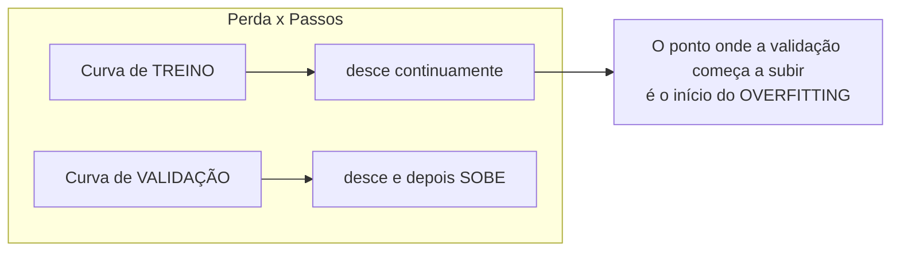
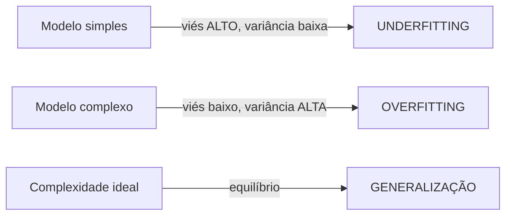
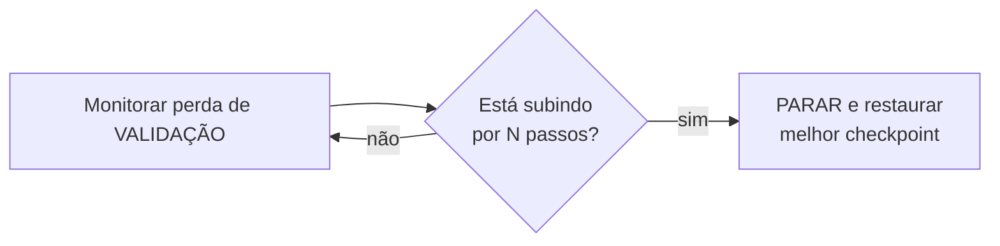

# Overfitting, underfitting e regularização

## Intuição: decorar versus entender

Imagine um aluno que decora todas as respostas de uma prova antiga, palavra por palavra, sem entender a matéria. Na prova antiga, ele tira nota 10. Mas quando o professor muda os números e formula novas perguntas, ele erra quase tudo. Outro aluno estudou os **conceitos**: ele erra um ou outro detalhe na prova antiga, mas vai bem em qualquer prova nova.

Uma rede neural pode se comportar exatamente assim. O primeiro caso é o **overfitting** (sobreajuste): o modelo "decora" os dados de treino, atingindo perda baixíssima neles, mas falha em dados que nunca viu. O segundo é o que queremos: o modelo captura o **padrão geral** e generaliza para dados novos.

> "Um modelo que decora os dados de treino é como um aluno que decora a prova: excelente naquilo que já viu, inútil diante do desconhecido."


## Conceito: os três regimes de ajuste

### Underfitting (subajuste)

O modelo é simples demais, está mal especificado ou treinou pouco para capturar o padrão. Pode errar tanto nos dados de treino quanto nos de validação. Sinais possíveis:

- Perda de treino alta.
- Perda de validação alta e **próxima** da de treino.
- Acurácia baixa em todo lugar.

É como um aluno que não estudou nem o conceito nem a prova: vai mal em tudo.

### Ajuste adequado (o alvo)

O modelo representa padrões úteis e tem bom desempenho em dados de validação relevantes. A distância entre treino e validação pode ajudar a diagnosticar o ajuste, mas sua interpretação depende da escala das métricas e da divisão dos dados.

### Overfitting (sobreajuste)

O modelo pode estar ajustando detalhes específicos do treino que não se repetem em dados novos. Sinais possíveis:

- Perda de treino **muito baixa** (às vezes tendendo a zero).
- Perda de validação **alta**, e **subindo** com o passar do tempo.
- Grande distância entre treino e validação (o "gap").

| Regime | Perda de treino | Perda de validação | Gap | Diagnóstico |
|--------|-----------------|--------------------|-----|-------------|
| Underfitting | Alta | Alta | Pequeno | Modelo fraco ou treino curto |
| Ajuste ideal | Baixa | Baixa | Pequeno | Generaliza bem |
| Overfitting | Muito baixa | Alta/subindo | Grande | Decorou o ruído |

### A curva que denuncia tudo

O gráfico clássico mostra a perda em função dos passos de treino:



Enquanto a perda de treino continua descendo (o modelo fica cada vez melhor em decorar), a perda de validação atinge um mínimo e começa a **subir**. A partir daquele ponto, cada passo de treino deixa o modelo pior para dados novos, mesmo que pareça melhor nos dados de treino.

## Viés e variância: a matemática da generalização

### A decomposição do erro

No caso de regressão com erro quadrático e ruído aditivo de média zero, uma forma clássica de analisar a previsão esperada é decompor o erro em viés, variância e ruído irredutível. Sob essas hipóteses:

$$
\mathbb{E}\!\left[(y - \hat{f}(x))^2\right] = \underbrace{\left(\text{Viés}[\hat{f}]\right)^2}_{\text{erro sistemático}} + \underbrace{\text{Variância}[\hat{f}]}_{\text{sensibilidade ao dado}} + \underbrace{\sigma^2}_{\text{ruído irredutível}}
$$

Cada termo tem um significado intuitivo nesse cenário:

- **Viés (bias):** quanto o modelo erra **em média** por ser simples demais. Um modelo linear ajustando uma relação curva tem viés alto — ele simplesmente não consegue representar a curva.
- **Variância (variance):** quanto a previsão do modelo muda se treinarmos em um conjunto de dados ligeiramente diferente. Um modelo muito flexível decora cada detalhe do conjunto específico, então muda muito de um conjunto para outro.
- **Ruído $\sigma^2$:** a imprevisibilidade inerente aos próprios dados. Nenhum modelo pode eliminá-la.

### O dilema viés-variância

Um padrão comum é o compromisso entre viés e variância, embora sua forma dependa do problema e não seja uma lei rígida para todo modelo:

- Aumentar a complexidade do modelo **diminui o viés** (ele passa a representar padrões mais ricos) mas **aumenta a variância** (ele passa a decorar ruído).
- Diminuir a complexidade faz o contrário.



O overfitting é, portanto, o regime de **alta variância**: o modelo é tão flexível que cada conjunto de treino produz um modelo diferente, e o modelo final "decora" os detalhes específicos daquele conjunto.

### Exemplo numérico: um polinômio que decora

Considere dados gerados por $y = 2x + 1$ com um pequeno ruído:

| $x$ | 0 | 1 | 2 | 3 |
|-----|---|---|---|---|
| $y$ | 0.9 | 3.2 | 4.8 | 7.1 |

Um modelo linear $\hat{f}(x) = ax + b$ ajustado a esses pontos dá algo como $\hat{f}(x) \approx 2.07x + 0.85$ — próximo da verdade. Sua perda nos dados de treino é pequena, mas não zero (o ruído impede acerto exato).

Um polinômio de grau 3 pode passar **exatamente** pelos quatro pontos, com perda de treino zero. Mas entre os pontos, ele oscila loucamente: em $x = 0.5$, por exemplo, ele pode prever um valor absurdo, distante da relação real. Ele "decorou" os quatro pontos em vez de entender a reta.

A diferença está na **capacidade** (complexidade) do modelo: o polinômio de grau 3 tem capacidade sobrando para os quatro pontos, e usa essa capacidade extra para memorizar ruído.

## Regularização: o antídoto

Regularização é o conjunto de técnicas que **penalizam a complexidade** para empurrar o modelo do regime de overfitting para o de generalização. A ideia geral: adicionar um custo que cresce quando o modelo fica "complicado demais", forçando-o a preferir soluções simples.

### Regularização L2 e weight decay

A forma clássica de regularização L2 adiciona à perda um termo proporcional ao quadrado da norma dos pesos. O termo *weight decay* também é usado para descrever o encolhimento dos parâmetros; a relação exata depende do otimizador:

$$
L_{\text{total}} = L_{\text{dados}} + \frac{\lambda}{2} \sum_{i} w_i^2
$$

Onde:

- $L_{\text{dados}}$ é a perda original (por exemplo, a entropia cruzada);
- $\lambda$ é o coeficiente de regularização (controla a força);
- $w_i$ são os pesos (não os vieses, em geral).

### Por que penalizar $w^2$ funciona

A intuição: em algumas parametrizações, pesos grandes podem tornar a saída mais sensível a mudanças nas entradas. A penalização $\sum w_i^2$ favorece pesos menores, mas não garante, por si só, uma função suave nem melhor generalização.

Em um polinômio, por exemplo, os coeficientes dos termos de grau alto tendem a ficar enormes quando o modelo decora ruído. A penalização L2 força esses coeficientes a encolher, reduzindo as oscilações espúrias.

### O efeito no gradiente

O gradiente do termo regularizador é simples:

$$
\frac{\partial}{\partial w_i}\left( \frac{\lambda}{2} \sum_j w_j^2 \right) = \lambda w_i
$$

Portanto, a atualização do gradiente descendente ganha um termo extra:

$$
w_i \leftarrow w_i - \eta \left( \frac{\partial L_{\text{dados}}}{\partial w_i} + \lambda w_i \right)
$$

O termo $\eta \lambda w_i$ é proporcional ao próprio peso, com sinal negativo: ele **encolhe cada peso um pouquinho a cada passo**, como um "atrito" que impede os pesos de crescer sem limite. Por isso o nome "weight decay" (decaimento de pesos).

### Exemplo numérico do decaimento

Suponha um peso $w = 2.0$, um gradiente de dados $\frac{\partial L_{\text{dados}}}{\partial w} = -1.0$, $\eta = 0.1$ e $\lambda = 0.1$.

1. Sem regularização: $w \leftarrow 2.0 - 0.1 \cdot (-1.0) = 2.0 + 0.1 = 2.1$.
2. Com regularização: $w \leftarrow 2.0 - 0.1 \cdot (-1.0 + 0.1 \cdot 2.0) = 2.0 - 0.1 \cdot (-1.0 + 0.2) = 2.0 - 0.1 \cdot (-0.8) = 2.08$.

Repare que o decaimento subtraiu $0.02$ do valor final. Com o tempo, esse "freio" acumulado impede que os pesos cresçam demais, e a soma $\sum w_i^2$ se mantém sob controle.

### Detalhe: AdamW separa o decaimento do momento

Quando a penalização L2 é incorporada ao gradiente de um otimizador adaptativo como Adam, ela passa pelo mecanismo de adaptação. AdamW aplica o decaimento de pesos desacoplado do passo adaptativo:

$$
w \leftarrow w - \eta \lambda w - \eta \cdot \text{(passo de Adam)}
$$


## Early stopping: parar antes de decorar

### A ideia

Se o overfitting surge **depois** de um certo número de passos (quando a validação começa a subir), uma regularização direta é simplesmente **parar o treinamento naquele ponto**. É o **early stopping** (parada antecipada).



O algoritmo é simples:

```text
entrada: modelo, dados de treino, dados de validação, paciência P
melhor = infinito; passos_sem_melhora = 0
para cada época/passo:
    treinar um passo
    v = perda de validação
    se v < melhor:
        melhor = v
        salvar checkpoint do modelo
        passos_sem_melhora = 0
    senão:
        passos_sem_melhora += 1
        se passos_sem_melhora >= P:
            parar e restaurar o melhor checkpoint
```

O parâmetro de **paciência** (patience) é quantos passos de validação sem melhora toleramos antes de parar. Paciência pequena para cedo demais (pode parar num vale temporário); paciência grande corre o risco de já ter decorado antes de parar.

### Exemplo numérico

Suponha a seguinte evolução da validação (medida a cada 50 passos):

| Passo | Validação | Melhor? |
|-------|-----------|---------|
| 0     | 5.20      | sim (salva) |
| 50    | 4.80      | sim (salva) |
| 100   | 4.55      | sim (salva) |
| 150   | 4.60      | não |
| 200   | 4.72      | não |
| 250   | 4.90      | não |

Com paciência $P = 2$, o treino pararia no passo 150 (segunda piora consecutiva), restaurando o checkpoint do passo 100 (validação $4.55$, a melhor). É o early stopping em ação: paramos no **mínimo de validação**, não no mínimo de treino.

## Decoração versus generalização: sinais durante o treino


- **Perda de treino:** mostra o ajuste aos exemplos usados para otimizar os parâmetros.
- **Métrica de validação:** estima o comportamento em dados reservados às decisões de modelagem.
- **Métricas da tarefa:** escolha medidas adequadas ao objetivo; acurácia e perplexidade não servem para todo problema.

Um sinal comum de overfitting é a perda de treino continuar caindo enquanto a validação **estagna ou sobe**. Essa divergência merece investigação, embora também possa refletir diferenças entre as distribuições ou problemas na divisão dos dados.

### Tabela de diagnóstico

| Observação | Possível interpretação | Ação |
|-------------------------|---------------|------|
| Treino alto, validação alto | Possível subajuste ou problema de dados/otimização | Investigar modelo, dados e treinamento |
| Treino baixo, validação baixo | Bom desempenho observado nessa divisão | Confirmar em dados e métricas relevantes |
| Treino baixíssimo, validação subindo | Possível overfitting | Verificar divisão e dados; testar regularização ou parada antecipada |
| Treino e validação oscilando | Possível instabilidade ou alta variância | Investigar taxa de aprendizado, dados e frequência de avaliação |

## A relação entre regularização e pesos ternários


### A quantização já é uma forma de regularização

Ao quantizar pesos para $\{-1, 0, +1\}$, limita-se a quantidade de valores representáveis por peso. Essa restrição pode atuar como um viés indutivo, mas não garante menor variância nem melhor generalização em toda tarefa.

### Mas a escala precisa de cuidado

Alguns métodos mantêm pesos latentes contínuos e calculam escalas a partir deles. O comportamento das escalas depende da regra de quantização e da parametrização, portanto precisa ser avaliado junto dos pesos e da qualidade do modelo.

### O weight decay atua nos pesos reais

Em métodos com pesos latentes, o *weight decay* do AdamW atua diretamente nos parâmetros aos quais foi aplicado. Isso pode alterar indiretamente as escalas e os valores quantizados; não garante uma distribuição ternária específica nem equivale sempre a adicionar uma penalidade L2 à perda.

## Código: visualizando o overfitting

Um experimento mínimo para comparar erro de treino e validação:

```python
import torch
import torch.nn as nn
import copy

torch.manual_seed(0)

# Dados de treino e validação gerados pelo mesmo padrão com ruído
X_train = torch.linspace(-1, 1, 30).unsqueeze(1)
Y_train = 2 * X_train + 1 + 0.3 * torch.randn_like(X_train)
X_val = torch.linspace(-1, 1, 100).unsqueeze(1)
Y_val = 2 * X_val + 1 + 0.3 * torch.randn_like(X_val)

def avaliar(model, x, y):
    model.eval()
    with torch.no_grad():
        return nn.MSELoss()(model(x), y).item()

def treinar(model, lambda_l2=0.0, passos=2000, eta=0.01):
    # O exemplo adiciona L2 explicitamente; por isso o weight_decay fica desativado.
    opt = torch.optim.AdamW(model.parameters(), lr=eta, weight_decay=0.0)
    perda = nn.MSELoss()
    model.train()
    for _ in range(passos):
        opt.zero_grad()
        pred = model(X_train)
        L = perda(pred, Y_train)
        if lambda_l2 > 0:
            L = L + 0.5 * lambda_l2 * sum((p ** 2).sum() for p in model.parameters())
        L.backward()
        opt.step()
    return avaliar(model, X_train, Y_train), avaliar(model, X_val, Y_val)

# Modelo simples (linear) x rede neural mais flexível
linear = nn.Linear(1, 1)
complexo = nn.Sequential(
    nn.Linear(1, 64), nn.Tanh(),
    nn.Linear(64, 64), nn.Tanh(),
    nn.Linear(64, 1),
)
complexo_com_l2 = copy.deepcopy(complexo)

for nome, modelo, regularizacao in [
    ("Linear", linear, 0.0),
    ("Rede flexível", complexo, 0.0),
    ("Rede flexível com L2", complexo_com_l2, 1e-3),
]:
    treino, validacao = treinar(modelo, lambda_l2=regularizacao)
    print(nome, "MSE treino:", round(treino, 4), "MSE validação:", round(validacao, 4))
```

O resultado depende da inicialização e dos hiperparâmetros; não é garantido que a rede mais flexível sobreajuste nesta execução. Compare as métricas e repita o experimento antes de tirar conclusões. A validação ajuda na escolha do modelo, mas não substitui um conjunto de teste reservado para a avaliação final.

## Erros comuns

- **Olhar só a perda de treino.** Uma perda de treino baixíssima não é mérito se a validação estiver subindo. Sempre acompanhe o gap.
- **Presumir que weight decay zero sempre causa overfitting.** Regularização depende da tarefa, dos dados e do modelo; use validação para diagnosticar.
- **Confundir weight decay com learning rate.** São coisas distintas: a taxa controla o tamanho do passo; o weight decay controla o freio sobre a magnitude dos pesos.
- **Usar early stopping sem guardar o melhor checkpoint.** Parar sem restaurar o melhor modelo joga fora o ponto ótimo; você fica com o modelo já degradado do final.
- **Ajustar a regularização antes de confirmar o diagnóstico.** Confirme que a divergência é consistente e não vem de uma divisão inadequada ou de diferenças entre treino e validação. Mais regularização pode piorar o subajuste.
- **Assumir que weight decay controla diretamente a distribuição ternária.** O efeito depende dos parâmetros e da regra de quantização.

## Resumo

- **Underfitting** = modelo simples demais (viés alto); **overfitting** = modelo flexível demais que decora ruído (variância alta).
- Na regressão quadrática sob hipóteses específicas, o erro esperado pode ser decomposto em viés², variância e ruído irredutível: $\mathbb{E}[(y-\hat{f})^2] = \text{Viés}^2 + \text{Variância} + \sigma^2$.
- **Regularização L2** adiciona um termo à função de perda; **AdamW** aplica weight decay desacoplado. Eles não são equivalentes em geral para otimizadores adaptativos.
- **Early stopping** interrompe o treino quando a validação para de melhorar, restaurando o melhor checkpoint.
- Um sinal comum de overfitting é a validação piorar enquanto a perda de treino continua caindo.
