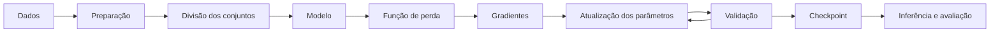

 # Pipeline de treinamento de um modelo

Treinar um modelo é um processo que transforma dados em parâmetros capazes de executar uma tarefa. O fluxo geral é parecido em regressão, classificação, visão computacional e modelos de linguagem, embora cada tarefa use dados, objetivos e métricas próprios.

## As etapas principais



1. **Definir a tarefa.** Especifique o que entra no modelo, o que ele deve produzir e como medir o resultado.
2. **Preparar os dados.** Remova ou trate dados inválidos, normalize características quando necessário e converta entradas para a representação que o modelo espera.
3. **Separar treino, validação e teste.** O conjunto de treino ajusta os parâmetros; a validação ajuda a comparar configurações; o teste estima o desempenho final em dados não usados nessas decisões.
4. **Construir o modelo.** Escolha uma arquitetura adequada à tarefa, à quantidade de dados e aos recursos disponíveis.
5. **Calcular previsões e perda.** A passagem *forward* produz previsões; a função de perda mede a diferença entre previsões e alvos.
6. **Calcular gradientes e atualizar parâmetros.** A retropropagação calcula como cada parâmetro contribuiu para a perda; um otimizador aplica as atualizações.
7. **Acompanhar a validação.** Compare o comportamento nos dados de treino e validação e ajuste o processo quando houver instabilidade ou sobreajuste.
8. **Salvar e avaliar.** Guarde checkpoints úteis e faça uma avaliação final com dados reservados antes de usar o modelo em produção.

## O ciclo de otimização

Uma forma simplificada do ciclo em PyTorch é:

```python
for inputs, targets in train_loader:
    optimizer.zero_grad()
    predictions = model(inputs)
    loss = loss_function(predictions, targets)
    loss.backward()
    optimizer.step()
```

`zero_grad()` limpa os gradientes da iteração anterior. `backward()` propaga o erro e preenche os gradientes dos parâmetros. `step()` aplica a atualização definida pelo otimizador. O código real também costuma incluir dispositivos, máscaras, precisão mista, acumulação de gradientes e tratamento de lotes incompletos.

Uma **época** é uma passagem pelo conjunto de treino. Um **passo do otimizador** é uma atualização dos parâmetros. Com acumulação de gradientes, vários lotes menores podem contribuir para um único passo.

## Pré-treinamento e fine-tuning

No **pré-treinamento**, o modelo aprende regularidades gerais a partir de uma coleção ampla de dados e um objetivo de aprendizado. Em modelos de linguagem, um objetivo comum é prever tokens ocultos ou seguintes.

No **fine-tuning**, um modelo pré-treinado é adaptado a uma tarefa, domínio ou formato de resposta usando dados mais específicos. Métodos como SFT atualizam o modelo com exemplos supervisionados; LoRA e outras técnicas PEFT treinam um conjunto menor de parâmetros adicionais.

Essas etapas são úteis, mas não obrigatórias para todo problema. Um modelo pequeno treinado do zero, um método estatístico ou um sistema baseado em regras pode ser mais adequado quando a tarefa e os dados são limitados.

## O que acompanhar

- **Perda de treino:** se o objetivo de otimização está sendo reduzido nos dados de treino.
- **Perda de validação:** se o modelo mantém desempenho em exemplos que não guiaram diretamente as atualizações.
- **Métricas da tarefa:** por exemplo, acurácia, precisão, recall, F1 ou erro absoluto médio.
- **Norma dos gradientes e taxa de aprendizado:** sinais úteis para identificar passos instáveis ou treinamento lento.
- **Recursos e throughput:** tempo por passo, exemplos ou tokens processados por segundo, e uso de memória.

Uma perda menor nem sempre significa um sistema melhor. Escolha métricas alinhadas à tarefa e examine erros qualitativos, subgrupos e situações fora da distribuição de treino.

## Problemas frequentes

| Sinal | Possível causa | O que verificar |
|---|---|---|
| A perda não diminui | dados incorretos, objetivo inadequado ou gradientes ausentes | entradas, alvos, função de perda e fluxo de gradientes |
| A perda oscila ou explode | taxa de aprendizado alta ou instabilidade numérica | taxa de aprendizado, precisão e clipping de gradientes |
| Treino melhora e validação piora | sobreajuste ou vazamento na divisão dos dados | separação dos conjuntos, regularização e duração do treino |
| Métrica alta, mas respostas ruins | métrica incompleta ou dados pouco representativos | exemplos reais, casos extremos e critérios de avaliação |

## Resumo

- O treinamento conecta dados, representação, modelo, função de perda e otimizador.
- O ciclo comum é **prever → medir o erro → calcular gradientes → atualizar parâmetros**.
- Treino, validação e teste têm papéis distintos; misturá-los produz avaliações enganosas.
- Pré-treinamento, fine-tuning e PEFT são estratégias diferentes, não etapas obrigatórias para toda aplicação.
- A qualidade depende tanto dos dados e da avaliação quanto da arquitetura escolhida.
