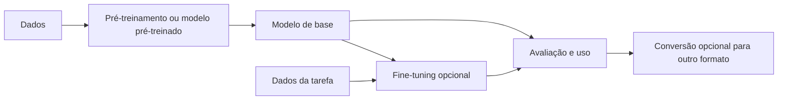

# Pré-treinamento e fine-tuning

Pré-treinamento e fine-tuning são estratégias de aprendizado que podem aparecer em momentos diferentes do desenvolvimento de um modelo. Nenhuma delas é obrigatória para todo problema: a escolha depende da tarefa, dos dados, dos recursos e dos modelos disponíveis.

## 1. Pré-treinamento

No pré-treinamento, um modelo aprende padrões a partir de dados amplos usando um objetivo definido. Em modelos de linguagem, um exemplo comum é prever tokens seguintes:

$$
\mathcal{L}_{\text{pre}}=-\frac{1}{N}\sum_{i=1}^{N}\log P(x_i\mid x_{<i}).
$$

Como os próprios dados fornecem os alvos, essa tarefa é chamada de **auto-supervisionada**. O modelo aprende regularidades estatísticas dos dados; isso não garante que adquira fatos corretos, raciocínio confiável ou conhecimento atualizado.

O resultado costuma ser um conjunto de pesos e metadados que pode servir como ponto de partida para outras tarefas. Pré-treinamento do zero pode exigir muitos dados e recursos, mas também é possível reutilizar modelos pré-treinados publicamente.

## 2. Fine-tuning

Fine-tuning adapta um modelo existente a uma tarefa, domínio, estilo ou formato de saída mais específico. O treinamento usa exemplos escolhidos para esse objetivo; em fine-tuning supervisionado, os exemplos contêm alvos ou respostas esperadas.

Há diferentes formas de ajustar um modelo:

- **Ajuste completo:** atualiza todos ou a maioria dos parâmetros.
- **PEFT:** atualiza um conjunto menor de parâmetros, por exemplo adaptadores ou módulos de baixa ordem como LoRA.
- **Congelamento parcial:** mantém alguns componentes fixos e treina outros.

Não é obrigatório congelar o modelo-base nem usar LoRA. A escolha envolve qualidade, memória, custo e compatibilidade com as ferramentas de inferência.

Em tarefas conversacionais, a perda pode ser calculada apenas sobre a resposta, ou sobre outras partes da sequência, conforme o objetivo e as máscaras usadas. O formato dos dados e o tokenizador precisam corresponder ao modelo.

## 3. Como as etapas se relacionam

O fine-tuning pode partir de um modelo pré-treinado, mas nem todo sistema precisa treinar do zero ou fazer fine-tuning. Conversão, quantização e implantação são etapas separadas e opcionais, definidas pelo runtime pretendido.

## 4. Diferenças principais

| Aspecto | Pré-treinamento | Fine-tuning |
|---|---|---|
| Objetivo | Aprender regularidades gerais ou representações úteis | Adaptar o modelo a uma tarefa ou distribuição específica |
| Dados | Normalmente amplos e diversos | Normalmente mais direcionados |
| Alvos | Podem ser derivados dos próprios dados | Podem ser rótulos, respostas ou objetivos especializados |
| Parâmetros atualizados | Depende do método | Ajuste completo, PEFT ou ajuste parcial |
| Custo | Varia; treinar do zero pode ser caro | Depende do modelo, dados e método |

Não há escala universal de duração, tamanho de dados ou qualidade. As necessidades dependem do modelo, da tarefa e da avaliação.

## 5. Avaliação

Use dados de validação que não tenham guiado diretamente as atualizações. Em tarefas de linguagem, perda e perplexidade podem ser úteis; em outras tarefas, escolha métricas apropriadas, como precisão, recall, F1 ou erro numérico.

Além de métricas agregadas, examine exemplos qualitativos, erros, subgrupos e casos fora da distribuição de treinamento. Um valor menor de perda não garante que o comportamento desejado tenha sido aprendido.

## 6. Formatos e implantação

O checkpoint usado para continuar treinamento pode conter pesos, estado do otimizador e outros dados. Para inferência, pode ser necessário converter ou quantizar os pesos em um formato aceito pelo runtime. Esses formatos não são intercambiáveis, e o runtime precisa oferecer suporte à arquitetura e aos tensores do modelo.

Se um modelo usa adaptadores, verifique se o runtime pode carregá-los diretamente ou se é necessário fundi-los aos pesos-base. Valide a qualidade após qualquer fusão ou quantização.

## Erros comuns

- Tratar pré-treinamento, fine-tuning e implantação como etapas obrigatórias para todo modelo.
- Presumir que fine-tuning sempre congela o modelo-base ou usa LoRA.
- Misturar tokenizadores ou formatos de conversa incompatíveis.
- Medir a qualidade apenas nos dados de treino.
- Presumir que um formato de inferência preserve o estado necessário para retomar o treinamento.
- Quantizar ou converter sem avaliar o modelo resultante.

## Resumo

- Pré-treinamento aprende a partir de dados amplos; fine-tuning adapta um modelo a objetivos mais específicos.
- Fine-tuning pode atualizar todos os parâmetros, parte deles ou adaptadores adicionais.
- A avaliação precisa refletir a tarefa e usar dados separados do treinamento.
- Conversão, quantização e implantação são escolhas distintas do processo de aprendizado.
