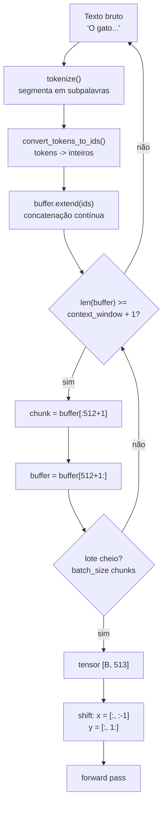

# Preprocessamento e tokenização


## Intuição: por que precisamos de números

Pense no que um computador faz com a palavra `"gato"`. Para você, é um animal. Para a CPU/GPU, é uma sequência de bytes. Mas mesmo os bytes não servem diretamente: uma rede neural é uma pilha de multiplicações de matrizes, e matrizes só aceitam números.

A solução é construir um **dicionário finito** — o vocabulário — onde cada pedaço reconhecível de texto recebe um índice inteiro único. Tokenizar é o ato de consultar esse dicionário: `"gato"` vira, digamos, o inteiro `1234`. O modelo então trabalha com `1234`, que depois é convertido em um vetor denso pela camada de embedding.

> A regra de ouro: **o modelo só entende os números que o tokenizer sabe produzir**. Um token que não está no vocabulário simplesmente não existe para o modelo. Toda a inteligência do modelo sobre linguagem está condicionada a essa ponte.

## Conceito: o que é um token, afinal?

Um token é a **unidade atômica de processamento** do modelo. Ele pode ser:

| Tipo | Exemplo | Comentário |
|---|---|---|
| Palavra inteira | `gato` → `1234` | Comum em palavras frequentes |
| Subpalavra | `impossível` → `im` + `possível` | Divide palavras raras |
| Caractere | `ç` → `123` | Fallback para símbolos isolados |
| Pontuação | `!` → `27` | Tokens próprios |
| Token especial | `<pad>` → `0` | Papel estrutural, sem significado léxico |

A escolha de dividir palavras em subpalavras é o coração da tokenização moderna. Ela resolve o dilema do vocabulário: se usássemos palavras inteiras, o vocabulário explodiria (milhões de palavras em inglês, sem contar flexões, erros de digitação e neologismos); se usássemos letras, o vocabulário seria minúsculo mas as sequências ficariam gigantes (cada palavra de 8 letras vira 8 tokens). As subpalavras ficam no meio: um vocabulário de dezenas de milhares de pedaços que conseguem montar qualquer palavra.

## Do texto aos ids: `encode`

A operação fundamental é o `encode`, que transforma uma string em uma lista de inteiros:

```python
ids = tokenizer.encode("o gato come peixe", add_special_tokens=False)
# ids = [3, 2690, 188, 1546, ...]   (valores ilustrativos)
```

O parâmetro `add_special_tokens` controla se tokens como `<pad>` ou `</s>` (fim de sequência) são adicionados automaticamente:

```python
tokenizer.encode("oi", add_special_tokens=True)   # [3, 85, 1]  -> inclui </s>
tokenizer.encode("oi", add_special_tokens=False)  # [3, 85]     -> só o texto
```


### Como o `encode` funciona por dentro

Internamente, o `encode` passa por duas fases:

1. **Tokenização (segmentação)**: o texto é quebrado em tokens de subpalavra segundo o algoritmo do tokenizer.
2. **Conversão em ids**: cada token é consultado no dicionário, produzindo o inteiro correspondente.

Podemos ver as duas fases separadamente:

```python
tokens = tokenizer.tokenize("impossível")
# ['▁im', 'possível']        (o "▁" marca o início de palavra)
ids = tokenizer.convert_tokens_to_ids(tokens)
# [12, 9456]
```

A fase de segmentação é determinística: o mesmo texto sempre produz a mesma sequência. É por isso que o modelo pode "aprender" a representação de um token específico — o token `9456` sempre significará o mesmo pedaço de texto.

## Dos ids de volta ao texto: `decode`

A operação inversa reconstrói o texto a partir dos ids:

```python
text = tokenizer.decode([3, 2690, 188, 1546])
# "o gato come peixe"
```


```python
context_tokens = x[-1, -context_length:].tolist()
context_text = tokenizer.decode(context_tokens)
```

E cada previsão Top-5 também:

```python
top5_words = [
    f"{tokenizer.decode([idx.item()])} ({prob.item() * 100:.2f}%)"
    for idx, prob in zip(top5_pred_indices, top5_probs)
]
```

> `encode` e `decode` não são perfeitamente inversos: o `decode` pode produzir uma string ligeiramente diferente do original (espaços antes de pontuação, por exemplo), porque a informação sobre o espaçamento original nem sempre é preservada com exatidão.

## Tokens especiais

Todo tokenizer reserva alguns ids para papéis estruturais. No `t5-small`, os principais são:

| Token | Id | Papel |
|---|---|---|
| `<pad>` | `0` | Preenchimento: iguala o tamanho das sequências em um lote |
| `</s>` (EOS) | `1` | Fim de sequência: marca onde o texto termina |
| `<unk>` | `2` | Desconhecido: qualquer símbolo fora do vocabulário |
| `<extra_id_0>` … `<extra_id_99>` | `32000` … `32099` | Sentinels usados no pré-treino do T5 (denoising) |


```python
pad_token_id = tokenizer.pad_token_id   # 0
criterion = nn.CrossEntropyLoss(ignore_index=pad_token_id)
```

Isso significa: quando o alvo de uma posição é `<pad>` (id 0), aquela posição é ignorada no cálculo da perda. É uma proteção contra o modelo "aprender" a prever padding em vez de conteúdo.

## Padding: igualando o tamanho das sequências

Um lote é uma matriz retangular de ids. Para que várias sequências de tamanhos diferentes caibam na mesma matriz, as mais curtas são **preenchidas** com `<pad>` até atingirem o comprimento da maior:

```python
batch = tokenizer(
    ["oi", "este é um texto bem mais longo"],
    padding=True,               # preenche até o maior
    truncation=True,            # corta o que exceder
    max_length=512,
    return_tensors="pt",
)
```

O resultado é uma matriz `[2, 512]` onde a primeira linha tem alguns ids reais seguidos de muitos `0`s:

$$
\text{batch} =
\begin{bmatrix}
85 & 1 & 0 & 0 & \cdots & 0 \\
37 & 251 & 56 & 12 & \cdots & 1
\end{bmatrix}
$$


## Truncamento: cortando o que não cabe

O truncamento é o oposto do padding: sequências longas demais são cortadas no comprimento máximo. O tokenizer aceita um parâmetro `truncation` e uma `max_length`:

```python
ids = tokenizer.encode(texto_longo, truncation=True, max_length=512)
# garante len(ids) <= 512
```


## Chunks de contexto: o fatiamento em $L+1$

Para previsão do próximo token, use um comprimento de entrada $L$ e mantenha um token adicional como alvo da última posição.

```python
context_length = 512  # exemplo, não um valor universal

while len(buffer) >= context_length + 1:
    chunk = buffer[:context_length + 1]
    del buffer[:context_length + 1]
    batch_buffer.append(chunk)
```

Com `context_length = 512`, cada chunk tem **513** tokens. Por que o `+1`?

O modelo de linguagem é **causal e autoregressivo**: para prever o token da posição $t$, ele só pode usar os tokens $0 \dots t-1$. Se um chunk tem 513 tokens, ele oferece 512 posições de treino:

- Entrada: os 512 primeiros tokens (`batch[:, :-1]`).
- Alvo: os 512 últimos tokens (`batch[:, 1:]`).

Cada posição de entrada tem um alvo "logo à frente". O token extra (o 513º) é o alvo da última posição de entrada — sem ele, a última posição não teria resposta.

### Exemplo numérico de chunking

Suponha `context_length = 4` (para caber no papel) e que o stream produza a sequência de ids:

$$
[1, 2, 3, 4, 5, 6, 7, 8, 9, 10]
$$

O buffer cresce conforme o texto é tokenizado. Quando atinge 5 tokens, um chunk é emitido:

- Buffer após processar: `[1, 2, 3, 4, 5, 6, 7, 8, 9, 10]`
- Chunk 1: `[1, 2, 3, 4, 5]` → entrada `[1, 2, 3, 4]`, alvo `[2, 3, 4, 5]`
- Buffer restante: `[6, 7, 8, 9, 10]`
- Chunk 2: `[6, 7, 8, 9, 10]` → entrada `[6, 7, 8, 9]`, alvo `[7, 8, 9, 10]`

Esses chunks não respeitam automaticamente fronteiras de frase ou documento. Para pré-treino de texto concatenado isso pode ser uma escolha válida, mas considere inserir separadores de fim de documento ou preservar os limites quando a tarefa exigir.

### O buffer atravessa exemplos

O `buffer` pode ser preservado entre exemplos. Se um exemplo termina no meio de um chunk, o próximo pode continuar preenchendo-o, desde que a tarefa permita atravessar fronteiras e que separadores apropriados sejam tratados:

```python
for item in dataset:
    text = item.get("text", "")
    tokens = tokenizer_obj.encode(text, add_special_tokens=False)
    buffer.extend(tokens)   # acumula, não substitui
```

Isso maximiza o aproveitamento dos tokens: nenhum pedaço de texto é desperdiçado como "sobra".

## O caminho completo, etapa por etapa


```text
1. Texto bruto      "O cachorro persegue a bola vermelha pelo parque..."
2. Tokenização      ['▁O', '▁cachorro', '▁persegue', '▁a', '▁bola', ...]
3. Conversão        [12, 345, 2345, 67, 890, ...]
4. Buffer           acumula ids conforme as regras de fronteira escolhidas
5. Chunking         fatia em pedaços de L + 1
6. Lote             agrupa sequências de mesmo comprimento -> [B, L+1]
7. Shift            x = [:, :-1], y = [:, 1:]
8. Tensor GPU       torch.tensor(lote, dtype=torch.long)
```

Cada etapa é barata e determinística, e o custo total é uma fração do custo do forward/backward.

## Código completo: mini-pipeline de preprocessamento

```python
import torch
from transformers import AutoTokenizer

tokenizer = AutoTokenizer.from_pretrained("identificador-do-tokenizador")

context_length = 512
batch_size = 2

textos = [
    "O gato persegue o rato pela casa inteira.",
    "A ciência de dados exige paciência e método.",
    "Machine learning transforma texto em números.",
]

buffer = []
batch_buffer = []

for texto in textos:
    ids = tokenizer.encode(texto, add_special_tokens=False)
    buffer.extend(ids)

    while len(buffer) >= context_length + 1:
        chunk = buffer[: context_length + 1]
        del buffer[: context_length + 1]
        batch_buffer.append(chunk)

        if len(batch_buffer) == batch_size:
            batch = torch.tensor(batch_buffer, dtype=torch.long)
            x = batch[:, :-1]   # [2, 512]  entradas
            y = batch[:, 1:]    # [2, 512]  alvos
            print("batch:", batch.shape, "x:", x.shape, "y:", y.shape)
            batch_buffer = []

# Exemplo de decode ida e volta
amostra = tokenizer.encode("o gato come peixe", add_special_tokens=False)
print("ids:", amostra)
print("decode:", tokenizer.decode(amostra))
```

## Tabela de shapes do preprocessamento

| Etapa | Representação | Formato |
|---|---|---|
| Texto bruto | string | — |
| Tokens | lista de strings de subpalavra | `[n_tokens]` |
| Ids | lista de inteiros | `[n_tokens]` |
| Buffer | lista acumulada de inteiros | variável |
| Chunk | fatia de ids | `[context_window + 1]` |
| Lote | matriz de ids | `[B, context_window + 1]` |
| Entrada `x` | shift esquerda | `[B, context_window]` |
| Alvo `y` | shift direita, achatado | `[B * context_window]` |

## Diagrama do fluxo de preprocessamento



## Erros comuns

- **Adicionar tokens especiais no gerador**: usar `add_special_tokens=True` no chunking insere `</s>` no meio do stream, quebrando a continuidade e ensinando o modelo a "terminar" onde não deveria.
- **Cortar em `context_window` sem o `+1`**: a última posição fica sem alvo, e o modelo perde sinal de treino.
- **Zerar o buffer entre exemplos**: descarta o texto que sobrou em cada exemplo, desperdiçando tokens e criando viés (os finais de exemplo nunca são treinados).
- **Ignorar o `ignore_index` do padding**: se o padding existir e não for ignorado, o modelo é penalizado por não "prever" `<pad>`.
- **Confundir `tokenize` com `encode`**: `tokenize` devolve strings de subpalavra; `encode` devolve ids. Alimentar o modelo com strings gera erro imediato.
- **Esquecer o `decode` ao apresentar previsões**: as saídas do modelo são IDs de tokens; convertê-las em texto exige o tokenizador correspondente.
- **Assumir que `decode` é o inverso perfeito de `encode`**: espaços e normalizações podem diferir levemente.

## Resumo

- Tokenização é a ponte entre texto e números: cada pedaço de texto vira um inteiro do vocabulário.
- `encode` converte texto em IDs; `decode` converte IDs de volta em texto usando o mesmo vocabulário.
- Tokens especiais: `<pad>` (0), `</s>` (1), `<unk>` (2) e os sentinels `<extra_id_N>` (32000+).
- Padding iguala sequências; truncamento corta as longas; o `ignore_index` protege a perda do padding.
- O `data_generator` corta o stream em chunks de `context_window + 1`, com o `+1` garantindo o alvo da última posição.
- O buffer atravessa exemplos, aproveitando 100% dos tokens sem desperdício.
- O shift `x = batch[:, :-1]`, `y = batch[:, 1:]` transforma cada chunk em pares de entrada/alvo.
