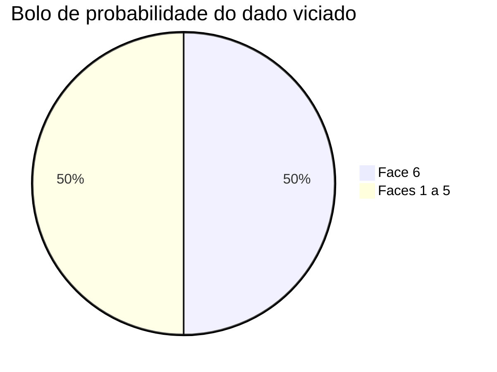
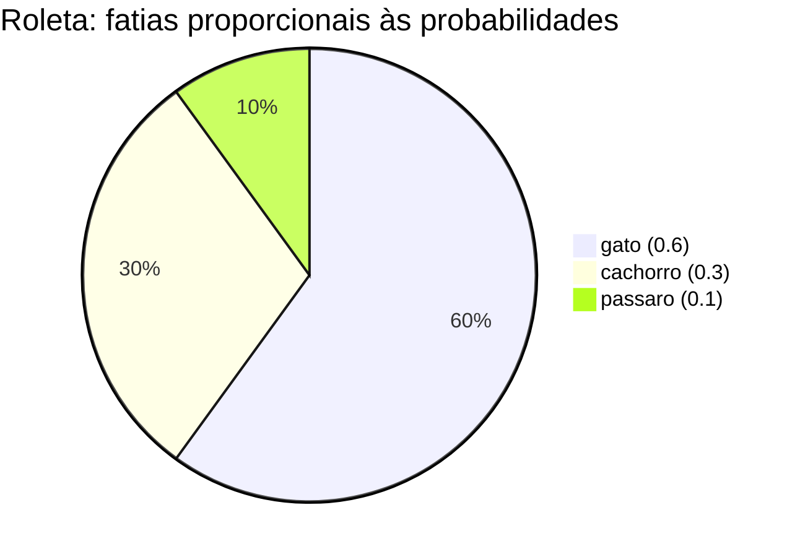

# Probabilidade para quem nunca viu

> "Probabilidade não é sobre o que vai acontecer. É sobre quanto você deveria acreditar em cada possibilidade, dado o que você já sabe."

Um modelo de linguagem atribui probabilidades a possíveis próximos tokens. A cada passo, ele considera o contexto e estima, por exemplo, "qual é a chance de o próximo token ser X?" A perda, a perplexidade e os métodos de amostragem são formas diferentes de examinar essas probabilidades. Este documento constrói o conceito desde o início.

## 1. A intuição: aposta justa e grau de crença

Imagine que você e um amigo apostam numa moeda. Se vocês querem que a aposta seja "justa" (nenhum dos dois sai perdendo na média), quanto cada um deve arriscar? A resposta depende de quão provável cada resultado é. Essa ideia de "medida de quanto acreditar" é exatamente a probabilidade.

Formalizamos com uma escala de $0$ a $1$:

- $0$ significa "impossível" (acontece nunca).
- $1$ significa "certo" (acontece sempre).
- $0.5$ significa "tão provável quanto o contrário" (moeda justa).
- $0.25$ significa "um quarto de certeza".

Uma forma concreta de sentir essa escala: se um evento tem probabilidade $p$, então, em um número muito grande de repetições, a fração de vezes em que ele ocorre tende a $p$. Esse é o ponto de vista **frequentista**. Há também o ponto de vista **bayesiano**, que trata probabilidade como grau de crença atualizável com evidência. Para treino de LLM, o frequentista costuma ser o mais direto para começar.

## 2. Espaço amostral: a lista de todos os futuros possíveis

Antes de falar de probabilidade, precisamos dizer *de quais resultados estamos falando*. O conjunto de todos os resultados possíveis de um experimento chama-se **espaço amostral**, geralmente denotado por $\Omega$ (a letra grega *ômega*).

### Exemplo 1: a moeda

Jogar uma moeda justa tem espaço amostral:

$$
\Omega = \{\text{cara}, \text{coroa}\}
$$

Cada resultado tem probabilidade $\frac{1}{2} = 0.5$.

### Exemplo 2: o dado

Jogar um dado de seis faces tem espaço amostral:

$$
\Omega = \{1, 2, 3, 4, 5, 6\}
$$

Para um dado honesto, cada face tem probabilidade $\frac{1}{6} \approx 0.1667$.

### Exemplo 3: o vocabulário de um LLM

Para um modelo de linguagem, o espaço amostral é o **vocabulário**: o conjunto de todos os tokens que o modelo conhece. Se o vocabulário tem $V = 50\,000$ tokens, então $\Omega$ tem $50\,000$ elementos, e o modelo atribui uma probabilidade a cada um deles a cada passo.

## 3. A regra de ouro: as probabilidades somam 1

Como o espaço amostral cobre *todos* os resultados possíveis, e um deles *tem* que acontecer, as probabilidades de todos os resultados somam exatamente $1$:

$$
\sum_{\omega \in \Omega} P(\omega) = 1
$$

Essa é a propriedade mais importante de todas. Ela diz que probabilidade é como um **bolo de tamanho 1** que precisa ser repartido inteiro entre todos os resultados possíveis. Se um resultado ganha mais bolo, outro precisa perder.

### Exemplo numérico

Um dado viciado tem as seguintes probabilidades para as faces $1$ a $6$:

$$
0.1,\ 0.1,\ 0.1,\ 0.1,\ 0.1,\ 0.5
$$

Confira a soma:

$$
0.1 + 0.1 + 0.1 + 0.1 + 0.1 + 0.5 = 1.0
$$

Faz sentido: a face $6$ tem chance de $0.5$ (metade do bolo), e as outras cinco dividem a outra metade igualmente.



## 4. Eventos: subconjuntos do espaço amostral

Um **evento** é qualquer conjunto de resultados. A probabilidade de um evento é a soma das probabilidades dos resultados que o compõem.

$$
P(A) = \sum_{\omega \in A} P(\omega)
$$

### Exemplo numérico

No dado honesto, qual a probabilidade de tirar um número **par**? O evento é $A = \{2, 4, 6\}$, e:

$$
P(A) = \frac{1}{6} + \frac{1}{6} + \frac{1}{6} = \frac{3}{6} = 0.5
$$

Para o dado viciado da seção anterior, o evento "par" seria $\{2, 4, 6\}$ com probabilidade $0.1 + 0.1 + 0.5 = 0.7$.

### Dois eventos úteis para modelos

- **Evento complementar**: "não A", denotado $\bar{A}$, tem probabilidade $P(\bar{A}) = 1 - P(A)$.
- **União de eventos disjuntos**: se $A$ e $B$ não podem acontecer juntos, $P(A \text{ ou } B) = P(A) + P(B)$.

## 5. A distribuição categórica

Quando o espaço amostral é um conjunto finito de categorias (como as faces de um dado, ou os tokens de um vocabulário), a distribuição de probabilidade sobre essas categorias chama-se **distribuição categórica**. Ela é inteiramente descrita por um vetor de números não negativos que somam $1$:

$$
\mathbf{p} = (p_1, p_2, \ldots, p_K), \quad p_i \ge 0, \quad \sum_{i=1}^{K} p_i = 1
$$

### Exemplo numérico

Um modelo precisa decidir entre três tokens: "gato", "cachorro" e "pássaro". Ele produz o vetor de probabilidades:

$$
\mathbf{p} = (0.6,\ 0.3,\ 0.1)
$$

Isso lê-se: $60\%$ de chance de "gato", $30\%$ de "cachorro", $10\%$ de "pássaro". Note que $0.6 + 0.3 + 0.1 = 1.0$.

### Como um modelo produz esse vetor (o softmax)

Um LLM não gera probabilidades diretamente. Ele gera números brutos chamados **logits** (um para cada token), que podem ser negativos ou maiores que $1$. Para transformá-los em uma distribuição categórica válida, aplica-se a função **softmax**:

$$
p_i = \frac{e^{z_i}}{\sum_{j=1}^{K} e^{z_j}}
$$

O numerador $e^{z_i}$ garante que todo $p_i$ seja positivo; o denominador $\sum_j e^{z_j}$ garante que tudo some $1$. (O papel do $e$ e do logaritmo é detalhado no documento sobre logaritmos e exponenciais.)

```python
import math

def softmax(logits):
    exp = [math.exp(z) for z in logits]
    soma = sum(exp)
    return [e / soma for e in exp]

logits = [2.0, 1.0, 0.1]
p = softmax(logits)
print(p)                    # [0.659, 0.242, 0.099]
print(sum(p))               # 1.0
```

Observe que o token com o maior logit ($2.0$) recebe a maior probabilidade ($\approx 0.659$).

## 6. Amostragem: sortear de acordo com as probabilidades

Saber as probabilidades é uma coisa; **escolher** um resultado é outra. Amostrar de uma distribuição categórica significa sortear um resultado de modo que, ao repetir o sorteio muitas vezes, cada categoria apareça com frequência igual à sua probabilidade.

### A intuição da roleta

Imagine uma roleta cujo círculo total vale $1$. Cada categoria recebe uma fatia proporcional à sua probabilidade. Girar a roleta e ver onde ela para é uma amostragem.



### Amostragem em Python

O jeito mais direto é `random.choices`, que recebe a lista de categorias, a lista de pesos e o número de amostras:

```python
import random

tokens = ["gato", "cachorro", "passaro"]
probs  = [0.6, 0.3, 0.1]

amostras = random.choices(tokens, weights=probs, k=1000)

from collections import Counter
contagem = Counter(amostras)
for tok in tokens:
    print(tok, contagem[tok] / 1000)
```

A saída típica é algo próximo de:

```text
gato 0.61
cachorro 0.30
passaro 0.09
```

As frequências se aproximam das probabilidades conforme $k$ cresce — quanto mais amostras, mais perto de $0.6$, $0.3$ e $0.1$ ficamos.

### Amostragem "manual" com acumulado

Para entender o que acontece por dentro, implementamos a roleta na mão usando o **prefixo acumulado**:

```python
def amostrar_categorica(categorias, probs):
    import random
    r = random.random()          # número uniforme em [0, 1)
    acumulado = 0.0
    for cat, p in zip(categorias, probs):
        acumulado += p
        if r < acumulado:
            return cat
    return categorias[-1]

# Teste com a distribuição do exemplo
for _ in range(5):
    print(amostrar_categorica(tokens, probs))
```

A lógica é: sorteamos um ponto $r$ no intervalo $[0, 1)$, e caminhamos pelas fatias somando probabilidades até ultrapassar $r$. A fatia onde isso acontece é a escolhida.

## 7. Log-probabilidades: somar em vez de multiplicar

Quando encadeamos eventos independentes, a probabilidade conjunta é o **produto** das probabilidades individuais:

$$
P(A \text{ e } B) = P(A) \cdot P(B)
$$

Para uma frase inteira de $T$ tokens, a probabilidade é:

$$
P(\text{frase}) = p_1 \cdot p_2 \cdots p_T = \prod_{t=1}^{T} p_t
$$

Aqui mora um problema prático: cada $p_t$ está entre $0$ e $1$, então multiplicar milhares deles faz o produto despencar para $0$ — o *underflow* que discutimos no documento sobre números no computador.

A solução é aplicar o logaritmo, que transforma produto em soma:

$$
\log\left(\prod_{t=1}^{T} p_t\right) = \sum_{t=1}^{T} \log p_t
$$

Como cada $p_t \le 1$, temos $\log p_t \le 0$, então os **log-probabilidades são números não positivos**. Em vez de um produto que tende a $0$, somamos termos negativos de magnitude moderada — muito mais estável numericamente.

### Exemplo numérico

Suponha uma frase de $3$ tokens com probabilidades $p = (0.5, 0.2, 0.1)$.

- Produto direto: $0.5 \times 0.2 \times 0.1 = 0.01$.
- Via log (base $e$): $\ln 0.5 \approx -0.693$, $\ln 0.2 \approx -1.609$, $\ln 0.1 \approx -2.303$.
- Soma: $-0.693 - 1.609 - 2.303 = -4.605$.
- Recuperando: $e^{-4.605} \approx 0.01$. Bate.

Trabalhar com $-4.605$ é muito mais seguro do que trabalhar com números que colapsam para $0$ após algumas centenas de multiplicações.

```python
import math
p = [0.5, 0.2, 0.1]

produto = 1.0
for x in p:
    produto *= x
print("produto:", produto)              # 0.01

log_produto = sum(math.log(x) for x in p)
print("log-produto:", log_produto)      # -4.605
print("exp(log-produto):", math.exp(log_produto))  # 0.01
```

## 9. Erros comuns

- **Esquecer que as probabilidades devem somar 1**: qualquer função que produza números usados como probabilidades precisa ser normalizada (por isso o softmax tem denominador).
- **Comparar logits diretamente como se fossem probabilidades**: logits podem ser negativos ou maiores que $1$; só depois do softmax viram uma distribuição válida.
- **Multiplicar probabilidades em vez de somar logs**: leva a underflow rápido em frases longas.
- **Confundir "mais provável" com "sempre escolhido"**: amostrar significa que mesmo o segundo mais provável pode ser sorteado; é isso que dá variedade ao texto gerado.
- **Usar probabilidade zero para algo que pode acontecer**: um $p_i = 0$ torna o log-probabilidade $-\infty$; na prática adicionamos um pequeno $\epsilon$ (suavização) para evitar isso.
- **Achar que mais amostras contradizem a teoria**: flutuações são esperadas; só convergem para as probabilidades reais quando $k \to \infty$.

## 10. Resumo

- Probabilidade é uma medida em $[0, 1]$ do grau de crença em cada resultado.
- O espaço amostral $\Omega$ lista todos os resultados; as probabilidades de todos eles somam $1$: $\sum_{\omega} P(\omega) = 1$.
- Um evento é um subconjunto, e sua probabilidade é a soma das probabilidades de seus elementos.
- A distribuição categórica é um vetor $\mathbf{p}$ não negativo que soma $1$; é exatamente o que o softmax produz a partir dos logits.
- Amostrar é sortear de acordo com $\mathbf{p}$; `random.choices` faz isso via pesos, e a roleta acumulada mostra o mecanismo interno.
- Log-probabilidades trocam produtos por somas, evitando underflow; cada termo é $\le 0$.
