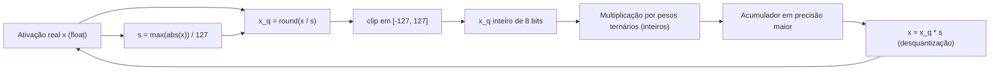

# Quantização de ativações (8 bits)

> "Pesos ternários economizam memória e aceleram a multiplicação. Mas as ativações também são tensores que viajam por toda a rede — quantizá-las para 8 bits multiplica esses ganhos, com um custo pequeno de precisão."


---

## 1. Intuição: o que são "ativações" e por que quantizá-las?

Em uma rede neural, **ativação** é qualquer tensor intermediário que flui entre camadas. Se os pesos são ternários (valores $\{-1, 0, +1\}$) mas as ativações continuam em `float32` ou `bfloat16`, parte do ganho de eficiência se perde: a multiplicação matriz-vetor ainda precisa ler e operar números de ponto flutuante de 16 ou 32 bits para as ativações.

Quantizar ativações para 8 bits significa mapear cada valor de ativação para um inteiro de 8 bits, geralmente **sinalizado** (com sinal), cobrindo o intervalo:

$$
[-128, 127] \quad \text{(256 valores possíveis)}
$$

ou, de forma simétrica e muito comum em hardware, o intervalo:

$$
[-127, 127] \quad \text{(255 valores possíveis, evitando a assimetria)}
$$

Com isso:

- A memória de ativação cai por um fator de 4 (de `float32`) ou 2 (de `bfloat16`).
- A multiplicação por pesos ternários pode ser feita inteiramente em aritmética inteira, extremamente rápida.
- O pipeline de inferência e treino fica mais amigável a aceleradores.

A ideia central da quantização de ativações é simples: **achar uma escala $s$ que converta um número real em um inteiro de 8 bits e vice-versa**.

---

## 2. Conceito: quantização por escala de tensor

### 2.1 A fórmula básica

Dado um tensor de ativações $x$ (real), a versão quantizada inteira $x_q$ é obtida por:

$$
x_q = \text{round}\left(\frac{x}{s}\right), \quad \text{com clip em } [-127, 127]
$$

onde $s$ é a **escala do tensor** (um único número real para todo o tensor). A desquantização (voltar para o domínio real) é:

$$
x \approx x_q \cdot s
$$

A escala é calculada a partir do **máximo valor absoluto** do tensor:

$$
s = \frac{\max(|x|)}{127}
$$

Assim, o valor máximo absoluto de $x$ cai exatamente em $127$ (ou perto disso), e todos os demais valores são distribuídos proporcionalmente.

### 2.2 Por que "escala por tensor" e não por canal?

Existem duas granularidades comuns:

| Granularidade | Descrição | Custo | Precisão |
|---|---|---|---|
| Por tensor | uma escala $s$ para o tensor inteiro | mínimo | menor |
| Por canal | uma escala $s_i$ por linha/coluna | maior | maior |


### 2.3 Quantização simétrica vs. assimétrica

- **Assimétrica**: usa um ponto zero (offset) além da escala, cobrindo intervalos como $[0, 255]$. Útil quando as ativações têm distribuição deslocada (ex.: após uma ReLU), mas adiciona um parâmetro extra.


---

## 3. Diagrama de fluxo

O diagrama abaixo mostra o ciclo de vida de uma ativação quantizada em 8 bits:



Note o detalhe crucial: a **multiplicação em si** acontece no domínio inteiro (`x_q` por pesos ternários). A escala só entra no início (quantização) e no fim (desquantização), mantendo o grosso do cálculo em aritmética inteira.

---

## 4. Matemática com exemplos numéricos resolvidos

### 4.1 Exemplo completo do zero

Considere o seguinte vetor de ativações:

$$
x = [0.0,\; 0.5,\; -1.0,\; 2.5,\; -3.2]
$$

**Passo 1 — máximo absoluto:**

$$
\max(|x|) = 3.2
$$

**Passo 2 — escala:**

$$
s = \frac{3.2}{127} \approx 0.02520
$$

**Passo 3 — quantização:**

$$
x_q = \text{round}\left(\frac{x}{0.02520}\right)
$$

| $x$ | $x / s$ | $\text{round}$ | $x_q$ |
|---|---|---|---|
| 0.0 | 0.00 | 0 | 0 |
| 0.5 | 19.84 | 20 | 20 |
| -1.0 | -39.68 | -40 | -40 |
| 2.5 | 99.21 | 99 | 99 |
| -3.2 | -127.00 | -127 | -127 |

**Passo 4 — desquantização (aproximação recuperada):**

$$
x \approx x_q \cdot s
$$

| $x_q$ | $x_q \cdot s$ | Original | Erro |
|---|---|---|---|
| 0 | 0.0000 | 0.0 | 0.0000 |
| 20 | 0.5040 | 0.5 | 0.0040 |
| -40 | -1.0080 | -1.0 | 0.0080 |
| 99 | 2.4948 | 2.5 | 0.0052 |
| -127 | -3.2000 | -3.2 | 0.0000 |

O erro máximo de quantização é metade do passo de quantização $s$:

$$
\text{erro}_{\max} \le \frac{s}{2} = \frac{0.02520}{2} \approx 0.0126
$$

Isso é o **erro de arredondamento** inerente: cada valor real é representado com resolução $s$.

### 4.2 A importância do clipping

O clipping em $\pm 127$ evita estouro. Considere um tensor com um outlier:

$$
x = [1.0,\; 1.2,\; 0.8,\; 50.0]
$$

Se a escala fosse calculada apenas pela maioria dos valores (sem considerar o outlier), o outlier estouraria o intervalo de 8 bits. Por isso, a escala é calculada pelo **máximo absoluto** do tensor inteiro:

$$
s = \frac{50.0}{127} \approx 0.3937
$$

Os valores pequenos ($1.0$, $1.2$, $0.8$) ficam comprimidos em valores inteiros pequenos ($\approx 2$ a $3$), e o outlier ocupa $127$. Esse é o **custo** da quantização por tensor: um único outlier "dilata" a escala e degrada a resolução dos demais valores. Em redes com RMSNorm, esse problema é mitigado porque a normalização mantém a magnitude dos tensores controlada.

### 4.3 O intervalo $[-128, 127]$ vs. $[-127, 127]$

O tipo `int8` cobre $[-128, 127]$, ou seja, 256 valores. A versão simétrica $[-127, 127]$ abre mão do valor $-128$ para manter a simetria perfeita em torno do zero. Isso é útil porque:

- O zero real mapeia exatamente para o zero inteiro (não há offset).
- O intervalo positivo e negativo têm o mesmo número de níveis.

Em termos de escala:

$$
s_{\text{simétrica}} = \frac{\max(|x|)}{127}
$$

Na prática, a diferença de resolução entre as duas convenções é mínima (um nível em 256), e a simetria simplifica enormemente a implementação.

---

## 5. O efeito no treino

### 5.1 Quantização é uma operação não-diferenciável

Assim como nos pesos, a quantização das ativações usa `round`, que tem derivada nula quase em toda parte. Para que o gradiente continue fluindo durante o treino, aplica-se o **Straight-Through Estimator (STE)** também nas ativações — exatamente a técnica descrita no documento sobre STE.

A diferença é que, enquanto a escala dos pesos ($\alpha$) é uma média de módulo aprendida, a escala das ativações ($s$) é computada dinamicamente a cada forward a partir do máximo absoluto do tensor de entrada.

### 5.2 Ruído de quantização como regularizador

Um efeito interessante: o erro de quantização introduz um **ruído** nos valores de ativação. Esse ruído, de certa forma, atua como um regularizador, ajudando a rede a ser robusta a pequenas perturbações. Isso é um dos motivos pelos quais quantização agressiva, bem feita, não degrada drasticamente a qualidade — e às vezes até ajuda na generalização.

### 5.3 Acumulador em precisão maior

Um ponto fundamental: a multiplicação inteira $x_q \cdot w_q$ pode acumular em um tipo de precisão maior (por exemplo, `int32`) antes de desquantizar. Isso evita estouro do acumulador quando a camada tem muitas entradas:

$$
y_q = \sum_{i} x_{q,i} \cdot w_{q,i} \quad (\text{em } \text{int32})
$$

Depois, a desquantização resgata a escala correta:

$$
y = y_q \cdot s_x \cdot \alpha
$$

onde $\alpha$ é a escala dos pesos ternários e $s_x$ a escala das ativações.

---

## 6. Implementação em Python

### 6.1 Quantização simétrica de um tensor

```python
import torch

def quantize_activations(x: torch.Tensor, num_bits: int = 8) -> tuple[torch.Tensor, float]:
    qmax = 2 ** (num_bits - 1) - 1          # 127 para 8 bits

    # Escala por tensor: máximo absoluto
    scale = x.abs().max() / qmax
    scale = scale.clamp(min=1e-5)           # evita divisão por zero

    # Quantização simétrica com clip
    x_q = torch.round(x / scale).clamp(-qmax, qmax)

    return x_q, float(scale)


def dequantize_activations(x_q: torch.Tensor, scale: float) -> torch.Tensor:
    return x_q * scale
```

### 6.2 Aplicando o STE nas ativações (para treino)

Para treinar com ativações quantizadas, o forward usa o valor inteiro e o backward passa o gradiente reto:

```python
def quantize_with_ste(x: torch.Tensor, num_bits: int = 8) -> tuple[torch.Tensor, torch.Tensor]:
    qmax = 2 ** (num_bits - 1) - 1

    scale = x.abs().max().detach() / qmax
    scale = scale.clamp(min=1e-5)

    x_scaled = x / scale
    x_quantized = torch.round(x_scaled).clamp(-qmax, qmax)

    # STE: forward exato (quantizado), backward identidade
    x_ste = (x_quantized - x_scaled).detach() + x_scaled

    return x_ste, scale
```

Nesse exemplo, a escala é **detachada** (`x.abs().max().detach()`), porque o máximo absoluto é uma função quase constante por partes — não faz sentido propagar gradiente por ele (diferente da média usada nos pesos, onde a dependência é suave).

### 6.3 Exemplo numérico completo em código

```python
x = torch.tensor([0.0, 0.5, -1.0, 2.5, -3.2])

x_q, s = quantize_activations(x, num_bits=8)
x_rec = dequantize_activations(x_q, s)

print("Escala s =", round(s, 5))
print("x_q    =", x_q.int().tolist())
print("x_rec  =", [round(v, 4) for v in x_rec.tolist()])
print("Erro   =", [round(abs(a - b), 4) for a, b in zip(x.tolist(), x_rec.tolist())])
```

Saída esperada (aproximada):

```text
Escala s = 0.0252
x_q    = [0, 20, -40, 99, -127]
x_rec  = [0.0, 0.504, -1.008, 2.4948, -3.2]
Erro   = [0.0, 0.004, 0.008, 0.0052, 0.0]
```

### 6.4 Quantização de uma camada inteira com pesos ternários

Combinando ativações de 8 bits com pesos ternários, o fluxo da multiplicação fica:

```python
def ternary_linear_with_quantized_activations(x: torch.Tensor, weight: torch.Tensor) -> torch.Tensor:
    # 1. Quantiza as ativações para 8 bits (com STE, se em treino)
    x_q, s_x = quantize_with_ste(x, num_bits=8)

    # 2. Escala e quantiza os pesos para {-1, 0, +1} (com STE)
    alpha = weight.abs().mean().clamp(min=1e-5)
    w_scaled = weight / alpha
    w_q = torch.round(w_scaled).clamp(-1, 1)
    w_ste = (w_q - w_scaled).detach() + w_scaled

    # 3. Multiplicação (idealmente em inteiros; aqui simulada em float)
    y = torch.matmul(x_q, w_ste.t())

    # 4. Desquantização: aplica as escalas de ativação e de peso
    y = y * s_x * alpha

    return y
```

O ponto pedagógico: no hardware real, `torch.matmul(x_q, w_ste.t())` seria substituído por uma multiplicação inteira sobre `x_q` (int8) e os pesos ternários (2 bits), acumulada em `int32`. As escalas $s_x$ e $\alpha$ entram apenas nas bordas.

---

## 7. Pseudocódigo do algoritmo

```text
FUNÇÃO quantizar_ativacoes(x, bits=8):
    qmax     <- 2^(bits-1) - 1              # 127
    max_abs  <- máximo(|x|)
    s        <- max_abs / qmax, com mínimo 1e-5
    x_q      <- round(x / s), clip em [-qmax, qmax]
    RETORNAR x_q, s
FIM-FUNÇÃO

FUNÇÃO camada_ternaria_quantizada(x, W):
    x_q, s_x <- quantizar_ativacoes(x)       # ativações 8 bits
    alpha    <- média(|W|), com mínimo 1e-5  # escala dos pesos
    w_q      <- round(W / alpha), clip em [-1, 1]
    y_q      <- x_q × w_q^T                  # em inteiro, acumulador int32
    y        <- y_q × s_x × alpha            # desquantização
    RETORNAR y
FIM-FUNÇÃO
```

---

## 9. Erros comuns e armadilhas

### 9.1 Esquecer o clamp

Sem o `clamp(-127, 127)`, um valor reescalado maior que 127 (por erro numérico ou outlier) estoura o `int8`, produzindo resultados absurdos (wrap-around). O clip deve sempre acompanhar o `round`.

### 9.2 Escala zero

Se o tensor de ativação for todo zero, $\max(|x|) = 0$ e a divisão `x / scale` explode. Por isso usa-se `scale.clamp(min=1e-5)` (ou um mínimo configurável).

### 9.3 Confundir granularidade da escala

Usar uma escala global única para todo o modelo (em vez de por tensor) degrada muito a precisão, porque camadas diferentes têm magnitudes diferentes. A escala deve ser **por tensor de ativação**.

### 9.4 Não usar acumulador de precisão maior

Acumular a multiplicação inteira em `int8` pode estourar rapidamente em camadas com milhares de entradas. O acumulador deve ser `int32` (ou `float32`) e a desquantização só ao final.

### 9.5 Propagar gradiente pela escala das ativações

A escala $s = \max(|x|)/127$ é não-suave (o `max` muda de forma abrupta). Propagá-la via STE pode injetar ruído espúrio no gradiente. O mais comum é detachar a escala das ativações e aplicar o STE apenas no caminho `round`.

### 9.6 Ignorar a distribuição das ativações


---

## 10. Resumo

| Conceito | Ideia central |
|---|---|
| Ativação | Tensor intermediário que flui entre camadas |
| Quantização 8 bits | Mapear real → inteiro de 8 bits, intervalo $[-127, 127]$ |
| Escala por tensor | $s = \max(\|x\|) / 127$ |
| Fórmula | $x_q = \text{round}(x/s)$, clip, $x \approx x_q \cdot s$ |
| Erro máximo | $\le s/2$ (metade do passo de quantização) |
| Treino | STE nas ativações, acumulador em precisão maior |


> "Pesos ternários cuidam da memória; ativações em 8 bits cuidam da velocidade. Juntas, elas transformam o modelo em um pipeline inteiro."
