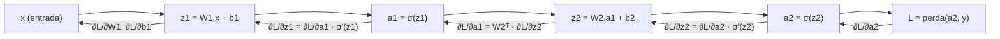

# A regra da cadeia aplicada a redes

## Intuição: o efeito dominó

Pense em uma linha de produção. A matéria-prima entra na primeira máquina, o resultado dela vai para a segunda, o da segunda para a terceira, e assim por diante. Se alguém perguntar "quanto a saída final muda se eu mexer na primeira máquina?", a resposta não é direta: a mudança se propaga **em cascata** por todas as máquinas intermediárias.

Uma rede neural é essa linha de produção. A entrada $x$ vira $z^{(1)} = W^{(1)} x + b^{(1)}$, que vira $a^{(1)} = \sigma(z^{(1)})$, que vira $z^{(2)}$, e assim por diante até a perda $L$. Para saber como ajustar os pesos da **primeira** camada, precisamos entender como a perda reage a mudanças nesses pesos — e essa influência passa por **todas** as camadas seguintes.

> A regra da cadeia é a ferramenta que propaga a influência de uma variável por uma cadeia de funções compostas. Ela é o motor matemático do backpropagation.

## Conceito: composição de funções

Quando o resultado de uma função alimenta outra, temos uma **composição**. Se $y = g(x)$ e $z = f(y)$, então $z = f(g(x))$ é a composição. A pergunta é: quanto $z$ muda quando $x$ muda?

A regra da cadeia em uma variável responde:

$$
\frac{dz}{dx} = \frac{dz}{dy} \cdot \frac{dy}{dx}
$$

Em palavras: a derivada da composição é a **derivada de fora vezes a derivada de dentro**. "Fora" é $f$ (avaliada em $g(x)$) e "dentro" é $g$.

### Exemplo numérico simples

Seja $z = f(y) = y^3$ e $y = g(x) = 2x + 1$. Então:

- $\frac{dz}{dy} = 3y^2$
- $\frac{dy}{dx} = 2$

Logo:

$$
\frac{dz}{dx} = 3y^2 \cdot 2 = 6y^2 = 6(2x+1)^2
$$

Verificando pela composição direta: $z = (2x+1)^3$, e $\frac{dz}{dx} = 3(2x+1)^2 \cdot 2 = 6(2x+1)^2$. Confere.

**Com números.** Em $x = 1$: $y = 3$, $\frac{dy}{dx} = 2$, $\frac{dz}{dy} = 3 \cdot 9 = 27$. Produto: $\frac{dz}{dx} = 27 \cdot 2 = 54$. Interpretação: um pequeno aumento em $x$ é amplificado por um fator 2 na passagem $x \to y$, e depois por um fator 27 na passagem $y \to z$, totalizando 54.

## Cadeias longas: multiplicar tudo

Para uma cadeia de várias funções $z = f_3(f_2(f_1(x)))$, a regra se estende:

$$
\frac{dz}{dx} = \frac{dz}{da} \cdot \frac{da}{db} \cdot \frac{db}{dx}
$$

onde $b = f_1(x)$, $a = f_2(b)$, $z = f_3(a)$. Cada elo da cadeia é uma derivada local, e o gradiente total é o **produto** de todos os elos.

### Exemplo em cascata com números

Considere:

- $b = f_1(x) = 3x$
- $a = f_2(b) = b^2$
- $z = f_3(a) = \frac{1}{2} a$

Com $x = 2$:

1. $b = 3 \cdot 2 = 6$.
2. $a = 6^2 = 36$.
3. $z = \frac{1}{2} \cdot 36 = 18$.

Agora as derivadas locais, de trás para frente:

| Elo | Derivada local | Valor no ponto |
|-----|----------------|----------------|
| $z \to a$ | $\frac{dz}{da} = \frac{1}{2}$ | $0{,}5$ |
| $a \to b$ | $\frac{da}{db} = 2b$ | $2 \cdot 6 = 12$ |
| $b \to x$ | $\frac{db}{dx} = 3$ | $3$ |

Produto (cascata de trás para frente):

$$
\frac{dz}{dx} = \frac{1}{2} \cdot 12 \cdot 3 = 18
$$

Verificação direta: $z = \frac{1}{2}(3x)^2 = \frac{9}{2} x^2$, logo $\frac{dz}{dx} = 9x = 18$ em $x = 2$. Confere.

## Regra da cadeia em várias variáveis (multivariada)

Em redes, cada camada tem **muitos** neurônios, então a influência de um valor pode se espalhar por vários caminhos. A versão multivariada soma as contribuições por todos os caminhos. Se $z$ depende de $y_1, y_2$ e cada $y_i$ depende de $x$:

$$
\frac{dz}{dx} = \frac{\partial z}{\partial y_1} \cdot \frac{dy_1}{dx} + \frac{\partial z}{\partial y_2} \cdot \frac{dy_2}{dx}
$$

A ideia: a influência de $x$ sobre $z$ flui por $y_1$ **e** por $y_2$, então somamos os dois caminhos.

### Exemplo numérico multivariado

Seja $y_1 = 2x$, $y_2 = x^2$, e $z = y_1 + 3y_2$.

- $\frac{\partial z}{\partial y_1} = 1$, $\frac{dy_1}{dx} = 2$.
- $\frac{\partial z}{\partial y_2} = 3$, $\frac{dy_2}{dx} = 2x$.

$$
\frac{dz}{dx} = 1 \cdot 2 + 3 \cdot 2x = 2 + 6x
$$

Em $x = 1$: $\frac{dz}{dx} = 2 + 6 = 8$. Verificação: $z = 2x + 3x^2$, $\frac{dz}{dx} = 2 + 6x$. Confere.

## Backpropagation intuitivo

Backpropagation é simplesmente a regra da cadeia aplicada ao grafo computacional da rede, calculada de forma **eficiente**.

A rede processa em duas fases:

1. **Forward pass (ida).** Calculamos cada ativação da esquerda para a direita e guardamos os valores intermediários (os $z^{(l)}$ e $a^{(l)}$). Isso é necessário porque as derivadas locais dependem desses valores.

2. **Backward pass (volta).** Começamos do final (da perda $L$) e voltamos, calculando o gradiente em relação a cada variável usando a regra da cadeia. Guardamos os gradientes já calculados para não recomputar — é isso que torna o processo eficiente (uma única passada de trás para frente).

A regra de ouro no backward: **o gradiente que chega em um nó é multiplicado pela derivada local desse nó**, e o resultado é distribuído para as entradas do nó.

### Diagrama do fluxo backward



As setas para a direita são o forward; as setas para a esquerda (com rótulos) são o backward, carregando gradientes.

## Exemplo com uma rede de 2 camadas

Vamos resolver uma rede mínima na mão. Considere:

- Entrada: $x$ (escalar).
- Camada 1: $z_1 = w_1 x + b_1$, ativação $a_1 = \text{ReLU}(z_1)$.
- Camada 2: $z_2 = w_2 a_1 + b_2$, saída $a_2 = z_2$ (linear).
- Perda: $L = \frac{1}{2}(a_2 - y)^2$ (erro quadrático médio escalado).

A derivada da ReLU é $\text{ReLU}'(z) = 1$ se $z > 0$, e $0$ se $z \leq 0$.

**Forward com números.** Suponha $x = 1$, $w_1 = 2$, $b_1 = -1$, $w_2 = 3$, $b_2 = 0$, e alvo $y = 5$.

1. $z_1 = 2 \cdot 1 - 1 = 1$.
2. $a_1 = \text{ReLU}(1) = 1$.
3. $z_2 = 3 \cdot 1 + 0 = 3$.
4. $a_2 = 3$.
5. $L = \frac{1}{2}(3 - 5)^2 = \frac{1}{2} \cdot 4 = 2$.

**Backward, passo a passo (cascata):**

1. Da perda para a saída:
   $$
   \frac{\partial L}{\partial a_2} = (a_2 - y) = 3 - 5 = -2
   $$

2. Da saída para $z_2$ (a derivada da função linear é $1$):
   $$
   \frac{\partial L}{\partial z_2} = \frac{\partial L}{\partial a_2} \cdot 1 = -2
   $$

3. Gradientes dos parâmetros da camada 2 (como $z_2 = w_2 a_1 + b_2$):
   $$
   \frac{\partial L}{\partial w_2} = \frac{\partial L}{\partial z_2} \cdot a_1 = -2 \cdot 1 = -2
   $$
   $$
   \frac{\partial L}{\partial b_2} = \frac{\partial L}{\partial z_2} \cdot 1 = -2
   $$

4. Propagando para $a_1$ (o gradiente atravessa o peso $w_2$):
   $$
   \frac{\partial L}{\partial a_1} = \frac{\partial L}{\partial z_2} \cdot w_2 = -2 \cdot 3 = -6
   $$

5. Atravessando a ReLU (que estava ativa, pois $z_1 = 1 > 0$):
   $$
   \frac{\partial L}{\partial z_1} = \frac{\partial L}{\partial a_1} \cdot \text{ReLU}'(z_1) = -6 \cdot 1 = -6
   $$

6. Gradientes dos parâmetros da camada 1:
   $$
   \frac{\partial L}{\partial w_1} = \frac{\partial L}{\partial z_1} \cdot x = -6 \cdot 1 = -6
   $$
   $$
   \frac{\partial L}{\partial b_1} = \frac{\partial L}{\partial z_1} \cdot 1 = -6
   $$

**Resumo dos gradientes:** $\frac{\partial L}{\partial w_2} = -2$, $\frac{\partial L}{\partial b_2} = -2$, $\frac{\partial L}{\partial w_1} = -6$, $\frac{\partial L}{\partial b_1} = -6$.

**Um passo de gradiente descendente** com $\eta = 0{,}1$:

| Parâmetro | Antes | Gradiente | Depois ($- \eta g$) |
|-----------|-------|-----------|---------------------|
| $w_2$ | 3,0 | -2 | $3 - 0{,}1 \cdot (-2) = 3{,}2$ |
| $b_2$ | 0,0 | -2 | $0{,}2$ |
| $w_1$ | 2,0 | -6 | $2{,}6$ |
| $b_1$ | -1,0 | -6 | $-0{,}4$ |

Repare como o gradiente da camada 1 ($-6$) é **maior** que o da camada 2 ($-2$): a influência se acumulou ao atravessar a camada 2, que multiplicou por $w_2 = 3$. É o efeito dominó em ação.

## Produto de Jacobianas (intuição simples)

Para camadas vetoriais, as derivadas locais viram **matrizes Jacobianas**. A Jacobiana de uma função $f: \mathbb{R}^n \to \mathbb{R}^m$ é a matriz $m \times n$ de todas as derivadas parciais:

$$
J_{ij} = \frac{\partial f_i}{\partial x_j}
$$

O backprop de uma camada é essencialmente uma multiplicação matriz-vetor: o gradiente que chega $\nabla_z L$ (um vetor coluna) é transformado pela Jacobiana (transposta) da camada:

$$
\nabla_x L = J^T \, \nabla_z L
$$

**Intuição sem se assustar com matrizes:** a Jacobiana guarda "quanto cada saída depende de cada entrada". Multiplicar o gradiente por $J^T$ é exatamente a versão vetorial do "somar por todos os caminhos" da regra da cadeia multivariada. Cada entrada do vetor resultante soma as influências de todas as saídas que dependem daquela entrada.

Para uma camada linear $z = W x + b$, a Jacobiana de $z$ em relação a $x$ é a própria matriz $W$. Por isso, no backward, o gradiente em relação a $x$ é:

$$
\nabla_x L = W^T \, \nabla_z L
$$

Ou seja, o backprop de uma camada linear multiplica pela **transposta** da matriz de pesos — um dos fatos mais importantes da implementação de redes.

Para uma cadeia completa com camadas $f_1, f_2, \dots, f_k$ com Jacobianas $J_1, J_2, \dots, J_k$, o gradiente total é o produto (em ordem reversa):

$$
\nabla_x L = J_1^T J_2^T \cdots J_k^T \, \nabla_{out} L
$$

A ordem é invertida porque o backward começa da última camada e volta para a primeira.

## Código: regra da cadeia em autograd

Veja como o PyTorch aplica a regra da cadeia automaticamente em uma composição de funções:

```python
import torch

# Composição: z = f(g(x)), com f = y^3 e g = 2x + 1
x = torch.tensor(1.0, requires_grad=True)

y = 2 * x + 1        # g(x)
z = y ** 3           # f(y) = y^3

z.backward()         # aplica a regra da cadeia automaticamente

print("dz/dx =", x.grad.item())  # esperado: 54
```

O framework calcula internamente $\frac{dz}{dy} = 3y^2 = 27$ e $\frac{dy}{dx} = 2$, e multiplica: $27 \cdot 2 = 54$.

### Backprop manual de uma rede pequena

O mesmo exemplo de 2 camadas, implementado com autograd:

```python
import torch

torch.manual_seed(0)

x = torch.tensor(1.0)
y_alvo = torch.tensor(5.0)

w1 = torch.tensor(2.0, requires_grad=True)
b1 = torch.tensor(-1.0, requires_grad=True)
w2 = torch.tensor(3.0, requires_grad=True)
b2 = torch.tensor(0.0, requires_grad=True)

eta = 0.1

z1 = w1 * x + b1
a1 = torch.relu(z1)
z2 = w2 * a1 + b2
a2 = z2
L = 0.5 * (a2 - y_alvo) ** 2

L.backward()

print("dL/dw2 =", w2.grad.item())  # -2
print("dL/db2 =", b2.grad.item())  # -2
print("dL/dw1 =", w1.grad.item())  # -6
print("dL/db1 =", b1.grad.item())  # -6

with torch.no_grad():
    w2 -= eta * w2.grad
    b2 -= eta * b2.grad
    w1 -= eta * w1.grad
    b1 -= eta * b1.grad

print("w1, b1, w2, b2 =", w1.item(), b1.item(), w2.item(), b2.item())
```

Os gradientes impressos batem com os valores calculados à mão acima, confirmando que o autograd segue exatamente a regra da cadeia.

## Pseudocódigo do backprop

```text
entrada: grafo computacional, perda L
backward(L):
    grad[L] = 1                      # semente do gradiente
    para cada nó, em ordem reversa (do final para o início):
        grad_local = derivada do nó em relação às suas entradas
        para cada entrada e do nó:
            grad[e] += grad[nó] * grad_local[e]
    devolver grad em todos os parâmetros
```

O laço "em ordem reversa" garante que processamos cada nó depois de já conhecer o gradiente de sua saída — a essência da regra da cadeia computada de trás para frente.

## Erros comuns

- **Esquecer a derivada da função de ativação.** Ao propagar por um $\sigma$ ou ReLU, é obrigatório multiplicar por $\sigma'$ ou $\text{ReLU}'$. Esquecer isso zera ou distorce o gradiente.
- **Somar vs. multiplicar.** Na passagem por um único caminho, multiplica-se; quando vários caminhos convergem para uma variável, soma-se. Confundir as duas é um erro clássico.
- **Ordem errada no produto.** O backward multiplica as Jacobianas na ordem **reversa** da composição (da última para a primeira). Inverter essa ordem dá resultados errados.
- **Usar a derivada local avaliada no ponto errado.** A derivada $f'(y)$ deve ser avaliada em $y = g(x)$, não em $x$. Guardar os valores do forward evita esse erro.
- **Ignorar a transposta.** Para camadas lineares, o backward usa $W^T$. Esquecer de transpor troca dimensões e gera erros de shape.
- **Achar que backprop é algo novo.** É apenas a regra da cadeia aplicada de forma eficiente a um grafo — entender isso desmistifica o treinamento.

## Resumo

- A regra da cadeia decompõe a derivada de uma composição em um **produto de derivadas locais**.
- Na versão multivariada, quando há vários caminhos, **somam-se** as contribuições.
- Backpropagation é a regra da cadeia executada de trás para frente no grafo computacional.
- Camadas lineares propagam gradiente multiplicando pela **transposta** da matriz de pesos.
- Em cadeias longas, os gradientes são produtos de Jacobianas em ordem reversa.
