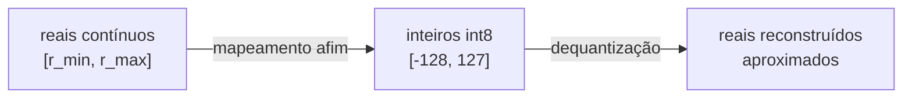
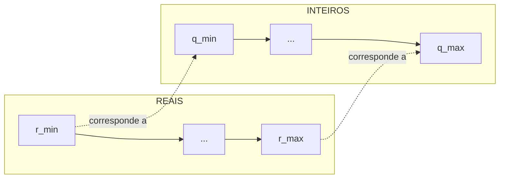
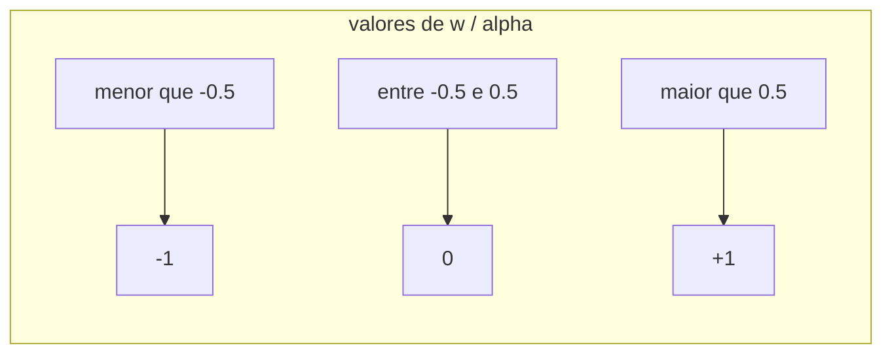

# Representação numérica para quantização

> "Quantizar não é outra coisa senão trocar uma régua contínua por uma escada com um número fixo de degraus — e guardar a distância entre os degraus num único lugar."

Antes de entender o BitLinear e o ternário, é preciso dominar um conceito mais fundamental: **o que significa quantizar um número**. Este documento parte da pergunta mais básica — como transformar um número real contínuo em um inteiro de poucos bits, e como desfazer essa transformação — e chega até os dois esquemas mais importantes da prática: a quantização **simétrica** e a **assimétrica**, com seus parâmetros de escala e de ponto zero. Tudo o que vem depois (int8, ternário, BitLinear) é um caso particular das ideias desenvolvidas aqui.

## 1. A intuição: uma régua com degraus

Pense em um termômetro analógico de mercúrio, com uma coluna contínua, e em um termômetro digital que só mostra valores inteiros. O analógico consegue distinguir $36.71$, $36.72$, $36.73$; o digital, com um dígito, só consegue mostrar $36$ ou $37$. Ao trocar o contínuo pelo discreto, o digital **arredonda** a temperatura real para o inteiro mais próximo.

Quantização numérica é exatamente isso, com duas decisões a tomar:

1. **Quantos degraus** vamos usar? (o número de níveis, controlado pelo número de bits)
2. **Qual o tamanho de cada degrau**? (a escala, que liga o intervalo dos reais ao intervalo dos inteiros)

Com $b$ bits temos $2^b$ degraus possíveis. O tamanho de cada degrau é o parâmetro que chamamos de **escala** ($s$), e a posição de referência é o **ponto zero** ($z$). A partir daí, quantizar é arredondar um real para o degrau mais próximo; dequantizar é multiplicar o inteiro de volta pela escala.

## 2. O mapeamento afim: a equação-mãe

Toda quantização uniforme pode ser escrita como um mapeamento **afim** entre o domínio contínuo e o domínio dos inteiros:

$$
q = \text{round}\!\left( \frac{x}{s} \right) + z
$$

E a operação inversa (dequantização) é:

$$
\hat{x} = s \cdot \left( q - z \right)
$$

Onde:

- $x$ é o número real original;
- $q$ é o inteiro quantizado;
- $s$ é a **escala** (o tamanho do degrau, em unidades reais);
- $z$ é o **ponto zero** (o inteiro que corresponde ao real $0$);
- $\hat{x}$ é a reconstrução aproximada de $x$ (não é exatamente igual por causa do arredondamento).

A diferença entre $x$ e $\hat{x}$ é o **erro de quantização**:

$$
e = x - \hat{x}
$$

Se $s$ é o tamanho do degrau e usamos arredondamento para o vizinho mais próximo, o erro fica limitado por meio degrau:

$$
\left| e \right| \le \frac{s}{2}
$$

Essa desigualdade é a chave de tudo: **quanto menor a escala $s$, menor o erro máximo — mas também menor o intervalo que os inteiros conseguem cobrir**. Há sempre uma troca entre precisão e alcance.

## 3. Quantização int8: o caso prático mais comum

O formato **int8** é um inteiro com sinal de 8 bits, que cobre o intervalo:

$$
[-128,\; 127] = [-2^{7},\; 2^{7} - 1]
$$

São $2^8 = 256$ valores distintos. Para quantizar números reais para int8, precisamos escolher um intervalo real $[r_{\min}, r_{\max}]$ e mapeá-lo sobre $[-128, 127]$.



### 3.1. Exemplo numérico resolvido

Suponha que os valores reais de um lote de pesos vivem no intervalo $[-0.9, 1.1]$. Vamos quantizá-los para int8.

**Passo 1 — escala.** O intervalo real tem largura $1.1 - (-0.9) = 2.0$. Os inteiros têm $255$ degraus entre $-128$ e $127$ (porque há $256$ níveis, logo $255$ intervalos). Então:

$$
s = \frac{r_{\max} - r_{\min}}{2^8 - 1} = \frac{2.0}{255} \approx 0.007843
$$

**Passo 2 — quantizar.** Para um peso $x = 0.5$:

$$
q = \text{round}\!\left( \frac{0.5}{0.007843} \right) = \text{round}(63.75) = 64
$$

**Passo 3 — dequantizar.**

$$
\hat{x} = 64 \cdot 0.007843 = 0.5019
$$

O erro é $\left| 0.5 - 0.5019 \right| = 0.0019$, que é menor que $\frac{s}{2} \approx 0.00392$. A aproximação é fiel, e gastamos apenas 8 bits em vez de 32.

## 4. Simétrico versus assimétrico

A grande decisão de projeto de uma quantização é: **o zero real vira qual inteiro?** A resposta divide a quantização em dois esquemas.

### 4.1. Quantização simétrica

Na quantização **simétrica**, o zero real é mapeado para o zero inteiro, ou seja, $z = 0$. O mapeamento colapsa para:

$$
q = \text{round}\!\left( \frac{x}{s} \right), \qquad \hat{x} = s \cdot q
$$

E a escala é calculada a partir do maior valor absoluto do intervalo:

$$
s = \frac{\max\left( |r_{\min}|, |r_{\max}| \right)}{2^{b-1} - 1}
$$

As vantagens: a conta é mais simples (não há subtração de $z$), e multiplicar duas matrizes quantizadas fica direto, porque o zero "casa" nos dois lados. A desvantagem: se a distribuição dos valores for assimétrica (ex.: ativações depois de uma ReLU, que são todas $\ge 0$), metade do intervalo inteiro fica desperdiçada com valores negativos que nunca ocorrem.

### 4.2. Quantização assimétrica

Na quantização **assimétrica**, o ponto zero $z$ é um inteiro qualquer (não necessariamente $0$). Isso permite aproveitar todo o intervalo inteiro para uma distribuição que não é centrada em zero:

$$
q = \text{round}\!\left( \frac{x}{s} \right) + z, \qquad \hat{x} = s \cdot \left( q - z \right)
$$

A escala usa a largura total do intervalo:

$$
s = \frac{r_{\max} - r_{\min}}{2^b - 1}
$$

E o ponto zero é:

$$
z = \text{round}\!\left( -\frac{r_{\min}}{s} \right)
$$

As vantagens: nenhum degrau é desperdiçado, e o erro médio tende a ser menor quando a distribuição é assimétrica. A desvantagem: a aritmética fica mais complicada, porque a multiplicação de duas matrizes quantizadas passa a exigir termos de correção envolvendo $z$.

### 4.3. Comparação lado a lado

| Propriedade | Simétrica | Assimétrica |
|-------------|-----------|-------------|
| Ponto zero $z$ | sempre $0$ | qualquer inteiro |
| Fórmula da escala | $\frac{\max \|r\|}{2^{b-1}-1}$ | $\frac{r_{\max}-r_{\min}}{2^{b}-1}$ |
| Custo aritmético | menor | maior (termos de $z$) |
| Bom para | pesos, distribuições centradas | ativações ReLU, distribuições deslocadas |
| Intervalo aproveitado | pode desperdiçar metade | total |

## 5. O mapeamento de intervalos em detalhe

Vamos visualizar o que acontece quando quantizamos um intervalo real $[r_{\min}, r_{\max}]$ sobre os inteiros $[q_{\min}, q_{\max}]$. O mapeamento é uma reta (afim), ilustrada abaixo:



A reta que liga os dois extremos tem inclinação $\frac{1}{s}$ e intercepto $-\frac{z}{s}$. A relação linear é:

$$
\frac{q - z}{x} = \frac{1}{s}
$$

Ou, reorganizando, exatamente a equação-mãe da seção 2. Um ponto importante: o mapeamento só é **exato nos extremos**; nos pontos intermediários há sempre o erro de arredondamento, que no máximo vale $\frac{s}{2}$.

### 5.1. Exemplo numérico progressivo

Vamos quantizar a temperatura de uma sala que varia entre $15.0$ °C e $35.0$ °C usando 4 bits (16 níveis, inteiros de $0$ a $15$).

**Escala:**

$$
s = \frac{35.0 - 15.0}{16 - 1} = \frac{20.0}{15} = 1.3333
$$

**Ponto zero (assimétrico):**

$$
z = \text{round}\!\left( -\frac{15.0}{1.3333} \right) = \text{round}(-11.25) = -11
$$

**Quantizar $x = 22.5$ °C:**

$$
q = \text{round}\!\left( \frac{22.5}{1.3333} \right) + (-11) = \text{round}(16.875) - 11 = 17 - 11 = 6
$$

**Dequantizar:**

$$
\hat{x} = 1.3333 \cdot (6 - (-11)) = 1.3333 \cdot 17 = 22.666
$$

O erro é $22.666 - 22.5 = 0.166$, dentro do limite $\frac{s}{2} = 0.667$. Repare que, se tivéssemos escolhido o esquema simétrico com $z = 0$, o intervalo $[15, 35]$ (todo positivo) teria de ser deslocado artificialmente, desperdiçando os níveis negativos — exatamente a situação em que o assimétrico brilha.

## 6. A quantização ternária como caso extremo


A escala é a média dos valores absolutos (diferente do int8, que usa o máximo):

$$
\alpha = \frac{1}{n} \sum_{i=1}^{n} \left| w_i \right|
$$

E a quantização é:

$$
\tilde{w} = \text{clip}\!\left( \text{round}\!\left( \frac{w}{\alpha} \right),\; -1,\; 1 \right)
$$

O que acontece aqui é um mapeamento de intervalos com apenas três destinos:



Ou seja, o mapeamento é definido por **dois limiares** ($\pm 0.5$) em vez de uma reta cheia. O erro de quantização, nesse caso, não é uniforme: valores com $\frac{w}{\alpha}$ perto de $\pm 0.5$ sofrem os maiores saltos, enquanto os que já estão perto de $\pm 1$ sofrem pouco.

### 6.1. Exemplo numérico

Com os pesos $w = [0.9, -0.1, -1.7, 0.3, 2.1]$:

$$
\alpha = \frac{0.9 + 0.1 + 1.7 + 0.3 + 2.1}{5} = \frac{5.1}{5} = 1.02
$$

Dividindo:

$$
\frac{w}{\alpha} = [0.882,\; -0.098,\; -1.667,\; 0.294,\; 2.059]
$$

Arredondando e clipando:

$$
\tilde{w} = [1,\; 0,\; -1,\; 0,\; 1]
$$

Repare que $2.059$ virou $+1$ (foi clipado, não arredondado para $2$), e $0.294$ virou $0$ (abaixo do limiar $0.5$). A magnitude de $2.1$ não se perde: ela foi "absorvida" pela escala $\alpha = 1.02$, que agora representa o tamanho típico de toda a camada.

## 7. Implementação em código

Vamos construir uma implementação completa e didática da quantização, cobrindo os três esquemas: simétrico int8, assimétrico int8 e ternário.

```python
def quantize_symmetric(values, bits=8):
    amax = max(abs(min(values)), abs(max(values)))
    qmax = 2 ** (bits - 1) - 1          # ex: 127 para int8
    s = amax / qmax
    q = [round(v / s) for v in values]
    q = [max(-qmax, min(qmax, x)) for x in q]
    return s, q

def dequantize_symmetric(s, q):
    return [s * x for x in q]

def quantize_asymmetric(values, bits=8):
    rmin, rmax = min(values), max(values)
    qmax = 2 ** bits - 1                # ex: 255
    s = (rmax - rmin) / qmax
    z = round(-rmin / s)
    q = [round(v / s) + z for v in values]
    q = [max(0, min(qmax, x)) for x in q]
    return s, z, q

def dequantize_asymmetric(s, z, q):
    return [s * (x - z) for x in q]

def quantize_ternary(values):
    alpha = sum(abs(v) for v in values) / len(values)
    q = [round(v / alpha) for v in values]
    q = [max(-1, min(1, x)) for x in q]
    return alpha, q
```

Testando com um vetor de pesos reais:

```python
w = [0.003, -0.021, 0.012, -0.0004]

# ternário
alpha, qt = quantize_ternary(w)
print(alpha)   # 0.0091
print(qt)      # [0, -1, 1, 0]

# int8 simétrico
s, qs = quantize_symmetric(w)
print(round(s, 5))  # ~0.000165 (usando max = 0.021)
print(qs)           # [18, -127, 73, -2]

# reconstrução int8
print([round(x, 6) for x in dequantize_symmetric(s, qs)])
# ~[0.00297, -0.02095, 0.01205, -0.00033]
```

O ponto didático: o ternário destrói quase toda a informação de magnitude individual (só sobra o sentido), enquanto o int8 preserva muito mais da forma dos valores. É por isso que o ternário depende criticamente da escala $\alpha$ para não perder a magnitude global da camada.

## 8. Erros comuns

- **Confundir escala com ponto zero**: a escala $s$ é o tamanho do degrau; o ponto zero $z$ é o inteiro que representa o real $0$. São parâmetros independentes.
- **Esquecer que a reconstrução é aproximada**: $\hat{x} \neq x$ sempre que $x$ não cai exatamente num degrau. O erro máximo é $\frac{s}{2}$.
- **Usar $2^b$ em vez de $2^b - 1$ no denominador da escala simétrica com sinal**: para int8 são $255$ intervalos, não $256$, quando o intervalo cobre os dois sinais de forma contínua.
- **Aplicar quantização simétrica a ativações pós-ReLU**: metade dos níveis (os negativos) fica ociosa. Prefira assimétrico ou use uma ativação que também produza negativos.
- **Não clipar o resultado**: valores fora de $[q_{\min}, q_{\max}]$ precisam ser cortados, senão o inteiro "estoura" para fora do tipo.
- **Confundir a escala do ternário (média de $|w|$) com a do int8 (máximo)**: são critérios diferentes, com sensibilidades diferentes a outliers.
- **Achar que mais bits sempre valem a pena**: cada bit a mais dobra o número de níveis, mas o ganho de precisão é marginal depois de certo ponto; o custo de memória e energia, não.

## 9. Resumo

- Quantizar é mapear um real contínuo para um inteiro discreto via um mapeamento afim $q = \text{round}(x/s) + z$.
- A **escala** $s$ é o tamanho do degrau; o **ponto zero** $z$ é o inteiro do zero real; o erro máximo é $\frac{s}{2}$.
- **int8** cobre $[-128, 127]$ com 256 níveis; a escala pode vir do máximo (simétrico) ou da largura do intervalo (assimétrico).
- **Simétrico** ($z = 0$) é simples e bom para pesos; **assimétrico** aproveita melhor intervalos deslocados (ativações ReLU).
- O **ternário** é a quantização simétrica extrema com três níveis, usando $\alpha = \frac{1}{n}\sum |w|$ como escala e clipando em $[-1, 1]$.
