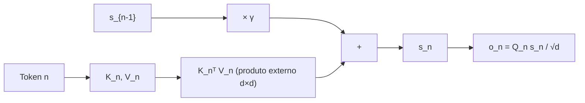

# Retention: a matemática completa

## Visão geral

Esta página deriva a retenção do RetNet **do zero**, começando pela atenção com softmax e chegando, passo a passo, à recorrência linear. O objetivo é que, ao final, você consiga (1) escrever a fórmula paralela e a recorrente, (2) provar que elas são equivalentes, (3) resolver um exemplo numérico completo à mão e (4) implementar as duas formas em código.


> A tese central: trocar o softmax por um decaimento exponencial $\gamma^{n-m}$ transforma uma soma que parece "quadrática e não-recursiva" em uma **recorrência de primeira ordem**.

## Notação

Vamos fixar a notação antes de começar. Para uma sequência de $n$ tokens com dimensão $d$:

- $X \in \mathbb{R}^{n \times d}$: a sequência de entrada (cada linha é um token).
- $W_q, W_k, W_v \in \mathbb{R}^{d \times d}$: as matrizes de projeção.
- $Q = X W_q$, $K = X W_k$, $V = X W_v$: as consultas, chaves e valores.
- $Q_n$: a linha $n$ de $Q$ (um vetor de dimensão $d$).
- $\gamma$: o fator de decaimento, com $0 < \gamma < 1$.
- $d$: dimensão do modelo (por cabeça, em geral).

Vamos usar a transposição denotada por $\top$ (por exemplo, $K^\top$ é a transposta de $K$).

## Passo 1: a atenção com softmax

A atenção escalada (scaled dot-product attention) produz, para a posição $n$, uma soma ponderada dos valores de todas as posições $m \le n$:

$$
o_n = \sum_{m=1}^{n} a_{nm} \, V_m
$$

onde o peso de atenção $a_{nm}$ é dado pelo softmax dos produtos escalares:

$$
a_{nm} = \frac{\exp\!\left(\frac{Q_n K_m^\top}{\sqrt{d}}\right)}{\sum_{j=1}^{n} \exp\!\left(\frac{Q_n K_j^\top}{\sqrt{d}}\right)}
$$

O denominador normaliza para que $\sum_m a_{nm} = 1$. Observe duas características desse peso:

1. Ele **depende do conteúdo** ($Q_n$ e $K_m$) e da **posição** de forma acoplada, via softmax.
2. Ele **não tem forma fechada** em função da distância $n - m$: para cada par $(n, m)$, precisamos computar a exponencial e dividir pela soma.

A consequência prática é que não conseguimos "fatorar" a soma da atenção em uma recorrência: para calcular $o_n$, precisamos de todos os $V_m$ e de todos os produtos $Q_n K_m^\top$ de uma vez. Isso é o que torna o custo quadrático.

### O que o softmax esconde

O softmax na verdade *aproxima* um decaimento: pares próximos tendem a receber pesos maiores que pares distantes. Mas esse decaimento é **emergente e implícito** — ele surge dos valores dos produtos escalares, não de uma regra explícita. O insight do RetNet é: *e se tornarmos esse decaimento explícito e determinístico?*

## Passo 2: trocando o softmax pelo decaimento $\gamma$

Em vez de aprender o peso de cada par, o RetNet **impõe** que o peso dependa apenas da distância temporal, decaindo exponencialmente:

$$
a_{nm} \;\rightarrow\; \gamma^{n-m}
$$

com $0 < \gamma < 1$. Quanto maior a distância $n - m$, maior o expoente e, como $\gamma < 1$, menor o peso. Por exemplo, com $\gamma = 0.9$:

| Distância $n - m$ | $\gamma^{n-m}$ |
|---|---|
| $0$ | $1.0$ |
| $1$ | $0.9$ |
| $2$ | $0.81$ |
| $3$ | $0.729$ |
| $10$ | $\approx 0.349$ |

Cada passo de distância **multiplica** a influência por $\gamma$. Isso é exatamente a forma de um **esquecimento exponencial**: o passado nunca some de vez, mas sua voz fica cada vez mais baixa.

A retenção fica então:

$$
o_n = \sum_{m=1}^{n} \gamma^{n-m} \, \frac{Q_n K_m^\top}{\sqrt{d}} \, V_m
$$

Note que mantivemos a escala $\frac{1}{\sqrt{d}}$ da atenção, mas **removemos** o softmax (e, portanto, a normalização que ele trazia). O fator $\gamma^{n-m}$ é determinístico e **não depende do conteúdo**.

## Passo 3: a forma paralela

A forma paralela expressa a retenção para **todas** as posições de uma vez, usando produtos de matrizes. Definimos a matriz de decaimento $D \in \mathbb{R}^{n \times n}$:

$$
D_{nm} =
\begin{cases}
\gamma^{n-m}, & \text{se } m \le n \\
0, & \text{se } m > n
\end{cases}
$$

O caso $m > n$ (zero) impõe a **causalidade**: nenhuma posição pode olhar para o futuro. Em notação compacta:

$$
D_{nm} = \gamma^{n-m} \cdot \mathbb{1}[m \le n]
$$

Então a retenção paralela é:

$$
\text{Retention}(X) = \left(\frac{Q K^\top}{\sqrt{d}} \odot D\right) V
$$

onde $\odot$ é o produto de Hadamard (elemento a elemento). A matriz $D$ para $n = 4$ e $\gamma = 0.9$ é:

$$
D =
\begin{bmatrix}
1 & 0 & 0 & 0 \\
0.9 & 1 & 0 & 0 \\
0.81 & 0.9 & 1 & 0 \\
0.729 & 0.81 & 0.9 & 1
\end{bmatrix}
$$

Repare: cada linha é a linha anterior "deslocada e multiplicada por $\gamma$". Essa estrutura repetitiva é a chave da recorrência.

## Passo 4: a forma recorrente

Aqui está a transformação central. Considere a soma que define $o_n$:

$$
o_n = \sum_{m=1}^{n} \gamma^{n-m}\, \frac{Q_n K_m^\top}{\sqrt{d}} \, V_m
$$

O termo $\frac{Q_n}{\sqrt{d}}$ **não depende de $m$**, então podemos colocá-lo em evidência:

$$
o_n = \frac{Q_n}{\sqrt{d}} \sum_{m=1}^{n} \gamma^{n-m} \, K_m^\top V_m
$$

Agora defina o **estado** $s_n$ como essa soma (sem o prefixo $Q_n$):

$$
s_n = \sum_{m=1}^{n} \gamma^{n-m}\, K_m^\top V_m
$$

A saída é então:

$$
o_n = \frac{Q_n}{\sqrt{d}}\, s_n
$$

Observe o formato de $s_n$: ele é uma **combinação linear** dos termos $K_m^\top V_m$, ponderada por $\gamma^{n-m}$. O termo mais recente ($m = n$) tem peso $\gamma^{0} = 1$; o anterior tem peso $\gamma$, e assim por diante.

### Derivando a recorrência

Agora, escreva $s_n$ separando o último termo do resto:

$$
s_n = K_n^\top V_n + \sum_{m=1}^{n-1} \gamma^{n-m} K_m^\top V_m
$$

Na soma restante, coloque um fator $\gamma$ em evidência, reescrevendo $\gamma^{n-m} = \gamma \cdot \gamma^{(n-1)-m}$:

$$
\sum_{m=1}^{n-1} \gamma^{n-m} K_m^\top V_m
= \gamma \sum_{m=1}^{n-1} \gamma^{(n-1)-m} K_m^\top V_m
= \gamma\, s_{n-1}
$$

Portanto:

$$
s_n = \gamma\, s_{n-1} + K_n^\top V_n
$$

Esta é a **recorrência fundamental da retenção**, com $s_0 = 0$. Cada passo: (1) "envelhece" o estado multiplicando por $\gamma$; (2) soma a contribuição do token atual $K_n^\top V_n$; (3) projeta com $Q_n$ para obter a saída.

> Repare na beleza: $K_n^\top V_n$ é um **produto externo** entre dois vetores de dimensão $d$, produzindo uma matriz $d \times d$. O estado $s_n$ é essa matriz, acumulada com esquecimento.



## Passo 5: equivalência paralelo ↔ recorrente

Vamos provar formalmente que as duas formas produzem exatamente a mesma saída.

**Forma paralela**, na posição $n$:

$$
o_n^{\text{par}} = \sum_{m=1}^{n} \gamma^{n-m}\, \frac{Q_n K_m^\top}{\sqrt{d}} \, V_m
$$

**Forma recorrente**: começando de $s_0 = 0$ e aplicando $s_m = \gamma s_{m-1} + K_m^\top V_m$ para $m = 1, \dots, n$, obtemos por indução:

$$
s_n = \sum_{m=1}^{n} \gamma^{n-m}\, K_m^\top V_m
$$

*(Base: $s_1 = K_1^\top V_1$. Passo: se $s_{n-1} = \sum_{m=1}^{n-1} \gamma^{(n-1)-m} K_m^\top V_m$, então $s_n = \gamma s_{n-1} + K_n^\top V_n = \sum_{m=1}^{n} \gamma^{n-m} K_m^\top V_m$.)*

A saída recorrente é:

$$
o_n^{\text{rec}} = \frac{Q_n}{\sqrt{d}}\, s_n = \frac{Q_n}{\sqrt{d}} \sum_{m=1}^{n} \gamma^{n-m} K_m^\top V_m
$$

Como $Q_n$ é um vetor linha e a soma é linear, o produto escalar distribui:

$$
o_n^{\text{rec}} = \sum_{m=1}^{n} \gamma^{n-m}\, \frac{Q_n K_m^\top}{\sqrt{d}} \, V_m = o_n^{\text{par}}
$$

Conclusão: $o_n^{\text{par}} = o_n^{\text{rec}}$ para todo $n$. **As duas formas são exatamente a mesma função**, apenas computadas em ordens diferentes.

### Por que isso é tão importante

- Na **forma paralela**, o custo é $O(n^2)$ (por causa de $Q K^\top$), mas é ótimo para GPU no treino.
- Na **forma recorrente**, o custo por token é $O(d^2)$ **constante** e a memória é fixa (só $s_n$), o que é ótimo para geração.
- Poder **trocar de forma sem trocar pesos** é o superpoder do RetNet: treina rápido, gera barato.

## Passo 6: exemplo numérico pequeno e resolvido

Vamos resolver a retenção completa para uma sequência de $n = 3$ tokens, com dimensão $d = 2$, uma única cabeça e $\gamma = 0.5$ (escolhido para facilitar as contas). Para simplificar ainda mais, ignoramos a escala $\frac{1}{\sqrt{d}}$ neste exemplo (ela apenas multiplica tudo por uma constante).

### Dados

Suponha as projeções já prontas (vamos trabalhar diretamente com $Q, K, V$):

$$
Q = \begin{bmatrix} 1 & 0 \\ 0 & 1 \\ 1 & 1 \end{bmatrix}, \quad
K = \begin{bmatrix} 1 & 0 \\ 1 & 1 \\ 0 & 1 \end{bmatrix}, \quad
V = \begin{bmatrix} 2 & 0 \\ 0 & 2 \\ 2 & 2 \end{bmatrix}
$$

Cada linha é um token. Vamos calcular $s_1, s_2, s_3$ e as saídas $o_1, o_2, o_3$ pelos dois caminhos.

### Forma recorrente (passo a passo)

**Passo 1** ($n=1$): $s_0 = 0$.

$$
K_1^\top V_1 = \begin{bmatrix} 1 \\ 0 \end{bmatrix} \begin{bmatrix} 2 & 0 \end{bmatrix} = \begin{bmatrix} 2 & 0 \\ 0 & 0 \end{bmatrix}
$$

$$
s_1 = \gamma s_0 + K_1^\top V_1 = 0.5 \cdot 0 + \begin{bmatrix} 2 & 0 \\ 0 & 0 \end{bmatrix} = \begin{bmatrix} 2 & 0 \\ 0 & 0 \end{bmatrix}
$$

Saída:

$$
o_1 = Q_1 s_1 = \begin{bmatrix} 1 & 0 \end{bmatrix} \begin{bmatrix} 2 & 0 \\ 0 & 0 \end{bmatrix} = \begin{bmatrix} 2 & 0 \end{bmatrix}
$$

**Passo 2** ($n=2$):

$$
K_2^\top V_2 = \begin{bmatrix} 1 \\ 1 \end{bmatrix} \begin{bmatrix} 0 & 2 \end{bmatrix} = \begin{bmatrix} 0 & 2 \\ 0 & 2 \end{bmatrix}
$$

$$
s_2 = \gamma s_1 + K_2^\top V_2 = 0.5 \begin{bmatrix} 2 & 0 \\ 0 & 0 \end{bmatrix} + \begin{bmatrix} 0 & 2 \\ 0 & 2 \end{bmatrix} = \begin{bmatrix} 1 & 2 \\ 0 & 2 \end{bmatrix}
$$

Saída:

$$
o_2 = Q_2 s_2 = \begin{bmatrix} 0 & 1 \end{bmatrix} \begin{bmatrix} 1 & 2 \\ 0 & 2 \end{bmatrix} = \begin{bmatrix} 0 & 2 \end{bmatrix}
$$

**Passo 3** ($n=3$):

$$
K_3^\top V_3 = \begin{bmatrix} 0 \\ 1 \end{bmatrix} \begin{bmatrix} 2 & 2 \end{bmatrix} = \begin{bmatrix} 0 & 0 \\ 2 & 2 \end{bmatrix}
$$

$$
s_3 = \gamma s_2 + K_3^\top V_3 = 0.5 \begin{bmatrix} 1 & 2 \\ 0 & 2 \end{bmatrix} + \begin{bmatrix} 0 & 0 \\ 2 & 2 \end{bmatrix} = \begin{bmatrix} 0.5 & 1 \\ 2 & 3 \end{bmatrix}
$$

Saída:

$$
o_3 = Q_3 s_3 = \begin{bmatrix} 1 & 1 \end{bmatrix} \begin{bmatrix} 0.5 & 1 \\ 2 & 3 \end{bmatrix} = \begin{bmatrix} 2.5 & 4 \end{bmatrix}
$$

### Forma paralela (verificação)

Vamos verificar $o_3$ pela forma paralela, somando diretamente:

$$
o_3 = \sum_{m=1}^{3} \gamma^{3-m}\, Q_3 K_m^\top V_m
$$

Calcule os produtos escalares $Q_3 K_m^\top = (K_m Q_3^\top)$, com $Q_3 = [1, 1]$:

| $m$ | $K_m$ | $Q_3 K_m^\top$ | $\gamma^{3-m}$ | $V_m$ | termo |
|---|---|---|---|---|---|
| $1$ | $[1, 0]$ | $1 \cdot 1 + 0 \cdot 1 = 1$ | $\gamma^2 = 0.25$ | $[2, 0]$ | $0.25 \cdot 1 \cdot [2,0] = [0.5, 0]$ |
| $2$ | $[1, 1]$ | $1 + 1 = 2$ | $\gamma^1 = 0.5$ | $[0, 2]$ | $0.5 \cdot 2 \cdot [0,2] = [0, 2]$ |
| $3$ | $[0, 1]$ | $0 + 1 = 1$ | $\gamma^0 = 1$ | $[2, 2]$ | $1 \cdot 1 \cdot [2,2] = [2, 2]$ |

Somando os três termos:

$$
o_3 = [0.5, 0] + [0, 2] + [2, 2] = [2.5, 4]
$$

Que é **exatamente** o valor obtido pela recorrência: $[2.5, 4]$. A equivalência está verificada num exemplo concreto.

### Leitura qualitativa do exemplo

Perceba como a contribuição do token 1 ($[0.5, 0]$) é pequena, porque foi atenuada por $\gamma^2 = 0.25$; a do token 2 ($[0, 2]$) é média ($\gamma = 0.5$); e a do token 3 ($[2, 2]$) é total ($\gamma^0 = 1$). É o esquecimento exponencial em ação: o passado pesa menos, mas nunca some.

## Passo 7: o papel do $\gamma$

### O que $\gamma$ controla

O fator $\gamma$ é o único "botão" que governa a memória da retenção:

- $\gamma$ **perto de 1** (ex.: $0.99$): o estado esquece devagar, lembrando de tokens distantes — memória longa.
- $\gamma$ **longe de 1** (ex.: $0.9$): esquece rápido, focando no contexto local — memória curta.

Podemos quantificar a "meia-vida" da memória: o número de passos $t$ para a influência cair à metade satisfaz $\gamma^{t} = \frac{1}{2}$, logo:

$$
t = \frac{\ln(1/2)}{\ln(\gamma)}
$$

Por exemplo, para $\gamma = 0.99$:

$$
t = \frac{\ln(0.5)}{\ln(0.99)} \approx \frac{-0.6931}{-0.01005} \approx 69 \text{ passos}
$$

Para $\gamma = 0.9$:

$$
t = \frac{\ln(0.5)}{\ln(0.9)} \approx \frac{-0.6931}{-0.1054} \approx 6.6 \text{ passos}
$$

## Implementação em código

### Forma recorrente

```python
import torch

def retention_recorrente(q, k, v, gamma, head_dim):
    """
    Gera tokens um a um usando o estado recorrente.
    q, k, v: tensores de shape [seq_len, d] para uma cabeça.
    Retorna as saídas [seq_len, d].
    """
    seq_len, d = k.shape
    estado = torch.zeros(d, d)               # s_0 = 0
    saidas = []
    for n in range(seq_len):
        estado = gamma * estado + torch.outer(k[n], v[n])   # K_n^T V_n
        o = (q[n] @ estado) / (head_dim ** 0.5)             # Q_n s_n / sqrt(d)
        saidas.append(o)
    return torch.stack(saidas)

# exemplo: n=3, d=2, gamma=0.5
q = torch.tensor([[1., 0.], [0., 1.], [1., 1.]])
k = torch.tensor([[1., 0.], [1., 1.], [0., 1.]])
v = torch.tensor([[2., 0.], [0., 2.], [2., 2.]])
print(retention_recorrente(q, k, v, gamma=0.5, head_dim=2))
# última linha = [2.5, 4.0] (ignorando o 1/sqrt(2) para comparar com o exemplo)
```

### Forma paralela

```python
def retention_paralela(q, k, v, gamma, head_dim):
    seq_len, d = q.shape
    # matriz de decaimento D (triangular inferior)
    n = torch.arange(seq_len).unsqueeze(1)     # [n, 1]
    m = torch.arange(seq_len).unsqueeze(0)     # [1, m]
    distancia = (n - m).clamp(min=0)
    causal = (n >= m).float()
    D = (gamma ** distancia) * causal          # [seq_len, seq_len]

    pesos = (q @ k.T) / (head_dim ** 0.5)      # Q K^T / sqrt(d)
    pesos = pesos * D                          # ⊙ D
    return pesos @ v                           # · V

print(retention_paralela(q, k, v, gamma=0.5, head_dim=2))
```

### Verificando a equivalência

```python
a = retention_recorrente(q, k, v, gamma=0.5, head_dim=2)
b = retention_paralela(q, k, v, gamma=0.5, head_dim=2)
print("diferença máxima:", (a - b).abs().max().item())  # ~0.0
```

### Pseudocódigo geral

```text
função retention_paralela(X):
    Q = X · W_q
    K = X · W_k
    V = X · W_v
    D[n,m] = gamma^(n-m) se m <= n, senão 0
    retorna ((Q·Kᵀ / sqrt(d)) ⊙ D) · V

função retention_recorrente(x_n, s_{n-1}):
    k_n = x_n · W_k
    v_n = x_n · W_v
    q_n = x_n · W_q
    s_n = gamma · s_{n-1} + k_nᵀ · v_n
    o_n = q_n · s_n / sqrt(d)
    retorna o_n, s_n
```

## Sobre a normalização

No artigo original do RetNet, a forma recorrente inclui um fator de normalização para compensar a perda de energia causada pelo decaimento. Se $\gamma < 1$, a soma $\sum_{m=1}^{n} \gamma^{n-m}$ não é $n$, e sim:

$$
\sum_{m=1}^{n} \gamma^{n-m} = \frac{1 - \gamma^{n}}{1 - \gamma}
$$


## Erros comuns

- **Esquecer o fator $\gamma$ ao envelhecer o estado**: sem `gamma * estado`, a recorrência vira uma soma acumulada sem esquecimento, que diverge e perde a noção de tempo.
- **Confundir a ordem do produto externo**: o termo é $K_n^\top V_n$ (coluna vezes linha, resultando em $d \times d$), **não** $V_n K_n^\top$.
- **Aplicar o softmax junto com o decaimento**: a retenção **substitui** o softmax; aplicar os dois ao mesmo tempo muda a função e quebra a equivalência paralelo↔recorrente.
- **Esquecer a máscara causal**: na forma paralela, sem `(n >= m)`, o modelo olha para o futuro.
- **Omitir a escala $\frac{1}{\sqrt{d}}$**: sem ela, os produtos escalares crescem com $d$ e o treino desestabiliza.
- **Usar $\gamma > 1$**: com $\gamma > 1$, o peso $\gamma^{n-m}$ cresce com a distância, dando mais voz ao passado distante que ao presente — o oposto do desejado (e o estado explode).
- **Achar que a recorrência é uma aproximação**: não é. É **exatamente** igual à forma paralela, como provamos.
- **Ignorar o fator de normalização em sequências muito longas**: sem normalização, estados com $\gamma$ muito próximo de 1 podem crescer; o RetNet original usa GroupNorm para isso.

## Resumo

- A retenção nasce da atenção ao trocar o softmax por um **decaimento exponencial determinístico** $\gamma^{n-m}$.
- A **forma paralela** é $(Q K^\top / \sqrt{d} \odot D) V$, com $D_{nm} = \gamma^{n-m} \mathbb{1}[m \le n]$.
- A **forma recorrente** é $s_n = \gamma s_{n-1} + K_n^\top V_n$, com $o_n = Q_n s_n / \sqrt{d}$.
- As duas formas são **provadamente equivalentes**, porque o decaimento exponencial permite colocar $\gamma$ em evidência e transformar a soma em recorrência.
- O **estado** $s_n$ é uma matriz $d \times d$ de tamanho fixo, que resume todo o passado com esquecimento.
