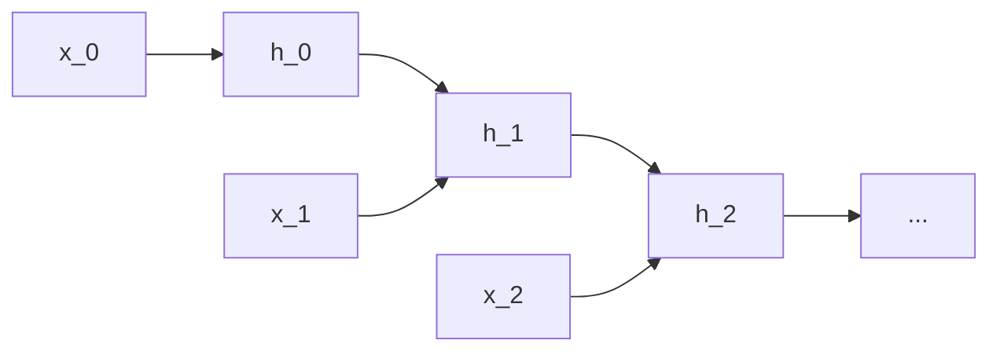
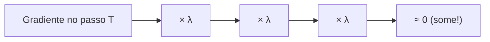
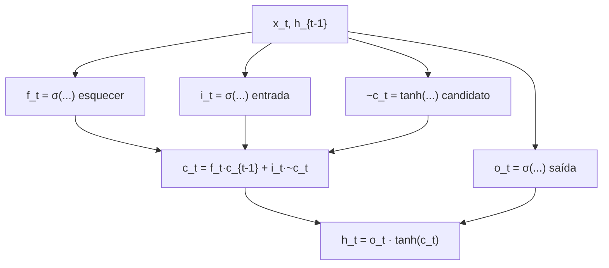
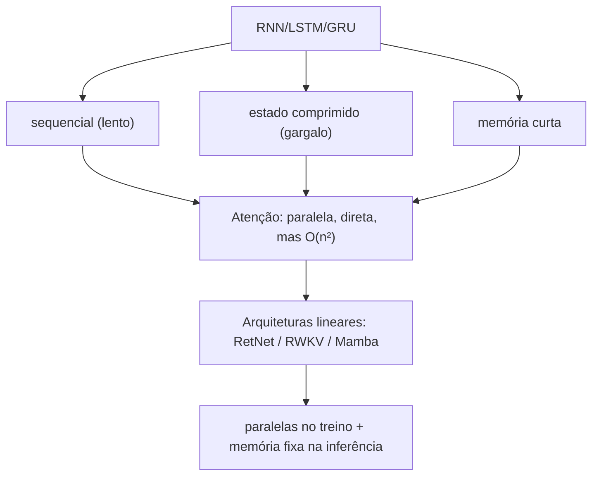

# RNN, LSTM e GRU — a história da recorrência


---

## 1. Intuição: o que é uma sequência?

Um modelo de linguagem lê palavras (tokens) em ordem. A palavra "banco" pode ser um assento ou uma instituição financeira — e só o contexto anterior ("sentei no ...") resolve a ambiguidade. Um modelo que olha cada token isoladamente não tem como fazer isso. Ele precisa de **memória**: algo que carregue a informação dos tokens anteriores até o token atual.

As redes recorrentes foram a primeira grande resposta a esse problema. Em vez de processar tudo de uma vez (como a atenção), elas processam **passo a passo**, mantendo um **estado oculto** $h_t$ que resume o que já foi visto.



---

## 2. A RNN simples

Uma RNN básica (Elman RNN) atualiza o estado oculto $h_t$ combinando a entrada atual $x_t$ com o estado anterior $h_{t-1}$:

$$
h_t = \tanh\!\left( W_{hh}\, h_{t-1} + W_{xh}\, x_t + b \right)
$$

E a saída (por exemplo, prever o próximo token) é uma projeção do estado:

$$
y_t = W_{hy}\, h_t + b_y
$$

Os parâmetros $W_{hh}$, $W_{xh}$ e $W_{hy}$ são **compartilhados** ao longo do tempo: a mesma matriz é reutilizada em cada passo, o que mantém o número de parâmetros independente do comprimento da sequência.

### 2.1 Desenrolando no tempo

Podemos "desenrolar" (unroll) a recorrência e ver uma RNN de $T$ passos como uma rede profunda de $T$ camadas, todas compartilhando pesos:

$$
h_T = \tanh\!\left( W_{hh} \left( \tanh\!\left( W_{hh} \left( \cdots \right) + W_{xh} x_{T-1} + b \right) \right) + W_{xh} x_T + b \right)
$$

Isso é crucial para entender o treinamento: o **BPTT** (backpropagation through time) aplica a regra da cadeia através de todos esses passos.

---

## 3. O problema do gradiente que desaparece

### 3.1 A origem matemática

Ao retropropagar o erro do passo $T$ até o passo $1$, o gradiente passa por uma cadeia de produtos das derivadas intermediárias. Para a parte recorrente, cada passo multiplica por algo da ordem de $W_{hh}$ (e pela derivada da tanh, que é $\le 1$). Em $T$ passos, isso vira:

$$
\frac{\partial L}{\partial h_1} \sim \prod_{t=1}^{T} \frac{\partial h_{t+1}}{\partial h_t}
$$

Se a magnitude do maior autovalor de $W_{hh}$ é $\lambda$, o produto se comporta como:

$$
\prod_{t=1}^{T} \lambda \sim \lambda^{T}
$$

Duas consequências fatais:

- Se $|\lambda| < 1$, então $\lambda^T \rightarrow 0$ (**vanishing gradient**): o gradiente some, e a rede para de aprender dependências longas.
- Se $|\lambda| > 1$, então $\lambda^T \rightarrow \infty$ (**exploding gradient**): o gradiente explode e o treino diverge.

Como a derivada da tanh está sempre entre 0 e 1, a tendência dominante na prática é o **desaparecimento**.

### 3.2 Exemplo numérico

Suponha que a cada passo o fator multiplicativo seja $\lambda = 0.5$ (uma derivada típica com tanh). Após $T$ passos:

$$
\lambda^{T} = 0.5^{T}
$$

| $T$ | $0.5^T$ |
|---|---|
| 1 | 0.5 |
| 5 | 0.03125 |
| 10 | 0.000977 |
| 20 | $9.5 \times 10^{-7}$ |

Em apenas 20 passos, o sinal de gradiente vindo de um token distante é um milionésimo do original. Na prática, isso significa que a RNN só consegue "lembrar" influências de uns poucos passos atrás.



---

## 4. O LSTM: memória com portas

O LSTM (Long Short-Term Memory, 1997) foi desenhado para resolver exatamente o vanishing gradient. A ideia central: substituir a multiplicação repetida por um **acúmulo aditivo** que deixa o gradiente fluir.

### 4.1 O estado de célula e a "rodovia" de gradiente

O LSTM mantém dois estados: a **célula** $c_t$ (memória de longo prazo) e o estado oculto $h_t$ (saída de curto prazo). A atualização da célula é **aditiva**:

$$
c_t = f_t \odot c_{t-1} + i_t \odot \tilde{c}_t
$$

Como a operação é uma soma (e não uma multiplicação por $W_{hh}$ repetida), o gradiente pode fluir através de $c_t$ por muitos passos sem ser esmagado — a chamada *constant error carousel* (esteira de erro constante).

### 4.2 As três portas

Cada porta é um vetor entre 0 e 1 (via sigmoide $\sigma$), que "regula" o fluxo de informação:

**Porta de esquecimento** $f_t$ — decide o que apagar da memória:

$$
f_t = \sigma\!\left( W_f \left[ h_{t-1}, x_t \right] + b_f \right)
$$

**Porta de entrada** $i_t$ e **candidato** $\tilde{c}_t$ — decidem o que gravar:

$$
i_t = \sigma\!\left( W_i \left[ h_{t-1}, x_t \right] + b_i \right)
$$

$$
\tilde{c}_t = \tanh\!\left( W_c \left[ h_{t-1}, x_t \right] + b_c \right)
$$

**Porta de saída** $o_t$ — decide o que expor como $h_t$:

$$
o_t = \sigma\!\left( W_o \left[ h_{t-1}, x_t \right] + b_o \right)
$$

$$
h_t = o_t \odot \tanh(c_t)
$$

Aqui $[h_{t-1}, x_t]$ é a **concatenação** do estado anterior com a entrada atual.



### 4.3 Por que isso resolve o vanishing gradient

Derive $c_t$ em relação a $c_{t-1}$: a parte que importa é $\frac{\partial c_t}{\partial c_{t-1}} = f_t$ (diagonal, pois a multiplicação é elemento a elemento). Ao longo de $T$ passos, o produto vira:

$$
\prod_{t=1}^{T} f_t
$$

Se as portas de esquecimento ficam próximas de 1 (o modelo aprende a "não esquecer"), o produto fica próximo de 1 e o gradiente **não desaparece**. É o oposto da RNN, onde o fator era sempre $< 1$.

### 4.4 Exemplo numérico simplificado

Imagine um LSTM escalar (uma dimensão) processando três passos. Valores de portas e candidato:

- $c_0 = 0.0$
- Passo 1: $f_1 = 0.9$, $i_1 = 0.8$, $\tilde{c}_1 = 1.0$
- Passo 2: $f_2 = 1.0$, $i_2 = 0.1$, $\tilde{c}_2 = 2.0$
- Passo 3: $f_3 = 0.7$, $i_3 = 0.5$, $\tilde{c}_3 = -1.0$

Passo 1:

$$
c_1 = 0.9 \cdot 0.0 + 0.8 \cdot 1.0 = 0.8
$$

Passo 2:

$$
c_2 = 1.0 \cdot 0.8 + 0.1 \cdot 2.0 = 0.8 + 0.2 = 1.0
$$

Passo 3:

$$
c_3 = 0.7 \cdot 1.0 + 0.5 \cdot (-1.0) = 0.7 - 0.5 = 0.2
$$

Repare: no passo 2 a porta de esquecimento $f_2 = 1.0$ preservou $c_1$ integralmente; no passo 3, $f_3 = 0.7$ descartou 30% do passado. A célula age como um "acumulador seletivo": soma o novo e esquece o velho conforme as portas mandam.

---

## 5. O GRU: o LSTM simplificado

O GRU (Gated Recurrent Unit, 2014) unifica a célula e o estado oculto em um único vetor, reduzindo o número de portas de três para duas.

**Porta de atualização** $z_t$ — decide quanto do passado manter:

$$
z_t = \sigma\!\left( W_z \left[ h_{t-1}, x_t \right] + b_z \right)
$$

**Porta de reset** $r_t$ — decide quanto do passado ignorar ao computar o candidato:

$$
r_t = \sigma\!\left( W_r \left[ h_{t-1}, x_t \right] + b_r \right)
$$

**Candidato** $\tilde{h}_t$:

$$
\tilde{h}_t = \tanh\!\left( W \left[ r_t \odot h_{t-1}, x_t \right] + b \right)
$$

**Atualização final** — interpolação entre passado e candidato:

$$
h_t = (1 - z_t) \odot h_{t-1} + z_t \odot \tilde{h}_t
$$

Quando $z_t \rightarrow 1$, o estado vira o candidato novo; quando $z_t \rightarrow 0$, o estado copia o passado. É uma interpolação convexa muito parecida com o token shift do RWKV e com o decaimento do RetNet — a mesma intuição de "mesclar passado e presente".

### 5.1 Exemplo numérico

GRU escalar, três passos, com $h_0 = 0.0$:

- Passo 1: $z_1 = 1.0$, $\tilde{h}_1 = 0.5$ → $h_1 = (1 - 1.0)\cdot 0 + 1.0 \cdot 0.5 = 0.5$
- Passo 2: $z_2 = 0.5$, $\tilde{h}_2 = 1.5$ → $h_2 = 0.5 \cdot 0.5 + 0.5 \cdot 1.5 = 0.25 + 0.75 = 1.0$
- Passo 3: $z_3 = 0.0$, $\tilde{h}_3 = 9.0$ → $h_3 = 1.0 \cdot 1.0 + 0.0 \cdot 9.0 = 1.0$

No passo 3, $z_3 = 0.0$ significou "ignorar o candidato e manter o passado" — a porta de atualização agiu como um interruptor de memória.

---

## 6. Código

### 6.1 RNN, LSTM e GRU do zero (numpy)

```python
import numpy as np

def sigmoid(z):
    return 1.0 / (1.0 + np.exp(-z))

def rnn_step(x, h, Wxh, Whh, b):
    return np.tanh(Whh @ h + Wxh @ x + b)

def lstm_step(x, h, c, params):
    Wf, Wi, Wc, Wo = params["Wf"], params["Wi"], params["Wc"], params["Wo"]
    bf, bi, bc, bo = params["bf"], params["bi"], params["bc"], params["bo"]
    z = np.concatenate([h, x])
    f = sigmoid(Wf @ z + bf)
    i = sigmoid(Wi @ z + bi)
    g = np.tanh(Wc @ z + bc)
    o = sigmoid(Wo @ z + bo)
    c = f * c + i * g
    h = o * np.tanh(c)
    return h, c

def gru_step(x, h, params):
    Wz, Wr, W, bz, br, b = (params["Wz"], params["Wr"], params["W"],
                            params["bz"], params["br"], params["b"])
    zz = np.concatenate([h, x])
    z = sigmoid(Wz @ zz + bz)
    r = sigmoid(Wr @ zz + br)
    cand = np.tanh(W @ np.concatenate([r * h, x]) + b)
    h = (1 - z) * h + z * cand
    return h
```

### 6.2 Comparando os três em PyTorch

```python
import torch
import torch.nn as nn

T, batch, dim = 10, 2, 16
x = torch.randn(T, batch, dim)

rnn = nn.RNN(dim, dim, batch_first=False)
lstm = nn.LSTM(dim, dim, batch_first=False)
gru = nn.GRU(dim, dim, batch_first=False)

out_rnn, _ = rnn(x)
out_lstm, _ = lstm(x)
out_gru, _ = gru(x)

print(out_rnn.shape, out_lstm.shape, out_gru.shape)  # (10, 2, 16) cada
```

---

## 7. Por que elas evoluíram para a atenção

As RNNs, LSTM e GRU dominaram por anos, mas tinham limitações estruturais que motivaram a atenção:

1. **Processamento sequencial obrigatório**: para calcular $h_t$ é preciso de $h_{t-1}$. Não dá para paralelizar os passos de uma sequência, o que torna o treino lento em GPU (que adora paralelismo).

2. **Gargalo de estado fixo**: toda a memória do passado precisa passar por um vetor $h_t$ de dimensão fixa. Em sequências muito longas, esse vetor é um gargalo: o LSTM ajuda, mas não elimina a compressão forçada.

3. **Dependências de muito longo alcance**: mesmo com o LSTM, manter informação por milhares de passos exige que as portas "decorem" o caminho, o que nem sempre acontece.

A atenção resolveu esses três problemas de uma vez: cada token olha **diretamente** para todos os anteriores (sem compressão), e o cálculo é **paralelizável** (todas as posições processadas ao mesmo tempo). O preço foi o custo quadrático.



---

## 9. Erros comuns

1. **Achar que LSTM e GRU eliminam todo vanishing gradient**: eles o atenuam fortemente, mas em sequências extremamente longas ainda podem sofrer; a atenção completa continua sendo o teto de "memória exata".
2. **Esquecer que a RNN é sequencial**: não dá para paralelizar os passos; usar RNN para sequências gigantes sem necessidade é lento.
3. **Confundir célula $c_t$ com estado oculto $h_t$** no LSTM: a célula é a memória de longo prazo; $h_t$ é a exposição de curto prazo.
4. **Achar que mais portas é sempre melhor**: o GRU tem menos parâmetros que o LSTM e, em muitos problemas, desempenho equivalente — a escolha depende dos dados e do problema.
5. **Ignorar o exploding gradient**: tão problemático quanto o vanishing; na prática usa-se *gradient clipping* (cortar a norma do gradiente) para evitar explosões.

---

## 10. Resumo

- A RNN processa sequências passo a passo com um estado oculto $h_t$, compartilhando pesos ao longo do tempo.
- O **vanishing gradient** surge do produto repetido de fatores $<1$ (como $\lambda^T$), limitando a memória de longo prazo.
- O **LSTM** usa uma célula com atualização aditiva ($c_t = f_t c_{t-1} + i_t \tilde{c}_t$) e três portas para deixar o gradiente fluir.
- O **GRU** simplifica para duas portas e uma interpolação entre passado e candidato.
- A atenção substituiu a recorrência por ser paralelizável e sem compressão, mas cobrou o custo quadrático.

---

*Próximo passo natural: conhecer a linhagem mais recente da recorrência — os modelos de espaço de estado (SSM) e o Mamba.*
