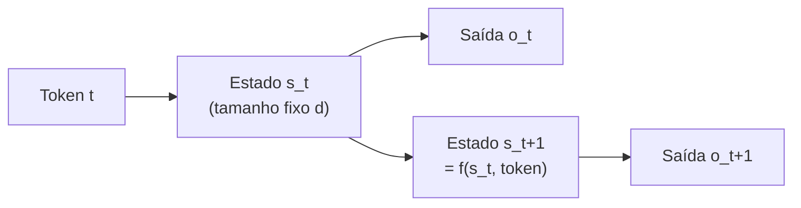
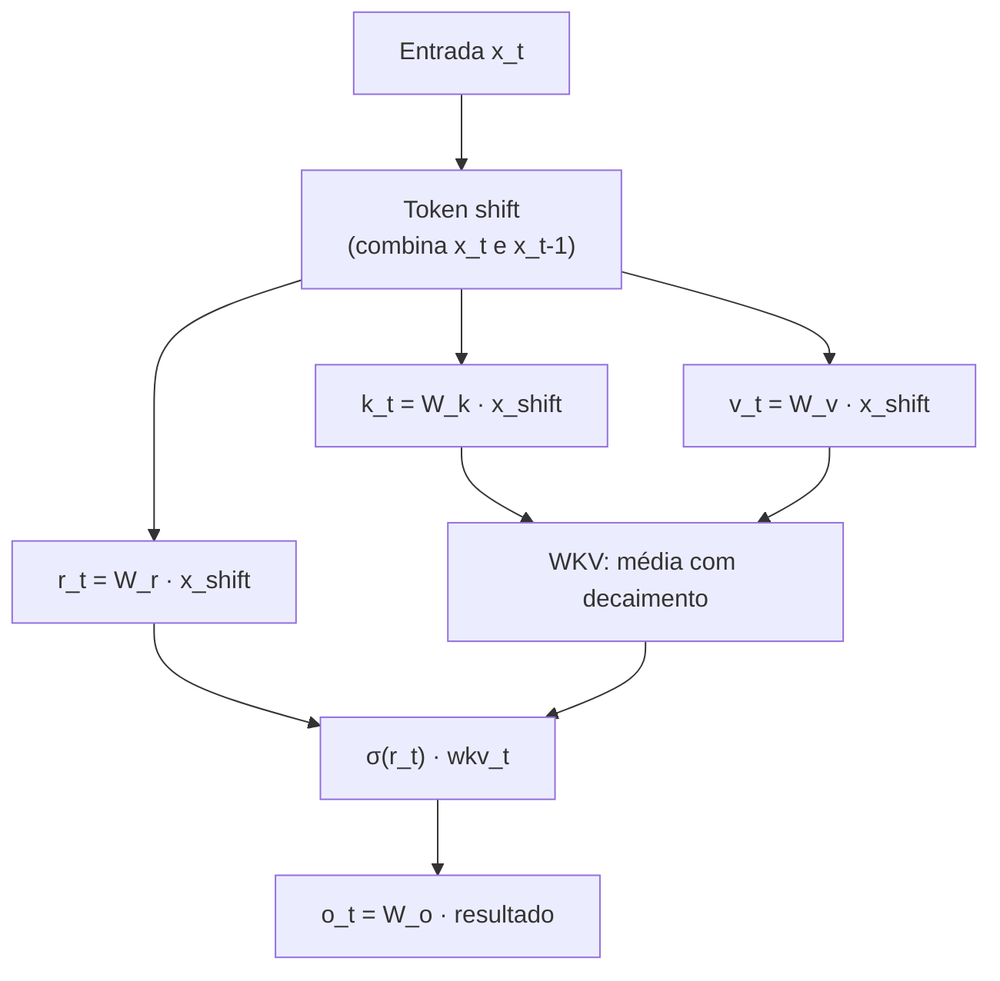
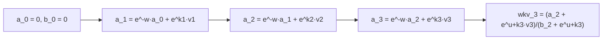
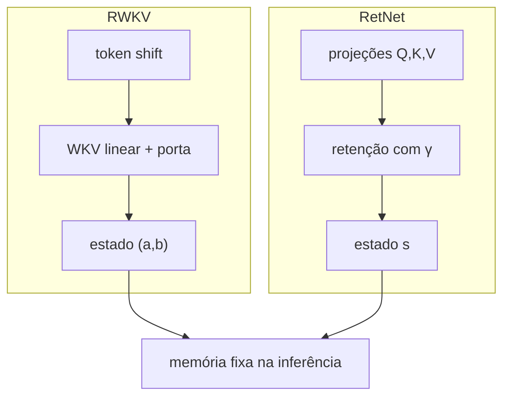

# RWKV — a alternativa linear e recorrente

> "Atenção total resolve o problema da memória longa, mas cobra um preço quadrático. O RWKV tenta responder uma pergunta simples: e se a atenção fosse *linear* e pudesse ser resolvida como uma recorrência?"

---

## 1. Intuição: o preço de olhar para tudo

Um Transformer, a cada novo token, olha para **todos** os tokens anteriores. Isso é o que chamamos de *atenção*. A qualidade é excelente, mas o número de comparações cresce com o quadrado do comprimento $n$ da sequência:

$$
\text{custo}_{\text{atenção}} \sim n^2
$$

Se $n$ dobra, o custo quadruplica. Para um documento de $n = 100\,000$ tokens, seriam $10^{10}$ comparações por camada. Esse é o motivo de existirem arquiteturas "lineares": redes que tentam resumir o passado em um **estado de tamanho fixo** e atualizá-lo a cada passo com custo constante.

$$
\text{custo}_{\text{recorrente}} \sim n \cdot d^2
$$

onde $d$ é a dimensão do estado. A diferença essencial é que $d$ é fixo, enquanto $n$ cresce com o texto.



O **RWKV** (Receptance Weighted Key Value) é uma das arquiteturas mais populares dessa família. Ele não usa atenção softmax completa; usa uma combinação de componentes lineares com um "deslocamento de token" (token shift) e um decaimento exponencial aprendível.

---

## 2. O que é o RWKV

O nome vem dos três vetores que aparecem no seu mecanismo de mistura temporal:

- **R** — *Receptance* (receptância): quanto do resultado "passa".
- **W** — *Weight* (peso): o decaimento exponencial, um vetor aprendível $w$.
- **K, V** — *Key* e *Value*: análogos às chaves e valores do Transformer.

A ideia central: em vez de calcular um produto de atenção $Q K^T$ com softmax, o RWKV calcula uma **média ponderada com decaimento exponencial** dos valores passados. O peso de cada valor passado $v_i$ sobre o token atual $t$ é:

$$
\text{peso}(i, t) = e^{-(t-1-i)\,w + k_i}
$$

Repare nas duas peças:

1. **Decaimento no tempo** $- (t-1-i)\,w$: quanto mais antigo o token, menor o expoente, menor o peso. O parâmetro $w$ (um vetor por canal) controla a velocidade desse "esquecimento".
2. **Relevância do conteúdo** $+ k_i$: a chave $k_i$ ajusta o peso de acordo com o conteúdo, como na atenção — mas sem o produto $QK^T$ completo.



Há duas versões principais do bloco: a **time-mixing** (mistura no tempo, que substitui a atenção) e a **channel-mixing** (mistura entre canais, que substitui o FFN).

---

## 3. Token shift (deslocamento de token)

O token shift é o truque mais barato do RWKV. Em uma recorrência pura, o estado $s_t$ carrega *tudo* do passado. O RWKV percebe que, para muitas tarefas, o token **imediatamente anterior** já dá informação local preciosa — sem precisar passar por um estado comprimido.

Ele mistura o token atual $x_t$ com o anterior $x_{t-1}$ usando uma interpolação linear com peso aprendível $\mu$ (um vetor por canal):

$$
x_{\text{shift}} = \mu \odot x_{t} + (1 - \mu) \odot x_{t-1}
$$

O símbolo $\odot$ é a multiplicação elemento a elemento. Se $\mu = 1$, usamos só o token atual (sem shift); se $\mu = 0$, só o anterior; valores intermediários misturam os dois.

### 3.1 Exemplo numérico

Suponha um canal com $x_{t-1} = 2.0$, $x_t = 6.0$ e $\mu = 0.25$:

$$
x_{\text{shift}} = 0.25 \cdot 6.0 + (1 - 0.25) \cdot 2.0 = 1.5 + 1.5 = 3.0
$$

Com $\mu = 0.75$:

$$
x_{\text{shift}} = 0.75 \cdot 6.0 + 0.25 \cdot 2.0 = 4.5 + 0.5 = 5.0
$$

Ou seja: $\mu$ controla a "inércia" — quanto maior $\mu$, mais rápido o canal responde ao token novo.

> O token shift é, em essência, uma convolução causal de largura 2 que só mistura posições vizinhas. É o componente que dá ao RWKV informação local sem custo quadrático.

---

## 4. Time-mixing: o operador WKV

A **time-mixing** é o coração do RWKV, substituindo a atenção. Primeiro aplicamos token shift e projetamos com três matrizes $W_r, W_k, W_v$:

$$
r_t = W_r \cdot \big(\mu_r \odot x_t + (1-\mu_r) \odot x_{t-1}\big)
$$

$$
k_t = W_k \cdot \big(\mu_k \odot x_t + (1-\mu_k) \odot x_{t-1}\big)
$$

$$
v_t = W_v \cdot \big(\mu_v \odot x_t + (1-\mu_v) \odot x_{t-1}\big)
$$

Depois calculamos o **WKV**, que é uma média ponderada dos valores com decaimento exponencial:

$$
\text{wkv}_t = \frac{\sum_{i=1}^{t-1} e^{-(t-1-i)\,w + k_i} \odot v_i \;+\; e^{u + k_t} \odot v_t}{\sum_{i=1}^{t-1} e^{-(t-1-i)\,w + k_i} \;+\; e^{u + k_t}}
$$

Leitura da fórmula:

- O **numerador** soma os valores $v_i$ ponderados pelos pesos exponenciais.
- O **denominador** soma os mesmos pesos (normalização).
- O termo $e^{u + k_t} v_t$ é o valor do token **atual**, com um bônus aprendível $u$ que costuma dar mais peso à posição presente.
- A divisão faz com que o resultado seja uma **combinação convexa** — uma média ponderada que não "estoura" em escala.

A saída da time-mixing combina a receptância (passada por uma sigmoide $\sigma$) com o WKV:

$$
o_t = W_o \cdot \big(\sigma(r_t) \odot \text{wkv}_t\big)
$$

A sigmoide $\sigma(r_t)$ age como uma porta: valores próximos de 0 zeram a contribuição; próximos de 1 deixam passar tudo.

### 4.1 Forma recorrente: o estado $(a, b)$

A grande sacada é que a soma acima não precisa ser recalculada do zero a cada passo. Definimos um estado de duas partes:

$$
a_t = e^{-w} \odot a_{t-1} + e^{k_t} \odot v_t
$$

$$
b_t = e^{-w} \odot b_{t-1} + e^{k_t}
$$

Então o WKV vira:

$$
\text{wkv}_t = \frac{a_{t-1} + e^{u + k_t} \odot v_t}{b_{t-1} + e^{u + k_t}}
$$

Aqui $a_t$ acumula o "numerador" e $b_t$ acumula o "denominador". A cada passo, ambos decaem por $e^{-w}$ e recebem o termo novo. O estado tem tamanho fixo ($2d$ números por canal), independente de $n$ — é por isso que o RWKV gera texto com **memória constante**.



---

## 5. Channel-mixing: o FFN com porta

Se a time-mixing substitui a atenção, a **channel-mixing** substitui o *feed-forward* (FFN). Ela mistura informação entre os canais (dimensões) do token, com uma porta de receptância:

$$
r'_t = W'_r \cdot \big(\mu'_r \odot x_t + (1-\mu'_r) \odot x_{t-1}\big)
$$

$$
k'_t = W'_k \cdot \big(\mu'_k \odot x_t + (1-\mu'_k) \odot x_{t-1}\big)
$$

$$
o'_t = \sigma(r'_t) \odot \Big( W'_v \cdot \max(k'_t, 0)^2 \Big)
$$

O termo $\max(k'_t, 0)^2$ é uma **ReLU ao quadrado**: zera os negativos e eleva os positivos ao quadrado, criando a não-linearidade típica de um FFN. A porta $\sigma(r'_t)$ decide o quanto de cada canal passa adiante.

---

## 6. O bloco completo do RWKV

Juntando tudo, um bloco RWKV processa um token em duas etapas:

1. **Time-mixing**: mistura o token com o passado temporal (substitui a atenção).
2. **Channel-mixing**: mistura os canais do token (substitui o FFN).

```text
Entrada: x_t, estado (a, b), token anterior x_{t-1}

# Time-mixing
r, k, v = token_shift(x_t, x_{t-1}) projetados por W_r, W_k, W_v
a_t = e^-w · a_{t-1} + e^k · v
b_t = e^-w · b_{t-1} + e^k
wkv = (a_{t-1} + e^(u+k) · v) / (b_{t-1} + e^(u+k))
x = W_o · (σ(r) · wkv)

# Channel-mixing
r', k' = token_shift(x, x_prev) projetados por W'_r, W'_k
x = σ(r') · (W'_v · max(k', 0)^2)

Saída: x (e o novo estado a_t, b_t para o próximo passo)
```

---

## 7. Exemplo numérico progressivo

Vamos acompanhar **um único canal** (escalar) por três passos, com números pequenos. Parâmetros fixos: $w = 0.5$ (logo $e^{-w} \approx 0.6065$), $u = 0$, e chaves/valores dados.

**Passo 1** — token 1, com $k_1 = 1.0$ e $v_1 = 2.0$:

$$
a_1 = 0.6065 \cdot 0 + e^{1.0} \cdot 2.0 \approx 2.7183 \cdot 2.0 = 5.4366
$$

$$
b_1 = 0.6065 \cdot 0 + e^{1.0} \approx 2.7183
$$

O WKV do primeiro passo usa só o termo atual (não há passado):

$$
\text{wkv}_1 = \frac{0 + e^{0+1.0} \cdot 2.0}{0 + e^{0+1.0}} = \frac{5.4366}{2.7183} = 2.0
$$

Faz sentido: com um único token, a "média ponderada" é o próprio valor.

**Passo 2** — token 2, com $k_2 = 0.5$ e $v_2 = 4.0$. Primeiro atualizamos o estado:

$$
a_2 = 0.6065 \cdot 5.4366 + e^{0.5} \cdot 4.0 \approx 3.2974 + 1.6487 \cdot 4.0 = 3.2974 + 6.5949 = 9.8923
$$

$$
b_2 = 0.6065 \cdot 2.7183 + e^{0.5} \approx 1.6487 + 1.6487 = 3.2974
$$

O WKV no passo 2 usa o estado anterior ($a_1, b_1$) mais o termo atual:

$$
\text{wkv}_2 = \frac{a_1 + e^{0+0.5} \cdot 4.0}{b_1 + e^{0+0.5}} = \frac{5.4366 + 6.5949}{2.7183 + 1.6487} = \frac{12.0315}{4.3670} \approx 2.755
$$

Interpretação: o valor 4.0 (token 2) tem peso maior porque é recente, mas o valor 2.0 (token 1) ainda contribui, resultando em uma média próxima de 2.755.

**Passo 3** — token 3, com $k_3 = 0.0$ e $v_3 = 8.0$:

$$
a_3 = 0.6065 \cdot 9.8923 + e^{0.0} \cdot 8.0 \approx 5.9997 + 8.0 = 13.9997
$$

$$
b_3 = 0.6065 \cdot 3.2974 + e^{0.0} \approx 2.0000 + 1.0 = 3.0000
$$

$$
\text{wkv}_3 = \frac{a_2 + e^{0} \cdot 8.0}{b_2 + e^{0}} = \frac{9.8923 + 8.0}{3.2974 + 1.0} = \frac{17.8923}{4.2974} \approx 4.164
$$

Repare no padrão: a cada passo, o estado antigo é **multiplicado por** $e^{-w} \approx 0.6065$ (decaimento) e o termo novo entra. O passado nunca é descartado por completo — apenas enfraquecido exponencialmente. É exatamente o mecanismo que o RetNet usa com $\gamma$: a diferença está na forma da normalização e na presença do token shift e do parâmetro $u$.

---

## 8. Código

### 8.1 Time-mixing recorrente do zero

```python
import math

def time_mixing(x, x_prev, state, Wr, Wk, Wv, Wo, mu_r, mu_k, mu_v, w, u):
    # token shift: interpolação linear entre token atual e anterior
    xs_r = mu_r * x + (1 - mu_r) * x_prev
    xs_k = mu_k * x + (1 - mu_k) * x_prev
    xs_v = mu_v * x + (1 - mu_v) * x_prev

    r = Wr @ xs_r
    k = Wk @ xs_k
    v = Wv @ xs_v

    a, b = state
    decay = math.exp(-w)          # decaimento exponencial por canal
    a = decay * a + math.exp(k) * v
    b = decay * b + math.exp(k)
    state = (a, b)

    wkv = (a_prev + math.exp(u + k) * v) / (b_prev + math.exp(u + k))
    return Wo @ (sigmoid(r) * wkv), state

def sigmoid(z):
    return 1.0 / (1.0 + math.exp(-z))
```

### 8.2 WKV com soma explícita (para conferência)

```python
import math

def wkv_explicito(k, v, w, u, t):
    # confere a forma recorrente com a soma direta
    num = 0.0
    den = 0.0
    for i in range(t - 1):
        peso = math.exp(-(t - 1 - i) * w + k[i])
        num += peso * v[i]
        den += peso
    num += math.exp(u + k[t - 1]) * v[t - 1]
    den += math.exp(u + k[t - 1])
    return num / den
```

### 8.3 Channel-mixing

```python
def channel_mixing(x, x_prev, Wr, Wk, Wv, mu_r, mu_k):
    xs_r = mu_r * x + (1 - mu_r) * x_prev
    xs_k = mu_k * x + (1 - mu_k) * x_prev
    r = Wr @ xs_r
    k = Wk @ xs_k
    return sigmoid(r) * (Wv @ (max(k, 0.0) ** 2))
```

---

## 9. Comparação com o RetNet

RWKV e RetNet perseguem o mesmo objetivo — memória eficiente com custo linear — mas por caminhos diferentes.

| Aspecto | RWKV | RetNet |
|---|---|---|
| Mecanismo central | WKV (média com decaimento + porta) | Retenção com decaimento $\gamma$ |
| Normalização | denominador acumulado $b_t$ | fator $D$ fixo (máscara) |
| Informação local | token shift explícito | implícita na forma paralela |
| Estado de inferência | par $(a_t, b_t)$ | vetor $s_t$ |
| Posição | decaimento aprendível $w$ | $\gamma$ aprendível por cabeça |
| Não-linearidade FFN | ReLU ao quadrado com porta | GELU/SiLU |




---

## 10. Vantagens e trade-offs

**Vantagens do RWKV:**

- **Inferência com memória constante**: o estado $(a, b)$ tem tamanho fixo; não existe *cache* KV que cresce com o texto.
- **Treino paralelizável**: o modo "paralelo" usa convolução/soma prefixada, explorando GPUs.
- **Custo linear** no comprimento da sequência, contra o quadrático do Transformer.
- **Sem softmax global**: a normalização por denominador é mais barata e estável.

**Trade-offs / limitações:**

- **Qualidade em recuperação exata**: para tarefas que exigem "copiar" um token distante exatamente (ex.: seguir instruções longas e precisas), a atenção completa ainda é a referência.
- **Estado comprimido é um gargalo**: tudo que o modelo "lembra" precisa passar por um vetor de dimensão $d$; informação que não cabe ali é perdida.
- **Sensibilidade ao decaimento**: o parâmetro $w$ controla o esquecimento; se mal ajustado, o modelo esquece cedo demais ou acumula ruído.
- **Menos adotado** em ecossistemas maduros em comparação ao Transformer, o que reduz a oferta de ferramentas e pesos prontos.

---

## 12. Erros comuns

1. **Confundir token shift com atenção**: o token shift só mistura o token atual com o *imediatamente anterior* — é informação local, não um mecanismo de memória longa. A memória longa vem do estado $(a, b)$.
2. **Esquecer a normalização** (o denominador $b_t$): sem dividir, o WKV cresce sem controle com o tamanho da sequência.
3. **Achar que $e^{-w}$ é constante global**: na prática $w$ é um **vetor por canal**, então cada dimensão esquece em uma velocidade própria.
4. **Ignorar o papel da sigmoide na receptância**: sem $\sigma(r)$, a porta de receptância deixa de ser uma porta (não fica entre 0 e 1).
5. **Assumir que o estado guarda "tudo"**: o estado é um resumo de dimensão fixa; ele comprime, não arquiva. Informação rara pode ser perdida.

---

## 13. Resumo

- O RWKV substitui a atenção por uma **média ponderada com decaimento exponencial** (WKV), com custo linear em $n$.
- O **token shift** mistura o token atual com o anterior via interpolação linear com peso $\mu$, fornecendo informação local barata.
- O bloco tem duas partes: **time-mixing** (substitui a atenção) e **channel-mixing** (substitui o FFN, com ReLU ao quadrado e porta).
- O estado recorrente $(a_t, b_t)$ tem **tamanho fixo**, permitindo geração com memória constante.
- A grande troca é: **eficiência e memória constante** em troca de uma capacidade de recuperação exata ligeiramente menor que a atenção completa.

---

*Próximo passo natural: entender de onde veio a ideia de recorrência — a história das RNN, LSTM e GRU — antes de comparar todas as arquiteturas lado a lado.*
