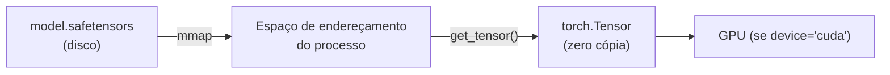

# safetensors

## 1. O que é o formato safetensors

O **safetensors** é um formato de serialização de tensores criado pelo HuggingFace para substituir o `.pt`/`.pth` do PyTorch no armazenamento de pesos de modelos. O nome embute a sua principal qualidade: ele é **seguro** (*safe*). Enquanto o formato tradicional do PyTorch serializa objetos Python via `pickle` — o que permite a execução de código arbitrário na hora de carregar — o safetensors grava **apenas dados**: um cabeçalho de metadados em JSON seguido de um bloco de bytes crus.

> **Intuição em uma frase:** carregar um arquivo `.pt` é como executar um programa que alguém te enviou; carregar um `.safetensors` é como abrir um arquivo de texto e números — você lê o conteúdo, mas ele não pode fazer nada além de ser lido.


## 2. Por que o formato antigo é inseguro

### 2.1 O problema do pickle

O `torch.save` e o `torch.load` usam o módulo `pickle` do Python, que serializa não apenas dados, mas **objetos e código**. Durante o `torch.load`, o pickle reconstrói os objetos, e essa reconstrução pode executar métodos arbitrários (`__reduce__`, `__setstate__`, etc.) definidos na classe do objeto.

Na prática, isso significa que um arquivo `.pt` malicioso pode executar **qualquer código** na máquina de quem o carrega — um vetor clássico de **remote code execution (RCE)**. Baixar um modelo da internet e carregá-lo com `torch.load` é, portanto, equivalente a baixar e executar um executável desconhecido.

### 2.2 A resposta do safetensors

O safetensors elimina essa classe de ataque **por construção**: como o formato só contém dtypes, formas e bytes crus, não existe código a executar. O pior que um arquivo safetensors malicioso pode fazer é ser inválido ou ocupar memória. Ele não pode executar comandos.

## 3. A anatomia do arquivo

### 3.1 Estrutura em duas partes

Um arquivo safetensors é composto por duas regiões consecutivas:

```text
+-----------------------------+
| 8 bytes: N (tamanho do      |
|          cabeçalho JSON)    |
+-----------------------------+
| N bytes: cabeçalho JSON     |
|  { "tensor_name": {         |
|      "dtype": "F32",        |
|      "shape": [1024, 1024], |
|      "data_offsets": [0, 4194304] } } |
+-----------------------------+
| Bloco de dados (bytes crus) |
|  do tensor 1, depois 2, ... |
+-----------------------------+
```

1. **Prefixo de 8 bytes**: um inteiro *little-endian* de 64 bits com o tamanho do cabeçalho JSON em bytes.
2. **Cabeçalho JSON**: um dicionário onde cada chave é o nome do tensor, e o valor contém `dtype`, `shape` e `data_offsets` (intervalo `[início, fim)` do tensor dentro do bloco de dados).
3. **Bloco de dados**: a concatenação dos bytes de todos os tensores, sem padding extra.

### 3.2 Como o cabeçalho encontra os dados

O `data_offsets` é a ponte entre o cabeçalho e o bloco. Para um tensor com `shape = [d1, d2, ..., dk]` e dtype de $b$ bytes por elemento, o número de bytes é:

$$
\text{numel} = d_1 \times d_2 \times \dots \times d_k, \qquad \text{tamanho} = \text{numel} \times b
$$

O primeiro tensor começa no offset 0; o segundo começa onde o primeiro termina, e assim por diante. O carregador usa esses offsets para **ler apenas o tensor desejado** diretamente do disco, sem deserializar o resto.

### 3.3 Os dtypes suportados

O cabeçalho codifica o tipo em strings curtas:

| Código | Tipo PyTorch | Bytes por elemento |
|--------|--------------|--------------------|
| `F64` | `float64` | 8 |
| `F32` | `float32` | 4 |
| `F16` | `float16` | 2 |
| `BF16` | `bfloat16` | 2 |
| `I64` | `int64` | 8 |
| `I32` | `int32` | 4 |
| `I16` | `int16` | 2 |
| `I8` | `int8` | 1 |
| `U8` | `uint8` | 1 |
| `BOOL` | `bool` | 1 |


## 4. A API em Python

### 4.1 `save_file`: gravando pesos

```python
from safetensors.torch import save_file

state_dict = model.state_dict()
state_dict.pop("lm_head.weight", None)   # weight tying: não duplica o embedding
save_file(state_dict, "checkpoints/base/model.safetensor")
```

O `save_file` aceita um dicionário `{nome: tensor}` e produz o arquivo em duas partes descrito acima. Ele também aceita um `metadata` opcional (dicionário JSON extra gravado no cabeçalho).

### 4.2 `load_file`: carregando tudo

```python
from safetensors.torch import load_file

weights = load_file("checkpoints/base/model.safetensor", device="cuda")
model.load_state_dict(weights, strict=False)
```

O `load_file` devolve um `dict` com todos os tensores, opcionalmente já movidos para um `device`. O parâmetro `device` evita carregar em CPU e copiar depois — o tensor já nasce na GPU.

### 4.3 `safe_open`: leitura preguiçosa e parcial

O `safe_open` abre o arquivo **sem carregar nada**: ele apenas lê o cabeçalho e deixa os dados *memory-mapped* (mapeados em memória). Você então lê apenas os tensores que precisa:

```python
from safetensors import safe_open

with safe_open("model.safetensor", framework="pt", device="cpu") as handle:
    for key in handle.keys():                 # itera sem carregar os dados
        shape = handle.get_slice(key).get_shape()   # só a forma
    embedding = handle.get_tensor("embeddings.weight")  # carrega só este
```


### 4.4 O `framework="pt"` e o `get_slice`

O `safe_open` precisa saber de qual framework são os dados (para converter o dtype corretamente). O `framework="pt"` indica PyTorch. O `get_slice(key)` devolve um "slice" do tensor mapeado, permitindo ler apenas uma fatia — útil para inspecionar pesos sem trazê-los inteiros para a RAM.

## 5. Memory mapping e leitura zero-cópia

### 5.1 O que é mmap

O *memory-mapped I/O* mapeia o conteúdo do arquivo diretamente para o espaço de endereçamento do processo. Quando você lê um tensor, o sistema operacional carrega apenas as páginas necessárias do disco para a RAM, e o tensor é exposto como um array sem uma cópia adicional.



### 5.2 As três vantagens práticas

1. **Carregamento rápido**: como não há deserialização, abrir um arquivo de 10 GB é quase instantâneo — só o cabeçalho é lido.
2. **Compartilhamento entre processos**: múltiplos processos podem mapear o mesmo arquivo e compartilhar as mesmas páginas físicas, economizando RAM.
3. **Leitura parcial**: você carrega só o tensor (ou a fatia) que precisa, essencial quando o arquivo é grande demais para a RAM.

## 6. Exemplo numérico do cabeçalho

Suponha um checkpoint mínimo com dois tensores:

```json
{
  "embeddings.weight": {"dtype": "BF16", "shape": [32000, 1024], "data_offsets": [0, 65536000]},
  "norm_f.weight":     {"dtype": "BF16", "shape": [1024],      "data_offsets": [65536000, 65538048]}
}
```

O primeiro tensor tem $32000 \times 1024 = 32\,768\,000$ elementos, cada um com 2 bytes (`BF16`):

$$
32\,768\,000 \times 2 = 65\,536\,000 \text{ bytes}
$$

Por isso o `data_offsets` do primeiro é `[0, 65536000]`. O segundo tem $1024 \times 2 = 2048$ bytes, indo de `65536000` até `65538048`. O bloco de dados total tem exatamente $65\,538\,048$ bytes. Repare como os offsets encadeiam: o fim de um é o início do próximo.

## 8. Tabela comparativa de formatos

| Aspecto | `torch.save` (`.pt`) | `safetensors` |
|---------|----------------------|---------------|
| Serialização | pickle (objetos Python) | JSON + bytes crus |
| Executa código ao carregar? | Sim (risco de RCE) | Não |
| Carregamento preguiçoso | Não (lê tudo) | Sim (`safe_open`, mmap) |
| Leitura parcial de tensor | Não | Sim (`get_tensor`, `get_slice`) |
| Compartilhamento entre processos | Não | Sim (mmap) |
| Velocidade de abertura | Lenta (desserializa tudo) | Rápida (lê só o cabeçalho) |
| Portabilidade entre frameworks | Limitada | Ampla (dtype explícito) |
| Formato do cabeçalho | Binário opaco | JSON legível |


## 10. Erros comuns e como evitá-los

| Erro | Sintoma | Correção |
|------|---------|----------|
| Carregar `.pt` de fonte desconhecida | RCE / código executado | Use safetensors; nunca carregue `.pt` não confiável |
| Esquecer `framework="pt"` no `safe_open` | Dtypes interpretados errado | Passe `framework="pt"` para tensores PyTorch |
| Escrever direto no arquivo final | Checkpoint corrompido se interrompido | Escreva em `.tmp` e faça `os.replace` |
| Tentar guardar o otimizador em safetensors | Erro de tipo (não é tensor) | Otimizador fica em `torch.save` |
| Achar que `load_file` é preguiçoso | Carrega todos os tensores | Para parcial, use `safe_open` + `get_tensor` |
| Não converter para CPU antes de salvar | Tensor preso ao device/grafo | Use `.detach().cpu().contiguous()` |
| Ignorar o `data_offsets` ao ler o formato manualmente | Leitura fora do alinhamento | Confie na biblioteca; offsets são `[início, fim)` |
| Salvar o `lm_head.weight` com weight tying | Duplica o embedding | Faça `pop("lm_head.weight")` antes |

## 11. Resumo

1. O safetensors armazena tensores como JSON (cabeçalho) + bytes crus, **sem pickle**.
2. Ele é "seguro" porque carregar não executa código — elimina o risco de RCE do `.pt`.
3. A estrutura é: prefixo de 8 bytes com o tamanho do cabeçalho, cabeçalho JSON com `dtype`/`shape`/`data_offsets`, e o bloco de dados.
4. O tamanho de cada tensor é `numel × bytes_por_elemento`; os offsets encadeiam os tensores.
5. `save_file` grava pesos; `load_file` carrega tudo (com `device` opcional).
6. `safe_open` + `get_tensor`/`get_slice` permitem leitura preguiçosa e parcial via mmap.
8. Escritas atômicas (`.tmp` + `os.replace`) garantem que o checkpoint nunca fique pela metade.
9. O formato pode ser usado por diferentes ferramentas de treinamento e inferência, desde que elas ofereçam suporte ao layout dos tensores.
10. A regra de segurança é simples: pesos compartilhados vão para safetensors; objetos internos arbitrários vão para `torch.save`.
