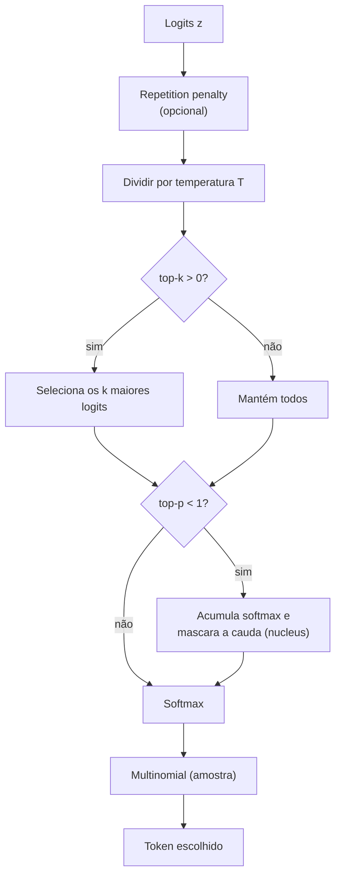

# Sampling: temperatura, top-k e top-p

## Visão geral

Depois que a rede calcula os logits do próximo token, ainda falta uma decisão crucial: **qual** token escolher? O modelo não "cuspirá" uma única resposta — ele produz uma distribuição de probabilidade sobre todo o vocabulário, e cabe a uma camada de **amostragem** (sampling) transformar essa distribuição em um token concreto.

Os três controles clássicos dessa decisão são a **temperatura**, o **top-k** e o **top-p** (nucleus sampling). Juntos, eles governam o espectro entre dois extremos: de um lado, a resposta **determinística** (sempre o token mais provável); de outro, a resposta **criativa** (variação entre execuções, às vezes surpreendente). Entender como cada parâmetro atua é a chave para calibrar um modelo para redação criativa, respostas factuais ou código.

> A ideia central em uma frase: o modelo sempre nos entrega uma distribuição; a temperatura *achata* ou *agudiza* essa distribuição, enquanto o top-k e o top-p *podam* o conjunto de candidatos antes da escolha.

## Intuição: por que não pegar sempre o mais provável?

### O comportamento guloso (greedy)

A escolha mais óbvia é sempre pegar o token de maior probabilidade — o chamado **argmax**, ou decodificação **gulosa** (*greedy*). Para uma distribuição:

$$
p = [0.60,\; 0.30,\; 0.08,\; 0.02]
$$

o argmax escolhe o primeiro token, com $0.60$. Isso parece razoável, mas tem um problema grave na prática: **repetição e monotonia**. Como o modelo sempre escolhe o caminho "mais seguro", ele tende a cair em loops — frases que se repetem, parágrafos que andam em círculos, falta de variedade.

### Por que amostrar em vez de escolher

A alternativa é **amostrar** da distribuição: escolher o token aleatoriamente, mas com probabilidade proporcional a $p$. Um token com $0.60$ tem $60\%$ de chance de ser escolhido; um com $0.02$ tem $2\%$. Isso introduz variedade natural e quebra os loops. É a diferença entre um robô que repete a mesma resposta e um escritor que, a cada tentativa, produz algo ligeiramente diferente.

Amostrar da distribuição inteira, porém, tem um efeito colateral: os tokens de cauda longa (milhares de tokens com probabilidade minúscula, como $10^{-6}$) somam uma massa significativa e, individualmente, quase nunca são bons. Amostrar entre *todos* eles gera texto ruidoso. É exatamente para controlar essa cauda que surgem top-k e top-p.

## Conceito: temperatura — a escala dos logits

### A fórmula

A temperatura $T$ é aplicada **antes** do softmax, dividindo os logits:

$$
p_i = \frac{\exp(z_i / T)}{\sum_{j=1}^{V} \exp(z_j / T)}
$$

Quando $T = 1$, recuperamos o softmax padrão. Quando $T < 1$, os logits são amplificados (diferenças ficam maiores) e a distribuição fica mais **aguda** (confiante). Quando $T > 1$, os logits são atenuados e a distribuição fica mais **achatada** (uniforme).

### Comportamento nos limites

No limite $T \to 0^{+}$, a distribuição tende a uma **one-hot** no token de maior logit — ou seja, vira argmax puro. No limite $T \to \infty$, todos os logits tendem a $\exp(0) = 1$, e a distribuição vira **uniforme** ($p_i = 1/V$). A temperatura, portanto, interpola continuamente entre "determinista" e "totalmente aleatório".

$$
T \to 0 \quad \Rightarrow \quad p \to \text{one-hot}(\arg\max z)
$$

$$
T \to \infty \quad \Rightarrow \quad p \to \left[\frac{1}{V}, \frac{1}{V}, \dots, \frac{1}{V}\right]
$$

### Exemplo numérico completo

Considere os logits de um vocabulário de 5 tokens:

$$
z = [2.0,\; 1.5,\; 1.0,\; 0.5,\; 0.0]
$$

**Caso $T = 1.0$** (padrão). Calculamos as exponenciais:

$$
\exp(2.0) \approx 7.389,\quad \exp(1.5) \approx 4.482,\quad \exp(1.0) \approx 2.718,\quad \exp(0.5) \approx 1.649,\quad \exp(0.0) = 1.000
$$

A soma é $7.389 + 4.482 + 2.718 + 1.649 + 1.000 = 17.238$. As probabilidades:

$$
p = [0.429,\; 0.260,\; 0.158,\; 0.096,\; 0.058]
$$

**Caso $T = 0.5$** (mais frio). Os logits viram $z/T = [4.0,\; 3.0,\; 2.0,\; 1.0,\; 0.0]$:

$$
\exp(4.0) \approx 54.598,\quad \exp(3.0) \approx 20.086,\quad \exp(2.0) \approx 7.389,\quad \exp(1.0) \approx 2.718,\quad \exp(0.0) = 1.000
$$

Soma $\approx 85.791$. Probabilidades:

$$
p \approx [0.636,\; 0.234,\; 0.086,\; 0.032,\; 0.012]
$$

O token topo subiu de $0.429$ para $0.636$ — a distribuição ficou mais **confiante**.

**Caso $T = 2.0$** (mais quente). Os logits viram $z/T = [1.0,\; 0.75,\; 0.5,\; 0.25,\; 0.0]$:

$$
\exp(1.0) \approx 2.718,\quad \exp(0.75) \approx 2.117,\quad \exp(0.5) \approx 1.649,\quad \exp(0.25) \approx 1.284,\quad \exp(0.0) = 1.000
$$

Soma $\approx 8.768$. Probabilidades:

$$
p \approx [0.310,\; 0.241,\; 0.188,\; 0.146,\; 0.114]
$$

O token topo caiu para $0.310$, e o último subiu para $0.114$ — a distribuição ficou mais **espalhada**.

### Tabela comparativa

| Temperatura | $p$ do topo | $p$ do último | Distribuição | Uso típico |
|---|---|---|---|---|
| $0.5$ | $0.636$ | $0.012$ | aguda | respostas factuais, código |
| $1.0$ | $0.429$ | $0.058$ | natural | uso geral |
| $2.0$ | $0.310$ | $0.114$ | achatada | brainstorming, criatividade |

## Conceito: top-k — podar a cauda por contagem

### A ideia

O **top-k** descarta todos os tokens exceto os $k$ mais prováveis. Depois de selecionar os $k$ melhores, renormaliza a distribuição (recalcula o softmax sobre apenas esses $k$) e amostra. Com $k$ pequeno, mantém apenas os poucos candidatos mais plausíveis; com $k$ grande (ou $k = 0$ para desativar), aproxima-se da amostragem sobre o vocabulário inteiro.

### Por que contar em vez de medir probabilidade

A motivação é eliminar a cauda longa: em um vocabulário de $V = 32000$, a maioria dos tokens tem probabilidade desprezível, mas eles somam uma massa considerável. Ao manter só os $k$ mais prováveis, garantimos que a escolha fique restrita a candidatos razoáveis. A limitação é que um $k$ **fixo** não se adapta à forma da distribuição: se a massa está concentrada em 3 tokens, $k = 50$ inclui 47 tokens irrelevantes; se a massa está espalhada em 500 tokens, $k = 50$ corta candidatos legítimos.

### Exemplo numérico

Retomando a distribuição com $T = 1.0$:

$$
p = [0.429,\; 0.260,\; 0.158,\; 0.096,\; 0.058]
$$

Com $k = 3$, mantemos apenas os três primeiros e renormalizamos:

$$
\text{massa mantida} = 0.429 + 0.260 + 0.158 = 0.847
$$

$$
p_{\text{top-3}} = \left[\frac{0.429}{0.847},\; \frac{0.260}{0.847},\; \frac{0.158}{0.847}\right] = [0.507,\; 0.307,\; 0.187]
$$

Os dois últimos tokens ($0.096$ e $0.058$) são **descartados** — recebem probabilidade zero. A amostragem agora só pode escolher entre três candidatos.

## Conceito: top-p (nucleus) — podar a cauda por massa

### A ideia

O **top-p** (ou *nucleus sampling*) também restringe os candidatos, mas por um critério **adaptativo**: ele mantém o **menor conjunto** de tokens cuja soma de probabilidades atinja (ou ultrapasse) um limiar $p$. Formalmente, ordena os tokens do mais ao menos provável, acumula as probabilidades, e corta tudo que vem **depois** do ponto em que a soma acumulada passa de $p$:

$$
\min \left\{ k \;\middle|\; \sum_{i=1}^{k} p_{(i)} \ge p \right\}
$$

onde $p_{(i)}$ são as probabilidades em ordem decrescente.

### Por que é adaptativo

Ao contrário do top-k, o top-p **se adapta à forma da distribuição**. Se a massa está concentrada, o núcleo é pequeno; se está espalhada, o núcleo é grande. Com $p = 0.9$, mantemos apenas os tokens que, juntos, cobrem $90\%$ da probabilidade — um "núcleo" de confiança.

### Exemplo numérico

Mesma distribuição $p = [0.429,\; 0.260,\; 0.158,\; 0.096,\; 0.058]$, já ordenada. Acumulamos:

| Token | $p$ | Soma acumulada |
|---|---|---|
| 1º | $0.429$ | $0.429$ |
| 2º | $0.260$ | $0.689$ |
| 3º | $0.158$ | $0.847$ |
| 4º | $0.096$ | $0.943$ |
| 5º | $0.058$ | $1.000$ |

Com $p = 0.9$, o núcleo precisa cobrir pelo menos $90\%$. A soma atinge $0.847$ no 3º token (ainda abaixo de $0.9$) e $0.943$ no 4º. O menor conjunto que atinge $0.9$ são os **4 primeiros** tokens (o 4º é incluído porque, sem ele, a soma ficaria em $0.847 < 0.9$). O 5º token é descartado.

Com $p = 0.7$, o núcleo seria apenas os 2 primeiros (soma $0.689$), pois o 2º já nos leva perto, e o 3º faria a soma saltar para $0.847$ — mas como $0.689 < 0.7$, precisamos incluir o 3º também. Neste caso, o menor conjunto que atinge $0.7$ é o dos 3 primeiros ($0.847 \ge 0.7$). Note como o critério é sutil: sempre inclui o token que **cruza** o limiar.

### A regra do "não remover o primeiro"


## Conceito: argmax vs. multinomial

### Duas filosofias de escolha

Uma vez definida a distribuição (já temperada e podada), resta **extrair** o token. Há dois mecanismos principais:


2. **multinomial** (amostragem): escolhe aleatoriamente segundo as probabilidades. O token $i$ tem probabilidade $p_i$ de ser sorteado. Produz saídas diferentes a cada execução (a menos que uma semente seja fixada).

Em código PyTorch, os dois ficam assim:

```python
import torch
import torch.nn.functional as F

logits = torch.tensor([[2.0, 1.5, 1.0, 0.5, 0.0]])

# argmax (guloso): sempre o índice do maior logit
guloso = torch.argmax(logits, dim=-1)          # tensor([[0]])

# multinomial: amostra com probabilidade proporcional ao softmax
probs = F.softmax(logits, dim=-1)
amostrado = torch.multinomial(probs, num_samples=1)   # varia a cada chamada
```

### O que "temperatura zero" significa na prática


## O pipeline completo de sampling

A ordem das operações importa. O fluxo padrão é:



Observe a ordem crítica: a **temperatura primeiro** (sobre os logits), depois **top-k**, depois **top-p**, e só então o **softmax final** e a amostragem. Aplicar top-p antes da temperatura, ou temperar probabilidades em vez de logits, muda o resultado de forma sutil e incorreta.

## Efeitos práticos de cada parâmetro

### Temperatura: o controle de "agudeza"

| Faixa | Efeito no texto | Quando usar |
|---|---|---|
| $T = 0$ | determinista, sem variação | extração factual, código exato |
| $0 < T < 0.7$ | confiante, variação pequena | respostas técnicas, resumos |
| $T \approx 0.7$–$1.0$ | natural, equilibrada | conversa, uso geral |
| $T > 1.0$ | criativa, às vezes incoerente | poesia, ideias livres, brainstorming |

### Top-k e top-p: o controle de "cauda"


| Parâmetro | Natureza | Valor típico | Efeito de reduzir |
|---|---|---|---|
| `top_k` | contagem fixa | $40$–$60$ | menos candidatos, menos variação |
| `top_p` | massa acumulada | $0.9$ | núcleo menor, menos variação |

### Exemplos de saída (ilustrativos)

Considere o prompt `"A capital da França é"`. As distribuições hipotéticas levariam a saídas diferentes conforme os parâmetros:

| Configuração | Saída provável |
|---|---|
| $T=0$ (guloso) | `A capital da França é Paris.` (sempre igual) |
| $T=0.7$, $top\_p=0.9$ | `A capital da França é Paris, uma cidade...` (variação controlada) |
| $T=1.5$, $top\_p=1.0$ | `A capital da França é um lugar cheio de história e pão...` (mais livre, mais risco) |

A lição: **temperatura alta** aumenta a chance de tokens de cauda; **top-p/top-k baixos** reduzem essa chance. Os três controles interagem — o resultado final depende da combinação.

## Erros comuns

- **Aplicar temperatura nas probabilidades em vez dos logits**: a divisão por $T$ deve acontecer **antes** do softmax. Aplicar depois distorce a normalização.
- **Usar `temperature = 0` literalmente na divisão**: $z/0$ explode. O código deve tratar $T \le 0$ como "modo guloso" ou usar um piso como `max(temperature, 1e-5)`.
- **Top-p antes de top-k (ou antes da temperatura)**: a ordem correta é temperatura → top-k → top-p. Inverter muda o conjunto de candidatos.
- **Remover o token mais provável no top-p**: o código deve forçar `remove[:, 0] = False`, senão pode acabar com zero candidatos.
- **Esquecer de renormalizar após o top-k**: se você corta candidatos, o softmax precisa ser recalculado sobre o subconjunto, senão as probabilidades não somam 1.
- **Top-k maior que o vocabulário**: `min(top_k, V)` evita índices fora do alcance.
- **Achar que top-k e top-p são excludentes**: eles podem (e costumam) ser combinados — top-k dá um teto de contagem, top-p faz o ajuste de massa.
- **Não fixar a semente quando quer reprodutibilidade**: a amostragem multinomial é aleatória; para reproduzir resultados, fixe `seed`.
- **Confundir temperatura alta com "mais correto"**: temperatura alta aumenta variedade, não qualidade; em tarefas factuais, pode introduzir alucinações.

## Resumo

- O modelo produz uma **distribuição de probabilidade**; a camada de sampling decide como transformá-la em token.
- **Temperatura** $T$ escala os logits antes do softmax: $T \to 0$ vira argmax (one-hot), $T \to \infty$ vira uniforme. É o controle de agudeza.
- **Top-k** mantém os $k$ tokens mais prováveis e descarta o resto — um corte por **contagem**.
- **Top-p** (nucleus) mantém o menor conjunto cuja massa acumulada atinge $p$ — um corte **adaptativo** por massa.
- **argmax** é determinístico; **multinomial** é aleatório e proporcional às probabilidades.
- A ordem canônica é: penalidade de repetição → temperatura → top-k → top-p → softmax → multinomial.
- A camada de sampling é **independente da arquitetura**: ela trata qualquer distribuição de logits da mesma forma.
