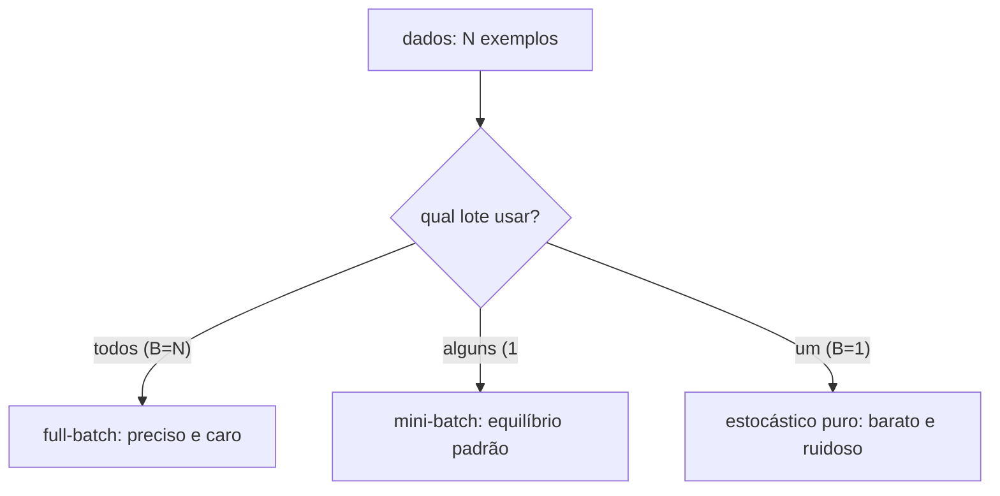

# SGD e momentum

> "Um passo na direção certa, mesmo que impreciso, vale mais do que nenhum passo." — o gradiente descendente estocástico troca a exatidão pela velocidade, e o momentum devolve a direção que o ruído tira.

No documento anterior, vimos a descida do gradiente em sua forma "exata", onde o gradiente é calculado sobre todos os dados. Em um modelo de linguagem com bilhões de parâmetros e trilhões de tokens, isso é impossível a cada passo. Este documento apresenta o **gradiente descendente estocástico (SGD)** — a versão que usa subconjuntos aleatórios — e o **momentum**, o refinamento que suaviza o ruído e acelera a convergência em "vales" alongados.

## 1. Intuição: estimar em vez de calcular exatamente

Imagine que você quer medir a temperatura média de uma cidade enorme. Calcular a média **exata** exige consultar todos os termômetros — caro e lento. Uma alternativa é sortear alguns bairros, medir só neles e usar essa amostra como estimativa. A estimativa flutua (ruído), mas, na média, acerta o valor.

O SGD faz exatamente isso com o gradiente. A perda verdadeira é uma média sobre $N$ exemplos:

$$
L(w) = \frac{1}{N} \sum_{i=1}^{N} \ell_i(w)
$$

O gradiente exato percorre os $N$ exemplos. O SGD sorteia um subconjunto (mini-batch) de $B$ exemplos e estima:

$$
\nabla L(w) \approx g(w) = \frac{1}{B} \sum_{i \in \mathcal{B}} \nabla \ell_i(w)
$$

Onde $\mathcal{B}$ é o mini-batch com $B$ exemplos. Essa estimativa é **ruidosa**, mas **não viesada**: em média, ela é igual ao gradiente verdadeiro.

## 2. Os três regimes de tamanho de lote

O tamanho do subconjunto usado para estimar o gradiente define três regimes:

| Regime | Tamanho do lote | Custo por passo | Ruído do gradiente | Uso |
|--------|-----------------|-----------------|--------------------|-----|
| **Batch (full-batch)** | $B = N$ (todos) | Altíssimo | Nenhum | Raro (apenas em problemas pequenos) |
| **Mini-batch** | $1 < B < N$ | Médio | Médio | **Padrão da indústria** |
| **Estocástico (puro)** | $B = 1$ (um exemplo) | Baixo | Altíssimo | Limite teórico, raramente usado |

### Full-batch (gradiente exato)

Usa todos os exemplos a cada passo. O gradiente é determinístico e preciso, mas cada passo é muito caro. Para dados de linguagem, é inviável.

### Mini-batch (o equilíbrio)

Usa dezenas a milhares de exemplos por passo. É o padrão em redes neurais: aproveita a paralelização de GPUs e mantém o gradiente estável o suficiente.

### Estocástico puro ($B=1$)

Um único exemplo por passo. O gradiente é extremamente ruidoso, mas cada passo é baratíssimo. É o extremo teórico que deu nome ao algoritmo (SGD), embora na prática ninguém use $B=1$ em redes grandes.



## 3. Por que a estimativa ruidosa ainda funciona

A propriedade que salva o SGD é que a estimativa do gradiente é **não viesada**:

$$
\mathbb{E}\left[ g(w) \right] = \nabla L(w)
$$

Em palavras: se você repetir o sorteio do mini-batch muitas vezes, a média das estimativas converge para o gradiente verdadeiro. Por isso, mesmo com cada passo individual apontando um pouco torto, o modelo **em média** caminha na direção certa.

Além disso, o ruído tem um efeito colateral útil: ele ajuda a **escapar de mínimos locais rasos**. Um gradiente exato pode ficar preso em um vale pequeno; o gradiente ruidoso ocasionalmente "empurra" o modelo para fora dele.

### Exemplo numérico do ruído

Suponha uma perda média sobre 3 exemplos, cada um com gradiente individual diferente: $\nabla \ell_1 = 2$, $\nabla \ell_2 = 6$, $\nabla \ell_3 = 4$. O gradiente exato é:

$$
\nabla L = \frac{2 + 6 + 4}{3} = \frac{12}{3} = 4
$$

Um mini-batch de tamanho 2 sorteando $\{1, 3\}$ estima $\frac{2+4}{2} = 3$. Sorteando $\{2, 3\}$, estima $\frac{6+4}{2} = 5$. Cada estimativa erra o alvo $4$ por um pouco, mas oscila em torno dele: $3$ e $5$ têm média $4$, o valor exato.

## 4. O ruído do SGD e suas consequências

O ruído do SGD tem uma consequência direta na **trajetória**. Em vez de descer suavemente, o modelo "treme" em torno da direção correta. Esse tremor tem três efeitos:

1. **Passos em zigue-zague.** Cada mini-batch puxa em uma direção um pouco diferente, então a trajetória serpenteia.
2. **Dificuldade de convergir com $\eta$ fixo.** Com ruído, mesmo perto do mínimo o modelo não para de tremer; para "assentar" é comum **reduzir a taxa de aprendizado** ao longo do treino (schedules).
3. **Velocidade menor em vales alongados.** Em direções de baixa curvatura, o gradiente é pequeno e o ruído domina, tornando o progresso lento.

É exatamente para combater esses efeitos que surgiu o momentum.

## 5. Momentum: uma "velocidade" que acumula

O momentum interpreta a otimização como uma bola rolando morro abaixo. Em vez de calcular o passo apenas a partir do gradiente atual, o momentum **acumula uma velocidade** $v$:

$$
v_{t} = \beta \, v_{t-1} + g_t
$$

$$
w_{t+1} = w_t - \eta \, v_t
$$

Onde $\beta \in [0, 1)$ é o fator de momentum (tipicamente $0{,}9$). A interpretação:

- $v_{t-1}$ é a "inércia" do passado (a velocidade já acumulada);
- $g_t$ é o gradiente atual;
- $\beta$ controla o quanto do passado é preservado.

### Duas visões equivalentes

**Visão de velocidade (bola).** Em uma região onde o gradiente aponta consistentemente na mesma direção, $v$ cresce e o passo acelera — como uma bola ganhando velocidade morro abaixo.

**Visão de média móvel exponencial (EMA).** A velocidade é uma média ponderada de todos os gradientes passados, dando mais peso aos recentes:

$$
v_t = g_t + \beta g_{t-1} + \beta^2 g_{t-2} + \dots
$$

Isso **suaviza** o ruído: flutuações de mini-batch em direções opostas se cancelam parcialmente, e a componente consistente do gradiente se soma.

> O PyTorch implementa o momentum exatamente como $v_t = \beta v_{t-1} + g_t$. A versão normalizada $v_t = \beta v_{t-1} + (1-\beta) g_t$ difere apenas por um fator de escala constante, mas é mais fácil de interpretar como "média".

## 6. Exemplo numérico com momentum

Considere $L(w) = w^2$ com gradiente $g = 2w$, partindo de $w_0 = 3$, com $\eta = 0{,}1$ e $\beta = 0{,}9$ (convenção do PyTorch, $v_0 = 0$).

| Passo | $g = 2w$ | $v = \beta v + g$ | $w$ depois |
|-------|----------|-------------------|------------|
| 1 | 6,000 | 6,000 | 2,400 |
| 2 | 4,800 | 10,200 | 1,380 |
| 3 | 2,760 | 11,940 | 0,186 |
| 4 | 0,372 | 11,118 | -0,926 |
| 5 | -1,852 | 8,154 | -1,741 |

Compare com o SGD puro (sem momentum), que após 3 passos tinha $w = 1{,}536$. O momentum chegou a $w = 0{,}186$ em 3 passos — **muito mais rápido** — mas **passou do ponto** no passo 4 ($w$ ficou negativo) e começou a oscilar.

Este é o retrato honesto do momentum: **acelera, mas pode ultrapassar o mínimo**. A oscilação é amortecida ao longo do tempo porque, perto do mínimo, o gradiente troca de sinal e reduz a velocidade. O momentum brilha de verdade em paisagens alongadas (como a elipse $w_1^2 + 25 w_2^2$ do documento anterior), onde o SGD puro "rasteja" e o momentum acumula velocidade na direção de descida consistente.

### A relação com o fator de amortecimento

Na visão de média móvel, $\beta = 0{,}9$ significa que a "memória" relevante dura cerca de:

$$
\frac{1}{1 - \beta} = \frac{1}{0{,}1} = 10 \text{ passos}
$$

Quanto maior $\beta$, mais longa a memória e mais suave a trajetória — mas também mais lenta a reação a mudanças de direção. $\beta = 0$ recupera o SGD puro.

## 7. SGD com momentum em Python

```python
import torch

w = torch.tensor(3.0, requires_grad=True)
eta = 0.1
beta = 0.9
v = 0.0

def perda(w):
    return w ** 2

for passo in range(6):
    L = perda(w)
    L.backward()
    with torch.no_grad():
        g = w.grad.item()
        v = beta * v + g          # atualiza a velocidade
        w -= eta * v              # passo com momentum
        w.grad.zero_()
    print(f"passo {passo}: w={w.item():.4f}, v={v:.4f}, L={L.item():.4f}")
```

Saída esperada:

```text
passo 0: w=2.4000, v=6.0000, L=5.7600
passo 1: w=1.3800, v=10.2000, L=1.9044
passo 2: w=0.1860, v=11.9400, L=0.0346
passo 3: w=-0.9258, v=11.1180, L=0.8571
passo 4: w=-1.7413, v=8.1540, L=3.0321
passo 5: w=-2.1273, v=3.8570, L=4.5254
```

Repare no "mergulho" para negativo e na oscilação de amortecimento gradual.

### Usando o otimizador do PyTorch

```python
import torch

w = torch.tensor(3.0, requires_grad=True)
otimizador = torch.optim.SGD([w], lr=0.1, momentum=0.9)

for passo in range(6):
    L = w ** 2
    otimizador.zero_grad()
    L.backward()
    otimizador.step()
    print(f"passo {passo}: w={w.item():.4f}")
```

Aqui `torch.optim.SGD` com `momentum=0.9` faz exatamente a atualização $v \leftarrow \beta v + g$ seguida de $w \leftarrow w - \eta v$, que implementamos manualmente acima.

## 8. Pseudocódigo do SGD com momentum

```text
entrada: pesos w0, taxa eta, momentum beta, número de passos T
w = w0
v = 0
para t = 1 até T:
    B = sortear mini-batch de B exemplos
    g = (1/B) * soma dos gradientes de B   # estimativa ruidosa
    v = beta * v + g                        # acumula velocidade
    w = w - eta * v                         # passo
devolver w
```

## 10. Erros comuns

- **Confundir tamanho de lote com número de passos.** Reduzir $B$ aumenta o ruído, mas também acelera cada passo. O custo total depende dos dois.
- **Usar momentum sem zerar o buffer.** A velocidade $v$ deve ser inicializada em zero a cada treino; reutilizar um buffer de outra sessão corrompe os primeiros passos.
- **Achar que momentum só acelera.** Ele também suaviza ruído e, mal calibrado, causa **oscilação e ultrapassagem** (como vimos em $w^2$).
- **$\beta$ muito alto.** Memória longa demais torna o modelo lento para reagir a mudanças de direção.
- **Esquecer que o gradiente do SGD é uma estimativa.** As flutuações são normais e esperadas; não são um bug.
- **Não reduzir a taxa de aprendizado.** Com ruído, um $\eta$ fixo deixa o modelo tremendo perto do mínimo para sempre.

## 11. Resumo

- O SGD substitui o gradiente exato por uma estimativa sobre um mini-batch de $B$ exemplos.
- A estimativa é **não viesada**: $\mathbb{E}[g] = \nabla L$.
- Full-batch ($B=N$), mini-batch ($1<B<N$) e estocástico ($B=1$) são os três regimes.
- O ruído do SGD causa zigue-zague, mas ajuda a escapar de mínimos locais rasos.
- O momentum acumula velocidade: $v_t = \beta v_{t-1} + g_t$, $w \leftarrow w - \eta v_t$.
- Momentum é uma média móvel exponencial que suaviza ruído e acelera em vales alongados.
